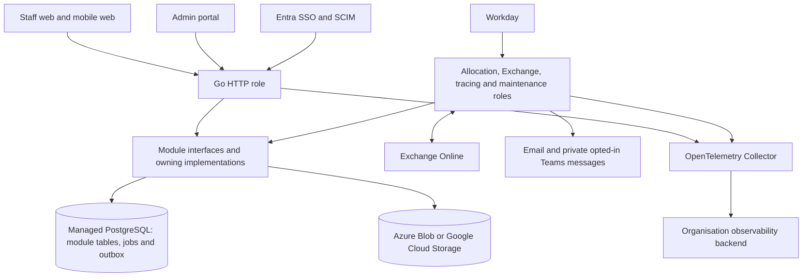

# SpaceWeave architecture blueprint

This blueprint combines the workplace-booking requirements and technology choices
with the accepted core ownership boundaries and representative package placement.
It is intended for technical architects and engineers evaluating the local consistency boundaries, enterprise integrations
and operating model. The [five architecture candidates](research/architecture-options/README.md)
compare alternative repository organisations. The
[Events–Booking boundary](adr/0023-separate-events-from-venue-booking.md),
[combined Identity](adr/0026-combine-workforce-identity-and-access-ownership.md),
[planning inside Booking](adr/0027-keep-attendance-planning-inside-booking.md) and
[separate Exchange](adr/0028-separate-exchange-synchronisation-from-booking.md)
are agreed logical owners across all five options. The repository-architecture
choice remains pending. Candidates retain their own organisations and dependency
rules; concrete package names, evidence retention settings and activation guards
are still subject to validation.

This is a design record. The existing implementation is the floor-plan tool;
the booking platform described here has not yet been implemented. The
[scope](../README.md#product-scope), [glossary](../GLOSSARY.md),
[decision records](README.md), [configurable defaults](policy-defaults.md) and
[verified integration constraints](architecture.md) provide the supporting detail.

## Product and platform requirements

SpaceWeave serves one organisation across many offices, targeting 100,000 staff
and 60,000 desks. Staff use web/mobile-web booking; administrators use a separate
portal with office-scoped capabilities and explicitly granted global powers.
Spaces include desks, meeting rooms, parking and event venues. Offices contain
buildings and floors with plans; a neighbourhood bundles desks and optional
meeting rooms within one building and can flex by date.

Staff choose attendance days and usual-office exceptions. Configurable advance
intents are allocated together, forming per-date allocation groups distinct from
externally maintained teams. The objective is to accommodate demand within hard constraints,
then prioritise explicit collaboration, team proximity and previously unfulfilled
demand. Divisional anchor days are organisational context. Attendance is reported;
the application does not impose a minimum attendance count.

An allocated desk becomes taken after its owner personally checks in. Anonymous
occupancy does not establish the owner's presence. No-shows return directly to
the pool, even when physical occupancy is detected. Optional sensors support
release after sustained vacancy following check-in. Waitlisted demand receives
released capacity before fresh direct requests.

Retain Go with the repository architecture pending, PostgreSQL-owned durable state and
jobs/outbox, and Azure/GCP blob adapters for revisioned assets. Separate React/
TypeScript portal entrypoints share UI and the existing renderer. Go owns SSO
sessions and provider tokens. OpenAPI defines the REST transport contracts.
The UI, MCP servers, SDKs, scripts, tests and Terraform consume the supported
public REST contracts. Platform workers use private interfaces. User-facing
access is Internet-accessible under Conditional Access rules/policies; the
application still checks actual actor, owner, capability and resource scope.
Human and application actors have independent authority; app-only credentials
cannot personally check in a desk. Terraform initially manages long-lived
configuration. Public API compatibility is independent of UI releases, and
first-party MCP/provider implementations follow the core platform/SDKs.
SpaceWeave RBAC is configurable. MCP runs in user context, while machine-identity
scripts use their separate channel; a consumer label does not choose one login
journey. Authorised UI edits may create Terraform drift. The initial public-major
retirement notice is 180 days, honouring published support dates.
Existing global administration manages configurable roles/scoped assignments;
SCIM-backed group mappings, grant-only composition and self-permission discovery
are agreed. Commands revalidate current authority.

Entra supplies SSO and SCIM user/mapped-group provisioning. Workday supplies
workforce lifecycle, reporting structure and usual office. Explicit source
correlation preserves stable internal staff identities. Exchange Online room
bookings synchronise both ways, with pending local holds until room acceptance
and automatic reconciliation wherever intentions are compatible.

## Logical ownership

Each logical owner controls its state and migrations through narrow interfaces.
The candidate architecture determines where its implementation and adapters sit. The allocation planner is
inside Booking so planning and direct requests share one capacity authority.
Events is a separate owner for registration, tickets and admission; Booking
retains the event-space claims. Identity combines workforce/source correlation
with sessions, access and delegation through distinct interfaces. Exchange owns
calendar integration/reconciliation independently; Identity retains its native
delegation-evidence adapter. These agreed owners constrain all five comparison layouts without selecting
a repository style or prescribing every internal package. Booking also owns
validated operational occupancy evidence; Attendance projects committed facts
under separately configured reporting retention. Plans asset approval is distinct
from Workplace operational mapping activation, validated against Booking inventory.

| Module | Owned state and behaviour | Interface callers rely on |
| --- | --- | --- |
| Identity | Staff identities/source links, effective workforce/team facts, SCIM/Workday progress, sessions, capabilities/scopes, global grants and source-labelled delegation. | Separate People, Access and Delegation interfaces resolve current eligibility, source-owned facts, sessions and actor/owner authority under one owner. |
| Workplace | Offices, buildings, floors, space features, calendars, baseline neighbourhoods, lifecycle schedules and operational plan mappings. | Publish versioned definitions/mappings, retire/reactivate resources and validate dated impact through Booking. |
| Policy | Versioned operational policies, allowed office overrides, publication/effective dates and organisation retention settings. | Resolve the applicable policy/version and validate a prospective publication. |
| Booking | Attendance intents/preferences/travel exceptions, allocation cycles/groups/proposals, dated inventory, holds, bookings, waitlists, validated operational occupancy evidence and desk check-in/release transitions. | Request, allocate, confirm, transfer, cancel, check in or release capacity while enforcing the same invariants from every caller. |
| Exchange | Provider mappings, desired/observed calendar state, durable observations, delta cursors/subscriptions and reconciliation work. | Consume Booking's committed room intentions and reconcile provider activity through Booking's owning room interface; never write claims directly. |
| Plans | Drawing packages, tracing/review workflows, immutable plan/render revisions and blob metadata/asset publication. | Upload, process, approve and retrieve immutable assets; Workplace separately publishes their operational mappings. |
| Visitors | Visitor profiles, hosted visits, visit windows and reception arrival/departure records. | Create/retrieve a visit, record reception activity and apply visitor retention. |
| Events | Event details/audience, registration, tickets/exclusive offers, reconfirmation, waitlists, admission and venue coordination. | Register, offer, reconfirm, cancel or admit within current event capacity and eligibility, coordinating secured venue changes with Booking. |
| Attendance and reporting | Derived attendance/occupancy projections, office-scoped reports and separately configured reporting retention. | Consume committed facts and report bookings/check-ins/occupancy distinctly; projections never authorise desk release. |
| Notifications | In-app messages, delivery preferences, message-specific Teams opt-in and asynchronous delivery attempts. | Deliver committed outcomes to intended recipients without altering the booking outcome. |

Composition wires the modules and runtime roles. Shared platform facilities cover
transactions, job leases/outbox delivery, operational incident declarations,
configuration, clocks and telemetry;
business rules stay with their owning module. Reporting reads its own projections
or published queries rather than acquiring unrestricted access to every table.

## Proposed repository and interface rules

The responsibility sketch below does not select a layout. All five candidates
provide concrete placement of composition, owning code, shared facilities and
frontend entrypoints using their own dependency rules.

```text
cmd/spaceweave/                 retained executable entrypoint
internal/                      owning components, composition and shared facilities in the chosen layout
web/staff/                     proposed staff/mobile-web entrypoint
web/admin/                     proposed administrative entrypoint
web/shared/                    shared UI, generated transport clients and renderer seam
web/floorplan-iso/             retained renderer during incremental adoption
api/                           proposed OpenAPI source contracts
```

Composition constructs owning implementations and exposes only approved
interfaces. Each candidate defines its import/visibility rules; nested per-owner
`internal` trees are one enforcement option rather than a prescribed repository
style. SQL queries and migrations require ownership review. Stable-ID foreign
keys may be used deliberately with migration
coordination; sharing a database does not grant arbitrary foreign-table writes.

Retain the existing CAD/geometry packages behind Plans rather than moving every
package to fit the diagram. Create module structure as behaviour is implemented.
HTTP routing remains Chi; CLI/configuration retain Cobra and strict YAML without
Viper. Domain contracts do not depend on generated HTTP types, Graph payloads,
SCIM wire resources or PostgreSQL row representations.

## Runtime and persistence



The roles use one versioned image/release and scale independently in Kubernetes.
They share module implementations, not permission to bypass interfaces. Durable
jobs have leases, bounded retries and operator-visible failure states; duplicate
triggers and delivery are expected. External calls occur after local commit.
Local revisions, retry identities and provider reconciliation protect against
duplicate/stale work without promising exactly-once external effects.

Core booking/check-in targets 99.95% monthly availability, with one-second p95
initial responses for core availability, booking and check-in at the agreed
representative workload. Background allocation and room acceptance are measured
separately. Exchange reconciliation runs on its agreed five-minute healthy
cadence and measures actual freshness.

One active write region uses multi-zone HA and a preprovisioned warm recovery
region. Protect committed business records and assets acknowledged durable or
published, verifying asset recovery copies before acknowledgement. Regional
targets are RPO five minutes/RTO fifteen minutes; healthy-primary operation
continues during excess recovery lag with critical alerts and explicit operator
approval for failover outside the loss budget. Fence old database and worker
writers before resuming in the recovery region, including external-write paths.

Runtime identities are separately scoped, using workload federation where
supported and organisational secret management otherwise. Trace/metric export
and JSON log collection feed the organisation's telemetry platform. Keep core
booking/check-in health distinct from degraded Exchange or notification delivery.

## Proposed consistency and workflow contracts

| Workflow | Required local contract |
| --- | --- |
| Desk allocation, direct requests and waitlist promotion | Booking serialises competing claims; enforce mandatory features, dated neighbourhood membership, one overlapping desk per person and existing waitlist priority. Confirmed assignments are protected. |
| Required desk plus parking | Secure both in one Booking transaction or confirm neither. A transfer acquires replacement capacity and releases the old claims together. |
| Main allocation run | Plan outside long transactions using a versioned snapshot. Commit each group's placement atomically, including required parking; replan only affected uncommitted groups on conflicts. |
| Workplace retirement/reactivation/deletion | Published immediate/scheduled retirement excludes new use on/after the office-local effective time, including descendants. Booking compares requested use with the lifecycle revision. Reactivation revalidates definitions/calendars/inventory while retaining identity/history; unconfirmed holds/offers cannot confirm excluded use and late Exchange effects reconcile. Confirmations remain manageable and deletion never silently cancels/cascades. |
| Operational plan activation | Plans approves immutable assets; Workplace owns geometry-to-stable-space mappings. Booking validates dated inventory and confirmed-claim impact under version guards before activation. Approval and activation have distinct public outcomes. |
| Check-in, no-show and vacancy | Booking decides the transition against current state/policy. A personal check-in wins only if the allocation remains valid. Anonymous occupancy cannot reserve a released desk. Sensor outages do not establish vacancy. |
| Room requests and reconciliation | Booking owns local holds/claims and transitions; Exchange owns provider observations/progress. Confirm only after acceptance and capacity revalidation. Keep external observations even if they conflict with local claims; reconcile rather than discarding provider truth. |
| Venue changes and ticket issuance | Events coordinates its ticket state with Booking's venue state through owning interfaces in a named shared local transaction where required. Generic booking edits cannot bypass the event venue workflow. |
| Visitor ticket issuance | Events and Visitors atomically commit a visit created specifically for registration with its ticket and retry outcome, or neither. A reused existing valid visit survives failed issuance. Visit arrival and event admission remain distinct actions. |
| Notifications and reporting | Consume committed facts through durable work. Their delay or failure does not undo the booking; projections expose freshness and cannot authorise a capacity claim. |

The agreed event venue coordinator is an explicit, narrow exception to a
single-module transaction. It prevents a venue/time/capacity change racing ticket issuance.
It does not expose foreign repositories or a general-purpose cross-module unit
of work. Confirmed venue loss moves existing tickets into pending recovery while
retaining their entitlements; pause admission and further issuance. The organiser
explicitly secures a suitable replacement or cancels the event, and confirmed
changes are communicated to attendees. This is the event venue recovery workflow,
not an instruction to erase tickets or invent replacement capacity.

The [event workflow contract](research/api-surfaces/event-workflows.md) also requires
attendee reconfirmation for office/time changes and linked visitor host/window
validation. A later invalid visit blocks admission while preserving the ticket
and seat pending authorised repair or explicit cancellation. Attendees may cancel
their own unused tickets; optional event waitlists receive released seats before
fresh registration in join order through exclusive, time-limited,
eligibility-checked offers. Decline/expiry ends the request; explicit rejoin is a
new request. Offer acceptance ends at registration closing time unless the
organiser explicitly extends registration. Published reconfirmation deadlines
release unconfirmed tickets under the enabled waitlist policy. Cancelling an
unused ticket also cancels an associated future visit with no other valid purpose.
Event cancellation also cancels visits whose only remaining valid purpose was that
event, preserving shared-purpose visits and historical records.

Confirmed outages pause affected reconfirmation deadlines, preserving seats and
publishing a recovery grace period within the event's usable attendance window.
Venue recovery preserves exclusive offers and pauses their expiry clocks, with
resumed acceptance bounded by registration closing time. Material office/time
changes instead withdraw old offers without ending their waitlist requests;
reoffer under the new details while preserving positions. Temporarily ineligible
queued requests are skipped without holding capacity and retain their position.

The [visitor-ticket decision](adr/0024-create-event-visitor-visits-with-tickets-atomically.md)
adds a second narrow transaction across Events and Visitors for registration-created
visits. It does not roll back an existing independently valid visit when ticket
issuance fails.

Every modifying interface carries the actual actor and relevant booking owner,
expected state/version where applicable, and a retry identity for retryable
requests. A repeated identical request returns the prior outcome; conflicting
reuse is rejected. Error contracts distinguish unavailable capacity, stale state,
pending external completion, forbidden actions and temporary dependency failure.
Opaque provider version tokens are compared only using documented semantics.

The [REST request contract](research/api-surfaces/request-behaviour.md) records
required keys/atomic receipts for booking creation, tickets and work
submission; previous-version configuration edits; standard/expensive admission;
actor-owned budgets across clients/sessions; and durable public operation status.
Keep bounded inputs and worker execution separate from HTTP rate admission.
Definitive refusal replay, partial allocation reporting and safe cancellation
are required. Recovery survives reloads/client restarts and a return the next
working day, through the end of that day in the booking/event office calendar,
including weekends/closures. Publish the recovery deadline; after expiry,
reconcile authorised resources before offering an explicit new attempt when
uncertainty remains. Booking visibility does not depend on retry-receipt retention.
An outage spanning the deadline extends affected recovery through the end of
the next office working day after restoration; retain evidence and publish the
extension while booking periods and capacity keep their normal rules.
Equivalent retries compare client-supplied JSON values, ignoring property order
and whitespace while preserving omitted/null distinctions and original
preconditions. Allocation cancellation stops before another group commit;
unfinished plans cannot publish; incomplete exports are cleaned up and completed
results retain normal access/expiry. Cancellation remains requested until work
stops and is serialized against commit/publication; preserve work committed first
and prevent the next commit/publication when cancellation wins. Receipt duration,
retained expiry evidence, wire details and numeric limits remain open. The contract applies across all
five candidate layouts; repository style, concrete activation guards and evidence
retention settings remain under review.

## Identity, lifecycle and privacy

SCIM provisioning clients are authenticated separately from staff SSO. Only
explicitly mapped groups become domain teams. Retain Entra and Workday source
identifiers, verified links and effective dates; hold ambiguous identity matches
for review. Neither missing fields nor a failed import means a person has left.
Independent account/provisioning/workforce eligibility inputs retain their source;
one source cannot reactivate access disabled by another authoritative input.

When a confirmed effective disable/leaver event is observed, reject further staff
access including existing sessions. Retain known state during feed outages.
Effective office/team changes update unconfirmed derived defaults, preserving
explicit travel and confirmed bookings. Release a leaver's future personal
desk/parking claims; review room/event ownership through assisted handover.
Provider organiser changes require an appropriate workflow, not an assumed
in-place Exchange property update.

Identity checks app-managed delegation against current local state. New actions
relying on native-derived grants require verification within the configurable
fifteen-minute limit; remove only the revoked source grant. A PA remains the
recorded actor and cannot personally check in the owner's desk for them.

Visitor, raw occupancy and attendance retention are separately configured and
applied to identifiable copies in projections as well as owning records. A
deleted SCIM resource disappears from the provisioning interface while internal
history follows retention rules. Avoid personal data in metrics and routine logs.

## Notifications and outage protection

Email and in-app messages cover booking outcomes, waitlist offers, visitor
invitations, tickets and handover tasks according to delivery preferences.
Teams has the narrower agreed purpose: a private message that a booking was
raised, with the individual's opt-in for that message. There is no default
Teams opt-in, shared-channel announcement or automatic extension to other events.

Propose proactive personal delivery through a Teams app/bot adapter. Installation
and a usable conversation are technical prerequisites; installation does not
grant message opt-in. Keep opt-in evidence for the intended message and recipient,
and check it before sending. Delivery is asynchronous and supplementary; retry
transient errors with backoff and expose permanent blocked/uninstalled failures.
A Teams failure must not fail a booking or cause duplicate fallback emails.
The [verified Teams constraints](architecture.md#verified-personal-teams-messaging-constraints)
explain the supported integration.

A confirmed application outage preventing check-in or offer acceptance pauses
affected no-show releases and waitlist-offer expiries. Persist the protected
incident/time interval through shared operational facilities so workers agree.
Booking and Events consume the same authoritative declaration through narrow
private reads and retain their own protected deadline state; Policy owns the
configured rules. Declaration publication is ordered against affected expiry.
The [incident contract](research/api-surfaces/operational-incidents.md) covers
that shared custody and request-recovery extensions; a lagging projection cannot
authorise expiry. Then apply configured recovery grace.
Preserve already committed reassignment outcomes; do not resurrect an earlier
claim over a later confirmed booking. Protection cannot extend desk usage beyond
its actual booking period. Anonymous occupancy is not an outage declaration.

## Proposed rollout and validation

Introduce durable persistence, access checks and job execution with the first
booking slice. Use real PostgreSQL acceptance tests and the repository's existing
coverage/lint gates. Exercise the published interfaces and concurrent workflows,
not just mocked repository calls. Preserve the existing floor-plan checks when
integrating the renderer. Run one controlled schema-migration step per release;
use expand/contract changes and compatible job/event contracts during rolling
API/worker upgrades. Retain rollback compatibility until the old release drains.

| Validation | Evidence required before relying on the design |
| --- | --- |
| Booking correctness | Race allocation/direct claims/waitlist, personal check-in/no-show, linked parking, office transfers, venue changes/ticket issuance and duplicate ticket scans against real transactions. |
| Identity and authorisation | Exercise SCIM provisioning/deactivation/reactivation/deletion, ambiguous matches, effective workforce changes, source outages, scope/delegation revocation and existing-session denial. |
| Exchange behaviour | Use an authorised test environment to exercise owner/delegate create/edit/cancel, delayed/late acceptance, missed notifications, duplicate/stale updates and incompatible changes. Verify conditional-write and room-replacement behaviour rather than assuming it. |
| Personal Teams delivery | Verify message-specific opt-in, installation, correct private recipient, opt-out before dispatch, throttling and blocked/uninstalled cases without affecting bookings. |
| Capacity and responsiveness | Establish a representative peak/site-skew workload for 100,000 staff/60,000 desks; measure one-second p95 initial responses separately from planner completion, queue drain and Exchange acceptance. |
| Resilience and recovery | Exercise process/zone failures, stalled workers, check-in/offer outage protection, regional replication lag, writer fencing and full database/blob/identity/routing recovery against RPO/RTO. |

Tenant-specific source identifiers/mappings, provisioning scope, Workday security
visibility, Exchange mailboxes/delegation, Teams installation arrangements,
provider/region selection and representative peak workloads remain deployment
inputs to verify. Numerical recovery-grace and retention settings require
explicit configuration. These are not measured guarantees or assumed production
access. Exact SQL schemas, generated-tool versions and resource sizing follow
the agreed contracts and validation rather than being silently fixed here.
