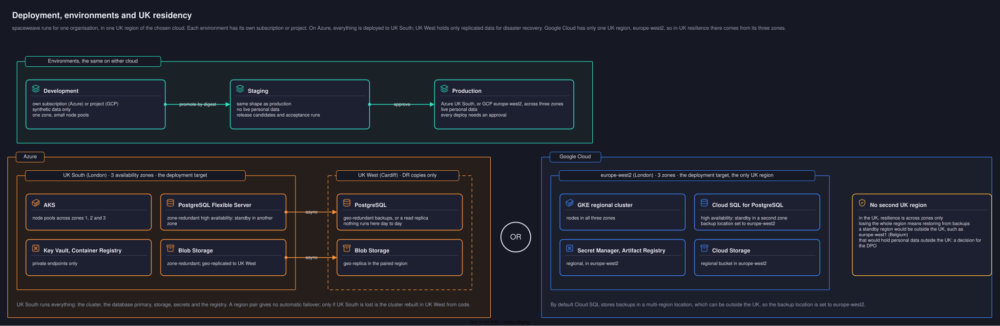

# Deployment, environments and UK residency

spaceweave is deployed for **one organisation**, not run as multi-tenant SaaS. It runs in UK data
centres on Azure or Google Cloud. This page covers where each piece runs and what disaster recovery
can look like without data leaving the UK.

Source: [`diagrams/deployment-residency.drawio`](diagrams/deployment-residency.drawio)

## Environments

| Environment | Isolation | Data | Purpose |
|---|---|---|---|
| Development | Its own subscription (Azure) or project (GCP) | Synthetic only | Day-to-day work; one zone, small node pools |
| Staging | Its own subscription or project | No live personal data | Release candidates and acceptance runs, in the same shape as production |
| Production | Its own subscription or project | Live personal data | UK region across three zones; every deploy needs an approval |

Images are promoted between environments by digest, never rebuilt (see [supply chain](supply-chain.md)).

## UK regions

| | Azure | Google Cloud |
|---|---|---|
| Deployment target | **UK South** (London, 3 availability zones). Everything runs here | **europe-west2** (London, zones a, b and c). Everything runs here |
| UK regions | UK South and **UK West** (Cardiff, no availability zones) are a region pair. UK West holds only DR copies | europe-west2 is the only Google Cloud region in the UK |
| In-region resilience | AKS node pools across zones 1–3; zone-redundant PostgreSQL HA; zone-redundant storage | GKE regional cluster across three zones; Cloud SQL HA with a standby in a second zone; a regional bucket |
| Disaster recovery inside the UK | UK West: geo-redundant PostgreSQL backups or a cross-region replica, and geo-replicated storage. The cluster is rebuilt from code | **Not available as a second region.** Losing europe-west2 means restoring from backups once it returns |

### Azure: a pair is not a failover

Microsoft says deploying to a region pair gives no automatic resilience, high availability or
failover. DR to UK West is a plan someone runs:
- promote the database replica or restore the geo-backup;
- rebuild the cluster from infrastructure code;
- move DNS at the edge.

UK West has no availability zones. Front Door Private Link is offered only in regions that have them,
so after a failover, the private origin needs re-planning. One option is a public origin locked to Front
Door until UK South returns.

### Google Cloud: decide before go-live

With one UK region, the choice is:
1. **Stay in the UK.** Three zones cover the loss of a data centre. Loss of the whole region is accepted
   as a risk, with recovery from backups held in europe-west2.
2. **Standby outside the UK,** for example europe-west1 in Belgium. This holds personal data outside the
   UK, so the data protection officer must decide it, and it must be recorded (see [personal data](personal-data.md)).

**Watch the Cloud SQL backup location.** By default Cloud SQL stores backups in a multi-region
location, which can be outside the UK. Set a custom backup location of europe-west2.

## Node pools and the allocation burst

Most of spaceweave's load is steady: people booking, and workers syncing calendars and sending
notifications. The allocation solver is different. When a cycle closes it groups and packs every
booking intent for the coming week, which needs a lot of CPU for a short time, and then nothing until
the next cycle. It therefore gets its own node pool.

| Node pool | Runs | Scaling |
|---|---|---|
| System | Cluster add-ons: KEDA, Ratify and Gatekeeper, the OpenTelemetry Collector | Always on. An AKS system pool needs at least two nodes, three recommended |
| Serving | Web app and API, MCP server, SCIM endpoint | Spread across zones; scaled on load |
| Workers | Calendar sync, notifications, webhook dispatch, the allocation and release scheduler, exports, floor plans | Small and always on |
| **Solver** | Allocation solver pods only | **Zero nodes between cycles.** Scales up when solver jobs are queued, and back to zero when they're done |

How the burst works:

- **Work is split into jobs.**
  - At cut-off the scheduler writes one solver job per venue and date to PostgreSQL.
  - Each job is independent, so the jobs run in parallel.
  - Daily top-up runs use the same path, with far fewer jobs.
- **Pods follow the queue.** A KEDA `ScaledJob` with the PostgreSQL scaler counts queued solver jobs and
  starts one Kubernetes Job for each. The Job runs to completion and ends, which is what `ScaledJob` is
  for.
  - **Azure:** the managed KEDA add-on, whose version follows the cluster's Kubernetes version. The
    scaler signs in to PostgreSQL Flexible Server with Entra Workload ID. KEDA 2.15 removed pod identity,
    so Workload ID must be enabled before the add-on.
  - **Google Cloud:** KEDA is installed with Helm, as in Google's scale-to-zero tutorial; it isn't a
    managed add-on. The PostgreSQL scaler has no Google identity option, so it uses a connection string
    from Secret Manager.
    - GKE 1.37 can also scale the horizontal pod autoscaler to zero on external metrics. That would mean
      exporting the queue depth as a Prometheus metric, and its API is still `v1beta1`, so KEDA is used
      for now.
- **Nodes follow the pods.**
  - The cluster autoscaler adds nodes when solver pods can't be scheduled, and removes them once they're
    empty.
  - **AKS:** a user node pool with `--min-count 0`. This allows the pool to reach zero but doesn't force
    it. Scale-down waits for the profile's `scale-down-unneeded-time` (default 10 minutes). The profile
    applies to every pool, so it isn't tuned for the solver.
  - **GKE Standard:** a node pool with autoscaling and `--total-min-nodes 0`. `--min-nodes` is per zone.
    A compute class can choose a compute-optimised machine family for it (`machineFamily`, such as
    `c3`).
- **Only solver pods run there.** The pool carries a taint and a label. Solver pods carry the matching
  toleration and a required node affinity; everything else stays off.
- **A running job isn't evicted.**
  - Solver pods carry `cluster-autoscaler.kubernetes.io/safe-to-evict: "false"`, which the autoscaler
    honours on both AKS and GKE.
  - The pool's maximum node count caps the cost and protects the subscription's quota.
- **Spot capacity is an option, not the default.**
  - Spot nodes are meant for interruptible batch work, but they can be evicted with 30 seconds' notice
    (best effort on Azure).
  - A cycle has a review and publish time to meet, so the main cycle uses regular nodes.
  - Top-up runs could use Spot, because a solver job writes its result in one transaction and an
    interrupted job is simply retried.
- **Environments.** Staging has the same solver pool as production, so acceptance runs exercise the
  burst. In development the solver can run on the worker pool.

## Where each store lives

| Store | Contents | Azure | Google Cloud |
|---|---|---|---|
| PostgreSQL | All state, the job queue and the outbox | UK South, replica or backups in UK West | europe-west2, with the backup location pinned |
| Object storage | Drawings, renders, exports, archives | UK South, geo-replica in UK West | Regional bucket, europe-west2 |
| Secrets | Graph credentials, webhook signing secrets | Key Vault, UK South | Secret Manager regional secrets, europe-west2 |
| Images | Signed container images | Container Registry, UK South | Artifact Registry, europe-west2 |
| Logs and audit | Telemetry and the SIEM | The organisation's Azure Monitor and Sentinel workspace | Cloud Observability and Security Operations, in its configured location |

Microsoft 365 data (Exchange calendars, Entra ID) stays in the organisation's Microsoft 365 tenant.
spaceweave holds only what it copies in (see [personal data](personal-data.md)).

## Sources

- [Azure region pairs](https://learn.microsoft.com/en-us/azure/reliability/regions-paired):
  "doesn't automatically make them more resilient"
- [Azure regions and availability zones](https://learn.microsoft.com/en-us/azure/reliability/regions-list)
- [Front Door Private Link regions](https://learn.microsoft.com/en-us/azure/frontdoor/private-link)
- [Google Cloud regions and zones](https://docs.cloud.google.com/compute/docs/regions-zones)
- Node pools and autoscaling:
  - AKS: [scale to zero](https://learn.microsoft.com/en-us/azure/aks/scale-cluster);
    [system pools](https://learn.microsoft.com/en-us/azure/aks/use-system-pools);
    [cluster autoscaler profile](https://learn.microsoft.com/en-us/azure/aks/cluster-autoscaler);
    [autoscaler and safe-to-evict](https://learn.microsoft.com/en-us/azure/aks/cluster-autoscaler-overview);
    [KEDA add-on](https://learn.microsoft.com/en-us/azure/aks/keda-about);
    [Spot node pools](https://learn.microsoft.com/en-us/azure/aks/spot-node-pool)
  - GKE: [cluster autoscaler](https://docs.cloud.google.com/kubernetes-engine/docs/concepts/cluster-autoscaler);
    [compute classes](https://docs.cloud.google.com/kubernetes-engine/docs/concepts/about-custom-compute-classes);
    [scale to zero with KEDA](https://docs.cloud.google.com/kubernetes-engine/docs/tutorials/scale-to-zero-using-keda);
    [Spot VMs](https://docs.cloud.google.com/kubernetes-engine/docs/concepts/spot-vms)
  - KEDA: [PostgreSQL scaler](https://keda.sh/docs/2.21/scalers/postgresql/);
    [scaling jobs](https://keda.sh/docs/2.21/concepts/scaling-jobs/)
  - Kubernetes: [taints and tolerations](https://kubernetes.io/docs/concepts/scheduling-eviction/taint-and-toleration/);
    [well-known annotations](https://kubernetes.io/docs/reference/labels-annotations-taints/)
- [Cloud SQL backups](https://docs.cloud.google.com/sql/docs/postgres/backup-recovery/backups);
  [backup location](https://docs.cloud.google.com/sql/docs/postgres/backup-recovery/backing-up)
