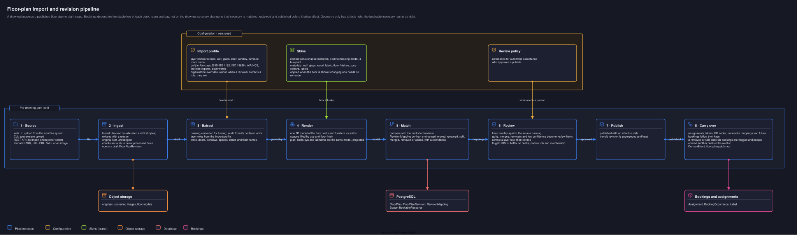

# Floor-plan import and revision pipeline

How a drawing becomes a published floor plan without breaking the bookings that depend on it. The
reasoning is in the domain model, in
[why floor plans need stable identity](../market/domain-model.md#why-floor-plans-need-stable-identity).

Source: [`diagrams/floor-plan-pipeline.drawio`](diagrams/floor-plan-pipeline.drawio)

## Steps

| Step | What happens | Writes |
|---|---|---|
| 1 · Source | A DWG, DXF, PDF, SVG or image (PNG, JPEG, WebP) is uploaded from the local file system: through the web UI, with the CLI (`spaceweave upload`), or to the REST API import endpoint for scripts and other systems. There is no SharePoint, OneDrive or IWMS connector | — |
| 2 · Ingest | The extension and the first bytes must agree, so a renamed or unsupported file is refused with a reason, such as which DWG release to save as instead. The original is stored unchanged, with a checksum so the same file isn't processed twice. A draft `FloorPlanRevision` is opened | Object storage, `FloorPlanRevision` (draft) |
| 3 · Extract | A drawing is converted for tracing, taking its scale from the units it declares (and checking a guessed scale against a door or a dimension). The import profile gives each layer its role. The trace finds walls, doors, windows, spaces, desks and their names | Draft geometry |
| 4 · Render | One 3D model of the floor: walls and furniture as solids, and spaces filled by their use and floor finish. The flat plan, a bird's-eye view and the isometric view are the same model seen from different angles | Floor model, in object storage |
| 5 · Match | Every key in the published revision is matched to the draft: unchanged, moved, renamed, split, merged, removed or added, each with a confidence | `RevisionMapping` |
| 6 · Review | The reviewer compares the trace overlay with the source drawing. Splits, merges, removals and low-confidence matches become review items. A wrong layer role is corrected and the floor retraced. The bookable inventory is checked against the target | Review decisions, with who reviewed each mapping |
| 7 · Publish | The revision is published with an effective date; the previous one is superseded and kept | `FloorPlanRevision` (published) |
| 8 · Carry over | Assignments, labels, QR codes, connector mappings and future bookings follow their keys. A removed or split desk's bookings are flagged, and the people are offered another desk or the waitlist | `DomainEvent`, notifications |

Render comes before Match and Review, so the reviewer sees the floor as staff will see it.

## The accuracy target

The target is **99% or better on the bookable inventory**: the count of desks, rooms and bays, their
names, their ids, and their membership of zones and levels. That's what people book against.
Geometry (walls, outlines, exact positions) only has to look right on the map. A wall in slightly the
wrong place annoys nobody; a missing or renamed desk breaks a booking. A trace's confidence is not a
measured accuracy score, which is why review checks the inventory itself.

## Configuration

All three are versioned, like the rest of the organisation's configuration.

- **Import profile:** says what each layer of a drawing holds: wall, glass, door, window, furniture,
  room name, or something to ignore.
  - It ships with built-in conventions:
    - Uniclass 2015 codes in BS 1192 and ISO 19650 layer names;
    - AIA/NCS layer names;
    - facilities-system exports;
    - plain words, in several languages.
  - When a reviewer corrects a layer's role, the correction is saved as an organisation override.
    Overrides always win, so the same mistake isn't made on the next floor.
  - Precedence lets conventions interleave the way a careful reader would. For example, a layer named
    "A-WALL-DIMS" is dimensions, although it says WALL.
- **Skins:** named looks for the rendered floor. Examples are shaded materials, a white architectural
  massing model, and a blueprint.
  - A skin sets the materials and colours for each kind of surface: walls, glass, wood, fabric, floor
    finishes, zone colours and labels.
  - Skins are applied when the floor is shown, so adding or changing one needs no re-render and no new
    revision.
  - A skin can take its colours from the organisation's `Brand`.
- **Review policy:** the confidence above which a match is accepted without a person, and who may
  publish.

## Rendering

- **One model, many views.** Walls and furniture are solids with heights, and spaces are filled areas.
  The renderer projects them with a parallel projection. Seen straight down, the projection is the plan
  exactly as drawn; at the isometric angle the three axes shorten equally. Moving between views is a
  smooth change of angle, not a different drawing.
- **Drawn in SVG with D3.** Every desk and room is an element keyed by its stable id. That's what the
  booking map highlights, selects and links to, and SVG keyed by stable space ids is the common way
  floor plans are exchanged.
- **Geometry stays decorative.** Heights, finishes and furniture shapes make the floor recognisable.
  None of them is part of the bookable inventory, so none of them blocks a publish.

## Why stable keys matter

A booking points at a `BookableResource` key, never at a shape in a drawing. When a new revision is
published, `RevisionMapping` decides what happens to each key:
- unchanged and moved keys carry on as they are;
- renamed keys keep their bookings under the new name;
- split, merged and removed keys always need a person to decide, because they change what people have
  booked.

## Sources

- [D3](https://d3js.org/what-is-d3)
