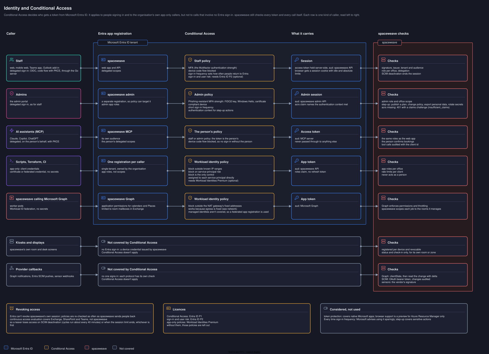

# Identity and Conditional Access

Who can call spaceweave, how each kind of caller gets its credential, and where Microsoft Entra
Conditional Access applies. Conditional Access is the main control on people signing in, but it only
decides who gets a token from Entra. spaceweave still checks every token and every call itself, and
some callers never sign in to Entra at all.

Source: [`diagrams/identity-conditional-access.drawio`](diagrams/identity-conditional-access.drawio)

## Callers

| Caller | Credential | Conditional Access | spaceweave checks |
|---|---|---|---|
| Staff: web, mobile web, Teams app, Outlook add-in | Delegated sign-in (OIDC, authorization code with PKCE) through the Go server; tokens stay server-side, and the browser gets a session cookie | **Staff policy** on the spaceweave registration | Signature, issuer, tenant and audience; role per office and delegation; SCIM deactivation ends the session |
| Admins | Delegated, through a **separate admin registration** | **Admin policy**, plus step-up through an authentication context | Admin role and office scope; the `acrs` claim before a sensitive action |
| AI assistants (MCP) | Delegated, on the person's behalf, with PKCE | **The person's own policy**, because the token is theirs | Audience is the MCP server; never passed through; the same roles as the web app |
| Scripts, Terraform, CI | App-only: client credentials with a certificate or a federated credential | **Workload identity policy** | App roles per office; rate limits; never acts as a person |
| spaceweave calling Microsoft Graph | App-only, through Workload ID federation | **Workload identity policy**, blocking calls from outside the NAT gateway's fixed addresses | Graph enforces permissions; spaceweave scopes each job to its rooms |
| Kiosks and displays | A device credential issued by spaceweave | **Not covered:** no Entra sign-in | Registered per device and revocable; status and check-in only |
| Provider callbacks: Graph notifications, Entra SCIM pushes, sensor webhooks | Each protocol's own check | **Not covered:** no one signs in | `clientState`, the SCIM bearer token, vendor signatures (see [sequences](sequences.md)) |

## Policies

- **Staff policy**
  - MFA, using the built-in Multifactor authentication strength. Staff can book from a personal phone.
  - Device code flow blocked through the authentication-flows condition.
  - A sign-in frequency that sets how often people go back to Entra, matched to spaceweave's session
    limits.
  - Sign-in risk and user risk, if the organisation has Entra ID P2.
- **Admin policy**
  - The built-in **Phishing-resistant MFA** strength: a FIDO2 security key, Windows Hello for Business
    or a platform credential, or multifactor certificate-based authentication.
  - A compliant device.
  - A short sign-in frequency.
  - An **authentication context** for step-up. Four actions need it: publishing an allocation plan,
    changing policy, exporting personal data, and rotating webhook secrets.
    - The admin API checks the token's `acrs` claim for the context's id.
    - If the claim is missing, the API answers `401` with a claims challenge
      (`error="insufficient_claims"`), and the client signs in again to meet it.
  - The admin portal has its own app registration, so this policy can target it without touching staff.
- **Workload identity policy**
  - Covers single-tenant service principals registered in the organisation's tenant: the automation
    registrations and spaceweave's own Graph registration.
  - The conditions are location (outside known public IP ranges) and service-principal risk. Block is
    the only control.
  - Each service principal is assigned to the policy directly; a group doesn't work.
  - Managed identities aren't covered. This is why spaceweave calls Graph through a federated app
    registration rather than a managed identity.

## What Conditional Access can't do for spaceweave

- **It can't end a spaceweave session.**
  - Entra can't revoke a session token issued by an application.
  - Policies are re-evaluated as often as spaceweave sends people back to Entra. So the session's idle
    and absolute limits, and the sign-in frequency, set how long a revoked person can keep access.
- **Continuous access evaluation stops at Microsoft's services.**
  - Its critical-event enforcement covers Exchange Online, SharePoint Online and Teams. Even there,
    propagation can take up to 15 minutes.
  - Nothing in Microsoft's documentation makes a custom API like spaceweave's a participant.
  - So a leaver loses access through SCIM `active: false` (cycles run about every 40 minutes), through
    the HR feed's leave date, or when the session limit ends, whichever comes first.
- **It doesn't cover calls with no Entra sign-in.** Kiosks, Graph notifications, SCIM pushes and sensor
  webhooks each have their own checks, shown in the bottom rows of the diagram and in the
  [threat model](threat-model.md) (T2, T3).

## Considered, not used

- **Token protection.**
  - It's generally available for native clients on Windows, iOS/iPadOS and macOS, for Exchange Online,
    SharePoint Online and Teams.
  - Browser support is a preview limited to selected web apps that call Azure Resource Manager.
  - It doesn't apply to spaceweave's own sign-in.
- **"Every time" sign-in frequency.**
  - Microsoft advises limiting the apps that use it.
  - It works only with apps that regularly send people back to Entra.
  - Step-up through authentication context covers the sensitive actions instead.

## Licences

| Capability | Licence |
|---|---|
| Conditional Access | Microsoft Entra ID P1 |
| Sign-in risk and user risk policies | Microsoft Entra ID P2 (ID Protection) |
| Conditional Access for workload identities | Workload Identities Premium. Existing policies keep working without it but can't be changed |

Without P2 or Workload Identities Premium, those policies are left out; the rest still applies.

## Sources

- Conditional Access:
  [overview and licensing](https://learn.microsoft.com/en-us/entra/identity/conditional-access/overview);
  [workload identities](https://learn.microsoft.com/en-us/entra/identity/conditional-access/workload-identity);
  [authentication flows](https://learn.microsoft.com/en-us/entra/identity/conditional-access/concept-authentication-flows);
  [grant controls](https://learn.microsoft.com/en-us/entra/identity/conditional-access/concept-conditional-access-grant);
  [session lifetime](https://learn.microsoft.com/en-us/entra/identity/conditional-access/concept-session-lifetime);
  [token protection](https://learn.microsoft.com/en-us/entra/identity/conditional-access/concept-token-protection)
- [Authentication strengths](https://learn.microsoft.com/en-us/entra/identity/authentication/concept-authentication-strengths)
- [Authentication context for developers](https://learn.microsoft.com/en-us/entra/identity-platform/developer-guide-conditional-access-authentication-context)
- [Claims challenges](https://learn.microsoft.com/en-us/entra/identity-platform/claims-challenge)
- [Continuous access evaluation](https://learn.microsoft.com/en-us/entra/identity/conditional-access/concept-continuous-access-evaluation)
- [Revoking user access](https://learn.microsoft.com/en-us/entra/identity/users/users-revoke-access)
