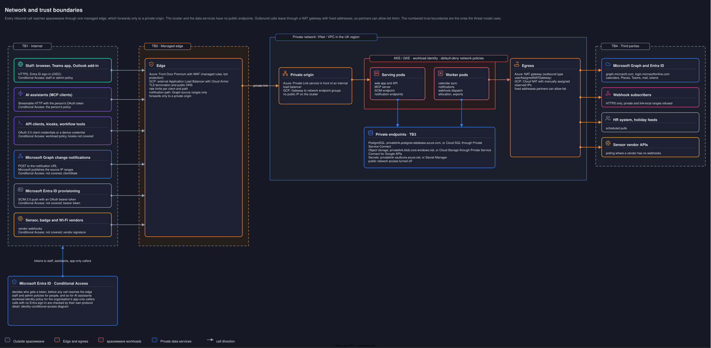

# Network and trust boundaries

How traffic reaches spaceweave and how it leaves. spaceweave is deployed for one organisation,
in one UK region of Azure or Google Cloud. The four trust boundaries (TB1 to TB4) are the ones the
[threat model](threat-model.md) uses.

Source: [`diagrams/network-trust-boundaries.drawio`](diagrams/network-trust-boundaries.drawio)

## What the diagram decides

- **One way in.** Every inbound call goes through a managed edge: Front Door Premium with WAF on Azure,
  or an external Application Load Balancer with Cloud Armor on Google Cloud. This includes the calls that
  third parties make to spaceweave: Graph notifications, SCIM pushes and sensor webhooks. The edge
  forwards only to a private origin, and the cluster has no public IP.
- **Graph notifications must reach a public HTTPS URL.** Microsoft Graph sends nothing to an endpoint it
  cannot reach, so the notification path stays public at the edge. Microsoft publishes the address ranges
  it sends from, and the edge allows only those on that path. That doesn't replace the `clientState`
  check (see [sequences](sequences.md)).
- **Room panels need nothing inbound.** Cisco room bookings reach Exchange only when Webex Hybrid
  Calendar is enabled, which talks to Exchange through Microsoft Graph. Without it, Webex keeps local
  bookings that never reach Exchange, so spaceweave can't see them: every panelled room needs Hybrid
  Calendar. spaceweave sees panel bookings only through its own Graph subscription. No Webex document says this outright: it follows from the documented design, and no
  inbound requirement is listed.
- **Conditional Access decides who gets a token, before any call reaches the edge.** Staff, admins and AI
  assistants are covered by the person's policy, and the organisation's app-only callers by the workload
  identity policy. Graph notifications, SCIM pushes, sensor webhooks and kiosks never sign in to Entra, so
  each inbound card names the check that covers it instead (see [identity](identity.md)).
- **Data services are private.** PostgreSQL, object storage and secrets are reached through private
  endpoints, and their public access is turned off.
- **Fixed egress.** Workers call out through a NAT gateway with reserved addresses, so HR systems,
  sensor vendors and webhook subscribers can allow-list spaceweave.

## Azure and Google Cloud

| Piece | Azure | Google Cloud |
|---|---|---|
| Edge | Front Door **Premium** with WAF. Standard gets custom WAF rules only; Bot Manager is Premium | Global external Application Load Balancer (`gke-l7-global-external-managed` Gateway), with a Cloud Armor policy attached through `GCPBackendPolicy` |
| Private origin | Private Link service in front of the AKS internal load balancer. The private endpoint connection is approved by the owner. Front Door Private Link is offered only in regions with availability zones: UK South, not UK West | Gateway to network endpoint groups in a VPC-native GKE cluster (the default for new clusters) |
| Cluster networking | Azure CNI Overlay (the AKS default) | VPC-native |
| PostgreSQL | Private endpoint, `privatelink.postgres.database.azure.com`. Microsoft recommends this over VNet integration. A VNet-integrated server can't move to another VNet or subnet, and moving it to private endpoints is a migration, so choose private endpoints at creation | Cloud SQL private IP through Private Service Connect, which is Google's default and recommended over private services access |
| Object storage | Private endpoint, `privatelink.blob.core.windows.net` | Private Service Connect endpoint for Google APIs, or Private Google Access on the subnet |
| Secrets | Private endpoint, `privatelink.vaultcore.azure.net` | Secret Manager through the managed CSI add-on, using workload identity |
| Egress | NAT gateway, outbound type `userAssignedNATGateway` (needs your own VNet). Up to 16 IPs | Cloud NAT with **manually** assigned reserved IPs. With automatic allocation, the next address can't be predicted |
| Pod identity | Microsoft Entra Workload ID, with federated credentials on annotated service accounts (20 per managed identity) | Workload Identity Federation for GKE |

## Limits worth knowing

- Front Door limits Private Link traffic to 7,200 requests per second per regional cluster, per profile.
- Graph marks an endpoint slow when more than 10% of responses in a 10-minute window take longer than
  3 seconds, and then delays new notifications by 10 minutes. When more than 15% take longer than the
  10-second retry timeout, notifications are dropped for 10 minutes. This is why the notification path
  only enqueues work (see [sequences](sequences.md)).

## Sources

- Front Door: [Private Link origins](https://learn.microsoft.com/en-us/azure/frontdoor/private-link);
  [internal load balancer origin](https://learn.microsoft.com/en-us/azure/frontdoor/standard-premium/how-to-enable-private-link-internal-load-balancer);
  [WAF on Front Door](https://learn.microsoft.com/en-us/azure/web-application-firewall/afds/afds-overview)
- AKS: [Azure CNI Overlay](https://learn.microsoft.com/en-us/azure/aks/azure-cni-overlay);
  [NAT gateway](https://learn.microsoft.com/en-us/azure/aks/nat-gateway);
  [Workload ID](https://learn.microsoft.com/en-us/azure/aks/workload-identity-overview)
- PostgreSQL: [private access](https://learn.microsoft.com/en-us/azure/postgresql/network/concepts-networking-private);
  [Private Link](https://learn.microsoft.com/en-us/azure/postgresql/network/concepts-networking-private-link)
- [Private endpoint DNS zones](https://learn.microsoft.com/en-us/azure/private-link/private-endpoint-dns)
- GKE: [VPC-native clusters](https://docs.cloud.google.com/kubernetes-engine/docs/concepts/alias-ips);
  [Gateway classes](https://docs.cloud.google.com/kubernetes-engine/docs/concepts/gateway-api);
  [Gateway policies](https://docs.cloud.google.com/kubernetes-engine/docs/how-to/configure-gateway-resources);
  [Workload Identity Federation](https://docs.cloud.google.com/kubernetes-engine/docs/concepts/workload-identity)
- Google Cloud services:
  [Cloud SQL private IP](https://docs.cloud.google.com/sql/docs/postgres/private-ip);
  [Private Google Access](https://docs.cloud.google.com/vpc/docs/private-google-access);
  [PSC for Google APIs](https://docs.cloud.google.com/vpc/docs/configure-private-service-connect-apis);
  [Secret Manager CSI](https://docs.cloud.google.com/secret-manager/docs/secret-manager-managed-csi-component);
  [Cloud NAT addresses](https://docs.cloud.google.com/nat/docs/ports-and-addresses)
- Microsoft Graph: [webhook delivery](https://learn.microsoft.com/en-us/graph/change-notifications-delivery-webhooks);
  [notification source IPs](https://learn.microsoft.com/en-us/microsoft-365/enterprise/additional-office365-ip-addresses-and-urls);
  [national cloud endpoints](https://learn.microsoft.com/en-us/graph/deployments)
- Webex: [room booking needs Hybrid Calendar](https://help.webex.com/en-us/article/nzp31jb/Enable-room-booking-for-shared-mode-Board-and-Room-Series-devices);
  [Hybrid Calendar uses Microsoft Graph](https://help.webex.com/en-us/article/n6cwujdb/Deployment-guide-for-Hybrid-Calendar)
