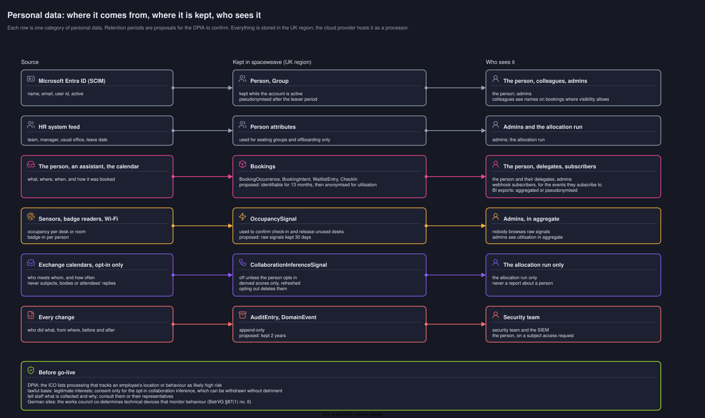

# Personal data and privacy

What personal data spaceweave holds, where it comes from, who sees it and how long it is kept, for the
organisation's DPIA. This is research to inform that assessment, not legal advice. Retention periods
are proposals for the DPIA to confirm.

Source: [`diagrams/personal-data-flow.drawio`](diagrams/personal-data-flow.drawio)

## Categories

| Category | Source | Entities | Used for | Proposed retention |
|---|---|---|---|---|
| Identity | Entra ID through SCIM | `Person`, `Group` | Sign-in, ownership, seating near your team | While active; pseudonymised after the leaver period |
| HR attributes | HR feed | `Person` attributes | Seating groups, offboarding | As identity |
| Bookings | The person, an assistant, the calendar, allocation runs | `BookingOccurrence`, `SpaceRequest`, `WaitlistEntry`, `CheckIn` | The service itself | Identifiable for 13 months, then anonymised for utilisation |
| Presence | Sensors, badge readers, Wi-Fi | `OccupancySignal` | Confirming check-in, releasing unused desks | Raw signals 30 days; aggregates kept |
| Collaboration inference (opt-in) | Exchange calendars: who meets whom, never subjects or bodies | `CollaborationInferenceSignal` | Seating collaborators near each other | Refreshed, not accumulated; deleted on opt-out |
| Audit | Every change | `AuditEntry`, `DomainEvent` | Security, accountability | 2 years, append-only |

`RetentionPolicy` in the domain model holds these periods, and its legal hold suspends deletion.

## What the guidance says

- **A DPIA is expected.**
  - The ICO's examples of likely high-risk processing include *"processing which involves tracking an
    individual's geolocation or behaviour"*, and also *"data processing at the workplace"* and
    *"processing location data of employees"*.
  - The European (WP29) criteria the ICO points to include systematic monitoring, and matching or
    combining datasets.
  - It notes that employees can count as vulnerable data subjects.
  - Sensors, badge-ins and inferred collaboration all touch these.
- **Lawful basis.**
  - The ICO's monitoring-workers guidance calls legitimate interests *"the most flexible"* basis. It
    warns that the basis may fail where workers *"would not reasonably expect"* the monitoring.
  - It says *"consent is not usually appropriate in the employment context"*. Consent works only where
    workers have a genuine choice and can withdraw without detriment.
  - That fits the collaboration inference: it is off by default, opt-in, and opting out deletes it.
- **Transparency and minimisation.**
  - Tell workers about monitoring in an accessible way, and collect no more than the purpose needs.
  - Keep monitoring data no longer than necessary, and make it available to workers on request.
  - Seek and document the views of workers or their representatives.
- **Profiling.**
  - Inferring collaboration from calendars is automated evaluation of behaviour, which fits the
    UK GDPR's definition of profiling (Article 4(4)).
  - Seating suggestions are made by an allocation run and reviewed by an admin before publishing.
    Whether a seating decision is "significant" under Article 22A (in force since 5 February 2026) is
    for the DPIA. No primary source settles it.
- **Rights.**
  - Subject access covers monitoring data. It also covers the existence of profiling where that
    profiling is part of a solely automated significant decision (Article 15(1)(h), Article 22C).
  - The right to object covers processing based on legitimate interests, including profiling.
  - Erasure follows a successful objection.
- **Residency.**
  - Keeping data in a UK region avoids a restricted transfer only if nobody outside the UK can reach it.
  - The ICO counts remote access from abroad by a separate organisation as a transfer. This means
    That would seem to cover a provider's support staff or a sub-processor outside the UK; the DPIA
    should confirm.
  - A Google Cloud standby outside the UK would be a transfer (see [deployment](deployment.md)).
- **Works councils (German sites).**
  - §87(1) no. 6 of the Works Constitution Act gives the works council co-determination over *"the
    introduction and use of technical devices designed to monitor the behaviour or performance of the
    employees"*. If the employer and the works council can't agree, the conciliation committee decides.
  - Sensors and the inference signal should go to the works council before they are switched on.
  - Other EU countries weren't researched.

## Design choices that follow

- **Raw presence is not browsable.** Admins see utilisation in aggregate; nobody reads one person's
  signals.
- **Inference stays inside the allocation run.** It is never shown as a report about a person, and holds
  scores rather than meetings.
- **Exports are aggregated or pseudonymised** unless an export is a subject access response.
- **The sensors are optional,** and check-in works without them, so a site can turn them off without
  losing the service.

## Sources

- ICO DPIA guidance:
  - [When do we need to do a DPIA?](https://ico.org.uk/for-organisations/uk-gdpr-guidance-and-resources/accountability-and-governance/data-protection-impact-assessments-dpias/when-do-we-need-to-do-a-dpia/)
  - [Examples of processing likely to result in high risk](https://ico.org.uk/for-organisations/uk-gdpr-guidance-and-resources/accountability-and-governance/data-protection-impact-assessments-dpias/examples-of-processing-likely-to-result-in-high-risk/)
- ICO: [Data protection and monitoring workers](https://ico.org.uk/for-organisations/uk-gdpr-guidance-and-resources/employment/monitoring-workers/data-protection-and-monitoring-workers/).
  The page says it is under review following the Data (Use and Access) Act 2025.
- ICO: [What is an international transfer?](https://ico.org.uk/for-organisations/uk-gdpr-guidance-and-resources/international-transfers/a-guide-to-international-transfers/what-is-an-international-transfer-of-personal-information/)
- UK GDPR articles:
  [Article 4](https://www.legislation.gov.uk/eur/2016/679/article/4),
  [Article 5](https://www.legislation.gov.uk/eur/2016/679/article/5),
  [Article 15](https://www.legislation.gov.uk/eur/2016/679/article/15),
  [Article 17](https://www.legislation.gov.uk/eur/2016/679/article/17),
  [Article 21](https://www.legislation.gov.uk/eur/2016/679/article/21),
  [Article 22A](https://www.legislation.gov.uk/eur/2016/679/article/22A)
- Works Constitution Act (BetrVG) §87:
  [English translation](https://www.gesetze-im-internet.de/englisch_betrvg/englisch_betrvg.html);
  [German text](https://www.gesetze-im-internet.de/betrvg/__87.html)
