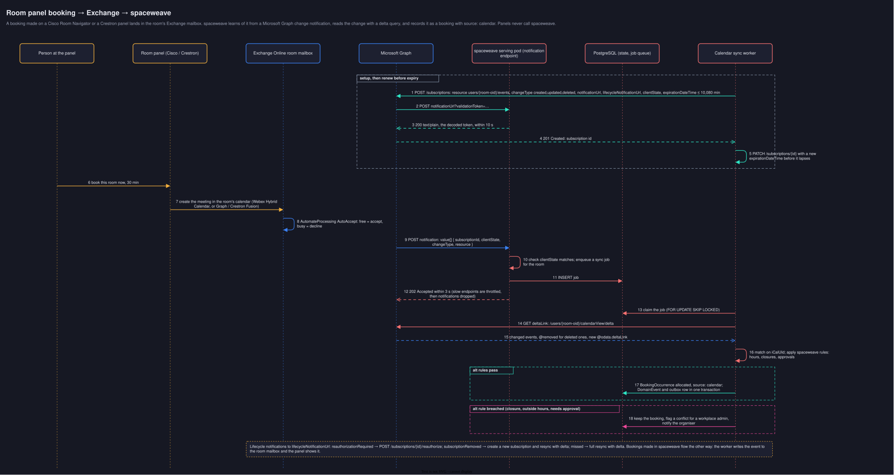
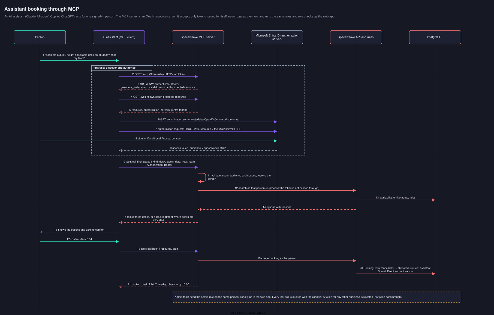
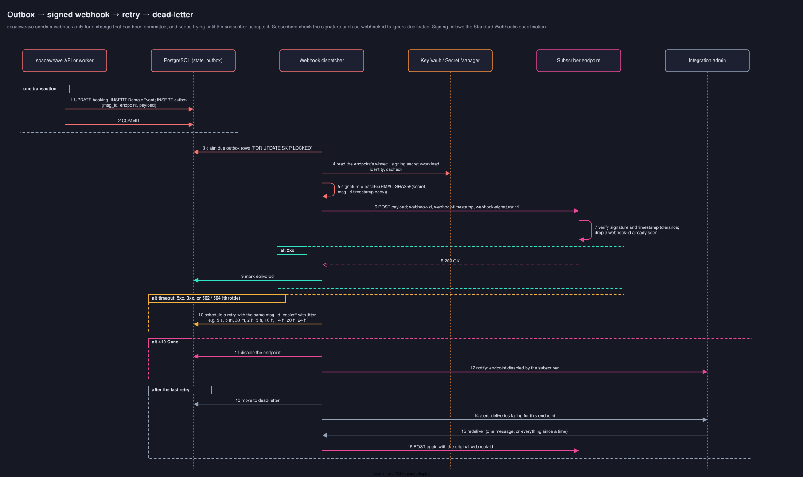
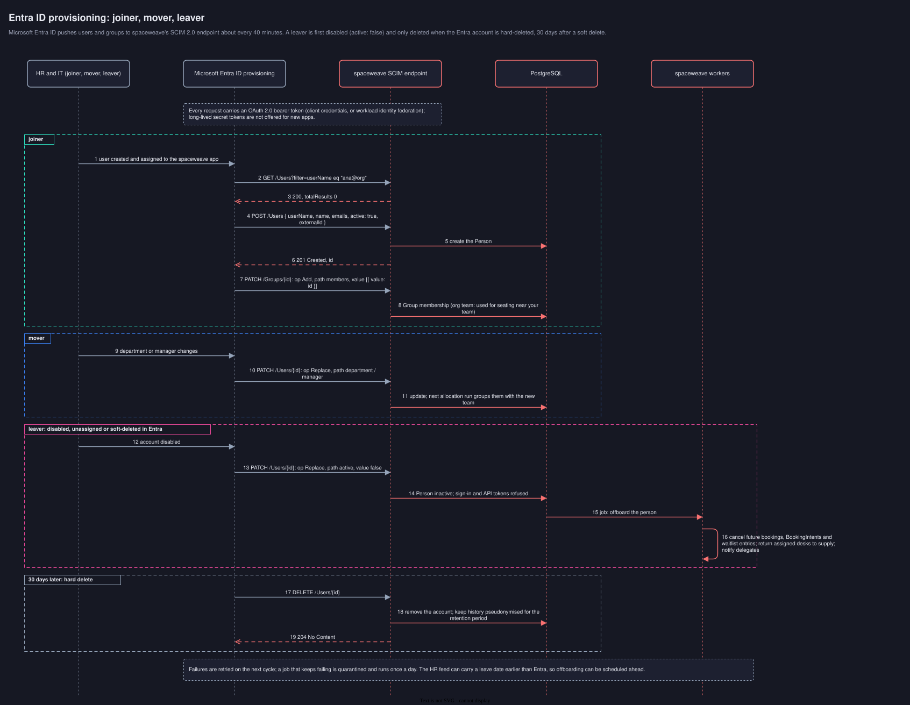

# Key integration sequences

Four flows, drawn with the API calls, fields and limits from the vendor documentation. All pages are
in one editable file, [`diagrams/sequences.drawio`](diagrams/sequences.drawio).

## 1. Room panel booking → Exchange → spaceweave

- **Subscription:**
  - `POST /subscriptions` on `users/{room-oid}/events`, with a `clientState` (128 characters at most).
  - An Outlook event subscription lasts at most 10,080 minutes, just under seven days, so the worker
    renews it with `PATCH /subscriptions/{id}`. A 404 on renewal means it's gone: create a new one.
  - Rooms are identified by object ID rather than UPN, as Microsoft recommends.
- **Validation:** Graph calls the notification URL with `validationToken`. The endpoint must answer
  `200 OK`, `text/plain`, with the decoded token, within 10 seconds. The `lifecycleNotificationUrl` is
  validated too, and it can't be added to an existing subscription later.
- **Notifications:**
  - Answer with a 2xx within 3 seconds; otherwise Graph retries for up to 4 hours.
  - Endpoints that are often slow are delayed, then dropped, and dropped notifications can't be
    recovered.
  - So the endpoint checks `clientState`, enqueues a job and returns `202 Accepted`.
- **Read the change:**
  - Basic notifications carry no event data, so the worker reads it with
    `GET /users/{id}/calendarView/delta`, following `@odata.nextLink` and keeping `@odata.deltaLink`.
  - Deleted events arrive under `@removed`.
  - Rich notifications with encrypted resource data exist for events, but are limited to one day of
    lifetime and need a certificate. Delta is simpler and also recovers from gaps.
- **Room acceptance** is Exchange's job: with `AutomateProcessing AutoAccept` (the Exchange Online default
  for room mailboxes created in the admin centre, or in PowerShell after 15 November 2018), a free room accepts and a busy one declines.
- **Lifecycle events:**
  - `reauthorizationRequired` → `POST /subscriptions/{id}/reauthorize`;
  - `subscriptionRemoved` → create the subscription again and resync with delta;
  - `missed` → a full resync with delta.
- **Rule breaches are flagged, not silently undone.** A panel booking that breaks a spaceweave rule (a
  closure, outside hours, needs approval) is kept and raised to a workplace admin. Deleting a meeting
  someone just made at the door would surprise them.

## 2. Assistant booking through MCP

- **The MCP server is an OAuth 2.1 resource server.** It implements Protected Resource Metadata
  (RFC 9728). An unauthenticated call gets a `401` whose `WWW-Authenticate` names the metadata URL, and
  the metadata lists the authorization server (Entra ID).
- **The client** finds the authorization server in the resource metadata, then reads that server's
  metadata: OpenID Connect discovery for Entra ID (MCP clients must support RFC 8414 too). It uses PKCE
  with `S256`. It sends the MCP server's canonical URI as the resource indicator (RFC 8707).
  > Open question: Entra ID sets a token's audience from the requested scope (`api://…/.default`).
  > Confirm how it treats the `resource` parameter before relying on it.
- **Audience is checked, and tokens are never passed through.** The server accepts only tokens issued
  for itself. It calls spaceweave's API in-process as the validated person, never forwarding the token.
- **Transport** is Streamable HTTP. In the 2026-07-28 specification this is a single POST endpoint, with
  no protocol sessions; the server must validate `Origin`.
- **Same rules, same roles.** The assistant can do only what the person can do in the web app, and every
  tool call is audited with the client id.

## 3. Outbox → signed webhook → retry → dead-letter

- **Transactional outbox:** the business change and the outbox row are written in one transaction, and
  a relay publishes later. The relay can publish a message more than once, so consumers must be
  idempotent.
- **Signing (Standard Webhooks):**
  - headers `webhook-id`, `webhook-timestamp` and `webhook-signature`;
  - the signature is `base64(HMAC-SHA256(secret, "msg_id.timestamp.payload"))`, sent as `v1,<signature>`;
  - the secret is the base64 part after `whsec_`.
- **Retries:** exponential backoff with jitter over several days. The specification's example is
  immediately, then 5 s, 5 m, 30 m, 2 h, 5 h, 10 h, 14 h, 20 h, 24 h. `webhook-id` stays the same on
  every retry, so subscribers use it to drop duplicates.
- **Responses:** a 2xx is success and a 3xx counts as failure. `410 Gone` disables the endpoint;
  `502`/`504` mean slow down.
- **Dead-letter and redeliver:** after the last retry the message is dead-lettered and an admin is
  alerted. Redelivery sends the original `webhook-id`.

## 4. Entra ID provisioning: joiner, mover, leaver

- **Push, about every 40 minutes** after the initial cycle.
- **Requests:**
  - users: `GET /Users?filter=userName eq "…"`, then `POST /Users`, `PATCH /Users/{id}`, `DELETE /Users/{id}`;
  - group membership: `PATCH /Groups/{id}` with `op: Add`, `path: members`.
  - Entra sends `op` as `Add`, `Replace` and `Remove`; treat it case-insensitively.
- **Leavers:**
  - unassigning, disabling or soft-deleting a user sends `PATCH … active: false`;
  - `DELETE` is sent on a hard delete: automatically 30 days after a soft delete, or sooner if an admin
    deletes the user permanently. It isn't sent for a user who was unassigned first.
  - spaceweave offboards on `active: false`: it cancels future bookings, requests and waitlist entries,
    and returns assigned desks to supply.
  - The HR feed can bring a leave date forward.
- **Authentication:** an OAuth 2.0 bearer token, from client credentials or workload identity federation.
  Long-lived bearer tokens are no longer supported for new gallery apps. A non-gallery app such as
  spaceweave can still use them, but they aren't used here.
- **Failures** are retried in the next cycle. A job that keeps failing is quarantined: its cycles
  slow gradually to once a day, and it is disabled after four weeks.

## Sources

- Microsoft Graph:
  - [Webhook delivery](https://learn.microsoft.com/en-us/graph/change-notifications-delivery-webhooks)
  - [Outlook change notifications](https://learn.microsoft.com/en-us/graph/outlook-change-notifications-overview)
  - [Subscription resource and limits](https://learn.microsoft.com/en-us/graph/api/resources/subscription?view=graph-rest-1.0)
  - [Update a subscription](https://learn.microsoft.com/en-us/graph/api/subscription-update?view=graph-rest-1.0)
  - [Lifecycle notifications](https://learn.microsoft.com/en-us/graph/change-notifications-lifecycle-events)
  - [Rich notifications](https://learn.microsoft.com/en-us/graph/change-notifications-with-resource-data)
  - [Event delta](https://learn.microsoft.com/en-us/graph/api/event-delta?view=graph-rest-1.0)
  - [Places API](https://learn.microsoft.com/en-us/graph/api/place-list?view=graph-rest-1.0)
- Exchange: [`Set-CalendarProcessing`](https://learn.microsoft.com/en-us/powershell/module/exchange/set-calendarprocessing)
- MCP specification:
  - [MCP authorization](https://modelcontextprotocol.io/specification/latest/basic/authorization)
  - [Security considerations](https://modelcontextprotocol.io/specification/2026-07-28/basic/authorization/security-considerations)
  - [Streamable HTTP transport](https://modelcontextprotocol.io/specification/2026-07-28/basic/transports/streamable-http)
- [Standard Webhooks specification](https://github.com/standard-webhooks/standard-webhooks/blob/main/spec/standard-webhooks.md)
- [Transactional outbox](https://microservices.io/patterns/data/transactional-outbox.html)
- Microsoft Entra ID provisioning:
  - [SCIM with Microsoft Entra ID](https://learn.microsoft.com/en-us/entra/identity/app-provisioning/use-scim-to-provision-users-and-groups)
  - [How provisioning works](https://learn.microsoft.com/en-us/entra/identity/app-provisioning/how-provisioning-works)
