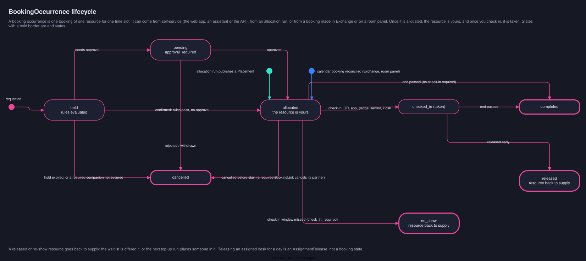
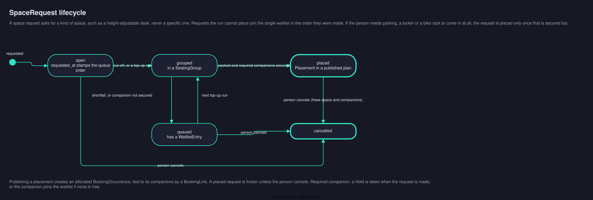
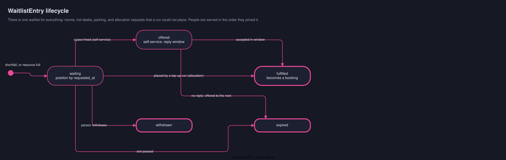
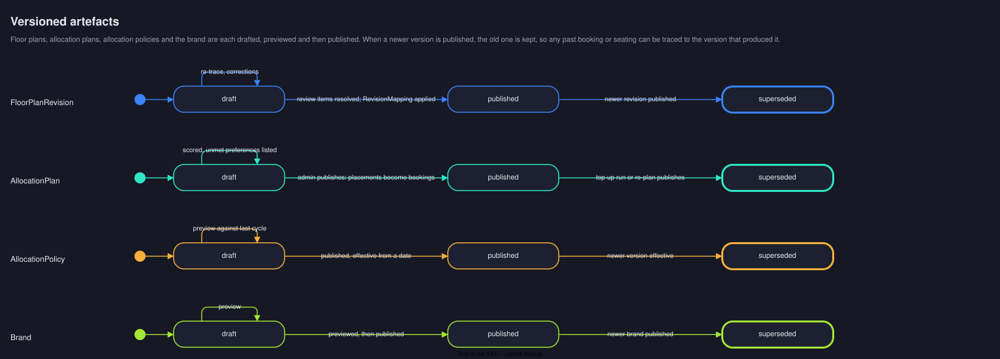

# Lifecycle state machines

The states and transitions of the entities whose lifecycle matters most. They match the
[common domain model](../market/domain-model.md) and the
[space allocation lifecycle](diagrams/space-allocation-lifecycle.drawio.svg). All pages are in one editable file,
[`diagrams/state-machines.drawio`](diagrams/state-machines.drawio).

## BookingOccurrence

- **Three ways in, one machine:**
  - self-service, from the web app, an assistant or the API, starts at `held`;
  - an allocation run publishes a placement straight into `allocated`;
  - a calendar booking from Exchange or a room panel is reconciled into `allocated`, with `source: calendar`.
- **Allocated means the resource is yours; taken means you checked in.** `checked_in` is the taken
  state.
- **A required companion is all or nothing.** If the parking bay is required and can't be held, the
  desk booking is cancelled. A `BookingLink` cancels its partner when either side is cancelled before
  the start.
- **No-show and released both return the resource to supply.** The waitlist is offered it, or the next
  top-up run places someone in it.

## SpaceRequest

- A request is for a kind of space, never a specific one. Order is `requested_at`: first come, first served.
- `grouped` → `queued` is a shortfall, or a required companion that isn't secured. The request then
  has a `WaitlistEntry`, and the next top-up run retries it.
- `placed` is frozen unless the person cancels. Cancelling frees the space and the companions.

## WaitlistEntry

There is one queue for everything. Self-service resources are **offered** with a reply window, and an
unanswered offer passes to the next person. Allocated kinds are **placed** directly by a top-up run,
with no offer step.

## Versioned artefacts

`FloorPlanRevision`, `AllocationPlan`, `AllocationPolicy` and `Brand` share one shape: draft, then
published, then superseded. A superseded version is kept, so any past booking, seating or page can be
explained by the version that produced it. How a floor plan revision is drafted and reviewed is in
[floor-plan pipeline](floor-plan-pipeline.md).
