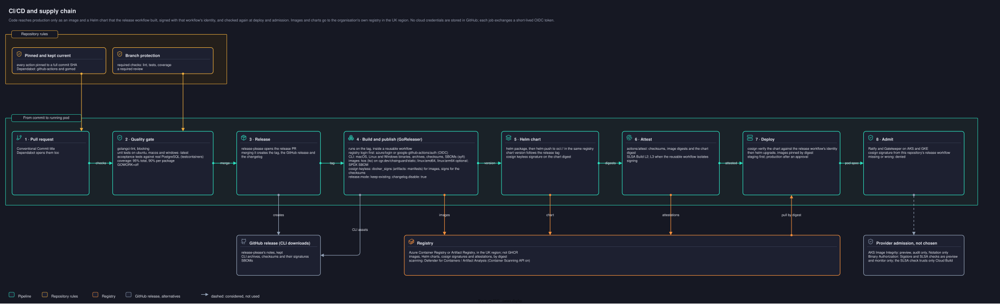

# CI/CD and supply chain

How code becomes a running pod. The quality gate follows the repository conventions in
[`CLAUDE.md`](../../CLAUDE.md):
- golangci-lint is the only linter, and it blocks;
- coverage must be at least 95% in total and 90% per package;
- builds run with `GOWORK=off`;
- actions are pinned by commit SHA, and Dependabot keeps them current;
- commits follow Conventional Commits, and release-please makes the releases.

Source: [`diagrams/ci-cd-supply-chain.drawio`](diagrams/ci-cd-supply-chain.drawio)

## Steps

| Step | What happens |
|---|---|
| 1 · Pull request | Conventional Commit title. Dependabot opens update PRs for the `github-actions` and `gomod` ecosystems |
| 2 · Quality gate | golangci-lint; unit tests on `ubuntu-latest`, `macos-latest` and `windows-latest`; acceptance tests against real PostgreSQL through testcontainers; the coverage gate; all with `GOWORK=off` |
| 3 · Release | release-please opens the release PR. Merging it creates the tag, the GitHub release and the changelog |
| 4 · Build and publish | GoReleaser runs on the tag inside a reusable workflow, after the OIDC registry login (`azure/login` or `google-github-actions/auth`). It builds the CLI for macOS, Linux and Windows with archives, checksums and syft SBOMs. It builds images with `kos` (ko) on `cgr.dev/chainguard/static` for `linux/amd64`, with `linux/arm64` as an option, and ko adds an SPDX SBOM. It signs keylessly with cosign, pushes images by digest and adds the CLI assets to the existing release |
| 5 · Helm chart | `helm package`, then `helm push` to `oci://` in the same registry (Helm 3.8 or later). The chart version follows the release tag. cosign signs the chart's digest keylessly |
| 6 · Attest | `actions/attest` records build provenance for the checksums, the image digests and the chart digest |
| 7 · Deploy | `cosign verify` checks the chart against the release workflow's identity, then `helm upgrade` runs with images pinned by digest. Staging first, then production after an environment approval |
| 8 · Admit | Ratify with Gatekeeper on both AKS and GKE verifies each image's cosign signature: issuer `https://token.actions.githubusercontent.com`, identity = this repository's release workflow. A missing or wrong signature is denied |

## GoReleaser settings that matter

- **`release.mode: keep-existing`** (the default) and **`changelog.disable: true`:** release-please owns
  the release notes; GoReleaser only adds assets to the release it finds.
- **`docker_signs` with `artifacts: manifests`:** ko images are added as manifests. The default
  (`''`) signs only images built by `dockers_v2`, so without this setting the ko images would go out
  unsigned. Keyless signing means no `--key` argument, plus `id-token: write` on the job.
- **`signs` with `artifacts: checksum`:** one cosign `sign-blob` bundle over `checksums.txt` covers every
  CLI archive.
- **`docker_digest`** writes `digests.txt` (GoReleaser 2.12 and later). GoReleaser's attestation guide
  passes it and `checksums.txt` to `actions/attest`. Check on the first release that `digests.txt` lists
  the ko images; if it doesn't, take the digests from `dist/artifacts.json`.
- **`kos.platforms`** defaults to `linux/amd64`. Add `linux/arm64` only if an Arm node pool is used
  (Azure Cobalt or Ampere, Google Axion). It costs build time, not design.

## Registry

Images, charts, signatures and attestations all go to the organisation's own **Azure Container Registry
or Artifact Registry in the UK region**. Nothing goes through GitHub's container registry. One registry
means one place to scan, one set of admission rules, and no mirroring step. Both registries hold Helm
charts as OCI artifacts and need Helm 3.8 or later. `az acr helm` was retired in September 2025, so use
`helm push`. The CLI downloads are the only artefacts outside it: they live on the GitHub release,
signed through the checksum bundle.

## Helm charts and signatures

Helm doesn't verify cosign signatures itself. Its built-in provenance is PGP (`helm package --sign`,
`helm install --verify`), and the Helm 4 changelog adds no Sigstore support. Charts are therefore signed
with cosign like the images, and the deploy job runs `cosign verify` on the chart's digest before
`helm upgrade`. Admission control (step 8) covers the images the chart deploys, not the chart itself,
which is why the deploy-time check is needed.

## Decisions and why

- **SLSA level.**
  - GitHub artifact attestations alone give SLSA v1.0 **Build Level 2**.
  - Build L3 needs the signing material kept out of reach of the build steps. GitHub reaches that with a
    reusable workflow that isolates the build, which is why step 4 is one.
  - SLSA v1.0 is now marked retired in favour of v1.2; the build levels carry over, but check the v1.2
    wording before claiming a level.
- **One admission controller on both clouds,** because neither cloud's own option enforces cosign
  signatures yet:
  - **AKS Image Integrity** is in preview, audit only, verifies only Notation signatures, and isn't
    recommended for production.
  - **GKE Binary Authorization:** its Sigstore check (continuous validation) is in preview and monitors
    rather than blocks. It needs public keys, not keyless certificates. Its SLSA check trusts only Cloud
    Build, so it can't check provenance built on GitHub.
  - Open-source **Ratify** has a built-in cosign verifier that checks the keyless certificate identity
    and issuer. It finds cosign signatures by the cosign tag convention (`cosignEnabled`), or,
    experimentally, through the OCI 1.1 referrers API. Microsoft's guide to running it on AKS with
    Azure Policy defaults to `Deny`. That guide uses Notation, so the cosign configuration comes from
    Ratify's own docs.
- **SHA pinning and Dependabot.**
  - Actions are pinned to full commit SHAs because a tag can be moved.
  - Dependabot's version updates keep the pins current, but it doesn't raise security alerts for
    SHA-pinned actions, so the update PRs are the safeguard.
  - GitHub now ranks a workflow dependency lockfile above SHA pinning. Adopt it once it fits the
    repository conventions.
- **Private repositories and transparency.**
  - Keyless cosign signing logs the workflow identity, which names the repository, in the public Rekor
    log.
  - GitHub attestations from private repositories use GitHub's own Sigstore instance, which has no
    public transparency log.
  - Decide which applies before the repository goes private or public.
- **Scanning.**
  - Defender for Containers scans new images in ACR, typically within a few hours of push, and rescans
    images pulled or running in the last 30 days.
  - Once the Container Scanning API is enabled (it is off by default), Artifact Analysis scans images
    on upload to Artifact Registry, including Go packages.

## Sources

- SLSA:
  [levels](https://slsa.dev/spec/v1.0/levels);
  [requirements](https://slsa.dev/spec/v1.0/requirements)
- Sigstore:
  [cosign signing overview](https://docs.sigstore.dev/cosign/signing/overview/);
  [CI quickstart](https://docs.sigstore.dev/quickstart/quickstart-ci/);
  [attestations](https://docs.sigstore.dev/cosign/verifying/attestation/)
- GitHub Actions security:
  [secure use](https://docs.github.com/en/actions/reference/security/secure-use);
  [OIDC](https://docs.github.com/en/actions/concepts/security/openid-connect);
  [OIDC reference](https://docs.github.com/en/actions/reference/security/oidc)
- GitHub OIDC to the clouds:
  [OIDC in Azure](https://docs.github.com/en/actions/how-tos/secure-your-work/security-harden-deployments/oidc-in-azure);
  [OIDC in Google Cloud](https://docs.github.com/en/actions/how-tos/secure-your-work/security-harden-deployments/oidc-in-google-cloud-platform)
- GitHub artifact attestations and Dependabot:
  [artifact attestations](https://docs.github.com/en/actions/concepts/security/artifact-attestations);
  [using artifact attestations](https://docs.github.com/en/actions/how-tos/secure-your-work/use-artifact-attestations/use-artifact-attestations);
  [Dependabot ecosystems](https://docs.github.com/en/code-security/dependabot/ecosystems-supported-by-dependabot/supported-ecosystems-and-repositories)
- GoReleaser:
  [release](https://goreleaser.com/customization/publish/release/);
  [changelog](https://goreleaser.com/customization/changelog/);
  [ko](https://goreleaser.com/customization/package/ko/);
  [Docker signing](https://goreleaser.com/customization/sign/docker_sign/);
  [signing](https://goreleaser.com/customization/sign/sign/);
  [SBOMs](https://goreleaser.com/customization/sbom/);
  [attestations](https://goreleaser.com/customization/attestations/)
- [release-please-action](https://github.com/googleapis/release-please-action)
- Helm:
  [OCI registries](https://helm.sh/docs/topics/registries/);
  [provenance](https://helm.sh/docs/topics/provenance/);
  [changelog](https://helm.sh/docs/changelog/)
- Helm charts in the registries:
  [ACR](https://learn.microsoft.com/en-us/azure/container-registry/container-registry-helm-repos);
  [Artifact Registry](https://docs.cloud.google.com/artifact-registry/docs/helm/store-helm-charts);
  [cosign for other OCI types](https://docs.sigstore.dev/cosign/signing/other_types/)
- AKS image verification:
  [Image Integrity (preview)](https://learn.microsoft.com/en-us/azure/aks/image-integrity);
  [Ratify on AKS](https://learn.microsoft.com/en-us/azure/security/container-secure-supply-chain/articles/validating-image-signatures-using-ratify-aks);
  [Ratify cosign verifier](https://ratify.dev/docs/plugins/verifier/cosign)
- Binary Authorization:
  [overview](https://docs.cloud.google.com/binary-authorization/docs/overview);
  [Sigstore check](https://docs.cloud.google.com/binary-authorization/docs/cv-sigstore-check);
  [SLSA check](https://docs.cloud.google.com/binary-authorization/docs/cv-slsa-check)
- Registries and scanning:
  [ACR OCI artifacts](https://learn.microsoft.com/en-us/azure/container-registry/container-registry-oci-artifacts);
  [Defender agentless scanning](https://learn.microsoft.com/en-us/azure/defender-for-cloud/agentless-vulnerability-assessment-azure);
  [Artifact Analysis](https://docs.cloud.google.com/artifact-analysis/docs/container-scanning-overview)
