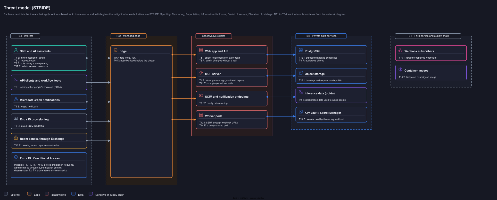

# Threat model (STRIDE)

Threats to spaceweave, grouped by element and trust boundary, with their mitigations. The trust
boundaries are the ones in [network](network.md). This is a starting model, to be revisited as the
product is built.

Source: [`diagrams/threat-model.drawio`](diagrams/threat-model.drawio)

## Method

STRIDE, as Microsoft defines it:
- **Spoofing:** using someone else's authentication;
- **Tampering:** malicious modification of data;
- **Repudiation:** denying an action with no way to prove otherwise;
- **Information disclosure:** exposing information to people who shouldn't have it;
- **Denial of service:** making the service unavailable to valid users;
- **Elevation of privilege:** an unprivileged user gaining privileged access.

API threats are cross-referenced to the OWASP API Security Top 10 (2023).

## Trust boundaries

| Boundary | Between |
|---|---|
| TB1 | The internet and the managed edge |
| TB2 | The managed edge and the private origin |
| TB3 | spaceweave workloads and the private data services |
| TB4 | spaceweave and third parties: webhook subscribers, vendor APIs, and the image supply chain |

## Threats and mitigations

| # | STRIDE | Threat | Boundary | Mitigation |
|---|---|---|---|---|
| T1 | S | A stolen session or token used to book or cancel as someone else | TB1 | Conditional Access staff policy: MFA, device code flow blocked, a sign-in frequency matched to spaceweave's session limits, and risk policies where licensed; tokens held server-side; idle and absolute session limits; sign-ins sent to the SIEM (see [identity](identity.md)) |
| T2 | S | A forged Graph notification | TB1 | Check `clientState`; allow only Microsoft's published ranges on the notification path; never trust the payload: read the change from Graph with delta |
| T3 | S | A stolen SCIM credential used to create or disable people | TB1 | OAuth client credentials or workload identity federation rather than a long-lived token; SCIM changes audited; alert on mass deactivation |
| T4 | E | MCP token passthrough or confused deputy | TB1 → TB2 | Accept only tokens whose audience is the MCP server; never forward them; per-client consent with exact `redirect_uri` matching (MCP security best practices) |
| T5 | I | Reading or changing other people's bookings by id (API1:2023, broken object level authorization) | TB2 | An authorization check on every object, in the API layer that MCP and the web app share; tests per role |
| T6 | D | Request floods (API4:2023, unrestricted resource consumption) | TB1 | WAF rate limits per client and path; per-person quotas; queue work rather than doing it inline |
| T7 | E | Scripts grabbing scarce parking or desks (API6:2023, sensitive business flows) | TB1 | Entitlements and limits per person; first come, first served with a cap; bot protection at the edge; app-only callers limited by app role and by the workload identity policy |
| T8 | R | Admin changes to policy, plans or bookings that nobody can trace | TB3 | `AuditEntry` written in the same transaction as the change; append-only; streamed to the SIEM |
| T9 | I | Collaboration inference used to judge people | TB3 | Opt-in only; scores, not meetings; used only by the allocation run; never reported per person; DPIA and works council (see [personal data](personal-data.md)) |
| T10 | E | Booking around spaceweave's rules through a panel or Outlook | TB1 | Rules re-applied when the calendar booking is reconciled; breaches flagged to an admin (see [sequences](sequences.md)) |
| T11 | T | A prompt-injected assistant making tool calls the person didn't intend | TB1 → TB2 | Bookings and cancellations confirmed by the person; admin tools need the admin role; tool calls audited with the client id |
| T12 | I | SSRF through webhook URLs (API7:2023) | TB4 | HTTPS only; private, link-local and metadata addresses refused at delivery time; egress only through the NAT gateway |
| T13 | I | Database, backups or drawings exposed | TB3 | Private endpoints with public access turned off; encryption at rest; backups kept in the UK region |
| T14 | E | A compromised pod reading secrets or data it doesn't need | TB3 | Workload identity per service account with least privilege; default-deny network policies; no static keys |
| T15 | T | A tampered or unsigned image deployed | TB4 | Signed images and admission control (see [supply chain](supply-chain.md)) |
| T16 | T | Forged or replayed webhooks sent to subscribers | TB4 | Standard Webhooks HMAC signature over id, timestamp and body; subscribers check the timestamp and drop seen ids; secrets rotated |
| T17 | E | An admin session taken over and used to publish a plan, change policy or export personal data | TB1 | A separate admin registration with its own Conditional Access policy: phishing-resistant MFA, a compliant device and a short sign-in frequency; step-up through an authentication context for sensitive actions, checked through the `acrs` claim; every admin change audited (T8) |
| T18 | D | An allocation cycle that starves other workloads, or doesn't finish in time for review and publish | TB3 | Solver pods run only on their own tainted node pool, with a maximum node count and resource requests and limits, so serving and sync pods are never short; each venue and date is a separate job, retried on failure without duplicating results; an alert fires when a venue and date has no draft plan by the review deadline |

## Where Conditional Access stops

Conditional Access mitigates T1, T7 and T17, but only for callers that sign in to Entra. It doesn't
cover kiosks, Graph notifications, SCIM pushes or sensor webhooks, which is why T2 and T3 have their own
mitigations. Entra also can't revoke spaceweave's own session, so the session limits are part of T1's
mitigation. The [identity](identity.md) page has the detail.

## Not yet covered

- Denial of service against Microsoft Graph quotas through bursts of calendar writes. This needs
  measurements of Graph's throttling limits.
- API9:2023 (improper inventory management) and API10:2023 (unsafe consumption of APIs). Both need the
  real API surface and the vendor connectors.

## Sources

- Microsoft:
  [Threat Modeling Tool threats (STRIDE)](https://learn.microsoft.com/en-us/azure/security/develop/threat-modeling-tool-threats);
  [Threat Modeling Tool features](https://learn.microsoft.com/en-us/azure/security/develop/threat-modeling-tool-feature-overview)
- [OWASP API Security Top 10 (2023)](https://api-security.owasp.org/editions/2023/en/0x11-t10)
- [MCP security best practices](https://modelcontextprotocol.io/specification/draft/basic/security_best_practices)
- [Standard Webhooks specification](https://github.com/standard-webhooks/standard-webhooks/blob/main/spec/standard-webhooks.md)
