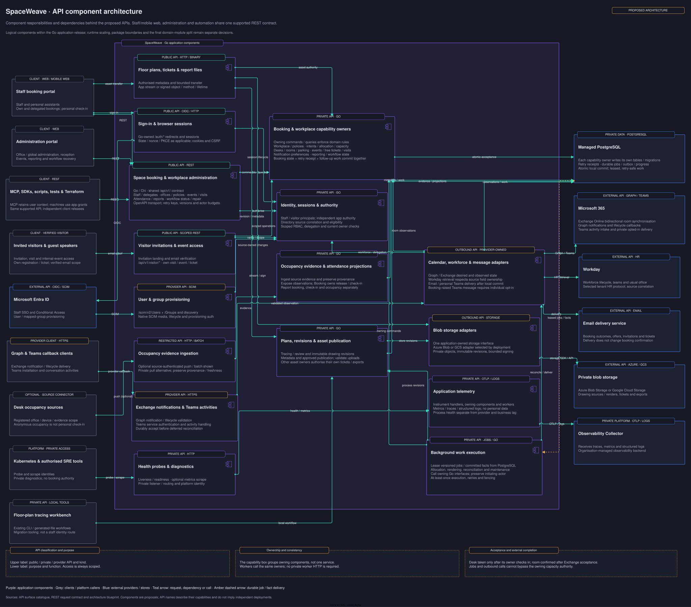

# Architecture diagrams

Two complementary views describe the proposed APIs:

- [API surface map](#proposed-api-surfaces): consumers, contract kinds and access.
- [API component diagram](#api-component-architecture): adapters, application
  responsibilities and dependencies.

## Proposed API surfaces

[View the SVG](api-surfaces.drawio.svg) · [Edit the draw.io source](api-surfaces.drawio)

The diagram maps consumers to SpaceWeave's logical interfaces and their contracts.
It covers the full surface catalogue, including the shared public REST API,
browser identity and visitor access, provisioning, provider callbacks, occupancy
sources, protected assets, private execution and operational interfaces, outbound
integrations and the existing local workbench during migration.

The staff/mobile-web and admin portals, MCP, SDKs, scripts, tests and Terraform
consume the same supported business REST contract. Provider protocols and private
worker contracts retain their own authentication, wire formats and lifecycle.
The layout does not prescribe one listener, network host or domain-module split.
Route examples are proposed, and optional integrations are identified explicitly.

Each surface has two separate labels. The upper badge identifies its API audience
and interface kind, such as **Public API · REST** or **Private API · Go / jobs**.
The lower heading names its purpose, such as **Space booking and workplace
administration**. Provider, source-restricted and outbound contracts retain their
own audience labels and authentication rules.

Purple identifies application surfaces, blue identifies contracts and integration
definitions, and grey identifies consumers. Teal arrows show requests/calls;
amber dashed arrows show generated adapters; grey dotted arrows show native or
private contract bindings. Descriptive surface names correspond to the catalogue
entries.

The SVG contains the editable diagram XML. Both the native source and the SVG
can be opened in draw.io. The SVG was exported from the Docker-hosted editor
and checked visually, including the diagram's dark background and inline icons.

Design sources:

- [API surface catalogue](../research/api-surfaces/README.md#surface-catalogue).
- [Access channels and configurable RBAC](../research/api-surfaces/access-channels-and-rbac.md).
- [REST request contract](../research/api-surfaces/request-behaviour.md).
- [Provider protocols](../research/api-surfaces/provider-contracts.md).

## API component architecture

[View the SVG](api-components.drawio.svg) · [Edit the draw.io source](api-components.drawio)

The component diagram shows the API adapters inside the proposed Go application
release, the capability owners they call, private background execution and outbound
provider adapters. Clients, provider services, managed PostgreSQL, private blob
storage and the observability Collector appear outside the application boundary.
Component symbols identify logical implementation responsibilities; the diagram
does not choose process placement, Kubernetes Deployments or the final domain
module split.

The upper label identifies the API audience and interface kind; the lower label
names its purpose. Staff and administration portals are separate components, while
both portals and automation use the same public REST adapter. Visitor access has
its own verified-email scope. SCIM and provider callbacks retain their native
protocols and authentication.

The booking and workplace capability box groups owning components for readability.
It does not introduce a shared business service, application bus or unrestricted
database facade. HTTP adapters and workers call the relevant owner's Go interface.
The diagram shows principal dependencies: other owners' scoped persistence,
authorisation and instrumentation follow the same documented contracts without
drawing every shared dependency.

PostgreSQL stores owned state, retry receipts and durable jobs/outbox. The amber
dashed connector shows leased job/fact delivery; teal connectors show requests,
calls and dependency use. Workers resume accepted work through owning interfaces.
Outbound provider effects follow local commit, and incoming Exchange observations
return through the owning booking workflow. Optional occupancy push is shown;
private pull is an alternative connector profile, not another staff API.

The local tracing workbench is migration tooling. Its connection to plan processing
does not establish a production authentication path. Private health and telemetry
interfaces remain separate from authorised business repair operations on public
REST.

Both the native file and SVG remain editable in draw.io. The SVG is exported and
visually checked using the Docker-hosted editor.

Component-view sources:

- [API surface catalogue](../research/api-surfaces/README.md#surface-catalogue).
- [Private execution and operations](../research/api-surfaces/README.md#private-interfaces-and-operational-contracts).
- [REST request contract](../research/api-surfaces/request-behaviour.md).
- [Architecture blueprint and proposed module ownership](../architecture-blueprint.md#proposed-module-ownership).
- [Architecture decision analysis](../research/architecture-options-spaceweave.md).
