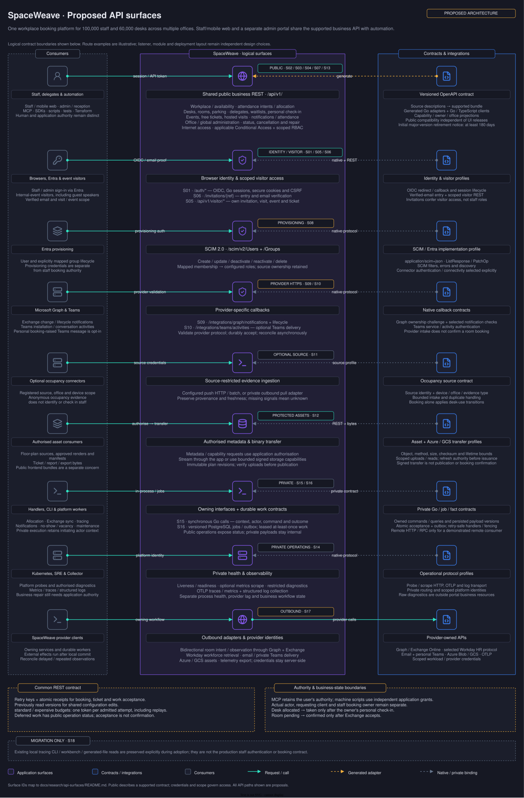

# Architecture diagrams

## Proposed API surfaces

[View the SVG](api-surfaces.drawio.svg) · [Edit the draw.io source](api-surfaces.drawio)

The diagram maps consumers to SpaceWeave's logical interfaces and their contracts.
It covers the full surface catalogue, including the shared public REST API,
browser identity and visitor access, provisioning, provider callbacks, occupancy
sources, protected assets, private execution and operational interfaces, outbound
integrations and the existing local workbench during migration.

The staff/mobile-web and admin portals, MCP, SDKs, scripts, tests and Terraform
consume the same supported business REST contract. Provider protocols and private
worker contracts retain their own authentication, wire formats and lifecycle.
The layout does not prescribe one listener, network host or domain-module split.
Route examples are proposed, and optional integrations are identified explicitly.

Purple identifies application surfaces, blue identifies contracts and integration
definitions, and grey identifies consumers. Teal arrows show requests/calls;
amber dashed arrows show generated adapters; grey dotted arrows show native or
private contract bindings. Surface IDs correspond to the catalogue entries.

The SVG contains the editable diagram XML. Both the native source and the SVG
can be opened in draw.io. The SVG was exported from the Docker-hosted editor
and checked visually, including the diagram's dark background and inline icons.

Design sources:

- [API surface catalogue](../research/api-surfaces/README.md#surface-catalogue).
- [Access channels and configurable RBAC](../research/api-surfaces/access-channels-and-rbac.md).
- [REST request contract](../research/api-surfaces/request-behaviour.md).
- [Provider protocols](../research/api-surfaces/provider-contracts.md).
