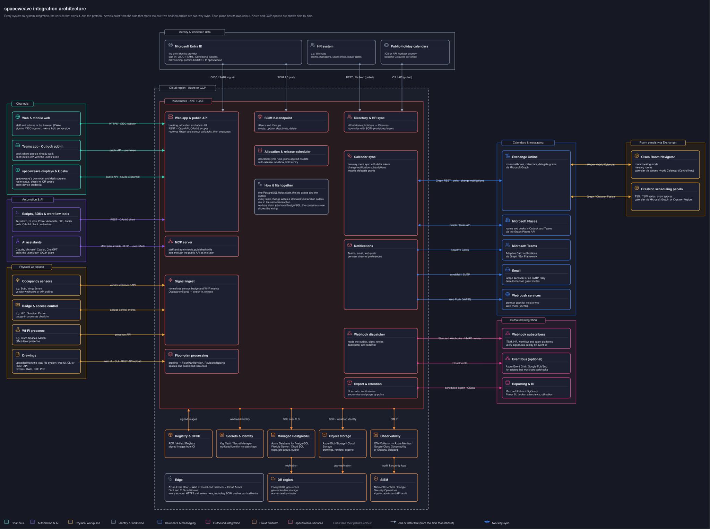
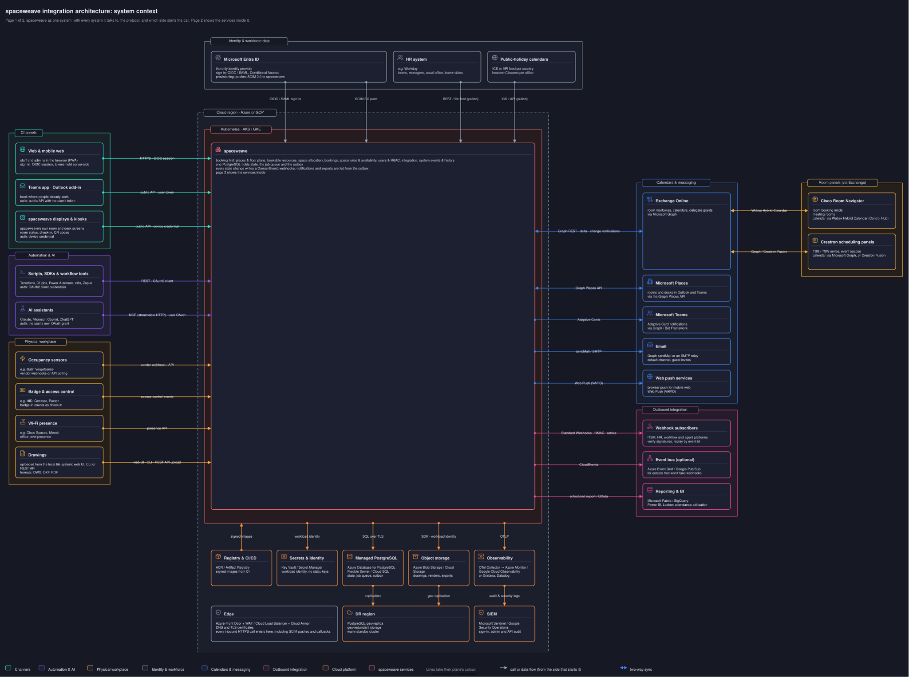
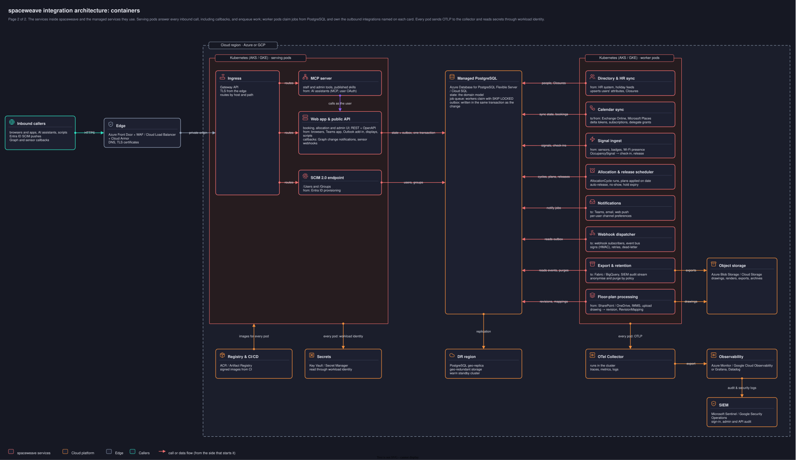

# Integration architecture

Every system-to-system integration spaceweave has, which service owns it, the protocol,
and which side starts the call. Azure and GCP options are shown side by side; the product
deploys to either.

Out of scope: Google Workspace Calendar, Slack, and identity providers other than Microsoft Entra ID.

There are two forms of the same architecture:
- **Single view:** every external system around the Kubernetes services, with the managed
  cloud services below.
- **Two pages:** a system context (spaceweave as one box) and a containers view (the
  services inside it and how they are wired). Both pages are in one editable file,
  [`integration-architecture-2-page.drawio`](diagrams/integration-architecture-2-page.drawio).

## Single view

Source: [`diagrams/integration-architecture.drawio`](diagrams/integration-architecture.drawio)

## Page 1: system context

## Page 2: containers

## Two points of direction

- **SCIM is inbound.** Microsoft Entra ID, the only identity provider, *pushes* users and groups to
  spaceweave's SCIM 2.0 endpoint; spaceweave does not pull. Sign-in (OIDC or SAML) is a
  separate flow from provisioning.
- **AI agents act through MCP and are told through webhooks.** An assistant calls the MCP
  server, which acts as the signed-in user through the public API. Webhooks run the other
  way: spaceweave pushes events out. Agent and workflow platforms (Copilot Studio, Power
  Automate, n8n, Zapier) subscribe to webhooks to trigger a flow, then act back through the
  API or MCP.

## Inventory

### Identity & workforce data

| Integration | Direction | Protocol | Owner | Purpose |
|---|---|---|---|---|
| Microsoft Entra ID sign-in | in | OIDC / SAML, Conditional Access | Web app & API | Staff and admin sign-in; tokens held server-side |
| Microsoft Entra ID provisioning | in (push) | SCIM 2.0 | SCIM endpoint | User and group create, update, deactivate, delete |
| HR system (e.g. Workday) | in (pulled) | REST or file feed | Directory & HR sync | Teams, managers, usual office, leaver dates, which Entra often lacks |
| Public-holiday calendars | in (pulled) | ICS or API | Directory & HR sync | Closures per country and office |

### Calendars & messaging

| Integration | Direction | Protocol | Owner | Purpose |
|---|---|---|---|---|
| Exchange Online room mailboxes and calendars | two-way | Microsoft Graph REST, delta queries, change notifications | Calendar sync | Room booking sync; delegate grants feed `Delegation` |
| Microsoft Places | two-way | Graph Places API | Calendar sync | Rooms and desks known to Outlook and Teams |
| Microsoft Teams | out | Graph / Bot Framework, Adaptive Cards | Notifications | Booking raised, waitlist offer, no-show warning |
| Email | out | Graph sendMail or an SMTP relay | Notifications | Default channel, guest invites |
| Web push | out | Web Push (VAPID) | Notifications | Mobile-web nudges, such as a check-in reminder |

### Channels and automation

| Integration | Direction | Protocol | Owner | Purpose |
|---|---|---|---|---|
| Web and mobile web | in | HTTPS, OIDC session | Web app & API | Staff and admin UI |
| Teams app, Outlook add-in | in | App manifests calling the public API with the user's token | Web app & API | Book where people already work |
| Room displays and kiosks | in | Public API, device credential | Web app & API | Room status, check-in, QR codes |
| Scripts, SDKs, Terraform, workflow tools | in | REST + OpenAPI, OAuth2 client credentials | Web app & API | Automation and infrastructure as code |
| AI assistants (Claude, Microsoft Copilot, ChatGPT) | in | MCP over streamable HTTP, the user's OAuth grant | MCP server | Assistant booking and admin, with published skills |

### Outbound integration

| Integration | Direction | Protocol | Owner | Purpose |
|---|---|---|---|---|
| Webhook subscribers | out | Standard Webhooks (HMAC signatures), retries, dead-letter | Webhook dispatcher | ITSM, HR, workflow and agent platforms react to bookings, check-ins, allocations |
| Event bus (optional) | out | CloudEvents to Azure Event Grid / Google Pub/Sub | Webhook dispatcher | Estates whose integration bus won't take webhooks |
| Reporting & BI | out | Scheduled export to Microsoft Fabric / BigQuery, or an OData feed | Export & retention | Attendance and utilisation in Power BI or Looker |

### Physical workplace

| Integration | Direction | Protocol | Owner | Purpose |
|---|---|---|---|---|
| Occupancy sensors (e.g. Butlr, VergeSense) | in | Vendor webhooks or API polling | Signal ingest | Vacancy evidence for release |
| Badge and access control (e.g. HID, Genetec, Paxton) | in | Vendor events | Signal ingest | Badge-in counts as check-in |
| Wi-Fi presence (e.g. Cisco Spaces, Meraki) | in | Vendor API | Signal ingest | Office-level presence |
| Drawing sources | in | Graph files (SharePoint, OneDrive), IWMS API (Planon, Archibus), upload | Floor-plan processing | Where the DWG, DXF or PDF actually lives |

Sensors are optional. Check-in works without them.

### Cloud platform

| Component | Azure | GCP | Used for |
|---|---|---|---|
| Hosting | AKS | GKE | Serving pods (web app & API, MCP, SCIM) and worker pods |
| Edge | Front Door + WAF | Cloud Load Balancer + Cloud Armor | Every inbound HTTPS call, including SCIM pushes and callbacks; DNS and TLS |
| Database | Azure Database for PostgreSQL Flexible Server | Cloud SQL for PostgreSQL | State, job queue, outbox |
| Object storage | Blob Storage | Cloud Storage | Drawings, renders, exports, archives |
| Secrets | Key Vault | Secret Manager | Graph app credentials, webhook signing secrets; read through workload identity, no static keys |
| Registry | Azure Container Registry | Artifact Registry | Signed images from CI |
| Observability | Azure Monitor | Google Cloud Observability | OTLP from every pod through an in-cluster OpenTelemetry Collector; Grafana or Datadog also work |
| SIEM | Microsoft Sentinel | Google Security Operations | Sign-in, admin and API audit |
| Disaster recovery | Geo-replica, geo-redundant storage | Cross-region replica, dual-region storage | Warm standby in a second region |

## How the services fit together

- **Serving pods answer every inbound call,** including Graph change notifications and sensor
  webhooks. They validate the call, write state, and enqueue work.
- **One PostgreSQL holds state, the job queue and the outbox.** Every state change writes a
  `DomainEvent` and an outbox row in the same transaction, so a webhook, notification or
  export is never sent for a change that rolled back, and never lost for one that committed.
- **Worker pods claim jobs from PostgreSQL** (`SKIP LOCKED`) and own the outbound
  integrations: calendar sync, notifications, webhook dispatch, exports, signal processing,
  floor-plan processing and the allocation scheduler.
- **No message broker is needed** at this scale. The optional event bus is an outbound
  integration for customers, not internal plumbing.
