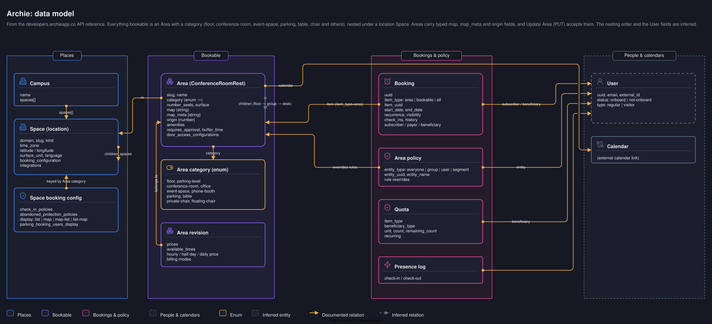

# Archie (archieapp.co)

Researched and validated 2026-11-25. Each bracketed number links to the Sources list in §18.

**Identity check.** This is Archie, the workspace platform at archieapp.co, operated by 9338-9666 Québec inc. in Verdun (Montréal), Québec, Canada [[1]](#s1). It covers desk booking, room booking, visitor management and coworking [[2]](#s2). **Name ambiguity:** several unrelated products are also called "Archie". Third-party listings show an AI back-office assistant from Arcanum AI (NZ) and "Archie AI" from archielabs.com, a software-planning tool (third-party) [[3]](#s3). Keep searches and comparisons to "archieapp" or "Archie App". The GitHub account `archieApp` was created 2026-03-30, has 0 public repos and no profile name or blog link to the vendor, so it is not treated as official [[4]](#s4).

## 1. Snapshot
- **Positioning:** "the most complete space management software" for hybrid offices, enterprises and coworking operators [[2]](#s2). Claims 1,000+ organisations [[5]](#s5).
- **Segments:** workplace (desks, rooms, visitors) and coworking (adds billing and community features). The API's `spaces.Kind` enum is `flexible-office | coworking` [[6]](#s6).
- **HQ:** Verdun, Québec, Canada [[1]](#s1).
- **Desk-booking pricing (as of 2026-11-25):**
  - Starter: from $159/month, 1 location [[5]](#s5).
  - Pro: from $249/month, multiple locations, Teams/Outlook, Slack, SSO & SCIM [[5]](#s5).
  - Enterprise: custom; adds custom data residency and premium API support [[5]](#s5). The comparison table also lists "Custom HRIS integration" and "Custom cloud hosting location" for Enterprise [[5]](#s5).
- **Other products' pricing (as of 2026-11-25)** [[5]](#s5):
  - Room booking: Starter from $159/month, Pro from $249/month.
  - Visitor management: Starter $109 and Pro $185 per location/month.
  - Coworking: Starter $192/month billed monthly or $165/month billed yearly (1 location, 100 active users); Pro $299/month billed monthly or $257/month billed yearly (2 locations, 200 active users).
  - Enterprise is custom-priced for every product.
- **Licensing unit:** priced per resource (desk/room/visitor), not per user. Desk/Rooms/Visitors plans include unlimited users [[5]](#s5)[[5]](#s5). Coworking plans count active bookers [[5]](#s5). Workplace plans are billed yearly [[5]](#s5). Products can be bought separately [[5]](#s5).
- **Which tier unlocks what:**
  - SSO & SCIM: Pro and above; not on Starter [[5]](#s5)[[5]](#s5).
  - API access + Webhooks: not included on Starter, a paid add-on on Pro, and "Custom" on Enterprise [[5]](#s5). "Premium API support" is Enterprise-only [[5]](#s5). On the Coworking plans, "API access + Webhooks" is listed as an Enterprise key feature [[5]](#s5).
- **Free tier:** none. A 14-day test environment is offered after a demo [[5]](#s5).

## 2. Space kinds
Every bookable thing is an **Area**. The API exposes areas under the legacy path `/conferenceRooms` [[7]](#s7). An area's `category` is one of: `floor, parking-level, conference-room, office, event-space, phone-booth, parking, table, private-chair, floating-chair, resource, resource-group, tour` [[6]](#s6).

| Kind | Marketing / docs | API representation |
|---|---|---|
| Desks (hot / assigned / neighbourhoods) | Desk groups are hot or dedicated, with individual desks inside (possibly stale, page dated 2025) [[8]](#s8). Also neighbourhoods, priority booking, hoteling, part-time and assigned desks [[9]](#s9). | Desk group = `table`. Individual seats = `private-chair` / `floating-chair` (mapping INFERRED from the enum plus the desk-group docs). |
| Meeting rooms | Rooms, phone booths, event spaces [[10]](#s10) | `conference-room`, `phone-booth`, `event-space` [[6]](#s6) |
| Private offices | (possibly stale, page dated 2025) [[8]](#s8) | `office` |
| Car parking | Assigned or bookable spots [[11]](#s11)[[10]](#s10) | `parking`, `parking-level` [[6]](#s6). The space's `booking_configuration` has `parking_booking_users_display` [[6]](#s6). |
| Event spaces | Booking dependencies with sub-rooms (possibly stale, page dated 2024) [[12]](#s12) | `event-space`, `area_booking_dependencies` [[6]](#s6) |
| Lockers / equipment | Lockers and equipment listed on the coworking page [[11]](#s11) | No dedicated enum. Presumably `resource` / `resource-group` (INFERRED). |
| Floors | Floors are created first (possibly stale, page dated 2025) [[8]](#s8) | `floor` is itself an area category; children endpoints form the hierarchy [[6]](#s6)[[7]](#s7) |

**Rules, quotas and capacity:**
- **Booking rules on each area:** min/max booking hours, interval, minimum notice, max book-ahead, cancellation, full-hour-only, and hourly/half-day/daily modes [[6]](#s6).
- **Overrides:** per-entity policies can override those rules for everyone, a group, a user or a segment [[6]](#s6).
- **Quotas:** a separate resource with item types and user/group beneficiaries [[13]](#s13).
- **Check-in and no-show:** check-in and abandoned-protection (no-show) policies are keyed by category in the space's booking configuration [[6]](#s6). The help centre describes both (possibly stale, page dated 2025) [[14]](#s14)[[14]](#s14).
- **Capacity:** stored as `number_seats` [[6]](#s6).

## 3. Features
- **Rules:**
  - One item per category at a time (possibly stale, page dated 2025) [[14]](#s14).
  - Booking dependencies (possibly stale, page dated 2024) [[12]](#s12).
  - Approval: `requires_approval` field [[6]](#s6) and an Approve Bookings endpoint [[7]](#s7).
- **Check-in:**
  - QR codes or physical-only check-in (possibly stale, page dated 2025) [[14]](#s14).
  - Auto check-in by IP address through a laptop agent, Enterprise only [[15]](#s15).
  - Wi-Fi check-in via IronWifi [[16]](#s16).
  - Door-access check-ins [[16]](#s16).
- **Analytics:** Conference rooms, Desks and Office Activity dashboards, plus a separate Reports section with CSV downloads (possibly stale, page dated 2024) [[17]](#s17). The Insights Hub adds presence rate and scheduled reports [[18]](#s18).
- **Visitor management:** host alerts, badge printing, e-signature [[19]](#s19). Evacuation reports (possibly stale, page dated 2025) [[20]](#s20)[[7]](#s7).
- **Mobile and devices:** iOS/Android apps [[5]](#s5). A Rooms tablet app [[21]](#s21). A kiosk web app (possibly stale, page dated 2024) [[22]](#s22).
- **Teams / Slack:** Teams bot plus booking with the floor plan (possibly stale, page dated 2024) [[23]](#s23). Slack notifications [[24]](#s24).

## 4. Floor-plan pipeline
- **Authoring:** the admin uploads one raster image per floor, enters the image width and height, then drags inventory items onto it and resizes them by the corners (possibly stale, page dated 2025) [[8]](#s8).
- **Formats:** the vendor blog says "usually a PNG or JPEG" [[25]](#s25).
- **Not publicly documented** (searched the help centre, developer portal, pricing and blog):
  - CAD, DWG, DXF, PDF or SVG import.
  - Automatic detection of desks or rooms.
  - IMDF, IndoorGML or IFC support.
- **Geometry via the API:** each Area carries `map` (string), `map_meta` (an object of string values) and `origin` (an object of number values) [[6]](#s6)[[26]](#s26). The keys inside `map_meta` and `origin` are undocumented. The likely reading (INFERRED) is that `map` is the image URL and `map_meta`/`origin` hold placement.
- **Write path:** there is no dedicated map-upload endpoint. However, Update Area (`PUT /spaces/{spaceDomain}/conferenceRooms/{areaUUIDOrSlug}`) takes `types.ConferenceRoomRest` as its body, which includes `map`, `map_meta` and `origin` [[26]](#s26). Writing placement through the API therefore looks possible, but it is untested.

## 5. Calendar & directory sync
- **Microsoft 365:** an admin OAuth sign-in, then one resource calendar linked per inventory item. Desks need one calendar each [[27]](#s27). Resource changes take up to 48 h to appear [[27]](#s27).
- **Google Workspace:** the same model, with a "Let Google send bookings update" option and 24 h propagation (possibly stale, page dated 2024) [[28]](#s28).
- **Sync direction:**
  - Marketing pages claim real-time two-way sync [[16]](#s16)[[29]](#s29).
  - The help articles describe linking resource calendars, plus the optional Google inbound-update toggle [[27]](#s27)[[28]](#s28).
  - `bookings.deleted` fires when an event is removed from a synced calendar [[7]](#s7), so inbound sync exists.
  - Bookings record their calendar origin: `subscriber_type` accepts `google | office-365` [[30]](#s30), and booking history has a `calendar` source [[30]](#s30).
- **Latency:** Not publicly documented beyond the resource-propagation notes.
- **Provisioning:** SCIM 2.0 at `https://archieapp.co/scim/v2` for users and groups, with guides for Entra and Okta [[31]](#s31) (Okta guide possibly stale, page dated 2025) [[32]](#s32). No HRIS connector is documented. Enterprise lists "Custom HRIS integration" [[5]](#s5).

## 6. IoT, sensors & hardware
- **Occupancy sensors:** Not publicly documented. "sensor" does not appear in the API index or on the integrations page. Presence comes from QR codes, IP, Wi-Fi and door access instead [[15]](#s15)[[16]](#s16)[[16]](#s16).
- **Access control:** Kisi, Salto, Tapkey, Brivo, Welcomr, DoorFlow, UniFi and custom integrations [[16]](#s16). The API has a door-access provider enum, which does not include Tapkey [[6]](#s6).
- **Devices:** kiosk web app (possibly stale, page dated 2024) [[22]](#s22), Rooms tablet display [[21]](#s21). No dedicated hardware is required [[5]](#s5).

## 7. Hosting & data
- **Model:** an on-prem offering is Not publicly documented.
- **Infrastructure:** databases on Google Cloud, application servers in Canada, global CDN for static assets [[33]](#s33).
- **Subprocessors:** Google Cloud (CA), Google LLC/Google Workspace (CA), Google Analytics (US), Cloudflare (US), Intercom (US), HubSpot (US), Stripe (US), MongoDB (CA), OneSignal (US), PandaDoc (US) and Twilio SendGrid (US), with a 10-business-day objection window [[34]](#s34).
- **Data residency:** custom residency is an Enterprise option [[5]](#s5). Backups every 6 h, retained 1 year; 99.9% availability target [[33]](#s33).

## 8. Compliance & privacy
- **Certifications:** claims SOC 2 Type II and GDPR [[33]](#s33). A downloadable report or trust portal is Not publicly documented.
- **ISO 27001:** Not publicly documented for Archie itself. The DPA attributes SOC 2 Type II and EN ISO 27001 compliance to the *infrastructure provider* [[35]](#s35).
- **DPA and transfers:** a DPA is published; EU transfers rely on the adequacy decision for Canada; data is returned or deleted within 90 days of termination [[35]](#s35). Public subprocessor list with 10-business-day objection [[34]](#s34).
- **Data processed:** the DPA explicitly lists check-in/check-out events, attendance status, floor-plan selections and access logs [[35]](#s35). Staff access is least-privilege and reviewed quarterly [[35]](#s35).
- **Employee location data:** the IP presence feature collects public IPs (and optionally MAC addresses) every 5 minutes [[15]](#s15). A specific stance on employee-location data is Not publicly documented.
- **Audit logs:** customer-facing audit log: Not publicly documented. Only webhook delivery logs are described (possibly stale, page dated 2025) [[36]](#s36).

## 9. Authentication
- **End-user SSO:** SAML 2.0 only (ACS `https://archieapp.co/saml/acs`) (possibly stale, page dated 2025) [[37]](#s37). Guides exist for Entra/Azure AD, Google Workspace, Okta, OneLogin and Shibboleth [[38]](#s38). OIDC: Not publicly documented.
- **SCIM:** v2, bearer token generated in Archie [[31]](#s31).
- **API auth:**
  - A Client Application in the space's Developer Portal issues a client ID and secret (possibly stale, page dated 2025) [[39]](#s39).
  - `POST /authenticate` with JSON `{client_id, client_secret}` returns `access_token`, `expires_in` and `refresh_token`. The OpenAPI security scheme is `http bearer`, not an `oauth2` type [[40]](#s40).
  - Bearer header with per-operation scopes `resource:read|write` [[41]](#s41)[[7]](#s7).
- **Zapier:** uses a separate API token (possibly stale, page dated 2024) [[42]](#s42).

## 10. REST API
- **Docs:** https://developers.archieapp.co (ReadMe), including `llms.txt` (possibly stale, page dated 2025) [[39]](#s39).
- **Base URL:** `https://api.archieapp.co/v1/` (possibly stale, page dated 2025) [[39]](#s39). Paths are `/spaces/{spaceDomain}/...` [[7]](#s7).
- **OpenAPI:** each reference page embeds an OpenAPI 3.1.0 fragment (API version v1.0) [[40]](#s40). No single downloadable spec was found.
- **Resources:** about 60 groups, including Areas, Bookings, Check-ins, PresenceLogs, Quotas, Users, Groups, Visits, Campuses, Evacuations and DoorAccessConfigurations, plus billing (Invoices, Payments, Plans) [[7]](#s7)[[7]](#s7)[[7]](#s7).
- **Pagination:** cursor-based (`limit` plus `startAfter` = next token). Responses carry `has_more`, `next_token` and `total_count` [[41]](#s41). The default page size is 40 [[7]](#s7).
- **Rate limit:** 100 requests per 10 s, then the IP is blocked for 1 minute with 429 (possibly stale, page dated 2025) [[39]](#s39).
- **Errors:** the errors guide shows an `error{message_code,message,type}` envelope plus `request_uuid` (possibly stale, page dated 2025) [[43]](#s43).
- **Versioning:** a `/v1` path. A deprecation policy is Not publicly documented.

## 11. Events & real-time
- **Event types:** `users`, `groups`, `bookings`, `subscriptions`, `check-ins`, `issue-tickets` and `presence-logs`, each with `.created/.updated/.deleted` (21 events) [[7]](#s7). Launched February 2024 (possibly stale, page dated 2025) [[36]](#s36).
- **Payload:** a JSON array of envelopes `{id, event, attempts, target_url, event_type, data}` [[30]](#s30). `data` is AES-GCM encrypted with the webhook secret (possibly stale, page dated 2025) [[36]](#s36).
- **Signing:**
  - Base64 HMAC-SHA256 over secret + URL + body + timestamp, sent in `X-Archie-Signature` and `X-Archie-Request-Timestamp` (possibly stale, page dated 2025) [[36]](#s36)[[44]](#s44).
  - **Doc inconsistency:** the replay window is 5 minutes in the reference [[36]](#s36) but 2 minutes in the Go recipe [[44]](#s44).
- **Batching:** up to 30 events every 5 s by default, configurable in the developer portal (possibly stale, page dated 2025) [[36]](#s36).
- **Retries:** 5 attempts with backoff 0/60/600/6000/60000 s (possibly stale, page dated 2025) [[36]](#s36). Statuses are in-flight, delivered, failed and not-sent; only HTTP 200 counts as delivered (possibly stale, page dated 2025) [[36]](#s36).
- **Gaps:** no webhooks for areas, floors or visits; no streaming API documented [[7]](#s7).

## 12. Data model (documented)

Source: [`diagrams/archie.drawio`](diagrams/archie.drawio). The SVG embeds the diagram, so it also opens in draw.io for editing.

| Entity | Key fields | Relations | Source |
|---|---|---|---|
| Space (location) | domain, slug, kind, time_zone, latitude/longitude, surface_unit, language, booking_configuration, integrations | children_spaces → Space; campus → Campus | [[6]](#s6)[[6]](#s6)[[6]](#s6) |
| Campus | name | spaces → Space[] | [[7]](#s7)[[6]](#s6) |
| Area (`ConferenceRoomRest`) | slug, name, category, number_seats, surface, map (string), map_meta (object of strings), origin (object of numbers), amenities, requires_approval, buffer_time, booking-rule fields, door_access_configurations | children via the children endpoints, not a schema field (Area hierarchy: floor → room/desk group → desk; nesting order INFERRED); area_booking_dependencies → Area[]; calendar → Calendar | [[6]](#s6)[[7]](#s7)[[6]](#s6)[[6]](#s6)[[6]](#s6)[[6]](#s6)[[26]](#s26) |
| Area revision | prices, available_times, hourly/half-day/daily price and billing modes | belongs to Area | [[7]](#s7) |
| Area policy | entity_type (everyone/group/user/segment), entity_uuid, entity_name, rule overrides | entity → User/Group/Segment | [[6]](#s6) |
| Booking | uuid, item_type (`area \| bookable \| all`), item_uuid, start_date, end_date, recurrence, visibility, check_ins, history, subscriber/payer/beneficiary types | item → Area or bookable resource, discriminated by item_type; subscriber → User/Group/calendar | [[30]](#s30)[[30]](#s30)[[30]](#s30)[[30]](#s30) |
| Quota | item_type, beneficiary_type, unit, count, remaining_count, recurring | beneficiary → User/Group | [[13]](#s13) |
| Presence log | check-in/out | → User | [[7]](#s7) |
| User (INFERRED) | uuid, email, external_id, status (`onboard \| not-onboard`), type (regular/visitor). Field list INFERRED: no ledger claim covers it; only the SSO External ID attribute is sourced [[37]](#s37). | groups (INFERRED; not in the UserRest schema) | [[37]](#s37) |
| Space booking config | check_in_policies, abandoned_protection_policies, per-kind display (`list, map, map-list, list-map`), parking_booking_users_display | keyed by Area category | [[6]](#s6)[[6]](#s6) |

## 13. SDKs & ecosystem
- **Official SDKs and GitHub org:** none found. The `archieApp` GitHub account has no public repos and no link to the vendor [[4]](#s4).
- **Community:** `zacharytyhacz/archie-api-ts`, an unofficial TypeScript SDK that warns of "misleading response types" in the docs [[45]](#s45).
- **Zapier:** integration via an API token (possibly stale, page dated 2024) [[42]](#s42). A public Zapier app page is Not publicly documented.
- **Microsoft AppSource:** the Teams help article links an official AppSource listing (https://appsource.microsoft.com/en-us/product/office/wa200006189) [[23]](#s23).
- **Power Automate / Make:** Not publicly documented.

## 14. Developer experience
- **Sandbox:** none separate. The 14-day trial space is the only test path [[5]](#s5).
- **Credentials:** self-serve from the Developer Portal, which shows webhook delivery logs (possibly stale, page dated 2025) [[39]](#s39)[[36]](#s36). API access is not included on Starter and is a paid add-on on Pro [[5]](#s5).
- **Postman, changelog, deprecation policy:** Not publicly documented.
- **Status page:** archie.instatus.com, linked from the archieapp.co footer [[46]](#s46).
- **Docs quality:**
  - Many endpoints, with typed enums [[6]](#s6)[[40]](#s40).
  - Typos ("GSM" for GCM [[36]](#s36); contact email `dev@archiapp.co` [[40]](#s40)).
  - The 5 vs 2 minute replay window conflict above [[36]](#s36)[[44]](#s44).
  - The errors guide shows `message_code/type`, but the OpenAPI fragments model errors as `sdkerr.HTTPErrorBody{error{message,template_key,params,errors[]},message,request_uuid}` [[43]](#s43).
  - The language enum on the `bookings.created` page has only 5 values, while the UI lists 7 [[6]](#s6).
  - The legacy `conferenceRooms` naming [[7]](#s7).
  - The community SDK reports inaccurate response types [[45]](#s45).

## 15. AI & agents
- **AI scheduling, MCP server, Copilot agent:** Not publicly documented.
- **LLM-facing surface:** only the docs' `llms.txt` index (possibly stale, page dated 2025) [[39]](#s39).

## 16. Accessibility & i18n
- **Languages:** UI in 7 languages: fr, en, de, es, pt, tr, he [[6]](#s6). Hebrew implies RTL support (INFERRED).
- **Time zones:** each space has its own `time_zone` [[6]](#s6).
- **Accessibility:** WCAG / VPAT is Not publicly documented.

## 17. Relevance to spaceweave (analysis)
- **Floor-plan ingestion is Archie's weak point.**
  - Maps are a raster image plus manually placed rectangles [[8]](#s8)[[25]](#s25). There is no documented CAD/PDF import and no auto-detection.
  - Admins must enter the image width and height and keep them fixed to avoid breaking placements [[8]](#s8).
  - A DWG/PDF → structured model pipeline is a clear differentiator here. A natural integration target would be exporting a PNG plus a placement list to Archie. Update Area accepts `map`, `map_meta` and `origin` [[26]](#s26), so pushing placement through the API may be possible without vendor cooperation. It is untested, and the keys inside `map_meta`/`origin` are undocumented, so a trial against a test space comes first.
- **Treat Area as a hierarchical, polymorphic resource** with a `category` enum. Archie models floors, parking levels, desk groups and individual chairs all as Areas linked by parent/child endpoints [[6]](#s6)[[7]](#s7).
  - spaceweave could adopt a similar single-node-type tree.
  - It should give geometry documented keys. Archie types `map_meta` and `origin` only as string and number maps with undocumented keys [[26]](#s26).
- **Split desk group from seat.** The `table` → `private-chair`/`floating-chair` split (INFERRED) cleanly separates the physical cluster from the bookable seat and the hot-vs-assigned decision. It is worth mirroring.
- **Keep rules off the geometry.** Booking rules live on the Area, with per-audience override policies [[6]](#s6)[[6]](#s6). Check-in and no-show policies are per category at the space level [[6]](#s6).
- **Parking and lockers are first-class categories** [[6]](#s6)[[11]](#s11). spaceweave's space-kind enum should cover parking levels and bays from the start.
- **Webhook design** (batched, signed, encrypted payload, logged retries) is a reasonable reference [[36]](#s36)–[[36]](#s36). It needs one documented replay window, and the model lacks area/map change events [[7]](#s7).

## 18. Sources

All accessed 2026-11-25.

1. https://archieapp.co/agreements-and-terms/privacy-policy (official-docs)
2. https://archieapp.co/ (official-docs)
3. https://www.sourceforge.net/software/compare/Archie-vs-Archie-AI (review)
4. https://api.github.com/users/archieApp (official-docs)
5. https://archieapp.co/pricing (official-docs)
6. https://developers.archieapp.co/reference/get_spaces-spacedomain-conferencerooms-areauuidorslug.md (api-ref)
7. https://developers.archieapp.co/llms.txt (api-ref)
8. https://help.archieapp.co/desk-and-rooms/en/articles/9222891-configuring-your-workspace (official-docs)
9. https://archieapp.co/desk-booking-software (official-docs)
10. https://archieapp.co/meeting-room-booking-software (official-docs)
11. https://archieapp.co/coworking-software/booking-system (official-docs)
12. https://help.archieapp.co/desk-and-rooms/en/articles/10149305-setting-booking-dependency-with-your-elements (official-docs)
13. https://developers.archieapp.co/reference/get_spaces-spacedomain-quotas.md (api-ref)
14. https://help.archieapp.co/desk-and-rooms/en/articles/9232503-setting-up-your-booking-policies (official-docs)
15. https://help.archieapp.co/desk-and-rooms/en/articles/18338076-configuring-ip-check-in-for-employee-presence (official-docs)
16. https://archieapp.co/integrations (official-docs)
17. https://help.archieapp.co/desk-and-rooms/en/articles/9222971-understanding-the-reports-and-analytics (official-docs)
18. https://archieapp.co/solutions/occupancy-analytics (official-docs)
19. https://archieapp.co/visitor-management-system (official-docs)
20. https://help.archieapp.co/desk-and-rooms/en/articles/10594007-evacuation-reports (official-docs)
21. https://help.archieapp.co/desk-and-rooms/en/articles/9243657-configuring-your-rooms-app (official-docs)
22. https://help.archieapp.co/desk-and-rooms/en/articles/9265979-configuring-your-kiosk-app (official-docs)
23. https://help.archieapp.co/desk-and-rooms/en/articles/10120009-integrating-microsoft-teams-with-archie (official-docs)
24. https://help.archieapp.co/desk-and-rooms/en/articles/10139617-integrating-slack-with-archie (official-docs)
25. https://archieapp.co/blog/interactive-office-floor-plans/ (blog)
26. https://developers.archieapp.co/reference/put_spaces-spacedomain-conferencerooms-areauuidorslug.md (official-docs)
27. https://help.archieapp.co/desk-and-rooms/en/articles/10119954-integrating-your-microsoft-365-account-with-archie (official-docs)
28. https://help.archieapp.co/desk-and-rooms/en/articles/10119861-integrating-your-google-workspace-account-with-archie (official-docs)
29. https://archieapp.co/solutions/microsoft (official-docs)
30. https://developers.archieapp.co/reference/post_bookings-created.md (api-ref)
31. https://help.archieapp.co/desk-and-rooms/en/articles/10644311-scim-with-azure (official-docs)
32. https://help.archieapp.co/desk-and-rooms/en/articles/10644326-scim-configuration-for-okta (official-docs)
33. https://archieapp.co/security (official-docs)
34. https://archieapp.co/agreements-and-terms/sub-processors (official-docs)
35. https://archieapp.co/agreements-and-terms/data-processing-addendum (official-docs)
36. https://developers.archieapp.co/reference/webhooks.md (api-ref)
37. https://help.archieapp.co/desk-and-rooms/en/articles/11608816-integrating-your-sso-okta-account-with-archie (official-docs)
38. https://help.archieapp.co/desk-and-rooms/en/collections/10672281-integrations (official-docs)
39. https://developers.archieapp.co/reference/getting-started.md (api-ref)
40. https://developers.archieapp.co/reference/post_authenticate.md (api-ref)
41. https://developers.archieapp.co/reference/get_spaces-spacedomain-bookings.md (api-ref)
42. https://help.archieapp.co/desk-and-rooms/en/articles/10126542-integrating-zapier-with-archie (official-docs)
43. https://developers.archieapp.co/reference/errors.md (api-ref)
44. https://developers.archieapp.co/recipes/webhook-endpoint.md (api-ref)
45. https://github.com/zacharytyhacz/archie-api-ts (github)
46. https://archie.instatus.com/ (official-docs)

## Validation

98 ACCEPT, 2 REVISE (C7, C90), 0 ledger REJECT, 4 NEW (N1–N4); 12 unsourced or wrong draft statements fixed. API + Webhooks gating is now stated as fact: not on Starter, paid add-on on Pro, Custom on Enterprise [C7]. The full subprocessor list replaces the short one [C90]. Rooms, Visitors and Coworking prices were added in place of the wrong "no prices" line [N1]. `map_meta`/`origin` are now described as typed (string/number maps) rather than untyped. The claims of no map write path in §4 and §17 were revised: Update Area (PUT) accepts map/map_meta/origin (untested) [N4]. The Booking item relation is now item_type-discriminated (area | bookable | all) [N3]. The User row and its groups relation are marked INFERRED (no ledger claim; groups is not in UserRest). Area children are now described as via endpoints. Dropped: the "Archie CRM" iPad mention, the Zapier 404 and AppSource 403 notes (replaced by the official AppSource link from the Teams article), the G2 AI-taxonomy remark, and the absence claims for on-prem and trust portal (now "Not publicly documented"). Other corrections: the API auth wording (POST /authenticate, http bearer scheme), parking_booking_users_display moved to booking_configuration, the ISO 27001 nuance (it applies to the infrastructure provider only), and the error-schema and language-enum doc inconsistencies were added. Flags: 26 claims are STALE (developer-portal pages updated 2025-09-08; help articles dated 2024–2025) and are marked inline; C97 is marked third-party. Claim ids (C#/N#) refer to the evidence ledger and validation report in `evidence/`.
