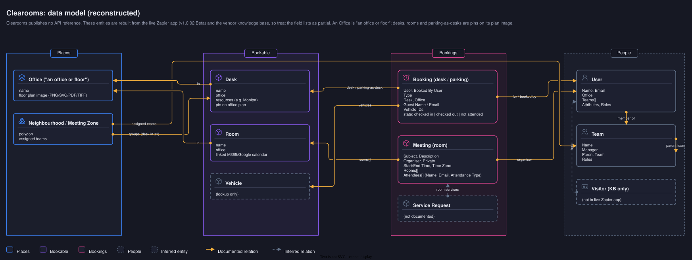

# Clearooms: vendor profile

Researched and validated 2026-11-25. Each bracketed number links to the Sources list in §18.

Almost no KB page carries an article date (the footer reads © 2025), so release-note entries are the main dated evidence. Several facts below come from the vendor's AI fact sheet (clearooms.com/ai-info, dated 3 Nov 2026). That page is official but is the vendor's self-description, so those claims are marked "vendor states".

**Headline:** Clearooms is a UK SMB/mid-market desk, room and parking booking tool, priced per bookable space. It claims an "open API" with full portal parity [[1]](#s1)[[2]](#s2), which it calls "REST-based, fully documented and available on every plan" [[1]](#s1). **The API reference itself is still not public.** The docs link sits inside the authenticated portal [[2]](#s2)[[3]](#s3). For integrations generally, the vendor says to "contact us to request access to additional documentation" [[4]](#s4). The vendor's G-Cloud 15 listing adds that the API docs are in OpenAPI (Swagger) format, that a sandbox exists, and that rate limiting applies [[5]](#s5). Everything below about the API's resources, fields and events comes from the Zapier integration, not from an API reference. Two Zapier sources disagree: the vendor's KB Zapier guide and the live zapier.com app. Each Zapier-derived item says which one it comes from.

## 1. Snapshot
- **Positioning:** "Desk and meeting room booking made easy, fast & affordable." The company is UK-based [[6]](#s6). It was founded in Huddersfield by Tony Gibson and Alex Wight [[7]](#s7).
- **Company:** the vendor states it is Clearooms Limited (Company No. 12855479), founded in 2020, with HQ in Huddersfield [[8]](#s8). Headcount is not publicly documented.
- **Segment:** SMB to mid-market. The vendor states it serves 500+ organisations across 35 countries [[8]](#s8). The SMB/mid-market label is my reading of the price bands, which top out at 500 desks before "Enterprise" [[9]](#s9).
- **Pricing** (GBP, clearooms.com/pricing, fetched 2026-11-25):
  - **Licensing unit:** per managed space, not per user [[9]](#s9). Users are unlimited [[10]](#s10).
  - **Desks:** banded flat fees, from £60/month annual or £66/month monthly for 1-19 desks, up to £1,050 or £1,155 for 400-499 desks. 500+ is Enterprise [[9]](#s9)[[9]](#s9).
  - **Meeting rooms:** priced per room per month, from £10-11 down to £6-7 [[9]](#s9).
  - **Parking:** same bands as desks, with Enterprise at 400+ [[9]](#s9).
  - **Billing:** annual billing saves about 10%. Billing is rolling monthly with no minimum term [[9]](#s9).
- **Feature gating:** none by tier. Calendar integration, Teams, SSO, SCIM, visitor management and the mobile apps are on every plan, "not paid add-ons" [[9]](#s9)[[11]](#s11)[[11]](#s11). API access is also on every plan [[1]](#s1).
- **Free tier:** none documented. There is a 30-day full-product trial [[9]](#s9).

## 2. Space kinds

| Kind | How it is represented | Rules / quotas | Check-in | Source |
|---|---|---|---|---|
| Hot desk | Desk pin placed on an office floor plan [[12]](#s12)[[13]](#s13) | Daily per-office usage cap with team/role/user exceptions [[14]](#s14). Rule catalogue includes half-day, repeat, max bookings in period, buffer times, same-day prevention, advance-booking limit [[15]](#s15) | Optional per office/team [[16]](#s16). QR, IP-restricted, auto-cancel if not checked in, step-out, check-out [[17]](#s17). Geofencing (Nov 2026, opt-in) checks users in on arrival and records a step-out when they leave [[18]](#s18)[[19]](#s19). Paxton auto check-in [[20]](#s20) | [[12]](#s12)[[13]](#s13)[[14]](#s14)[[15]](#s15)[[16]](#s16)[[17]](#s17)[[18]](#s18)[[19]](#s19)[[21]](#s21)[[22]](#s22)[[25]](#s25)[[27]](#s27)[[30]](#s30) |
| Assigned / part-time desk | Same desk entity plus "advanced allocation" to a user, team or "Guests". Part-time allocation releases unallocated days to the hot-desk pool. Priority allocations auto-release [[21]](#s21)[[21]](#s21) | Restrict to assigned users/teams [[15]](#s15) | as above | [[21]](#s21) |
| Neighbourhood | Polygon drawn around desks on the plan. Clearooms detects which desks fall inside the boundary, and each desk belongs to only one neighbourhood. Can be restricted to teams. Permission `bookings.override-allocations` bypasses the restriction [[22]](#s22)[[22]](#s22) | Team restriction | n/a | [[22]](#s22) |
| Meeting room | Room placed on the plan. Optional "meeting zone" polygon [[22]](#s22). Linked 1:1 to an M365 room calendar or a Google resource [[23]](#s23)[[24]](#s24) | Per-person per-week/month limit, bypassable through Outlook/Google. Exceptions by room, role or team; admins exempt [[25]](#s25) | Room-display contactless check-in [[26]](#s26) | [[1]](#s1)[[23]](#s23)[[24]](#s24)[[25]](#s25) |
| Car parking | **Modelled as hot desks.** Placed on the existing plan or in a separate "office" acting as a car park [[27]](#s27). Priced separately [[9]](#s9) | Permit, EV, Blue Badge, contractor and visitor bays; conflict prevention and waitlists [[9]](#s9) | Same as desks (INFERRED from desk modelling) | [[9]](#s9)[[27]](#s27) |
| Events | "Event Management" for internal events, with attendee reservation and download [[28]](#s28) | Capacity not publicly documented | Not publicly documented | [[28]](#s28) |
| External / monetised spaces | OpenSpaces: rooms and desks sold to external bookers, with widget, pricing packages, payment gateway and cancellation policies [[29]](#s29) | Cancellation policies | n/a | [[29]](#s29) |
| Lockers | Not publicly documented (no KB article found) | | | |
| Equipment | "Resources" are **filterable desk attributes** (monitor, dock, phone), not bookable items [[30]](#s30) | | | [[30]](#s30) |

## 3. Features
- **Rules and quotas:** see section 2 [[14]](#s14)[[25]](#s25)[[15]](#s15).
- **Check-in:** QR, IP, geofence, Paxton door event, room display [[16]](#s16)-[[19]](#s19)[[20]](#s20)[[26]](#s26).
- **Analytics:** desk and room usage reports, which can be scheduled [[31]](#s31). The vendor states reports export as CSV or PDF [[8]](#s8).
- **Visitor management:** reception kiosk, pre-registration, host emails [[32]](#s32).
- **Mobile:** iOS app covering desks, rooms and parking [[33]](#s33). The pricing page states that iOS and Android apps are included on every plan [[9]](#s9). Separate Room Display app for Android and iOS [[34]](#s34)[[26]](#s26).
- **Teams:** Teams app with floor plan and booking [[11]](#s11)[[35]](#s35).
- **Slack:** plug-in for daily attendance reports and reminders [[36]](#s36). A separate Slack webhook setting only sends room-display power alerts [[37]](#s37).

## 4. Floor-plan pipeline
- **Accepted formats:** "PNG, SVG, PDF or TIFF" [[38]](#s38). **CAD/DWG/DXF is not listed.** The KB does not document DWG import.
- **Authoring:** the plan is uploaded per office as a background image [[12]](#s12). Admins then pick an item type (desk, room or parking) and click to place a pin. The V2 editor (Aug 2026) sizes icons per type [[13]](#s13)[[18]](#s18). Neighbourhoods and room zones are hand-drawn polygons [[22]](#s22). The neighbourhood page's "automatic desk detection" assigns already-placed desks to a drawn boundary; it does not detect desks from the plan image [[22]](#s22).
- **Service:** if the customer has no plan, Clearooms draws one from a sketch, with a draft in 48 hours [[38]](#s38)[[6]](#s6). This is a human service. Automated desk/room detection from a plan is not publicly documented.
- **Indoor-map standards (IMDF, IndoorGML, IFC):** not publicly documented.
- **Map geometry via API:** not publicly documented. The vendor's G-Cloud API scope covers desks, rooms, open spaces, bookings, users/attributes and events, with no geometry mentioned [[5]](#s5). Neither Zapier source exposes geometry fields [[39]](#s39)[[39]](#s39)[[40]](#s40).

## 5. Calendar and directory sync
- **Microsoft 365:**
  - Rooms sync two-way with room calendars [[23]](#s23)[[23]](#s23).
  - Latency is about 10 s from Outlook to Clearooms and 1-2 s from Clearooms to Outlook [[23]](#s23).
  - The KB page does not name Microsoft Graph.
  - The KB sync page covers rooms only.
- **Google Workspace:**
  - Two-way sync is claimed [[1]](#s1).
  - Room resources are imported and placed on the plan [[24]](#s24).
  - Setup needs admin API scopes [[24]](#s24).
- **Provisioning:**
  - SCIM for Entra ID, with a tenant URL and secret token [[41]](#s41). Entra syncs about every 40 minutes [[42]](#s42).
  - SCIM for Okta (KB title) [[43]](#s43).
  - Entra department maps to a Clearooms Team through the SCIM enterprise `department` attribute [[44]](#s44).
  - Bulk user and data import uses CSV [[5]](#s5).
  - HRIS: no native connector is publicly documented. The integrations page mentions it only through Zapier.

## 6. IoT, sensors and hardware
- **Occupancy sensors:** the vendor states it has no native occupancy sensor hardware and no sensor partnerships. Sensor data can be connected through the open API [[8]](#s8).
- **Access control:**
  - Paxton Net2 ≥ 6.0.2 syncs users, maps doors and auto checks in [[20]](#s20).
  - Salto Space unlocks doors from bookings through CSV files exchanged over (S)FTP, explicitly "not … over an API" [[45]](#s45).
- **Displays:** Android and iOS tablets, including PoE models. Clearooms can supply hardware [[34]](#s34).
- **Kiosks:** visitor kiosk [[32]](#s32).

## 7. Hosting and data
- The deployment model is public cloud only, per the G-Cloud listing [[5]](#s5). Private or on-prem hosting is not offered there.
- Hosted on AWS in Ireland [[46]](#s46). Aurora Serverless v2, multi-AZ [[47]](#s47).
- Data is "primarily stored in Ireland, with some transfers to the United States" [[48]](#s48). The G-Cloud listing gives the storage and processing location as the EEA [[5]](#s5).
- **Data residency:** customers cannot choose where their data is stored or processed [[5]](#s5).
- **Export:** data exports are in CSV, and bulk extraction is possible through the Open API [[5]](#s5).

## 8. Compliance and privacy
- **Certification:** Cyber Essentials Plus [[49]](#s49). The vendor states that Clearooms itself does not hold ISO 27001 or SOC 2; those certifications belong to its AWS infrastructure [[8]](#s8).
- **Trust centre:** security evidence is shared through Risk Ledger on request [[50]](#s50). No public trust centre or status page is documented.
- **GDPR:** AES-256 at rest [[48]](#s48). Backups are kept 35 days after termination [[48]](#s48). A Data Processing Agreement is published at clearooms.com/dpa/ [[51]](#s51).
- **Subprocessors:** six are listed, with AWS EMEA as host [[52]](#s52).
- **Audit logs:** users get real-time audit information, and user and supplier audit data is kept for at least 12 months. All exports are role-controlled and audit-logged [[5]](#s5).
- **Employee location data:**
  - Geofencing is per-user opt-in [[19]](#s19). Storage and retention of location data are not documented.
  - Admin privacy controls hide meeting titles and attendees, plus "Privacy Mode" and desk privacy [[17]](#s17).
- **Security advisories:** the KB publishes them, for example a PHP CVE advisory [[43]](#s43).

## 9. Authentication
- **End-user SSO:** SAML-based [[53]](#s53). IdPs are Entra ID, Google Workspace, Okta, JumpCloud, AD FS and OneLogin [[1]](#s1). Multiple SSO configurations are supported [[43]](#s43). MFA uses authenticator apps and can be enforced [[54]](#s54).
- **SCIM:** Entra ID and Okta [[43]](#s43)[[41]](#s41).
- **API auth:** admin-created **API tokens** with expiry and expiry notifications [[2]](#s2)[[2]](#s2). These give access to "all data from your account". The token header format and scopes are not publicly documented.
- **Zapier auth:** the KB guide says Zapier connects by signing in to Clearooms as an Admin [[39]](#s39). The live zapier.com app's metadata shows the connection uses OAuth (Zapier-derived, not from vendor API docs) [[40]](#s40).

## 10. REST API
- **Docs URL:** portal.clearooms.com/settings/account/api, which is login-gated [[2]](#s2)[[3]](#s3). For integrations generally, the vendor says to contact it for additional documentation [[4]](#s4).
- **Vendor description:** REST-based, fully documented, on every plan [[1]](#s1).
- **Base URL:** api.clearooms.com serves an app titled "Clearooms API" with no public content [[55]](#s55). That it is the REST base is INFERRED and unconfirmed.
- **Documented in the G-Cloud 15 listing (2026-01-29):** API docs in OpenAPI (Swagger) format, an API sandbox or test environment, and rate limiting [[5]](#s5). The specification itself is not public, and rate-limit values are not stated.
- **API scope (G-Cloud):** desks, rooms, open spaces, bookings, users/attributes, and triggering and consuming events and status updates for third-party systems [[5]](#s5).
- **Not publicly documented:** Postman collections, pagination and versioning.
- **Main resources (Zapier-derived, not an API reference):**
  - Per the KB Zapier guide: Booking, Meeting, Visitor, User, Desk, Office, Room, Service Request, Team, Invitation, Custom Field and Desk Recommendation [[39]](#s39)[[39]](#s39).
  - Per the zapier.com listing (v1.0.92, Beta): the same, **minus Visitor and Desk Recommendation**, plus Create User and hidden lookups for Building, Role, Attribute, Custom Field, Invitation, Room Resource, Timezone and Scope [[40]](#s40)[[40]](#s40).

## 11. Events and real time
- **Webhooks:** no customer-facing webhook catalogue, signing or retry policy is documented. G-Cloud says the API can trigger and consume events, without detail [[5]](#s5).
- **Zapier triggers** are the de facto event catalogue (Zapier-derived):
  - Per the KB Zapier guide: create, update and delete on Bookings (desks and parking), Meetings, Visitors, Users, Desks, Offices, Rooms and Service Requests. Bookings also have Checked In, Checked Out and Not Attended [[39]](#s39).
  - Per the zapier.com listing (v1.0.92, Beta): 24 triggers matching these, **except that there are no Visitor triggers** [[39]](#s39)[[40]](#s40).
- **Delivery:** all Clearooms Zapier triggers are instant (REST-hook), not polling. The KB FAQ says "All Clearooms triggers fire in real time" [[40]](#s40).
- The Slack webhook only carries display power alerts [[37]](#s37).

## 12. Data model (from docs and Zapier only, no API schema)

Source: [`diagrams/clearooms.drawio`](diagrams/clearooms.drawio). The SVG embeds the diagram, so it also opens in draw.io for editing.

Field names marked "zapier.com" come from the live Zapier listing (v1.0.92, Beta) [[40]](#s40). Those marked "KB Zapier" come from the vendor's KB Zapier guide [[39]](#s39)[[39]](#s39). Neither is the vendor's API schema.

| Entity | Key fields (documented) | Relations | Source |
|---|---|---|---|
| Office | name. Has a floor plan. KB Zapier defines an office as "an office or floor" | contains Desks, Rooms and parking-as-desks, placed as pins on the office plan | [[12]](#s12)[[13]](#s13)[[27]](#s27)[[39]](#s39) |
| Desk | name, office (zapier.com: Find Desk "by name and optionally by office"), resources | belongs to Office. Allocated to User/Team/Guests. Belongs to at most one Neighbourhood | [[21]](#s21)[[22]](#s22)[[30]](#s30)[[40]](#s40) |
| Room | name, office (zapier.com: Find Room "by name and office"), linked calendar | belongs to Office. 1:1 with M365/Google room calendar | [[23]](#s23)[[24]](#s24)[[40]](#s40) |
| Neighbourhood / Meeting Zone | polygon, assigned teams | groups Desks (each desk in only one) / outlines a Room | [[22]](#s22) |
| Booking (desk or parking) | zapier.com trigger fields: User, User Teams, Type, Booked By User, Booked By User Teams, Desk, Office. Create Booking also takes Guest Name, Guest Email, Book All Available, Vehicle IDs. States: checked in, checked out, not attended | User → Desk (or parking space); booked-by User; optional guest; Vehicles | [[39]](#s39)[[40]](#s40) |
| Meeting (room) | zapier.com Create Meeting: Subject, Description, Organiser, Private, Start/End Time, Time Zone, Rooms, Attendees (Name, Email, Attendance Type). Privacy flags | Organiser User → Room(s) | [[17]](#s17)[[40]](#s40) |
| Visitor | **KB Zapier only; absent from the live zapier.com app** | host User (INFERRED) | [[32]](#s32)[[39]](#s39) |
| User | zapier.com Create User: Name, Email, Office, Teams, Attributes, Roles. Find User filters by manager status, teams and roles. Department → Team (SCIM) | member of Teams; has Roles and Attributes | [[40]](#s40)[[44]](#s44) |
| Team | zapier.com Create Team: Name, Manager, Parent Team, Roles | has Users; has a Manager; nested under a Parent Team. Desk and neighbourhood restrictions | [[22]](#s22)[[40]](#s40)[[44]](#s44) |
| Service Request | not documented | Meeting (INFERRED from "Meeting Room Services") | [[39]](#s39) |
| Resource | label (e.g. Monitor) | attribute of Desk | [[30]](#s30) |
| Other lookups (zapier.com, Zapier-derived) | Building, Role, Attribute, Custom Field, Invitation, Room Resource, Timezone, Scope, Vehicle | not documented (INFERRED from dynamic dropdowns) | [[40]](#s40) |

## 13. SDKs and ecosystem
- **Official SDKs:** none. The GitHub org "Clearooms Limited" has 0 public repos [[56]](#s56).
- **Community:** one 1-commit OCaml stub from 2023 with no endpoints [[57]](#s57).
- **Zapier:** official app, released Oct 2026 [[39]](#s39)[[40]](#s40)[[18]](#s18). The live listing is labelled Beta [[40]](#s40).
- **Power Automate and Make:** not publicly documented.
- **Microsoft marketplace:** not publicly documented on a page that could be loaded.

## 14. Developer experience
- **Sandbox:** the G-Cloud listing says an API sandbox or test environment exists [[5]](#s5). How to request it is not publicly documented.
- **Postman:** not publicly documented.
- **Changelog:** a monthly product changelog exists in the KB [[18]](#s18). API changes are not mentioned in it.
- **Deprecation policy:** not publicly documented.
- **Docs quality:** the KB is broad on admin settings, with hundreds of articles. The vendor says API docs exist in OpenAPI format [[5]](#s5), but they are not on the public web; access is through the login-gated portal [[2]](#s2).

## 15. AI and agents
- **Smart Booking:** an AI desk recommender that uses favourites, colleague proximity and history, with a match score [[58]](#s58)[[6]](#s6).
- **Other AI features:** the vendor states it has shipped intelligent placement in Team Planner and an AI assistant in the ArrivalsHQ visitor journey builder [[8]](#s8).
- **Not publicly documented:** MCP server, Copilot or Teams agent, and LLM-facing APIs.

## 16. Accessibility and i18n
- **Portal languages:** the KB FAQ lists 7 portal languages (EN, FR, DE, ES, IT, NL, Welsh) [[59]](#s59). The current feature-list page lists 9, adding Portuguese and Polish [[60]](#s60).
- **iOS app:** declares no accessibility features [[33]](#s33).
- **WCAG/VPAT:** the G-Cloud listing claims no accessibility standard for the service ("None or don't know"). It describes testing with Accessibility Insights for Web, and says the documentation meets WCAG 2.2 AA [[5]](#s5). No VPAT is documented.
- **Timezones:** Zapier's Create Meeting takes a Time Zone field [[40]](#s40). Wider timezone handling is not publicly documented.

## 17. Relevance to spaceweave (ANALYSIS, not vendor fact)
- **Floor plans are an image backdrop with pins.** Clearooms accepts PNG/SVG/PDF/TIFF only [[38]](#s38). The plan is a raster/vector underlay, and desks and rooms are point icons placed by hand [[13]](#s13). Its "automation" is a human drafting service with 48 h turnaround [[38]](#s38). This is exactly the gap spaceweave targets, since there is no DWG ingest and no geometry extraction. A spaceweave export to a clean SVG or PDF plus a desk/room coordinate list would be the natural hand-off. Clearooms has no publicly documented import API for pin positions, though, so a bulk-placement integration would need the vendor's OpenAPI spec [[5]](#s5).
- **Space-kind modelling is minimal and overloaded.** Parking is literally a desk [[27]](#s27), and equipment is a desk attribute [[30]](#s30). Zones are free-drawn polygons over the image [[22]](#s22). For spaceweave's domain model this argues for a first-class `kind` enum (desk, room, parking, …) on a common bookable-space type. Real room and zone polygons should come from geometry, not be redrawn by an admin.
- **Allocation semantics are worth copying:** part-time allocation, multi-owner allocation, guest-only spaces, priority release windows, and team-restricted neighbourhoods [[22]](#s22)[[21]](#s21)[[21]](#s21). These are the rules a booking model needs, independent of geometry. Team hierarchy (Parent Team, Manager) also appears in the Zapier app [[40]](#s40).
- **The integration surface is gated rather than absent.** An OpenAPI spec, a sandbox and rate limiting exist per G-Cloud [[5]](#s5), but none is public, there is no documented webhook catalogue, and Zapier's instant triggers are the only visible event bus [[39]](#s39)[[40]](#s40). An export connector would be speculative until the spec is obtained from the vendor [[4]](#s4).

## 18. Sources

All accessed 2026-11-25.

1. https://clearooms.com/integrations/ (official-docs)
2. https://knowledgebase.clearooms.com/api-tokens (official-docs)
3. https://portal.clearooms.com/settings/account/api (official-docs)
4. https://knowledgebase.clearooms.com/can-clearooms-integrate-with-other-systems/platforms (official-docs)
5. https://www.applytosupply.digitalmarketplace.service.gov.uk/g-cloud/services/644555930164125 (official-docs)
6. https://clearooms.com/ (official-docs)
7. https://clearooms.com/why-clearooms/about/ (official-docs)
8. https://clearooms.com/ai-info/ (official-docs)
9. https://www.clearooms.com/pricing (official-docs)
10. https://knowledgebase.clearooms.com/we-have-a-high-number-of-staff-who-use-our-offices.-how-many-users-can-i-add (official-docs)
11. https://clearooms.com/blog/microsoft-teams-integration/ (blog)
12. https://knowledgebase.clearooms.com/getting-started-offices (official-docs)
13. https://knowledgebase.clearooms.com/locations-office-floorplan (official-docs)
14. https://knowledgebase.clearooms.com/usage-limit (official-docs)
15. https://knowledgebase.clearooms.com/general (official-docs)
16. https://knowledgebase.clearooms.com/enable-check-in (official-docs)
17. https://knowledgebase.clearooms.com/settings (official-docs)
18. https://knowledgebase.clearooms.com/whats-new-in-clearooms (official-docs)
19. https://knowledgebase.clearooms.com/geofencing (official-docs)
20. https://knowledgebase.clearooms.com/paxton-setup-guide (official-docs)
21. https://knowledgebase.clearooms.com/introduction-to-advanced-allocation (official-docs)
22. https://knowledgebase.clearooms.com/meeting-zones-desk-neighbourhoods (official-docs)
23. https://knowledgebase.clearooms.com/outlook-and-clearooms-the-two-way-sync (official-docs)
24. https://knowledgebase.clearooms.com/set-up-google-calendar-integration (official-docs)
25. https://knowledgebase.clearooms.com/usage-limit-meeting-rooms (official-docs)
26. https://knowledgebase.clearooms.com/room-display-app (official-docs)
27. https://knowledgebase.clearooms.com/car-parking-spaces- (official-docs)
28. https://knowledgebase.clearooms.com/event-management (official-docs)
29. https://knowledgebase.clearooms.com/openspaces (official-docs)
30. https://knowledgebase.clearooms.com/resources (official-docs)
31. https://knowledgebase.clearooms.com/can-we-run-usage-reports-from-clearooms (official-docs)
32. https://knowledgebase.clearooms.com/visitor-management (official-docs)
33. https://apps.apple.com/app/id1549660486 (review)
34. https://knowledgebase.clearooms.com/what-hardware-is-needed-for-booking-meeting-rooms (official-docs)
35. https://knowledgebase.clearooms.com/microsoft-teams-integration (official-docs)
36. https://knowledgebase.clearooms.com/slack-plug-in (official-docs)
37. https://knowledgebase.clearooms.com/slack-webhook-url (official-docs)
38. https://knowledgebase.clearooms.com/what-type-of-floor-plans-are-required (official-docs)
39. https://knowledgebase.clearooms.com/zapier (official-docs)
40. https://zapier.com/apps/clearooms/integrations (review)
41. https://knowledgebase.clearooms.com/scim-set-up-for-azure (official-docs)
42. https://knowledgebase.clearooms.com/how-often-does-azure-ad-scim-sync-with-clearooms (official-docs)
43. https://knowledgebase.clearooms.com/security (official-docs)
44. https://knowledgebase.clearooms.com/sync-entra-id-departments-to-clearooms-teams (official-docs)
45. https://knowledgebase.clearooms.com/salto-space-setup-guide (official-docs)
46. https://knowledgebase.clearooms.com/where-is-clearooms-hosted (official-docs)
47. https://knowledgebase.clearooms.com/infrastructure-and-security-faqs (official-docs)
48. https://knowledgebase.clearooms.com/gdpr (official-docs)
49. https://knowledgebase.clearooms.com/certificate-of-assurance-cyber-essentials-plus (official-docs)
50. https://knowledgebase.clearooms.com/compliance (official-docs)
51. https://clearooms.com/llms.txt (official-docs)
52. https://knowledgebase.clearooms.com/sub-processors (official-docs)
53. https://knowledgebase.clearooms.com/does-the-application-support-single-sign-on-sso-and-scim-user-provisioning (official-docs)
54. https://knowledgebase.clearooms.com/multi-factor-authentication (official-docs)
55. https://api.clearooms.com (official-docs)
56. https://github.com/clearooms (github)
57. https://github.com/georgejkaye/clearooms-app (github)
58. https://knowledgebase.clearooms.com/clearooms-user-guide-smart-booking-and-favourites- (official-docs)
59. https://knowledgebase.clearooms.com/what-languages-are-supported (official-docs)
60. https://clearooms.com/product/feature-list/ (official-docs)

## Validation

88 ledger claims checked: 82 ACCEPT, 6 REVISE (C21, C25, C26, C28, C63, C82), 0 REJECT, plus 17 new claims (N1-N17), all integrated. Revisions: C21 now covers integrations documentation generally rather than API docs specifically. C25, C26 and C28 now separate the vendor's KB Zapier guide from the live zapier.com app (v1.0.92, Beta), which has no Visitor triggers, Create Visitor, Find Visitor or Find Desk Recommendation, but adds Create User and Find-or-Create actions. C63 now describes a step-out, not a check-out. C82 is reconciled with the 9-language feature list (N17). Several "not publicly documented" statements were overturned and replaced. From the G-Cloud 15 listing: OpenAPI/Swagger docs, an API sandbox, rate limiting, audit logs kept for at least 12 months, CSV export/import, public cloud only and no data-residency choice (N2, N3, N5, N6). From zapier.com: instant REST-hook triggers and an OAuth connection (N13, N14). From the vendor: it does not hold ISO 27001 or SOC 2, there are no native sensors, it was founded in 2020, and a DPA is published (N7, N8, N9, N10). Also added: EV, permit and waitlist parking (N12), two more AI features (N11) and WCAG 2.2 AA for the documentation only (N4). 24 unsourced draft statements were either re-cited to new claims or deleted. Deleted with no claim to support them: the room rule list, parking misuse reporting, room "services", desk QR stickers, the blog's Outlook desk/visitor sync, "Users - Last Seen", the status/trust-centre DNS observation, and the Microsoft marketplace note. The §12 data model now cites N15 field names (booking Vehicle IDs, meeting Time Zone, team Manager/Parent Team, user Roles/Attributes). Neighbourhood membership is upgraded from INFERRED. Fields with no claim were removed (office working hours and geofence, desk notes, room capacity, visitor custom fields), and Zapier-only lookup entities were added and labelled as such. The data model and event catalogue are still framed as Zapier-derived. Flags: N7-N11 and N16 come from the vendor's self-description (ai-info), and C28/N13-N15 come from a third-party marketplace listing. No STALE flags; most KB pages are undated. Claim ids (C#/N#) refer to the evidence ledger and validation report in `evidence/`.
