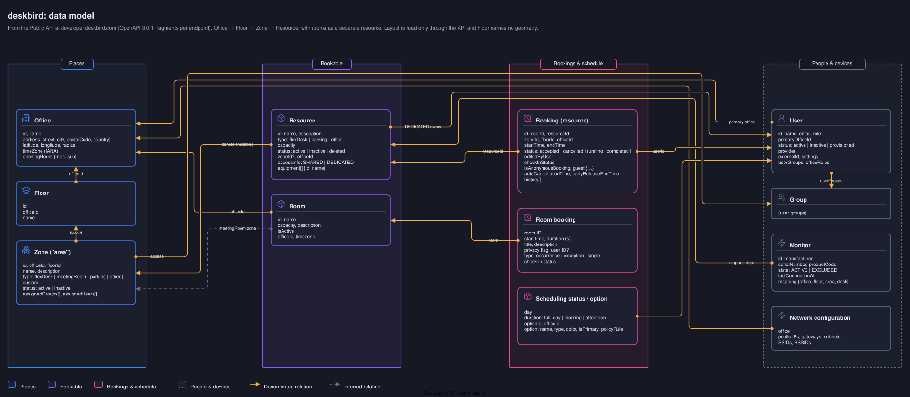

# deskbird: vendor profile

Researched and validated 2026-11-25. Each bracketed number links to the Sources list in §18.

## 1. Snapshot
- **Positioning:** a hybrid-workplace platform (desk, room and parking booking, visitors, ticketing, signage, analytics) that calls itself "Europe's leading workplace management platform" [[1]](#s1). It claims 10,000+ offices, 250,000+ users and 40,000+ bookings a day [[1]](#s1).
- **HQ:** Switzerland. Founded in 2020 by Ivan Cossu and Jonas Hess [[1]](#s1).
- **Pricing (deskbird.com/pricing, read 2026-11-25):**
  - Business costs USD 3.75 per active user per month billed annually, or 4.75 billed monthly, from 25 users [[2]](#s2).
  - Professional and Enterprise are custom-priced [[2]](#s2).
  - After the free trial you can stay on a Starter plan capped at 15 users [[2]](#s2).
- **Licensing unit:** the *active user*. Desks, parking, users, admins and locations are unlimited on every tier [[2]](#s2)[[2]](#s2).
- **Feature gating:**
  - **Public API:** Professional and above [[2]](#s2)[[3]](#s3)[[4]](#s4).
  - **MCP server:** Desks Professional or Enterprise, being rolled out gradually [[5]](#s5).
  - **SAML SSO, SCIM and HRIS sync:** sold as the *User & Data Management (UDM) Plus* add-on, not as part of a tier [[2]](#s2)[[6]](#s6)[[7]](#s7). Some contracts carry an older UDM plan instead [[7]](#s7).
  - **On every tier:** Entra ID and Google Workspace login, and calendar sync [[2]](#s2)[[7]](#s7).
- **Add-ons:** Rooms Plus (kiosks, catering, approvals, multi-tenancy) and Visitors Plus [[2]](#s2).

## 2. Space kinds

| Kind | Admin model | API representation | Notable rules |
|---|---|---|---|
| Desks (flex / assigned) | "Desk area" containing desks [[8]](#s8) | `Resource.type = flexDesk` [[9]](#s9). Assignment is `accessInfo.type = DEDICATED` with `autoBook` and `allowOthersToBook` [[9]](#s9) | Assigned desks auto-book when the user sets their status to "Office" [[10]](#s10). Equipment tags drive booking filters [[10]](#s10) |
| Meeting rooms | "Meeting room" area, imported from Microsoft/Google or created manually [[8]](#s8) | A separate `/rooms` API: Room = id, name, capacity, description, isActive, officeId, timezone [[11]](#s11). Bookings are typed occurrence, exception or single, and can be private [[12]](#s12) | Room check-in has its own settings, and geolocation check-in isn't available for rooms [[13]](#s13). The provider calendar is the source of truth [[14]](#s14) |
| Parking | "Parking area" on a floor (create a floor such as "Underground parking" if needed) [[15]](#s15) | `Resource.type = parking` [[9]](#s9) | Priority groups, booking windows, waiting lists, license plates and barrier integration [[16]](#s16). Some of these need Professional+ [[15]](#s15) |
| Other | "Other" area [[8]](#s8) | `Resource.type = other` [[9]](#s9). The zone type also allows `custom` for a company-defined resource type [[17]](#s17) | Same check-in settings as desks [[13]](#s13). Lockers, phone booths and equipment are modelled as "Other" resources [[18]](#s18) |
| Event spaces, equipment loans, neighbourhoods | Not publicly documented as distinct kinds. Lockers exist only as "Other" resources [[18]](#s18); only "Other" resources and the `custom` zone type exist [[17]](#s17) | - | - |

- **Capacity:** every resource has `capacity`, documented as "Typically 1 for desks and parking spaces" [[9]](#s9).
- **Zone access:** controlled by `assignedGroups` and `assignedUsers`. A zone with both empty is open to everyone [[17]](#s17).
- **Closures:** areas and floors can be closed indefinitely, or temporarily (with an end date) on Desks Professional and above [[8]](#s8)[[4]](#s4). Closing a floor or area cancels future bookings in the closed period for desks, parking and other resources. Meeting rooms keep their own Active/Inactive toggle, and their bookings are **not** cancelled [[8]](#s8).

## 3. Features
- **Booking rules:**
  - Advanced booking rules come with Professional [[2]](#s2).
  - Priority access, weekday rules and temporary restrictions need Professional+ [[15]](#s15)[[4]](#s4).
  - Hybrid-work policies are tied to scheduling options through a `policyRule` field [[12]](#s12).
- **Check-in:**
  - Three methods, set per office: none, click and/or QR, or QR only [[13]](#s13).
  - Unconfirmed bookings are auto-cancelled after a grace period [[13]](#s13).
  - Geolocation uses the office geofence `radius` [[19]](#s19), and check-in by geolocation is a Professional/Enterprise feature [[4]](#s4).
  - Other check-in routes: office check-in through the API, which checks in all of that user's non-room bookings [[12]](#s12); badge events through Salto [[20]](#s20); and laptop signals through deskbird Dock [[21]](#s21).
- **Analytics:**
  - Office and workforce analytics on all tiers [[2]](#s2). Advanced analytics on Professional [[2]](#s2).
  - Managers see aggregated data only [[22]](#s22).
- **Visitors:**
  - A Visitors module with API read access to visits and visit types [[12]](#s12).
  - Visitors Plus adds a reception kiosk and pre-registration [[2]](#s2).
- **Mobile, Teams and Slack:** native iOS/Android apps, a Teams app, an Outlook add-in and a Slack app on all tiers [[2]](#s2). The Slack app supports scheduling, booking, check-in and status sync [[23]](#s23).
- **Also available:** workplace ticketing and catering/service requests, both exposed in the API [[12]](#s12)[[4]](#s4).

## 4. Floor-plan pipeline
- **Authoring model:**
  - A floor plan is an uploaded *background image* [[24]](#s24).
  - Areas are drawn on top of it as rectangles or custom shapes [[24]](#s24).
  - Desks and other resources are placed as markers inside an area [[24]](#s24).
  - The overlay is independent of the image: switching image versions leaves the placed items where they are [[24]](#s24).
  - Admins can bulk-create resources in the UI (for example 10 desks), setting their status and a naming prefix and starting number; this does not place them on the plan [[10]](#s10).
- **Import formats:**
  - Accepted: SVG (recommended), PDF, JPG, JPEG, PNG and WEBP. Maximum 15 MB and 4096×4096 px [[24]](#s24).
  - PDFs are auto-converted on upload [[24]](#s24).
  - **DWG, DXF and other CAD formats: not publicly documented.** Not in the upload list [[24]](#s24), and help-centre searches for "dwg", "dxf" and "CAD" returned nothing.
  - No layout or floor-plan import (CSV or bulk) is documented; CSV imports exist only for users, groups and license plates.
- **Editor:**
  - SVG and imported PDFs can be edited, but only by moving or rotating elements. Raster images can't be edited [[24]](#s24).
  - Every upload and edit is kept in a version history [[24]](#s24).
  - Other tools: snapping, a grid overlay, 1 px nudging, and a "Map items size" scale that matches marker size to the drawing [[24]](#s24).
- **Auto-detection:**
  - Professional includes an "AI-powered floor plan designer" [[2]](#s2).
  - The help centre describes "Enhance with AI", which produces an *enhanced image* and is available on request [[24]](#s24).
  - Marketing claims AI onboarding digitizes plans "in whatever format you have" and flags the 10% it can't classify [[25]](#s25), and a "floor plan enhancer" for blueprints or sketches [[26]](#s26). **These are marketing claims.** The help centre does not document automatic desk or room detection that creates resources.
- **Indoor-map standards (IMDF, IndoorGML, IFC):** not publicly documented. Not mentioned anywhere fetched.
- **Map geometry via the API: not exposed.**
  - `Floor` = {id, officeId, name} [[27]](#s27).
  - `Zone` has no shape or polygon field [[17]](#s17).
  - `Resource` has no coordinates [[9]](#s9).
  - The only geometry in the API is the office lat/long and geofence radius [[19]](#s19).

## 5. Calendar and directory sync
- **Rooms:**
  - Bi-directional sync with Microsoft 365 and Google room calendars [[28]](#s28).
  - Microsoft uses the Graph *application* permissions Place.Read.All and Calendars.ReadWrite [[14]](#s14). By default this covers all calendars unless an Application Access Policy narrows it [[29]](#s29) (possibly stale, page dated 2025).
  - Google needs a Super Admin, the app marked Trusted, and domain-wide delegation [[30]](#s30).
  - New Microsoft rooms can take up to 48 h to appear for import [[14]](#s14).
  - Rooms created manually in deskbird can't be synced [[28]](#s28).
  - Sync latency for bookings is not publicly documented.
- **Schedules:** work-location statuses sync to users' calendars [[28]](#s28).
- **Provisioning:**
  - SCIM works with Entra ID and Okta. It is push-based through deskbird's `/scim` route and syncs groups. The first sync takes 1–2 h [[6]](#s6).
  - HRIS sync is offered, and an HRIS-provisioned company can't create SCIM keys [[3]](#s3).
  - The user `provider` enum shows the supported sources: Internal, Azure, Google, Okta, OneLogin, SAML, HRIS, SCIM [[31]](#s31).
  - Bookings record whether they came from calendarSync or hrisSync [[32]](#s32).

## 6. IoT, sensors and hardware
- **deskbird Dock:** a software "soft sensor" on employees' laptops. It reads monitor, dock and Wi-Fi (BSSID/subnet) signals instead of hardware sensors [[21]](#s21).
  - Monitors are mapped to desks automatically or manually [[33]](#s33).
  - The API exposes the monitors (manufacturer, serial number, state, last connection and office/floor/area/desk mapping) and the office-detection network configurations [[12]](#s12)[[12]](#s12).
  - Room occupancy hardware: none documented. The help centre has an in-app survey about interest in room sensors [[33]](#s33).
- **Access control:** Salto integration [[20]](#s20). Access-control integration is a Professional+ feature [[2]](#s2).
- **Displays:**
  - Room kiosk mode runs on any Android tablet or browser. Partner panels are iiyama, ProDVX and Neat [[34]](#s34).
  - Embrava desk and room signs [[35]](#s35).
- **Parking barriers:** through the "Open API" [[16]](#s16).

## 7. Hosting and data
- **Delivery:** SaaS, multi-tenant with logical isolation [[22]](#s22).
- **Hosting:** the security page says data is "hosted exclusively in the EU", including subprocessors [[22]](#s22), and the about page says "hosted securely in Germany" [[1]](#s1). The deskbird Intelligence transparency article (scoped to that feature, Desks Professional+ or Dock Plus) states Google Cloud Platform, region europe-west3 (Frankfurt), "Data does not leave the EU", and a single endpoint, api.deskbird.com [[36]](#s36).
- **Contradiction:** the MCP developer docs [[5]](#s5) and the help-centre MCP connector article [[37]](#s37) both mention a "deskbird US environment" with its own endpoint, connect.us.deskbird.com. That hostname did not resolve in public DNS on 2026-11-25, and no other source documents US hosting or data residency. The US environment is therefore **mentioned, not confirmed to exist**; it may be planned or private, and it conflicts with the "exclusively EU" claim [[22]](#s22).
- **On-premises or private cloud:** not publicly documented.

## 8. Compliance and privacy
- **Certifications:** the trust centre (header "Powered by SafeBase"; footer logo "SafeBase by Drata") lists GDPR, ISO/IEC 27001:2022 and SOC 2 Type 2 under Compliance [[38]](#s38). (Read through a summariser only; the page refuses direct fetches.)
- **Subprocessors:** the trust centre's Legal section names five subprocessors: Mailgun Technologies, Inc., Sentry, Customer.io, Jimo and Mixpanel. No locations are shown [[38]](#s38). The security page says subprocessors are EU-hosted [[22]](#s22).
- **Security controls:** TLS 1.2+ in transit and AES-256 at rest. Annual third-party penetration tests [[22]](#s22).
- **Retention:** personal booking data is anonymized after 6 months by default, with custom windows for Enterprise [[22]](#s22). Bookings carry an `anonymized` history action [[32]](#s32).
- **Audit logs:** "Audit Logging" appears as a trust-centre security-programme control [[38]](#s38), and the API marketing FAQ says audit logs exist [[39]](#s39). An admin-facing audit-log feature or API is **not publicly documented**.
- **Employee location data:**
  - Aggregated analytics only, with no per-employee surveillance [[22]](#s22).
  - Works-council readiness and a Betriebsvereinbarung template [[22]](#s22).
  - Anonymous bookings and private meetings [[22]](#s22).
- **DPA:** available via the trust centre, per the deskbird Intelligence transparency article [[36]](#s36). The document itself was not read.

## 9. Authentication
- **End-user login:**
  - Email/password, Microsoft and Google [[40]](#s40). Microsoft and Google sign-in is available on every plan [[7]](#s7).
  - SAML 2.0 SSO with Okta, Keycloak or a custom IdP [[40]](#s40), and with Entra ID [[41]](#s41)[[22]](#s22).
  - MFA is enforced at the IdP [[22]](#s22).
  - OIDC: Entra ID SSO can be set up as a manual OIDC app registration instead of the gallery Enterprise Application [[42]](#s42). Generic OIDC SSO for other third-party IdPs is not documented.
- **SCIM:** keys of type "SCIM", generated by a Global Admin under Admin > Company: API keys [[43]](#s43)[[3]](#s3). Requires UDM Plus [[6]](#s6).
- **Public API keys:**
  - Company-scoped keys, sent as a Bearer token [[43]](#s43).
  - Created by a Global Admin [[43]](#s43)[[3]](#s3). The developer overview says to use the Integrations section ("Public API section"); the help centre says Admin > Company: API keys, choosing type **API** or **SCIM** [[43]](#s43).
  - There is no key limit [[3]](#s3).
  - Expiry options are 1, 2 or 3 years or never, with reminders 3 months and 2 weeks before expiry [[3]](#s3)[[3]](#s3).
  - No OAuth flow or per-endpoint scopes are documented; keys are company-scoped [[43]](#s43). Marketing says "each API key is scoped per client" without further detail [[39]](#s39).
  - Create, update and cancel calls run as the "API token creator" [[12]](#s12).
- **MCP:** OAuth 2.1 authorization code with PKCE and client registration by CIMD (no DCR) [[44]](#s44).
  - A single `mcp` scope [[44]](#s44).
  - 1-hour JWT access tokens, rotating refresh tokens, and a 90-day absolute session [[44]](#s44).
  - Admin-only [[5]](#s5).

## 10. REST API
- **Docs:** https://developer.deskbird.com (also llms.txt). Base URL: https://connect.deskbird.com [[45]](#s45)[[27]](#s27).
- **OpenAPI:** each endpoint page embeds an OpenAPI 3.0.1 fragment [[27]](#s27). A downloadable full spec was **not found** (/openapi.json returns 404).
- **Resources:** Users, Groups, Offices (with office check-in), Floors, Zones, Resources, Bookings, Rooms and room bookings, Scheduling statuses and options, Tickets, Sensors (monitors and networks), Visitors, Service requests [[12]](#s12).
  - Resource bookings support full CRUD plus check-in and early release [[12]](#s12).
  - Room bookings support create, update, check-in and cancel [[12]](#s12).
  - Floors, zones and resources are **read-only**: no create or update endpoints are listed [[12]](#s12).
- **Pagination:** limit/offset with `total` [[43]](#s43). Change feeds poll with `updatedAt` and de-duplicate by id [[12]](#s12)[[12]](#s12).
- **Rate limit:** 10 requests per second per key, with HTTP 429 when exceeded [[43]](#s43).
- **Versioning:** not publicly documented. There is no version in the path, and every fragment says `version: 1.0.0` [[27]](#s27).

## 11. Events and real-time
- **Webhooks:** not publicly documented. There is no webhook endpoint or event catalogue on the developer hub, and a help-centre search for "webhook" returned 0 results.
- **Polling instead:** the documented pattern is `updatedAt` delta polling, used for room bookings, tickets, visits and service requests [[12]](#s12)[[12]](#s12).
- **Streaming:** none. The MCP server uses stateless Streamable HTTP, POST only [[5]](#s5).

## 12. Data model

Source: [`diagrams/deskbird.drawio`](diagrams/deskbird.drawio). The SVG embeds the diagram, so it also opens in draw.io for editing.

| Entity | Key fields | Relations | Source |
|---|---|---|---|
| Office | id, name, address{street, city, postalCode, country, latitude, longitude, radius, timeZone (IANA)}, openingHours{mon..sun} | Has floors (from `Floor.officeId`) | [[19]](#s19) |
| Floor | id, officeId, name | → Office | [[27]](#s27) |
| Zone (area) | id, officeId, floorId, name, description, type{flexDesk, meetingRoom, parking, other, custom}, status{active, inactive}, assignedGroups[], assignedUsers[] | → Floor, → Office, ↔ Group/User (access) | [[17]](#s17)[[17]](#s17)[[17]](#s17) |
| Resource | id, type{flexDesk, parking, other}, capacity, name, description, status{active, inactive, deleted}, zoneId (nullable), officeId, accessInfo{SHARED \| DEDICATED(user, autoBook, allowOthersToBook)}, equipment[{id, name}] | → Zone, → Office, → User (dedicated) | [[9]](#s9)[[9]](#s9)[[9]](#s9) |
| Room | id, name, capacity, description, isActive, officeId, timezone | → Office. Room→Zone/Floor link: INFERRED (rooms are zone type `meetingRoom` in admin, but RoomResponse has no zoneId or floorId) | [[11]](#s11)[[17]](#s17) |
| Booking (resource) | id, userId, resourceId, zoneId, floorId, officeId, startTime, endTime, status{accepted, cancelled, running, completed, editedByUser}, checkInStatus{…}, isAnonymousBooking, guest{firstName, lastName, email}, autoCancellationTime, earlyReleaseEndTime, history[{action, source, userUuid, completedAt}] | → Resource, → User, → Zone/Floor/Office | [[32]](#s32)[[32]](#s32)[[32]](#s32) |
| Room booking | room ID, start time, duration (s), title, description (optional), privacy flag, user ID (optional), type{occurrence, exception, single}, check-in status | → Room, → User | [[12]](#s12) |
| User | id, name, email, role, primaryOfficeId, status{active, inactive, provisioned}, provider{…}, include: externalId, settings, userGroups, officeRoles | → Office (primary), ↔ Group | [[31]](#s31) |
| Scheduling status / option | day, duration{full_day, morning, afternoon}, optionId, officeId. Option has name, type, color, isPrimary, isActive, policyRule | → User, → Office | [[12]](#s12) |
| Monitor | id, manufacturer, serialNumber, productCode, state{ACTIVE, EXCLUDED}, lastConnectionAt, mapping{office, floor, area, desk} | → Resource (desk) | [[12]](#s12) |
| Network configuration | office, public IPs, gateways, subnets, SSIDs, BSSIDs | → Office | [[12]](#s12) |

The full hierarchy is Office → Floor → Zone → Resource, built from the documented foreign keys [[9]](#s9)[[27]](#s27)[[17]](#s17). Zones are "areas" in the admin UI (INFERRED from matching terms: `MonitorAreaResponse` and the help centre's "areas").

## 13. SDKs and ecosystem
- **Official SDKs:** none. The `github.com/deskbird` org has 3 public repos, all forks, none of them an SDK [[46]](#s46).
- **Community:** "deskbooker" (Python, 10 stars, stale since 2022) scrapes the private web-app API through Firebase tokens [[47]](#s47) (third-party).
- **Zapier, Power Automate, Make:** not found. The Zapier app URL returns 404, and the help-centre searches came back empty.
- **Integration directory:** the deskbird.com sitemap has about 100 integration pages (102 /integration/ URLs), including Personio, HiBob and BambooHR [[48]](#s48). Salto and Embrava have dedicated pages [[20]](#s20)[[35]](#s35).

## 14. Developer experience
- **Getting access:** self-service keys for Professional+ admins [[3]](#s3). The marketing FAQ says the API is "fully self-service" [[39]](#s39).
- **Sandbox, mock server or trial API:** not publicly documented.
- **Postman collection:** not found.
- **Changelog:** product updates are published in an in-app "What's New" feed, reached through the bell icon [[49]](#s49). An API changelog or deprecation policy is not publicly documented.
- **Status page:** status.deskbird.com (Better Stack) [[50]](#s50).
- **Docs quality (ANALYSIS):**
  - Good per-endpoint schemas, with descriptions, enums, examples and an llms.txt [[12]](#s12)[[27]](#s27).
  - Gaps: no assembled OpenAPI download, no documented versioning, and no webhooks. No dedicated error-model page was seen (reviewer judgement).

## 15. AI and agents
- **MCP server:** official, read-only, admin-only, OAuth 2.1 [[5]](#s5)[[44]](#s44).
  - Tools: users_list, analytics_query, analytics_get_hierarchy (office → floor → zone with occupancy), analytics_get_docs [[5]](#s5)[[51]](#s51).
  - Supported clients: Claude (web, desktop, mobile and Claude Code) [[37]](#s37), and ChatGPT (Codex) in the desktop app only; ChatGPT in the browser does not support this connection [[52]](#s52).
- **Marketing claims** for "Agentic Workplace":
  - Works with Copilot, Claude, ChatGPT and Gemini [[25]](#s25).
  - AI onboarding of floor plans [[25]](#s25).
- **Copilot / Teams agent:** no documentation found for a specific integration.

## 16. Accessibility and i18n
- **WCAG / VPAT:** not publicly documented (searched the security page, trust centre and help centre).
- **Languages:** 9 UI languages: EN-US, FR, ES, DE, IT, UK, NL, CS, HU [[53]](#s53).
- **Time zones:** every office and room carries an IANA time zone [[19]](#s19)[[11]](#s11). The monitors endpoint states its timestamps are UTC [[12]](#s12); other endpoints do not say.

## 17. Relevance to spaceweave (ANALYSIS, not vendor fact)
- **What deskbird stores:** the floor plan is a raster or SVG *backdrop* with a hand-placed overlay of area polygons and desk markers [[24]](#s24)[[24]](#s24). It is not a semantic building model. deskbird documents no CAD/DWG ingestion and no wall, opening or room geometry, and does not expose geometry through its API [[24]](#s24)[[27]](#s27)[[17]](#s17)[[9]](#s9).
- **Where spaceweave fits:** spaceweave's DWG/PDF → structured walls, rooms and desks pipeline sits upstream of the step deskbird does manually. It could produce the SVG backdrop deskbird recommends, plus the area and desk placements, if those could be written in.
- **The blocker:** the Public API is **read-only for floors, zones and resources** [[12]](#s12). Pushing generated layouts into deskbird would need a partner channel or a layout import that isn't documented; the UI's bulk resource creation does not place resources on the plan [[10]](#s10).
- **Space-kind model worth mirroring:** deskbird uses two orthogonal axes:
  - Zone type: flexDesk, meetingRoom, parking, other, custom [[17]](#s17).
  - Resource type: flexDesk, parking, other [[9]](#s9).
  - Meeting rooms are a separate entity, synced to calendars [[11]](#s11)[[28]](#s28).

  spaceweave should keep `kind` (desk, room, parking, other, custom) separate from *access mode* (shared vs dedicated with autoBook and allowOthersToBook [[9]](#s9)). Areas should be containers, since a resource must sit inside an area [[24]](#s24).
- **Office/Floor/Zone/Resource hierarchy:** the stable IDs (UUIDs) map cleanly to a spaceweave export. A deskbird adapter could match spaceweave entities to existing deskbird resources by name (`exact:`/`ilike:` filters [[54]](#s54)) and floor/zone IDs.
- **Accuracy implication:** deskbird's own AI claims "90% auto-classification" with manual review [[25]](#s25). That frames the competitive bar for automatic desk and room detection; spaceweave targets 99%+.
- **Sensor data:** Dock's monitor-to-desk mapping [[12]](#s12)[[33]](#s33) gives ground-truth desk positions tied to real hardware. This is a potential validation signal if a customer shares it.

## 18. Sources

All accessed 2026-11-25.

1. https://www.deskbird.com/about (official-docs)
2. https://www.deskbird.com/pricing (official-docs)
3. https://help.deskbird.com/hc/en-us/articles/35124028049169-Public-API (official-docs)
4. https://help.deskbird.com/hc/en-us/articles/52408433243281 (official-docs)
5. https://developer.deskbird.com/mcp/overview.md (api-ref)
6. https://help.deskbird.com/hc/en-us/articles/10434221556113-SCIM-Overview-automatically-de-provision-users (official-docs)
7. https://help.deskbird.com/hc/en-us/articles/52413482256145 (official-docs)
8. https://help.deskbird.com/hc/en-us/articles/9958562486417-Floors-and-spaces (official-docs)
9. https://developer.deskbird.com/api/resources/gets-a-resource-by-id.md (api-ref)
10. https://help.deskbird.com/hc/en-us/articles/29197912042385-Desks-Parking-Spots-and-Other-Resources (official-docs)
11. https://developer.deskbird.com/api/rooms/lists-company-rooms.md (api-ref)
12. https://developer.deskbird.com/llms.txt (api-ref)
13. https://help.deskbird.com/hc/en-us/articles/10090587826321-Check-in-and-auto-cancellation-settings (No check-in, Check-in with click and/or QR Codes, Check-in with QR Codes only" ... "All settings apply per office.")
14. https://help.deskbird.com/hc/en-us/articles/44844319171345-Sync-meeting-rooms-with-Microsoft-365 (official-docs)
15. https://help.deskbird.com/hc/en-us/articles/51836219032721-Set-up-parking (official-docs)
16. https://www.deskbird.com/platform/parking-space-booking (official-docs)
17. https://developer.deskbird.com/api/zones/lists-company-zones.md (api-ref)
18. https://help.deskbird.com/hc/en-us/articles/47589092863249 (official-docs)
19. https://developer.deskbird.com/api/offices/lists-company-offices.md (api-ref)
20. https://www.deskbird.com/integration/salto-systems (official-docs)
21. https://www.deskbird.com/platform/dock (official-docs)
22. https://www.deskbird.com/security (official-docs)
23. https://help.deskbird.com/hc/en-us/articles/47589499245329-Use-deskbird-in-Slack (official-docs)
24. https://help.deskbird.com/hc/en-us/articles/9983699701521-Floor-plans (official-docs)
25. https://www.deskbird.com/platform/agentic-workplace (official-docs)
26. https://www.deskbird.com/platform/desk-booking (official-docs)
27. https://developer.deskbird.com/api/floors/lists-company-floors.md (api-ref)
28. https://help.deskbird.com/hc/en-us/articles/17996926042385-Calendar-sync-for-schedule-status-and-meeting-rooms (official-docs)
29. https://help.deskbird.com/hc/en-us/articles/34371643687825-Calendar-Sync-Data-security-and-Options-to-Restrict-Data-Access (official-docs)
30. https://help.deskbird.com/hc/en-us/articles/44844224920209-Sync-meeting-rooms-with-Google-Workspace (official-docs)
31. https://developer.deskbird.com/api/users/lists-company-users.md (api-ref)
32. https://developer.deskbird.com/api/bookings/lists-company-bookings.md (api-ref)
33. https://help.deskbird.com/hc/en-us/articles/50504420895249-Resource-detection (official-docs)
34. https://www.deskbird.com/platform/meeting-room-kiosk (official-docs)
35. https://www.deskbird.com/integration/embrava (official-docs)
36. https://help.deskbird.com/hc/en-us/articles/52160055961361-How-deskbird-Intelligence-works-a-transparency-overview (official-docs)
37. https://help.deskbird.com/hc/en-us/articles/50620548711441-deskbird-MCP-connector-for-Claude (official-docs)
38. https://trust.deskbird.com/ (official-docs)
39. https://www.deskbird.com/integration/public-api (official-docs)
40. https://help.deskbird.com/hc/en-us/articles/10343803264529-Login-options-overview (Login with Microsoft)
41. https://www.deskbird.com/integration/ms-entra-id (official-docs)
42. https://help.deskbird.com/hc/en-us/articles/14911346851345 (official-docs)
43. https://developer.deskbird.com/api/overview.md (api-ref)
44. https://developer.deskbird.com/mcp/authentication.md (api-ref)
45. https://developer.deskbird.com/ (api-ref)
46. https://github.com/deskbird (github)
47. https://github.com/tobiasknudsen/deskbooker (github)
48. https://www.deskbird.com/sitemap.xml (official-docs)
49. https://help.deskbird.com/hc/en-us/articles/10039231616785 (official-docs)
50. https://status.deskbird.com/ (official-docs)
51. https://developer.deskbird.com/mcp/tools-reference.md (api-ref)
52. https://help.deskbird.com/hc/en-us/articles/51372253024273 (official-docs)
53. https://help.deskbird.com/hc/en-us/articles/47588952938385-Change-your-app-language (official-docs)
54. https://developer.deskbird.com/api/resources/lists-company-resources.md (api-ref)

## Validation

The validator accepted 95 ledger claims, revised 7 (C3, C24, C28, C42, C60, C75, C76), rejected no ledger claims, and added 10 new claims (N1–N10). It also flagged 11 unsourced draft statements (U1–U11), and all 11 were fixed. Corrections: (1) Hosting now says the US environment is only mentioned (C35, N1). It is not confirmed to exist, and connect.us.deskbird.com does not resolve in DNS. C75 is now scoped to the deskbird Intelligence article. (2) "No OAuth or scopes" is now "no documented OAuth flow or per-endpoint scopes; keys are company-scoped [C2]", next to marketing's "scoped per client" [C95]. (3) Entra ID manual OIDC is documented (N3). (4) The changelog is now the in-app "What's New" feed (N7). (5) ChatGPT/Codex desktop support cites N2. (6) §17 now reads "documents no CAD/DWG ingestion". (7) "Mostly HRIS" and the "recently added groups" line were dropped, and the integration count cites N9. (8) The DPA line was reworded to cite C75. (9) C76 now names exactly 5 subprocessors with no locations, and its trust-centre platform attribution was corrected. (10) The C60 closures text adds that meeting-room bookings are not cancelled. (11) The C3/SCIM key path is now Admin > Company: API keys, set by a Global Admin. (12) UTC timestamps are narrowed to the monitors endpoint (C28). (13) The data-model fields now cite the widened C24, C27, C28 and C30. Lockers as "Other" resources (N6), bulk resource creation (N8) and Professional add-ons (N4) were added. Flags: C96 (possibly stale, page dated 2025), C98 (third-party), C99 (stale 2024 blog, not cited in the body), C76 and C77 (summariser-only, because trust.deskbird.com blocks direct fetches), and C57, C58, C86, C91, C94 and C95 (marketing). Claim ids (C#/N#) refer to the evidence ledger and validation report in `evidence/`.
