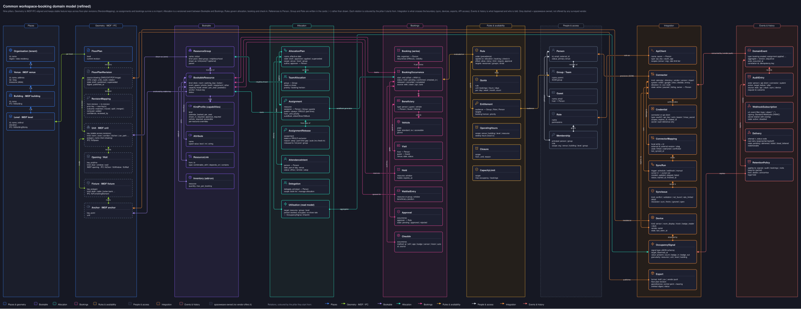

# A common workspace-booking domain model

This model merges the data models of the eight vendors and five open-source projects in
this survey. It is analysis, not sourced fact. Each vendor mapping below points to the
§12 "Data model" section of that vendor's profile, where every field is cited. Eptura's
mapping uses its profile, which was validated last.

Source: [`diagrams/common-domain-model.drawio`](diagrams/common-domain-model.drawio). One diagram per vendor sits beside it in [`diagrams/`](diagrams/).

## What the survey shows

1. **No product exposes the building as geometry.** The richest are:
   - Officely Enterprise: a JSON `floor-manifest/1` with desk rectangles and room or zone polygons ([officely](officely.md#12-data-model-enterprise-from-api-reference)).
   - Seatsurfing: a per-space box, rotation and shape, plus `map_scale` ([open-source](open-source.md)).
   - Archibus, via Eptura: a floor returned as base64 SVG ([eptura](eptura.md)).

   Envoy exposes only normalised desk x/y, and only when a desk is created ([envoy](envoy.md#12-data-model-documented)). Skedda, deskbird and Robin expose no geometry at all, and Clearooms has no public API reference.
2. **Every floor plan starts as a picture or as hand-layered CAD.** No surveyed product documents finding walls, rooms or desks in an unprepared DWG or PDF. Each instead uses one of these:
   - an image upload with hand-placed pins. PDFs count here: Eptura SpaceIQ takes DWG, PDF or PNG and publishes a PNG, and Teem takes PDFs through a submission flow.
   - a staff tracing service: Skedda, Robin, Clearooms
   - CAD with fixed layer conventions: Eptura Workplace, Serraview, Archibus, and the Eptura AutoCAD/Revit plugins. Robin's self-serve DXF import is walls-only.
3. **"Space kind" is modelled inconsistently.**
   - An enum on the bookable thing:
     - Officely: `desk | room | parking_bay | locker | equipment | pass | session | other`
     - Archie: Area `category`
     - deskbird: `flexDesk | parking | other`
     - Envoy: `DESK | ROOM`
   - A venue-defined label over structural categories: Skedda, with `bookable | assigned | addOn` plus a free-text Type.
   - Admin-defined types: LibreBooking.
   - Typed attributes: Seatsurfing.
4. **Bookable and structural are separate concerns.** Officely makes the split explicit: non-bookable `Space` (building, level, zone, room, car park, kitchen) and bookable `Resource`. The others merge the two into one "space" record. That merge is lossy once a meeting room is both a physical room and something people book.
5. **Bookings come as a series plus occurrences.** Skedda has Booking with BookingOccurrence. Robin has `series_id` and `recurrence_id` with RRULE. LibreBooking has `reservation_series` and `reservation_instances`. deskbird's room bookings have type `occurrence | exception | single`.
6. **Integrations are similar everywhere:**
   - calendar rooms paired one-to-one with M365 or Google resource calendars
   - SCIM groups mapped to tags or teams
   - signed webhooks: Skedda and Archie document the signing, and Officely Enterprise has signed webhook endpoints
   - presence from Wi-Fi, badges or sensors as an inbound signal

## The nine pillars

The model is organised as nine pillars, each a column in the diagram. Cards point to
Person, Group and Role in their text (`→ Person`) instead of with drawn lines, because
nearly every card refers to people. Drawing all of those links would hide the structure.
Grey dashed cards are things spaceweave should own because no surveyed vendor offers them.

| # | Pillar | Question it answers |
|---|---|---|
| 1 | **Places** | Which tenant, venue, building and level? |
| 2 | **Geometry · IMDF / IFC** | What is physically there, and how does it carry over from one drawing revision to the next? |
| 3 | **Bookable** | What can be used, how it is grouped, and what it can do |
| 4 | **Allocation** | Who is given what, on what terms, and by which plan? |
| 5 | **Bookings** | Who uses what, and when, including holds, queues, approvals and check-in |
| 6 | **Rules & availability** | What is allowed, how much, and when places are open |
| 7 | **People & access** | Who people are, and what they may administer, and where |
| 8 | **Integration** | What crosses the boundary: connected systems and their credentials, sync runs and issues, devices and their signals, exports, API clients |
| 9 | **Events & history** | What happened, who is told about it, and how long it is kept |

### Why allocation is its own pillar

Assigning people to space is not an attribute of a desk. It is an *event*: a team is
sorted, sized and packed onto zones and desks, a plan is drafted and approved, and then it
is applied on a date. The result is a set of owned or shared resources. Those resources
later release days back to the pool, generate bookings automatically, and are re-planned
when teams change or utilisation shifts. Folding this into `BookableResource.assignedTo`
loses the plan, the history and the rules that produce bookings.

The vendors already treat it as a process:
- **Robin:** assigned seats and neighbourhoods are managed in *assignment drafts*. Shared assigned desks are weekly RRULE ownership with exclusions that open `reverse_hoteled` sub-bookings ([robin](robin.md)).
- **Clearooms:** "advanced allocation" goes to a user, a team or guests. Part-time allocation releases days to the hot-desk pool, and priority allocations auto-release ([clearooms](clearooms.md)).
- **deskbird:** dedicated access carries `autoBook` and `allowOthersToBook`. Zones are assigned to groups and users, and per-day scheduling statuses record intent ([deskbird](deskbird.md)).
- **Officely Enterprise:** separate `Assignment`, `AssignmentRelease` and `Delegation` objects ([officely](officely.md)).
- **Envoy:** neighbourhoods are limited to named employees or SCIM groups, with neighbourhood captains, alongside WorkSchedules ([envoy](envoy.md)).

The allocation lifecycle:
- An `AllocationPlan` moves from draft to approved to applied to superseded.
- Applying a plan writes `TeamAllocation`s and `Assignment`s.
- An assignment then emits `AssignmentRelease`s and, when `autoBook` is on, `BookingOccurrence`s.
- `AttendanceIntent` (demand) and `Utilisation` (what really happened) size the next plan.

### Why geometry needs stable identity

spaceweave's input is a drawing that gets revised. If a re-import mints new ids, every
assignment, booking and vendor mapping attached to a desk breaks. Every vendor surveyed
avoids this by having a person re-pin desks by hand. To keep identity across revisions:
- Each geometric feature (`Unit`, `Opening`, `Fixture`, `Anchor`) carries a **stable key**.
- Each import is a `FloorPlanRevision` with a published coordinate reference: origin, units, scale and rotation.
- A `RevisionMapping` records what happened to each prior key: matched, moved, split, merged, removed or added. It records a confidence and who reviewed it.
- `BookableResource` is anchored by stable key, not by revision-local id. Publishing a revision resolves through the mapping, so the resource, its assignments and its bookings carry over. Splits, merges and removals become review items rather than silent breakage.

### Standards alignment

The places and geometry pillars use IMDF feature names, so spaceweave can export a
standards-based indoor map. No surveyed vendor offers one, and only Archibus touches IFC.

| spaceweave | IMDF | IFC |
|---|---|---|
| Venue | venue | IfcSite |
| Building | building | IfcBuilding |
| Level | level | IfcBuildingStorey |
| Unit | unit | IfcSpace |
| Opening / Wall | opening (walls implied by unit boundaries) | IfcDoor / IfcWindow / IfcOpeningElement / IfcWall |
| Fixture | fixture | IfcFurnishingElement |
| Anchor | anchor | (placement point) |

Two IMDF terms are used differently here. IMDF's `amenity` is a point of interest, so the
model calls resource features `Attribute` to avoid confusion. Walls are a spaceweave
extension, because IMDF draws units and openings, not wall solids.

## Proposed entities

### Places
| Entity | Purpose | Closest vendor equivalents |
|---|---|---|
| **Organisation** | Tenant and data-residency boundary | Skedda Venue; Officely Account/Organisation; Envoy Company; Seatsurfing organizations |
| **Venue** | A site or campus, with an IANA timezone | Archie Campus/Space; Robin campus; Eptura Site; Officely Place; Envoy Location |
| **Building** | A physical building | Robin building; Eptura Building; Officely Space `type=building` |
| **Level** | One storey, which anchors floor plans | deskbird Floor; Envoy Floor; Robin level; Officely Space `type=level`; Archie Area `category=floor` |

### Geometry · IMDF / IFC
| Entity | Purpose | Closest vendor equivalents |
|---|---|---|
| **FloorPlan** | The plan for one level, pointing at its current revision | Officely FloorPlan; Seatsurfing `location_floor_plans` |
| **FloorPlanRevision** *(spaceweave)* | An imported drawing with its coordinate reference (origin, units, scale, rotation): draft → published → superseded | Officely's draft, preview and publish, keeping the last 3 versions; Seatsurfing `map_scale`. Elsewhere it is only an image |
| **RevisionMapping** *(spaceweave)* | What happened to each feature key between two revisions | None. Vendors re-pin by hand |
| **Unit** *(spaceweave)* | A room, zone, corridor, kitchen or car-park polygon taken from the drawing | Officely Space (non-bookable); Clearooms neighbourhood polygons |
| **Opening / Wall** *(spaceweave)* | Doors, windows and walls | None exposed |
| **Fixture** *(spaceweave)* | Furniture such as desks, tables and locker banks | Envoy desk x/y (normalised, create-only); Seatsurfing box with rotation; Mensam position, direction and size |
| **Anchor** *(spaceweave)* | A stable point inside a unit that a resource hangs from | None |

### Bookable
| Entity | Purpose | Closest vendor equivalents |
|---|---|---|
| **ResourceGroup** | A logical pool, desk group or neighbourhood, optionally drawn as a zone `Unit` | Officely ResourceGroup and pools; Archie desk groups (`table`); Robin desk groups; LibreBooking resource_groups; Envoy Neighborhood; deskbird Zone |
| **BookableResource** | The thing people book: kind, capacity mode (whole, per seat or pooled), anchor, status | Skedda Asset; deskbird Resource/Room; Officely Resource; Envoy Space/Desk; Robin Desk (Seat); Archie Area; Eptura Engage Resource |
| **KindProfile** | Capability flags behind each kind: calendar-backed, per-seat, check-in or approval required, vehicle required, accessible. Overridable per resource | Robin's scheduling config is separate from type; Envoy rooms must be calendar resources; Clearooms parking bays (EV, Blue Badge, permit) |
| **Attribute** | A typed feature used for filtering | Skedda tags/type; deskbird equipment; Seatsurfing typed attributes; Robin seat_amenities |
| **ResourceLink** | Rooms that combine, depend on or contain one another | Archie `area_booking_dependencies` and event-space sub-rooms |
| **Inventory** | Counted add-on stock with a per-booking cap | Skedda add-on `quantity` / `maxQuantityPerBooking` |

### Allocation
| Entity | Purpose | Closest vendor equivalents |
|---|---|---|
| **AllocationPlan** | A versioned plan that packs teams and people onto groups and resources | Robin assignment drafts; Robin space and move planning |
| **TeamAllocation** | A team given a neighbourhood: seat count or share, priority, booking horizon | Clearooms team neighbourhoods; deskbird zone `assignedGroups`; Envoy SCIM-group neighbourhoods |
| **Assignment** | A resource given to a person, group or guests: always or on an RRULE, with `autoBook` and `allowOthersToBook` | Skedda `assigned`; Officely Assignment; deskbird `DEDICATED`; Envoy `assignedTo`; Robin `shared` RRULE; Clearooms part-time and multi-owner |
| **AssignmentRelease** | Days given back: manually, as a part-time gap, or on a missed check-in | Officely AssignmentRelease; Robin RRULE exclusions; Clearooms priority auto-release |
| **AttendanceIntent** | Who plans to be where, by day and part of day | Envoy WorkSchedule; deskbird scheduling status |
| **Delegation** | Who may book for, or manage the allocation of, someone else | Officely Delegation |
| **Utilisation** | A read model of booked against occupied against no-show, which feeds the next plan | Skedda Insights; Robin and deskbird analytics |

### Bookings
| Entity | Purpose | Closest vendor equivalents |
|---|---|---|
| **Booking (series)** | Organiser, RRULE recurrence, visibility | Skedda Booking; Robin series; LibreBooking reservation_series; Archie Booking.recurrence |
| **BookingOccurrence** | One instance: offset times plus IANA zone, a state machine (held → pending → confirmed → checked_in / released / cancelled → completed), source | Skedda BookingOccurrence; deskbird Booking; Envoy Reservation; Officely Booking |
| **Beneficiary** | Who a booking is for: a person, a guest or a vehicle | deskbird guest bookings; Clearooms Vehicle IDs |
| **Vehicle** | Plate, type (standard, EV, accessible), permit | Clearooms vehicles and bay types; Envoy parking amenities |
| **Visit** | A guest attached to a host | Envoy Entries/Invites; Robin Visit; Officely Visit; Eptura Engage Visitor |
| **Hold** | A short reservation that expires | Officely Hold |
| **WaitlistEntry** | A place in the queue for a contested resource or group | Officely Waitlist Entry |
| **Approval** | Gates a request-only booking for an approver role | Officely Approval; Robin request-only spaces; Archie `requires_approval`; LibreBooking `requires_approval` |
| **CheckIn** | Method (QR, Wi-Fi, app, badge, sensor, kiosk, auto), time and source. Auto-release is an event | Robin Confirmation; Skedda and Clearooms check-in methods |

### Rules & availability
| Entity | Purpose | Closest vendor equivalents |
|---|---|---|
| **Rule** | An ordered rule with an effect (allow, deny, limit, require approval) that applies to allocation, booking or check-in | Officely BookingRule (ordered); Skedda (strictest quota wins); Archie Area policy; deskbird `policyRule` |
| **Quota** | A count per period | Skedda quotas; Archie Quota |
| **Entitlement** | Audience → targets, with booking horizon and priority | Robin priority booking for groups; Skedda booking windows |
| **OperatingHours** | Weekly hours for a venue, building, level or resource | deskbird `openingHours`; Archie `available_times` |
| **Closure** | A dated closure of a scope | Officely Closure |
| **CapacityLimit** | Maximum occupancy or bookings for a scope | Envoy `capacityLimit` |

### People & access
| Entity | Purpose | Closest vendor equivalents |
|---|---|---|
| **Person / Group** | Directory identities and SCIM groups | Skedda VenueUser/VenueUserTag; Robin SCIM User; deskbird User; Clearooms User/Team |
| **Guest** | A non-directory person with a host | Robin and Envoy guests |
| **Role / Membership** | A role granted to a person or group, scoped to the organisation, a venue, building, level or group. Captains are a scoped role | Officely Role; Skedda tag types (bookingAdmin, owner …); Envoy captains |

### Integration
| Entity | Purpose | Closest vendor equivalents |
|---|---|---|
| **ApiClient** | A third party calling spaceweave: API key or OAuth app, scopes, rate-limit tier | Skedda per-venue static API keys; Officely Account API Tokens (`oat_v1_…`) and PKCE Person tokens; Envoy OAuth2 (24 h access, refresh) |
| **Connector** | A configured link to a calendar, directory (SCIM), vendor, sensor or import source, with direction and health state | Skedda two-way calendar sync; Clearooms Room ↔ calendar; SCIM provisioning at most vendors; Robin Universal Presence Connector |
| **Credential** | The secret a connector or API client uses: OAuth2, API key, SCIM bearer or HMAC secret, with scopes, expiry and rotation. Stored only as a vault reference | Skedda SCIM bearer per venue; Officely's Entra setup token that expires after 7 days; Officely webhook secret rotation |
| **ConnectorMapping** | Local entity and id ↔ external id and version, with state (linked, orphaned, conflicted) | Needed because only Officely Enterprise (floor-plan documents) and Archie (Area PUT) offer a geometry write path |
| **SyncRun** | One sync pass: trigger, cursor in and out, counts and status. Makes sync observable and resumable | None exposed by any surveyed vendor |
| **SyncIssue** | A conflict, validation failure, missing record or rate limit raised by a run, with how it was resolved | None exposed |
| **Device** | A sensor, room display, kiosk, badge reader or dock, with its placement (an `Anchor`) and last-seen time | Robin room displays and Universal Presence Connector; Envoy Butlr sensors and the iPad kiosk; deskbird Dock; Clearooms Room Display; Skedda PWA tablet displays |
| **OccupancySignal** | An observation from a device, typed by a JSON schema, with its granularity (resource, unit, level or building) | Officely Signal and SignalType; Robin presence (building or floor level only); deskbird presence networks |
| **Export** | A published floor-plan revision exported as IMDF, CSV or a vendor push, with the georeference used ([ADR 0001](../../adr/0001-indoor-map-standard-imdf.md)) | None. No surveyed vendor offers a standard geometry export |

### Events & history
| Entity | Purpose | Closest vendor equivalents |
|---|---|---|
| **DomainEvent** | The single append-only stream of typed changes (`booking.created`, `assignment.applied` …), with aggregate version, sequence, actor, correlation id and idempotency key | Skedda booking and check-in events; Archie's 21 `.created/.updated/.deleted` events; Envoy entry and desk events; Eptura Engage event types 0–8 |
| **AuditEntry** | Who did what to which record, from where, with before and after | Officely AuditLogEntry (who, where from, outcome, what changed); deskbird booking `history[]` |
| **WebhookSubscription** | An outbound endpoint with an event filter, Standard Webhooks signing, and secret rotation with overlap | Officely WebhookEndpoint (event, `object.*` or `*`; Standard Webhooks; previous secret still signs during rotation); Skedda Standard Webhooks; Archie HMAC + AES-GCM payloads |
| **Delivery** | One attempt to deliver an event: status code, next retry with backoff, dead-lettered, redeliverable | Archie 5 attempts with backoff and in-flight, delivered, failed or not-sent statuses; Eptura Engage `Attempt` count; Officely resendable deliveries |
| **RetentionPolicy** | How long signals, audit entries, bookings and visits are kept, and whether they are then deleted or anonymised, with legal hold | deskbird anonymises personal booking data after 6 months by default; Envoy save or purge for visitor data; Robin keeps anonymised derived data |

### Why integration and history are split

The previous single pillar mixed four flows that go in different directions:
- data coming in: calendars, directories, vendors and sensors;
- data going out: webhooks and exports;
- the record of what happened;
- how long that record is kept.

With the split, each relation reads in one direction:
- **Integration** is what crosses the boundary. Every connector run is a `SyncRun`, so a failing calendar or directory sync is visible and resumable instead of silent. Each problem is a `SyncIssue` with a resolution, not a log line.
- **Events & history** is what happened. Every state change writes one `DomainEvent`. Audit entries, webhook deliveries and vendor-push connectors all read from that one stream, so they can never disagree.
- **Retention** applies to the data that matters most for employee privacy: occupancy signals and audit entries. It is a policy in the model, not a config file.
- **Devices** are first class and placed on an `Anchor`. A signal can then be tied to a desk or room rather than only to a floor, which is Robin's documented limitation.

## Design recommendations for spaceweave

- **Treat identity across revisions as the core contract.** Give every geometric feature a stable key and publish revisions through `RevisionMapping`. Make splits, merges and removals review items. This is what lets a revised DWG flow through without breaking bookings, and no vendor offers it.
- **Keep geometry, grouping and booking apart.** `Unit` and `Fixture` come from the drawing. `ResourceGroup` is logical and may be drawn as a zone. `BookableResource` hangs from an `Anchor`. One drawing can then feed any vendor's flatter model.
- **Drive behaviour from capabilities, not kind names.** Keep the kind enum for projection (Skedda category + Type, Envoy `DESK | ROOM`, Officely `type`), but let `KindProfile` flags decide check-in, approval, calendar backing and vehicles.
- **Model allocation as an event.** Version plans, apply them on a date, and emit events. Feed vendors that only have `assignedTo` (Envoy, Skedda) a flattened copy.
- **Evaluate rules in one place.** A single ordered rule set covers allocation, booking and check-in. Quotas and entitlements hang off rules, and availability (hours, closures, capacity) is evaluated in the scope's IANA timezone.
- **Model bookings as series plus occurrences with an explicit state machine.** Holds, waitlists and approvals are first-class, and check-in records its method.
- **Make everything observable.** Every state change writes a `DomainEvent` and an `AuditEntry` in the same transaction. Webhook deliveries are recorded per attempt and can be redelivered. Every connector pass is a `SyncRun` with its issues.
- **Keep secrets and personal data on a short leash.** Credentials live in a vault and the model holds only references, with expiry and rotation tracked. Occupancy signals and audit entries carry a retention policy that deletes or anonymises them on schedule.
- **Treat vendor sync as connectors.** Skedda, deskbird and Robin have no layout write API, and Envoy's desk positions are create-only. Each target is a `Connector` with `ConnectorMapping`s: push where the vendor allows it, and export or CSV elsewhere.
