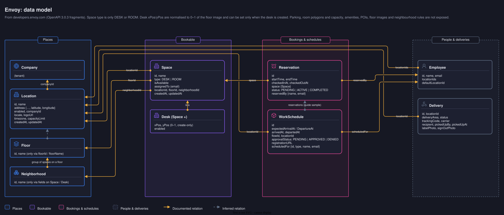

# Envoy

Researched and validated 2026-11-25. Each bracketed number links to the Sources list in §18.
Do not confuse it with Envoy Global (immigration) or the Envoy proxy (CNCF). Both came up in searches and were excluded.

## 1. Snapshot

- **Positioning:** a workplace platform for visitors, space reservations, emergency response, signage, mail and analytics, pitched on security: "We protect the workplaces the world relies on most" [[1]](#s1).
- **HQ:** 410 Townsend St, San Francisco. This comes from the homepage's structured data [[1]](#s1).
- **Segment:** Not publicly documented as a stated segment. Pricing and plan names point to mid-market and enterprise, but that is inference.
- **Pricing (envoy.com/pricing, accessed 2026-11-25, page undated)** [[2]](#s2):
  - Visitors Basic is free "with limited features".
  - Visitors Premium is $362 per location per month, billed annually.
  - Visitors Enterprise and Critical are custom-priced.
  - Reservations (desks, rooms, parking) is $5 per bookable resource per month, plus a platform fee whose amount the page does not state.
- **Licensing unit:**
  - Current model: per bookable resource for Reservations, per location for Visitors [[2]](#s2).
  - Legacy Workplace was billed per active user in Standard, Premium and Premium Plus tiers [[3]](#s3).
- **Tier gating:**
  - Desks, Rooms and Parking need Workplace Premium or above. Maps alone are available on any Workplace plan or Visitors Standard and above [[4]](#s4).
  - Directory sync needs Premium or Enterprise [[5]](#s5).
  - SAML SSO is not on Visitors Basic [[2]](#s2).
  - SCIM role provisioning is "Limited" on Enterprise and Critical only [[2]](#s2). Admin SCIM Sync is Enterprise-only [[3]](#s3).
  - Presence, Map Drafts and GPS sign-in need Enterprise [[3]](#s3)[[6]](#s6).
  - API access by tier: not publicly documented. The pricing table's "Webhooks and build your own integrations" row appears only in page data, not in the visible table, so treat it as unconfirmed.
- **Free tier:** Visitors Basic only [[2]](#s2).

## 2. Space kinds

The API has only two space types, `DESK` and `ROOM` [[7]](#s7). The product has more resource kinds than that, and they live only in the UI and the help docs.

| Kind | Booking rules / quotas | Check-in | Capacity | API representation |
|---|---|---|---|---|
| Desks (hot, assigned, neighbourhood) | Booking hours by day and time [[8]](#s8). Assigned desks can only be booked by their assignee [[7]](#s7). Neighbourhoods can be limited to named employees or SCIM groups [[9]](#s9). "Scheduling limits" set how far ahead people can book [[3]](#s3). Reservations last at most 24 h, and the default is all-day [[10]](#s10)[[10]](#s10). | Optional desk check-in with full- or partial-day auto-release; assigned desks are not released [[8]](#s8). API check-in and check-out endpoints exist [[11]](#s11)[[12]](#s12). | Location capacity limits are enforced [[3]](#s3)[[13]](#s13). | `Space` with type=DESK [[7]](#s7), a `Desk` resource with full create, read, update and delete [[14]](#s14)–[[15]](#s15), and `Reservation` [[16]](#s16). |
| Meeting rooms | Booked in Google or Microsoft 365; Envoy sits on top of the calendar [[17]](#s17). A room must exist as a calendar resource before it can go on the map [[4]](#s4). | 5-minute check-in window by default, with auto-release [[18]](#s18) (possibly stale, page dated 2025). Recurring meetings lose the room after 3 missed check-ins [[18]](#s18) (possibly stale, page dated 2025). Room Resizer prompts in Slack or Teams [[18]](#s18) (possibly stale, page dated 2025). | Not publicly documented (no capacity field in the API Space schema). | `Space` with type=ROOM. Creating a room reservation requires `spaceId`, and the default end time is 30 minutes [[10]](#s10)[[10]](#s10). |
| Car parking | Reservable, with assignment and amenities such as EV and Accessible; amenity names are up to 25 characters [[19]](#s19)[[19]](#s19). | Not publicly documented. | — | Not exposed. The Space type enum is DESK and ROOM only [[7]](#s7). |
| Event spaces | Not publicly documented. | — | — | — |
| Lockers | Not publicly documented as a bookable kind. The only mention is a partner example in App Extensions [[20]](#s20) (possibly stale, page dated 2025). | — | — | — |
| Equipment | Not publicly documented. | — | — | — |
| Other | Non-bookable spaces such as kitchens are part of the Space concept [[21]](#s21). The map also holds visitor areas, delivery areas and points of interest, including custom POIs [[4]](#s4). | — | — | Not exposed as space types. |

## 3. Features

- **Rules and quotas:** booking hours, scheduling limits, capacity limits, neighbourhood restrictions and neighbourhood captains [[9]](#s9)[[8]](#s8)[[3]](#s3).
- **Check-in:**
  - manual desk and room check-in [[8]](#s8)[[18]](#s18);
  - passive "Presence" check-in from badge, network, SSO login, MDM or geofence (Enterprise) [[22]](#s22)[[6]](#s6);
  - a multi-signal policy that requires two or more signals before recording a sign-in [[6]](#s6).
- **Analytics:** pre-built Desks, Rooms and Parking dashboards on Premium, and custom dashboards on Enterprise [[3]](#s3)[[3]](#s3).
- **Visitor management:** the core product, with webhook events for entries, invites and blocklists [[23]](#s23)[[23]](#s23). Synchronous feature hooks can approve or deny a sign-in [[24]](#s24).
- **Mobile app:** finds the nearest Rooms iPad over BLE [[17]](#s17).
- **Teams and Slack:** booking an office day and reserving a desk from either [[3]](#s3). Room Resizer prompts arrive there [[18]](#s18) (possibly stale, page dated 2025).

## 4. Floor-plan pipeline

- **Authoring:**
  - An admin creates a floor in Maps and uploads one raster image [[4]](#s4).
  - Desks, parking, visitor and delivery areas, and POIs are placed by clicking or dragging. Rooms are drawn as polygons by clicking corners [[4]](#s4).
  - A "floor" can stand for a parking lot or an outdoor area [[4]](#s4).
- **Import formats:**
  - Map images: PNG or JPEG only [[4]](#s4)[[25]](#s25).
  - Desk and parking lists: CSV with Floor Name, Desk and Enabled, plus optional Neighborhood, Assigned To, and X/Y placement columns [[25]](#s25)[[25]](#s25)[[19]](#s19).
  - CAD, DWG, DXF, PDF and SVG import: not publicly documented. The upload docs list only PNG and JPEG.
- **Auto-detection of desks or rooms:** AI desk auto-placement from the floor image was marketed in a September 2026 blog post ("Envoy Workplace uses computer vision AI to detect and place multiple seats") [[26]](#s26). Its linked help article now returns 404 and the current maps article does not mention it, so current availability is unclear [[26]](#s26). Room auto-detection is not publicly documented.
- **Editor:** a web map editor with marker scaling, Map Drafts for scenarios (Enterprise), and export to SVG or PNG per floor [[4]](#s4)[[27]](#s27)[[28]](#s28)[[3]](#s3).
- **Indoor-map standards (IMDF, IndoorGML, IFC):** Not publicly documented. None is mentioned in the developer docs or help pages that were read.
- **Map geometry in the API:**
  - Desks only. On create, `xPos` and `yPos` are normalised 0–1 coordinates "on the Map" (read here as relative to the floor map image) [[14]](#s14)[[29]](#s29).
  - Position is create-only: the desk update input has no `xPos`/`yPos`, so a desk cannot be repositioned through the API after creation [[30]](#s30).
  - Room polygons, floor images, floor objects and neighbourhood geometry are not exposed. Floors and neighbourhoods appear only as IDs and names on Space and Desk [[7]](#s7).
  - There is no Floor or Neighborhood endpoint in the reference sidebar we checked.

## 5. Calendar and directory sync

- **Calendars:**
  - Google Workspace and Microsoft 365, with read and write access to resources and events [[31]](#s31)[[31]](#s31).
  - On O365, a global admin authorises Envoy, which then appears as an Azure Enterprise Application [[31]](#s31).
  - Sync is described as "real-time" [[31]](#s31). No numeric latency is documented.
  - Rooms are assigned to locations per location [[31]](#s31).
- **Directory provisioning:**
  - Okta SCIM is push-based, with Okta as the source of truth [[32]](#s32).
  - Other sources: Entra, Centrify, OneLogin and Sailpoint (all SCIM), Google, on-prem AD through a cron script, HRIS, and CSV [[5]](#s5).
  - HRIS PTO data feeds analytics on Enterprise [[3]](#s3).

## 6. IoT, sensors and hardware

- **Occupancy sensors:**
  - Butlr (thermal sensors) cancels unused desk bookings at a cut-off time. It needs a Butlr Hive and Heatic sensors, and a paid Butlr account [[33]](#s33)[[34]](#s34).
  - No public sensor-ingest API is documented.
- **Badge and access control:**
  - Badge events drive Presence check-in (Enterprise) [[3]](#s3)[[22]](#s22).
  - The integrations page lists Kisi among other access-control vendors [[33]](#s33).
- **Wi-Fi:** Meter and other Wi-Fi integrations are listed on the integrations page [[33]](#s33). Wi-Fi auto sign-in is Enterprise [[3]](#s3).
- **Kiosks and displays:**
  - the iPad Visitors kiosk;
  - the Rooms iPad app for room displays [[17]](#s17);
  - Screens (digital signage) at $12 per device per month [[2]](#s2).
- **Device API:** the legacy v3 Visitor API has a devices endpoint [[35]](#s35).

## 7. Hosting and data

- SaaS only, "100% cloud-based" on AWS, with Cloudflare in front [[36]](#s36).
- **Regions:**
  - US data is in AWS us-east-1, us-west-1 and us-west-2 [[37]](#s37).
  - EU accounts are in eu-central-1, Frankfurt [[37]](#s37).
  - The EU datacenter is documented for Visitors and uses a separate dashboard at dashboard.envoy.eu [[38]](#s38) (possibly stale, page dated 2024). Whether Workplace (desks and rooms) data can be hosted in the EU is not publicly documented.
- **Private or on-prem hosting:** Not publicly documented (no on-prem offering found).

## 8. Compliance and privacy

- **Trust centre:** trust.envoy.com (SafeBase-style). It lists ISO/IEC 27001, SOC 2 Type 2, GDPR, CCPA/CPRA, HIPAA, a DPA and a pentest report [[39]](#s39).
- **Security page:** claims SOC 2 Type II, TLS 1.2 or later, and encryption at rest [[36]](#s36)[[36]](#s36). It also states a GDPR commitment [[36]](#s36).
- **Subprocessors:** AWS, Datadog, Looker, Omni Analytics, Databricks, Sigma, Segment and Twilio. Anthropic and Merge.dev are used at the customer's election; Stream.io is used for emergency-notification two-way communications only [[40]](#s40).
- **AI:** Envoy says it does not train on customer data, third-party AI is opt-in, and Claude runs through Bedrock for document parsing [[41]](#s41)[[41]](#s41).
- **Retention and audit logs:** the security page documents retention: Premium and Enterprise customers can choose to save or purge visitor sign-in and employee health-check responses, and purged data (except the screening result) is deleted within 24 hours [[36]](#s36). An `audit-logs.read` OAuth scope exists in the Core API security scheme [[13]](#s13), but no audit-log endpoint is documented.
- **Employee location data:**
  - GPS sign-in is opt-in per employee: "Employees can individually allow the Envoy app to track their location" [[3]](#s3).
  - The Live Map hides employee names on reserved parking spots for privacy [[4]](#s4).
  - No broader stance on employee location data is published.

## 9. Authentication

- **End-user SSO:**
  - SAML 2.0 with any IdP. NameID must equal the user's email [[42]](#s42).
  - Guides exist for Okta, OneLogin, Entra, ADFS and Google [[42]](#s42)[[43]](#s43).
  - Global admins can always fall back to a password [[42]](#s42).
  - OIDC for end users is not publicly documented.
- **SCIM:** Okta, Entra, OneLogin, Sailpoint and Centrify [[32]](#s32)[[5]](#s5).
- **API auth** [[44]](#s44)–[[45]](#s45):
  - OAuth2. The token endpoint is `POST https://api.envoy.com/oauth2/token`. Access tokens last 24 h, and refresh tokens are supported [[46]](#s46).
  - Grant types: password (private apps; the user must be a global admin), client credentials (listed apps), and authorization code (unlisted apps) [[45]](#s45)[[45]](#s45)[[47]](#s47).
  - Alternative: a long-lived Client API Key sent in `X-API-Key`, which works on `/v1` only [[46]](#s46)[[46]](#s46).
  - Scopes are per resource, for example `spaces.read`, `reservations.read`/`write`, `work-schedules.read`/`write`, `locations.read` and `employees.read` [[48]](#s48)[[48]](#s48).
  - **Legacy endpoint:** the hub's llms.txt (undated, hand-maintained) names `POST https://app.envoy.com/a/auth/v0/token`. That URL is the token URL of the legacy Visitor API (v3), not the documented v1 endpoint; for v1, `https://api.envoy.com/oauth2/token` is authoritative [[49]](#s49)[[46]](#s46)[[35]](#s35).

## 10. REST API

- **Docs:** https://developers.envoy.com/hub (ReadMe). Base URL: `https://api.envoy.com` [[7]](#s7).
  - Core resources sit under `/rest/v1/...`, for example locations and companies [[13]](#s13).
  - Spaces, Workplace and Visitors resources sit under `/v1/...`.
  - The legacy Visitor API is `https://app.envoy.com/a/visitors/api/v3` and is deprecated [[49]](#s49)[[35]](#s35).
- **OpenAPI:** each reference page embeds an OpenAPI 3.0.3 fragment [[16]](#s16). Readers can get it by appending `.md` to the page URL. No single combined spec download or Postman collection was found.
- **Main resources:**
  - Locations, Companies, Employees [[13]](#s13)[[50]](#s50);
  - Spaces (read) [[7]](#s7);
  - Desks (create, read, update, delete) [[14]](#s14)–[[15]](#s15);
  - Reservations (list, create, cancel, check in, check out) [[16]](#s16)–[[12]](#s12);
  - WorkSchedules (list, create, check in) [[51]](#s51)[[52]](#s52), plus check out and delete [[53]](#s53);
  - Entries, Invites and Blocklists (event resources) [[23]](#s23);
  - Deliveries [[54]](#s54).
- **Pagination:** `page` and `perPage`; the default perPage on spaces is 250 [[7]](#s7). Responses use `{data, meta}` [[7]](#s7).
- **Limits:**
  - Reservations list: at most a 30-day window; `startTime` and `endTime` default to 14 days before and after now [[16]](#s16).
  - Rate limit: 10 requests per second per token, and per install for public apps [[21]](#s21)[[21]](#s21). Over the limit the API returns 429, and the docs advise exponential backoff [[55]](#s55).
  - Error bodies come in several shapes [[56]](#s56).
- **Versioning:** path-based (`v1` new, `v3` legacy) [[46]](#s46). No deprecation policy is published.

## 11. Events and real-time

- **Webhooks:**
  - Registered in the dashboard (Apps → Webhooks) [[57]](#s57)[[58]](#s58).
  - Catalogue: visitor entry, invite and blocklist events, plus Workplace events [[23]](#s23)[[23]](#s23):
    - `employee_entry_sign_in` and `employee_entry_sign_out`;
    - `employee_upcoming_visit`;
    - `location_capacity_updated`;
    - `desk_sign_in` (beta) and `ticket_created` (beta).
  - There are no events for room reservations, reservation cancellation, or desk create, update or delete.
- **Payload:** `{event, meta:{location, company}, payload:{…}}`. For example, `desk_sign_in` carries desk_id, desk_name, floor_name, neighborhood, reservation times and user fields [[23]](#s23).
- **Signing:** `X-Envoy-Signature`, a Base64 HMAC-SHA256 of the body keyed with the app client secret. Optional HTTP Basic auth [[58]](#s58)[[58]](#s58).
- **Retries:** 5 attempts over 10 minutes [[58]](#s58).
- **Synchronous feature hooks:** Envoy blocks the visitor sign-in until the app answers, with a 30 s timeout [[24]](#s24).
- **Streaming:** Not publicly documented (no SSE or WebSocket API).

## 12. Data model (documented)

Source: [`diagrams/envoy.drawio`](diagrams/envoy.drawio). The SVG embeds the diagram, so it also opens in draw.io for editing.

| Entity | Key fields | Relations | Source |
|---|---|---|---|
| Location | id, name, address{…, latitude, longitude}, enabled, companyId, locale, logoUrl, timezone, capacityLimit, createdAt, updatedAt | belongs to Company | [[13]](#s13) |
| Floor | id, name (only as `floorId` and `floorName` on Space and Desk) | INFERRED: belongs to Location. Docs: "all of the spaces on the same level" | [[21]](#s21)[[7]](#s7) |
| Neighborhood | id, name (only as fields on Space and Desk) | "group of spaces on a specific floor" | [[21]](#s21)[[7]](#s7) |
| Space | id, name, type (DESK\|ROOM), isAvailable, assignedTo (email), locationId, floorId, floorName, neighborhoodId, neighborhoodName, createdAt, updatedAt | Location, Floor, Neighborhood | [[7]](#s7)[[7]](#s7)[[7]](#s7) |
| Desk | Space fields plus xPos and yPos (normalised 0–1 on create); create input also takes `enabled`; update input is name, neighborhoodId, assignedTo, enabled only, so position is create-only | Location, Floor, Neighborhood | [[14]](#s14)[[29]](#s29)[[30]](#s30)[[30]](#s30) |
| Reservation | id, startTime, endTime, checkedInAt, checkedOutAt, space{Space}, status (PENDING\|ACTIVE\|COMPLETED), reservedBy{name,email} | Space, user | [[21]](#s21)[[16]](#s16)[[16]](#s16)[[10]](#s10) |
| ReservationInput | required: locationId, spaceType (DESK default), userEmail, startTime; optional: spaceId (required for rooms), endTime | — | [[10]](#s10)–[[10]](#s10) |
| WorkSchedule | id, expectedArrivalAt, expectedDepartureAt, arrivedAt, departedAt, flowId, locationId, approvalStatus (PENDING\|APPROVED\|DENIED), registrationURL, scheduledFor{id,type,name,email}, createdAt, updatedAt | Location, user; the guide sample nests `reservations` | [[51]](#s51)[[52]](#s52) |
| Employee | id, name, email, locationIds, defaultLocationId, createdAt, updatedAt | Location(s) | [[50]](#s50) |
| Delivery | id, locationId, deliveryArea, status, trackingCode, carrier, recipient, pickedUpBy, pickedUpAt, labelPhoto, signOutPhoto | DeliveryArea, Carrier | [[54]](#s54) |

Not in the API:
- parking spots;
- room polygons and capacity;
- amenities;
- POIs;
- floor map images;
- neighbourhood membership and rules.

## 13. SDKs and ecosystem

- **Official SDKs:**
  - Node.js only, `@envoy/envoy-integrations-sdk` v2.5.8, last pushed 2026-11-23 [[59]](#s59)[[60]](#s60).
  - The org also has `envoy-platform-sdk-nodejs` [[61]](#s61).
  - It is middleware for building Envoy apps (setup steps, event handlers, signature verification), rather than a general REST client.
- **MCP plugin:** for Cursor [[62]](#s62).
- **Community libraries:** Not publicly documented.
- **Low-code:** Power Automate, Pipedream and IFTTT appear on Envoy's integrations page [[33]](#s33). Zapier has an Envoy app, but the page returned HTTP 500, so it was not verified.
- **Marketplace:** the Envoy Integration Directory, with listed, unlisted and private apps [[47]](#s47). A Microsoft AppSource listing could not be fetched (HTTP 403), so it was not verified.

## 14. Developer experience

- **Getting started:** register apps in the Dev Dashboard [[46]](#s46); the quickstart is billed as taking 10 minutes [[63]](#s63). A sandbox or developer tenant is not publicly documented. Rooms has a 60-day free trial [[17]](#s17).
- **Changelog:**
  - The API changelog was last updated 2024-11 [[64]](#s64)[[64]](#s64), so it is stale.
  - The product changelog at changelog.envoy.com is undated [[65]](#s65).
- **Status page:** status.envoy.com, with a "Developer API" component [[66]](#s66).
- **Deprecation policy:** Not publicly documented. Only the "Visitor APIs (Deprecated)" note exists [[49]](#s49).
- **Docs quality notes:**
  - Each page embeds OpenAPI, which helps.
  - There are inconsistencies:
    - the quickstart mixes `/rest/v1/locations` and `/api/v1/locations` [[63]](#s63);
    - the "Errors" and "Status Codes" page titles are swapped (observed by the validator on 2026-11-25; pages: [[55]](#s55)[[56]](#s56));
    - the hand-maintained llms.txt names the legacy v3 token endpoint and contradicts the dated guides on grant types [[49]](#s49).
  - The schema has GraphQL-flavoured scalar descriptions, which suggests a GraphQL backend behind REST. That is inference.

## 15. AI and agents

- A hosted remote MCP server at `https://mcp.envoy.com/mcp`, live over streamable HTTP. It uses Envoy OAuth sign-in (authorization code with PKCE and dynamic client registration), tools follow account permissions, and it covers visitors, employees, desks and rooms [[62]](#s62)[[67]](#s67)[[68]](#s68).
- A plugin repo for Cursor, created 2026-09-24 [[62]](#s62). No MCP tool list is published [[67]](#s67).
- In-product AI: document parsing with Claude on Bedrock, ID scanning and facial matching with Rekognition, and threat-intelligence scoring [[41]](#s41)[[41]](#s41).
- AI desk auto-placement on maps was marketed in September 2026, but its current availability is unclear [[26]](#s26).
- Not publicly documented: AI desk scheduling, Copilot or Teams agents, and a list of MCP tools.

## 16. Accessibility and i18n

- **Accessibility:** a WCAG 2.1 AA target, and the VPAT is available on request [[69]](#s69) (possibly stale, page dated 2024).
- **Languages:** the kiosk supports 40+ languages (41 listed) per the dedicated language article [[70]](#s70); an older accessibility article saying "30+" is outdated [[69]](#s69). The mobile app has 7 languages, sourced only from that 2024 article [[69]](#s69) (possibly stale, page dated 2024).
- **Timezones:** a timezone per location [[13]](#s13). Reservation times are UTC in the API [[10]](#s10).

## 17. Relevance to spaceweave (analysis — not vendor claims)

- **Floor-plan ingestion is Envoy's weak point.** Envoy accepts only a PNG or JPEG backdrop. Desks are pins, rooms are hand-drawn polygons, and there is no CAD/PDF import. AI desk auto-placement from the floor image was marketed in September 2026, but its help article is now 404, so current availability is unclear [[26]](#s26). This is the gap spaceweave targets. A spaceweave output could feed Envoy by:
  1. rasterising each floor to PNG;
  2. creating desks through `POST /v1/desks` with `xPos`/`yPos` normalised to the raster's width and height [[29]](#s29), or through the desk CSV with X/Y columns [[25]](#s25). Positions must be right at creation, because the API cannot move a desk afterwards [[30]](#s30).

  Rooms cannot be pushed by API. They must exist as Google or M365 calendar resources [[4]](#s4) and be drawn by hand on the map.
- **Coordinate model to mirror:** Envoy stores desk positions as 0–1 fractions of the floor image, not real-world units [[29]](#s29). Marker sizes are also stored as ratios of image width [[4]](#s4). spaceweave should keep real-world geometry (metres) internally and export image-normalised coordinates for vendors like Envoy. It should record the raster extent and transform so round-trips are lossless.
- **Space-kind modelling:**
  - The public API has a two-value `SpaceType` (DESK, ROOM) [[7]](#s7), while the product also handles parking, visitor and delivery areas, and POIs.
  - Floors double as "areas" such as parking lots [[4]](#s4).
  - spaceweave's model should have an open set of space kinds, with bookability as a separate property. Envoy's own Space definition already includes non-bookable spaces like kitchens [[21]](#s21).
- **Hierarchy:** Location (with timezone and capacity) → Floor → Neighborhood → Space [[21]](#s21)–[[21]](#s21)[[13]](#s13). Assignment (`assignedTo` email) and `enabled` are per-space attributes [[7]](#s7)[[29]](#s29). This matches a straightforward Building/Level/Zone/Unit hierarchy.
- **Integration risk:** there are no webhooks for desk or room inventory changes [[23]](#s23), and the API changelog has been quiet since 2024 [[64]](#s64). A sync connector would have to poll `/v1/desks` within the 10 rps limit [[21]](#s21).

## 18. Sources

All accessed 2026-11-25.

1. https://envoy.com/ (official-docs)
2. https://envoy.com/pricing (official-docs)
3. https://envoy.help/en/articles/7263142-envoy-workplace (official-docs)
4. https://envoy.help/en/articles/6793105-setting-up-workplace-maps (official-docs)
5. https://envoy.help/en/articles/3450115-setting-up-the-directory (official-docs)
6. https://envoy.help/en/articles/12159459-presence-control-center (official-docs)
7. https://developers.envoy.com/hub/reference/spaces-1 (api-ref)
8. https://envoy.help/en/articles/6657426-book-desks-by-the-hour (official-docs)
9. https://envoy.help/en/articles/4642928-about-desks-neighborhoods (official-docs)
10. https://developers.envoy.com/hub/reference/createreservation (api-ref)
11. https://developers.envoy.com/hub/reference/checkinreservation (api-ref)
12. https://developers.envoy.com/hub/reference/checkoutreservation (api-ref)
13. https://developers.envoy.com/hub/reference/locations-1 (api-ref)
14. https://developers.envoy.com/hub/reference/desks-2 (api-ref)
15. https://developers.envoy.com/hub/reference/deletedesk (api-ref)
16. https://developers.envoy.com/hub/reference/reservations-1 (api-ref)
17. https://envoy.help/en/articles/3673273-about-envoy-rooms (official-docs)
18. https://envoy.help/en/articles/6901393-rooms-space-saver-features (official-docs)
19. https://envoy.help/en/articles/11157865-setting-up-parking (official-docs)
20. https://developers.envoy.com/hub/docs/app-extensions (official-docs)
21. https://developers.envoy.com/hub/reference/introduction-1 (api-ref)
22. https://envoy.help/en/articles/8125322-automatic-check-in-using-presence-integrations (official-docs)
23. https://developers.envoy.com/hub/reference/events (Whenever a desk is reserved and assigned. *This feature is currently in beta and may not be available on your account.*")
24. https://developers.envoy.com/hub/docs/approve-or-deny-visitors-using-hooks (official-docs)
25. https://envoy.help/en/articles/4374428-set-up-desks (official-docs)
26. https://envoy.com/space-management/space-planning-envoy-workplace-maps (official-docs)
27. https://envoy.help/en/articles/15461594-exporting-workplace-maps (official-docs)
28. https://envoy.help/en/articles/8178128-map-drafts (official-docs)
29. https://developers.envoy.com/hub/reference/createdesk (api-ref)
30. https://developers.envoy.com/hub/reference/updatedesk (api-ref)
31. https://envoy.help/en/articles/3613982-connecting-your-calendar (official-docs)
32. https://envoy.help/en/articles/3453325-okta (official-docs)
33. https://envoy.com/integrations (official-docs)
34. https://envoy.com/integrations/butlr (official-docs)
35. https://developers.envoy.com/hub/reference/retrieve-devices (api-ref)
36. https://envoy.com/security (official-docs)
37. https://envoy.help/en/articles/3330093-customer-data-storage (official-docs)
38. https://envoy.help/en/articles/9221726-eu-data-settings-for-visitors (official-docs)
39. https://trust.envoy.com/ (official-docs)
40. https://envoy.help/en/articles/12142662-core-subprocessors-list (official-docs)
41. https://envoy.help/en/articles/16301838-ai-usage-in-envoy-products (official-docs)
42. https://envoy.help/en/articles/3450163-setting-up-saml (official-docs)
43. https://envoy.help/en/articles/4712320-sso-for-envoy-via-microsoft-active-directory (official-docs)
44. https://developers.envoy.com/hub/reference/authentication-1 (api-ref)
45. https://developers.envoy.com/hub/docs/authenticate-overview (official-docs)
46. https://developers.envoy.com/hub/docs/getting-an-access-and-refresh (official-docs)
47. https://developers.envoy.com/hub/docs/overview-building-apps (official-docs)
48. https://developers.envoy.com/hub/docs/scopes (Data about a desk booking \)
49. https://developers.envoy.com/hub/llms.txt (official-docs)
50. https://developers.envoy.com/hub/reference/employees-2 (api-ref)
51. https://developers.envoy.com/hub/reference/workschedules-1 (api-ref)
52. https://developers.envoy.com/hub/docs/envoy-workplace-reservation-api-guide (official-docs)
53. https://developers.envoy.com/hub/reference/checkoutworkschedule (official-docs)
54. https://developers.envoy.com/hub/reference/deliveries-1 (api-ref)
55. https://developers.envoy.com/hub/reference/errors-1 (Too many requests hit the API too quickly. We recommend an exponential backoff of your requests.")
56. https://developers.envoy.com/hub/reference/status-codes (api-ref)
57. https://developers.envoy.com/hub/docs/webhooks-1 (official-docs)
58. https://developers.envoy.com/hub/docs/create-webhooks (official-docs)
59. https://developers.envoy.com/hub/docs/nodejs (official-docs)
60. https://github.com/envoy/envoy-integrations-sdk-nodejs (github)
61. https://github.com/envoy (github)
62. https://github.com/envoy/mcp-plugin (github)
63. https://developers.envoy.com/hub/docs/make-your-first-api-request (official-docs)
64. https://developers.envoy.com/hub/changelog (api-ref)
65. https://changelog.envoy.com/export-workplace-maps-as-svg-or-png-341574 (blog)
66. https://status.envoy.com/ (official-docs)
67. https://github.com/envoy/mcp-plugin/blob/main/plugin.json (github)
68. https://github.com/envoy/mcp-plugin/blob/main/mcp.json (official-docs)
69. https://eu.envoy.help/en/articles/9944689-accessibility (official-docs)
70. https://eu.envoy.help/en/articles/9944722-what-languages-do-you-support (official-docs)

## Validation

The validator accepted 125 claims, revised 2 (C55, C111), rejected 0 and added 6 (N1–N6). Conflicts were resolved in favour of the dated reference pages: the v1 token endpoint is api.envoy.com/oauth2/token, and app.envoy.com/a/auth/v0/token is the legacy v3 URL from the hand-maintained llms.txt; the reservation window is 30 days; the kiosk supports 40+ languages. The llms.txt statements that contradicted these (31 days, client_credentials for private apps) were dropped. Corrections: AI desk auto-placement was marketed in a 2026-09 blog but its help article 404s, so availability is unclear (N1); desks cannot be repositioned by API after creation (N2); the MCP server is live with OAuth/PKCE sign-in and no published tool list (N3); retention is documented (N4); WorkSchedule check-out/delete cited to N5; quickstart timing re-cited to N6; Entries/Invites/Blocklists re-cited to C120 (RecurringInvites and Flows dropped); Stream.io is not optional (emergency-notification use only). Dropped as unsourced: iOS/Android, bulk select, undo/redo, the third-party connector list and the ai-for-envoy redirect. STALE flags were added inline for C50, C78–C80, C106, C110 and C111. ReservationInput required fields are now marked; Floor → Location stays INFERRED. Claim ids (C#/N#) refer to the evidence ledger and validation report in `evidence/`.
