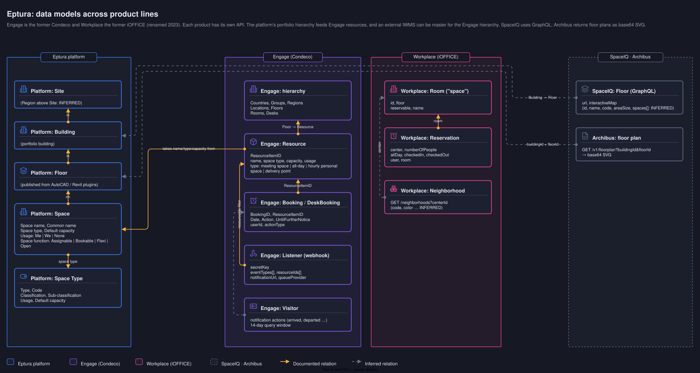

# Eptura

Researched and validated 2026-11-25. Each bracketed number links to the Sources list in §18.

"Not publicly documented" means the item was not found in these sources:
- knowledge.eptura.com: the Engage, Eptura (platform), Workplace, Serraview, SpaceIQ, Teem and Archibus trees, read through the public MindTouch API
- developer-portal.condecosoftware.com
- developer.spaceiq.com
- ioffice.github.io/api
- help.archibus.com Swagger
- security.eptura.com and status.eptura.com
- eptura.com pricing, platform and history pages
- GitHub

eptura.com blocks direct fetches (Cloudflare 403), so its pages were read through a fetch summariser. Microsoft Marketplace and G2 also returned 403 and are not cited.

**Staleness:** "possibly stale" marks a source page last edited before 2025-11-25. Where most of a section rests on such pages, a single note at the top of the section says so. Individual stale feature and pricing claims are also tagged inline.

## 0. Lineage: which product, which API

Eptura was formed from nine companies: Archibus, Condeco, Hippo CMMS, iOffice, ManagerPlus, Proxyclick, Serraview, SpaceIQ and Teem [[1]](#s1)[[1]](#s1). The name was announced on 4 Oct 2022, and HQ is in Atlanta [[1]](#s1). Thoma Bravo became majority investor in iOffice and SpaceIQ in Aug 2021 [[1]](#s1). Condeco began in London in 2005. Archibus began in Boston in 1982 and merged with Serraview in 2018 [[1]](#s1). iOffice was renamed **Eptura Workplace** in July 2023 [[2]](#s2)[[1]](#s1), and Condeco was renamed **Eptura Engage** in June 2025 [[3]](#s3).

| Current product | Heritage | Role for booking | API that applies |
|---|---|---|---|
| **Eptura Engage** | Condeco [[3]](#s3) | Primary desk/room/parking/locker booking product, hybrid work [[4]](#s4)[[5]](#s5) | **Eptura Engage (Condeco) Admin API**: Azure APIM at developer-portal.condecosoftware.com, 5 collections, Listener webhooks [[6]](#s6)[[7]](#s7)[[8]](#s8). Also the Engage SCIM API [[3]](#s3) and the Historical bookings API / Direct Data Connection [[9]](#s9) |
| **Eptura Workplace** | iOffice [[2]](#s2)[[1]](#s1) | IWMS for operations and space management, with a Reservations module (desks/rooms, neighborhoods) [[5]](#s5)[[10]](#s10)[[11]](#s11) | **iOffice REST API v2** (ioffice.github.io), plus Sensor and Visitor (beta) APIs and webhooks [[12]](#s12)[[13]](#s13)[[12]](#s12)[[14]](#s14) |
| SpaceIQ (still a separate product on the status page) | SpaceIQ | Space planning and hoteling | **SpaceIQ GraphQL** at api.spaceiq.com [[15]](#s15)[[16]](#s16) |
| Teem (still a separate component on the status page) | Teem | Not researched in depth | Zapier integration documented [[17]](#s17); status page [[16]](#s16) |
| **Serraview by Eptura** | Serraview | Portfolio and space management, with a "Serraview Engage" module and an integration that makes Serraview the authority for HR and location data in Eptura Engage [[18]](#s18) | Serraview Public API (OrgUnits/People), using a JWT-bearer grant [[19]](#s19)[[20]](#s20) |
| **Archibus by Eptura** | Archibus | IWMS. Offered as SaaS or non-SaaS (on-prem/partner hosted) and FedRAMP [[5]](#s5)[[21]](#s21)[[22]](#s22) | Web Central REST API (Swagger public) with OIDC/JWT auth [[23]](#s23)[[24]](#s24). A deployable read-only MCP server [[25]](#s25) |
| **Eptura platform services / Eptura Home** | New, cross-product | Shared Portfolio Manager (sites/buildings/floors/spaces), Space Types and Directory. Engage consumes these when enabled [[26]](#s26)[[26]](#s26)[[26]](#s26) | **Eptura Public API** (invite-only early access): Asset, Authentication, Floor Plan, HR, Space and Visitor APIs, with no Booking API listed [[27]](#s27)[[28]](#s28). The source page is titled "Eptura APIs OLD" (edited 2026-11-09), so this list may be superseded [[27]](#s27). AutoCAD/Revit floor-plan publishing plugins [[29]](#s29) |

The Workplace = iOffice link is stated directly: the July 2023 Workplace release note reads "iOffice is Eptura Workplace" [[2]](#s2), and Eptura's history page says "In 2023 the iOffice product was renamed Eptura Workplace" [[1]](#s1). It is also visible in the product: the Workplace REST API page links to ioffice.github.io [[12]](#s12), and the Workplace AutoCAD plugin's button reads "Send to iOffice" [[30]](#s30).

## 1. Snapshot
- **Positioning:** "Transform the way you manage your physical world" is the platform page headline [[5]](#s5). Engage is pitched for "workplace experience and hybrid work" [[5]](#s5).
- **Segment** (analysis): enterprise. Contracts run for at least one year [[31]](#s31), and a FedRAMP option exists for Archibus [[4]](#s4).
- **HQ:** Atlanta [[1]](#s1).
- **Pricing (page undated, read 2026-11-25):**
  - No prices are published [[31]](#s31).
  - The annual subscription is "based on the number of users supported (or locations for Eptura Visitor)" [[31]](#s31).
  - The pricing page lists two tiers, **Advanced** and **Power**, for every product (Asset, Engage, Visitor, Workplace, Serraview). Parts of the page copy are "Lorem ipsum" placeholders [[31]](#s31).
- **Licensing unit:** users. Visitor is licensed per location [[31]](#s31).
- **API / SSO / SCIM gating (unverified):**
  - The tier columns are unlabelled and the tick images have no alt text. The fetch summariser *inferred*, but did not read, that "Access to the extensive API and Developer Portal" is ticked in both Engage tiers [[31]](#s31). Treat tier-gating as unverified.
  - The Engage rows for "User management integrations including Azure AD, SCIM and Okta" and "Integrate with Outlook and Google Calendar" were also inferred as available in both tiers [[31]](#s31).
  - The Workplace rows for AutoCAD/Revit floor-plan import and Okta SSO show a single tick in an unlabelled column, so they are probably limited to one tier, and it is not known which [[31]](#s31).
  - Separately, the Engage API is sold as per-customer APIM "products" such as `[customer]_ExternalBookings_Platinum` [[32]](#s32).
  - The Eptura Public API has Starter/Advanced/Power quota packages [[28]](#s28).
- **Free tier / trial:** not publicly documented. Third-party per-user prices were seen in search snippets but could not be fetched, so they are not cited.

## 2. Space kinds (Eptura Engage unless stated)

| Kind | Booking rules / quotas | Check-in | Capacity | API / data model |
|---|---|---|---|---|
| **Desks / personal spaces** ("all-day" and "hourly") | All-day: whole or half day. Hourly: 5/15/30/60-minute increments [[33]](#s33). Several personal spaces per slot only if each is a different workspace type [[33]](#s33). Booking allowances are slot maxima per resource group, with per-user overrides [[34]](#s34). Workweek restricts weekdays [[34]](#s34). Anchor points steer a group to one floor area [[35]](#s35) (possibly stale, page dated 2025) | Check-in window and bump [[36]](#s36). Web/mobile/kiosk, QR, geofence, self-certification [[36]](#s36). Sensors [[37]](#s37) and badge/ACS [[38]](#s38) (possibly stale, pages dated 2025) | Default capacity 1 for "Me" space types [[39]](#s39) | Platform: Space with usage **Me** [[26]](#s26). Engage API: `DeskBooking_*` endpoints [[40]](#s40). Webhooks Desk / DeskProgression [[41]](#s41)[[41]](#s41) |
| **Assigned desks** (fixed / flexi) | Fixed: no booking or check-in needed. Flexi: assigned but must check in, else bumped. Either can be released to others [[42]](#s42) | Flexi only [[42]](#s42) | n/a | Platform space function Assignable→Fixed, Flexi→Flexi. Assignment is held in the Directory [[26]](#s26) |
| **Neighbourhoods** | Engage: anchor points / zones [[35]](#s35) (possibly stale, page dated 2025). Workplace: neighborhoods are a reservation-rule scope [[11]](#s11) | n/a | n/a | Engage: no neighbourhood resource in the API [[6]](#s6). Workplace: `GET /neighborhoods?centerId` [[13]](#s13) |
| **Meeting rooms** | Self-managed (book) or managed/allocated (request, admin allocates) [[35]](#s35) (possibly stale, page dated 2025). Huddle, board, training types [[33]](#s33) | Start via `UpdateMeeting_V1` actionType=1 [[43]](#s43). Sensor auto check-in/out [[37]](#s37) (possibly stale, page dated 2025) | Default capacity from platform [[26]](#s26) | Space usage **We** [[26]](#s26). `Bookings_GetBookings_V1` [[40]](#s40). Webhooks Meeting External / MeetingProgression [[8]](#s8) |
| **Car parking** | Bookable as a personal-space workspace type in the "Other spaces" list [[33]](#s33) | as desks | n/a | Platform default Space Type "Parking Space" (usage None, so it must be changed to Me before Engage shows it, which is INFERRED from [[26]](#s26) + [[39]](#s39)) |
| **Lockers** | Personal-space workspace type. Booking need not set "in office" [[33]](#s33) | as desks | n/a | Me space [[26]](#s26) |
| **Event spaces** | Engage **Events** group meeting-space bookings and output a BEO PDF [[44]](#s44) | n/a | n/a | Not exposed in the documented API collections [[6]](#s6) |
| **Equipment / services** | Vendors and catering via the Vendor collection [[6]](#s6). Delivery points are a fourth Engage resource type, Engage-only [[26]](#s26) | n/a | n/a | Vendor API collection [[6]](#s6) |
| **Visitors** | Visitor collection; visitor queries must fall within 14 days [[43]](#s43) | Visitor webhooks [[8]](#s8) | n/a | Visitor collection [[6]](#s6); Public Visitor API [[27]](#s27) |

## 3. Features
- **Rules / quotas:**
  - Engage: group-level booking rules, check-in, bump, allowances, workweeks [[36]](#s36)[[34]](#s34)[[34]](#s34).
  - Workplace: reservation rules scoped Center < Neighborhood < Space Type < Space, e.g. "Only During Work Hours", "Max Duration" [[11]](#s11).
- **Check-in:** web, mobile, kiosk, QR, geofence, sensor and badge [[36]](#s36)[[37]](#s37)[[38]](#s38). The sensor and badge pages are possibly stale (dated 2025).
- **Analytics:**
  - The Engage Historical bookings API runs on Azure Table Storage, refreshed every 24 h [[9]](#s9) (possibly stale, page dated 2025).
  - Direct Data Connection (SQL) launched in Oct 2024 [[9]](#s9) (possibly stale, page dated 2025).
- **Visitor management:** Visitor API collection [[6]](#s6) and Eptura Visitor (Proxyclick) [[4]](#s4).
- **Mobile apps:** Engage mobile app with check-in and self-certification [[36]](#s36).
- **Teams / Slack:**
  - The Engage app for Teams books spaces and shares in-office schedules [[45]](#s45).
  - Workplace sends Slack notifications [[46]](#s46) (possibly stale, page dated 2025).
  - An Engage Slack integration is not publicly documented (no Slack page in the Engage KC tree).

## 4. Floor-plan pipeline (the strongest area)
*Note: the Workplace CAD standards ([[52]](#s52)[[53]](#s53), dated 2023) and the Archibus pages ([[21]](#s21)[[22]](#s22)[[58]](#s58)[[72]](#s72), dated 2025) are possibly stale. The Workplace standards page is still linked from the 2026 SoftSpace page [[30]](#s30).*

There are four main pipelines, one per heritage:

1. **Eptura Engage native (Condeco heritage):**
   - Raster only: JPEG/PNG, recommended at most 1080×1920 px and 2 MB [[47]](#s47).
   - Admins drag resources onto the image as pins (squares for rooms, circles for hourly desks) [[47]](#s47).
   - All-day desks go on separate per-group images [[47]](#s47).
   - The image carries no space geometry: resources are placed by hand [[47]](#s47).
2. **Eptura platform services ("Floor Plan Publishing"):**
   - **Eptura for AutoCAD** (AutoCAD 2021+) and **Eptura for Revit** plugins publish floors and spaces into Portfolio Manager [[29]](#s29)[[48]](#s48)[[49]](#s49).
   - Three drawing configurations:
     - *Shapes*: floor boundary (external gross required, internal gross optional), closed space boundaries, and exactly one identifier per space as a block attribute or text, on any user-chosen layers [[48]](#s48)[[48]](#s48)[[48]](#s48).
     - *Markers*: identifiers only, no areas [[48]](#s48).
     - *Background*: image only [[48]](#s48).
   - The plugin auto-detects units, validates spaces (errors shown in red block publishing), can centre labels [[48]](#s48)[[48]](#s48), and optionally publishes space types from a layer on first publish only (unknown types become "Unknown") [[48]](#s48).
   - Revit needs a floor-plan view with Rooms and an area-plan view with gross boundaries [[49]](#s49).
   - Publishing replaces manually created spaces [[50]](#s50). Every import is logged and downloadable [[51]](#s51).
   - Once used, Engage's raster upload is disabled for that floor [[26]](#s26)[[47]](#s47).
3. **Eptura Workplace (iOffice):**
   - SoftSpace AutoCAD plugin (not AutoCAD LT) [[30]](#s30)[[30]](#s30).
   - DWG is rendered to SVG and served as PNG tiles [[30]](#s30).
   - Strict layer convention: `!A-AREA-SPACE`, `!A-AREA-FLOOR`, `!A-AREA-ROOM#`, `!BOUNDARY` [[52]](#s52), plus `!FURN`/`!WKST`/`!PANELS`/`!FILES` on the same page [[52]](#s52).
   - One unique room-number text per closed space polyline, drawings to scale, flattened, no hatches, OVERKILL/AUDIT/PURGE [[52]](#s52)[[52]](#s52).
   - One floor per DWG [[53]](#s53). Reloading surfaces "orphaned users" [[54]](#s54).
4. **Serraview:**
   - DWG per floor in AutoCAD 2013 or 2018 format, named `[Building]_[Floor].dwg` [[55]](#s55)[[56]](#s56).
   - The automated **Floor Plan Importer** batch-processes DWGs and "identif[ies] all spaces based on their polylines". Upload is via tool, file upload or SFTP [[55]](#s55).
   - The SV-ZONE layer holds the floor boundary per the BOMA/REBNY measurement standard [[56]](#s56).

**SpaceIQ and Teem (PDF accepted):**
- SpaceIQ floor plans can be prepared from a .DWG, .PDF or .PNG source file and are published into SpaceIQ as a PNG image [[57]](#s57). The PDF is therefore a source for a raster image; nothing documents parsing it into spaces.
- Teem floor plans are submitted as a PDF through a "Prepare and Submit a Floor Plan" flow [[57]](#s57) (possibly stale, page dated 2022). The page describes a submission, not automatic parsing.

**Archibus:**
- Smart Client Extensions for AutoCAD/Revit link CAD entities to DB records ("asset symbols") [[58]](#s58).
- Plans are published as **Enterprise Graphics SVG** [[58]](#s58).
- IFC models can be cataloged (rooms/equipment) from Autodesk Construction Cloud, but IFC room area is not imported [[59]](#s59).

**Auto-detection of desks/rooms from raw DWG/PDF:** not publicly documented in any product. The geometry-bearing pipelines (platform, Workplace, Serraview) all need pre-layered, closed-polyline CAD [[48]](#s48)[[52]](#s52)[[55]](#s55). That is not true of every pipeline: Engage native plans are plain raster images [[47]](#s47), and SpaceIQ and Teem accept PDF floor plans, which become images or go through a submission flow rather than being parsed [[57]](#s57).

**Indoor-map standards:**
- IFC import is supported in Archibus only [[59]](#s59).
- IMDF and IndoorGML are not publicly documented.
- PDF is accepted only as a raster or submitted source in SpaceIQ and Teem [[57]](#s57). PDF-to-geometry import is not publicly documented.

**Geometry via API:**
- Archibus: `GET /v1/floorplan` returns base64 SVG [[23]](#s23).
- SpaceIQ: Floor `url` (PNG) and `interactiveMap` iframe, plus Map Image with zoom [[15]](#s15)[[15]](#s15).
- Eptura Public API: a "Floor Plan API" that can "publish floor plan data" [[27]](#s27). Its schema is behind the invite-only portal [[28]](#s28).
- Engage Admin API: no floor-plan endpoint among its five collections [[6]](#s6).

## 5. Calendar & directory sync
*Note: most Engage calendar and provisioning sources here ([[60]](#s60)[[61]](#s61)[[62]](#s62), dated 2025) are possibly stale.*

- **Microsoft:**
  - Two Engage modes: the Microsoft 365 integration (Cloud/Evergreen only [[60]](#s60)) and Exchange Sync (Engage 3.4.5+ hosted by Eptura [[60]](#s60)).
  - Exchange Sync uses EWS for actions and Graph only for notifications [[61]](#s61).
  - It subscribes only to room calendars and can be scoped with an Application Access Policy [[61]](#s61).
  - Known gaps: no unlimited recurrences, setup/clean-down times or waitlists [[62]](#s62).
- **Google:** a Google Calendar service is configured in the Device Hub with a service-account JSON key [[63]](#s63). The pricing page lists "Integrate with Outlook and Google Calendar" [[31]](#s31). Sync direction and latency are not publicly documented.
- **Provisioning:**
  - Engage SCIM 2.0 (cloud only), with Entra/Azure AD and Okta guides [[3]](#s3).
  - Platform SCIM (Entra ID, Okta) publishes to a message broker for downstream modules. On-prem AD is unsupported [[64]](#s64).
  - The Serraview-to-Engage integration makes Serraview the authoritative source for HR and location data [[18]](#s18).
  - HRIS connectors are not publicly documented.

## 6. IoT, sensors & hardware
*Note: the Engage sensor and badge pages ([[37]](#s37)[[38]](#s38)[[65]](#s65)[[66]](#s66), dated 2025) are possibly stale.*

- **Engage:**
  - Sensor Integration needs a subscription, the production API, the cloud calendar service and the Device Hub [[65]](#s65).
  - A Sensor Data Aggregator polls vendor APIs [[65]](#s65).
  - Supported sensors: VergeSense and PointGrab [[66]](#s66).
  - Rules cover auto check-in and auto check-out for meetings, but not for Exchange-mapped rooms [[37]](#s37).
  - Sensor partners get their own APIM account [[67]](#s67).
- **Workplace:** `GET /sensors` (e.g. GE occupancy, UtilLive motion types) [[13]](#s13) and a separate Sensor API [[12]](#s12).
- **Badge / ACS:** Engage auto check-in via Eptura Visitor, a pre-built ACS connector, or the API [[38]](#s38).
- **Kiosks / displays:** Engage Kiosk, Room Screen v3, Desk Screen v3 and Wayfinder [[68]](#s68), all managed in the Device Hub [[63]](#s63).

## 7. Hosting & data
- **Engage:**
  - Cloud ("Engage Cloud", Evergreen) [[60]](#s60), on Microsoft Azure: analytics storage is in MS Azure [[9]](#s9) and the API is fronted by Azure APIM [[7]](#s7).
  - The Device Hub URL is `westeurope.condecoconnect.com` [[63]](#s63).
  - Release cadence is every 3 weeks [[69]](#s69).
  - The requirement that Exchange Sync run on "Engage hosted by Eptura" [[60]](#s60) hints that non-hosted Condeco installs existed (INFERRED). Current on-prem Engage is not publicly documented.
- **Platform:** each tenant is a "dedicated and isolated instance of Microsoft cloud services" [[70]](#s70).
- **Older security page:** logically separated DBs and backups in encrypted AWS S3 [[71]](#s71) (possibly stale, page dated 2024). Engage analytics is on Azure [[9]](#s9), so the S3 statement may not apply to every product.
- **Archibus:** SaaS (hosted by Archibus, quarterly updates) or non-SaaS (on-prem or partner-hosted, dedicated server) [[21]](#s21)[[22]](#s22). On SaaS, CAD files move by SFTP [[72]](#s72) (possibly stale, pages dated 2025).
- **Regions / data residency:**
  - Serraview is hosted on AWS, and customers choose the hosting region: Sydney, Canada Central, Frankfurt, Singapore or US East [[73]](#s73) (possibly stale, page dated 2022).
  - For Engage and Workplace, regions are not publicly documented beyond the westeurope Device Hub hostname [[63]](#s63).

## 8. Compliance & privacy
- **Trust portal** (security.eptura.com, published 2026-09-25): ISO-27001, Data Privacy Framework, GDPR, CCPA, HECVAT [[4]](#s4). No SOC 2 report is listed [[4]](#s4).
- **DPA and sub-processors:** the trust portal links a Data Processing Addendum (eptura.com/terms/dpa/) and a Sub-processors list (eptura.com/terms/subprocessors/) [[4]](#s4).
- **Older KC security page** (possibly stale, page dated 2024): ISO 27001 "Certified"; SSAE 16 SOC 2 listed as "SOC 2 certification provided by AWS and Azure"; GDPR "Compliant". The page does not say whether Eptura holds its own SOC 2 report [[71]](#s71).
- **Data classes** handled include floorplans and "utilization information about what properties are being used, and by whom", all classed as Restricted [[71]](#s71) (possibly stale, page dated 2024).
- Exchange Sync stores no extra data beyond health logs [[61]](#s61) (possibly stale, page dated 2025).
- Assistant preview chat history is kept 24 h [[74]](#s74).
- **Not publicly documented:** audit log export, and a specific stance on employee-location data.

## 9. Authentication
- **Platform:** OAuth 2.0 framework with a PingFederate federation server. OIDC and SAML 2.0 SSO, tested with Okta and Entra ID [[70]](#s70). Self-serve IdP connection arrived in Nov 2026 [[70]](#s70)[[75]](#s75).
- **Engage (legacy):** SP-initiated SAML via Ping, ACS `sso.condecosoftware.com`, entity `PING-CONDECO` [[76]](#s76)[[77]](#s77) (possibly stale, pages dated 2023 and 2025).
- **Workplace:** SAML 2.0 [[10]](#s10) (possibly stale, page dated 2025).
- **SCIM:** Engage SCIM throttles at 500/min with a 2 MB body limit [[78]](#s78) (possibly stale, page dated 2023).
- **API auth:**
  - Engage Admin API: `Ocp-Apim-Subscription-Key` + `Authorization: Bearer <JWT>` [[79]](#s79). Sensor partners get their client account through the customer and Eptura support [[67]](#s67).
  - Eptura Public API: APIM key + private-key-JWT (RS/ES 256–512, exp ≤1 h) exchanged with Okta [[28]](#s28)[[28]](#s28).
  - Workplace: basic auth via `x-auth-username`/`x-auth-password` headers [[13]](#s13), or an OAuth2 authorization-code flow (scopes not yet enforced) [[80]](#s80) (possibly stale, page dated 2023).
  - SpaceIQ: admin-generated bearer token [[15]](#s15).
  - Serraview: JWT-bearer grant [[20]](#s20) (possibly stale, page dated 2025).
  - Archibus: customer-IdP-signed JWT [[24]](#s24).

## 10. REST API (Engage focus)
*Note: the core Engage API overview pages ([[6]](#s6)[[40]](#s40)[[86]](#s86), dated 2025-06) are possibly stale.*

- **Docs:** Engage KC API pages plus the APIM portal at developer-portal.condecosoftware.com [[7]](#s7). Sign-up is via integrationportal(-uat).condecosoftware.com and needs two support tickets [[32]](#s32).
- **Base URL:** per customer, `/{ClientName}/api/V1/...` [[43]](#s43).
- **Main resources:** five collections: CostCode, ExternalBooking (bookings, desk bookings, users, listeners), HierarchyMapping (Countries, Groups, Regions, Locations, Floors, Rooms, Desks, with the external system as master), Vendor and Visitor [[6]](#s6)[[6]](#s6)[[40]](#s40).
- **OpenAPI:**
  - Engage: rendered in the APIM portal [[7]](#s7). Whether it can be downloaded publicly was not verified, because the portal needs a login (assumption: it cannot). A Postman collection (`Condeco_AdminAPI_Generic.json`) is referenced [[79]](#s79).
  - Archibus: Swagger HTML is public [[23]](#s23).
  - Workplace: public HTML reference docs [[13]](#s13).
- **Pagination:** Engage uses `pageNumber`/`pageSize` [[43]](#s43). Workplace uses `limit` (≤100) and `startAt` [[13]](#s13).
- **Rate limits:**
  - Engage: 500/min and 50k/week [[40]](#s40).
  - Public API: 100k/200k/500k per week by package [[28]](#s28).
  - Workplace: not publicly documented.
- **Versioning:** a `V1` path segment and `_V1` endpoint suffixes [[40]](#s40)[[43]](#s43). Workplace is `/rest/v2` [[13]](#s13). A deprecation policy is not publicly documented.
- **Design guidance:** endpoints are "mostly room centric". Bulk-load 14 days, then follow listeners. Polling degrades beyond ~150 resources [[40]](#s40)[[40]](#s40).

## 11. Events & real-time
- **Engage Listener service:**
  - `POST/GET/DELETE /api/V1/listener` (delete takes a JSON body) [[79]](#s79)[[79]](#s79).
  - Event types 0–8 (Meeting, Desk, MeetingExternal, MeetingProgression, DeskProgression, Resource, Visitor, among others) [[79]](#s79).
  - Delivery by HTTP POST or Azure Storage Queue [[79]](#s79).
  - Payload envelope: `Id`, `Attempt` (delivery count, which implies retries), and `Notifications[]{Action, DynamicParamA}`, where `DynamicParamA` is AES-encrypted with the upper-cased ClientId as key and IV [[81]](#s81) (possibly stale, page dated 2025).
  - A `secretKey` is included for verification [[79]](#s79).
  - Payloads are thin (IDs plus an action enum) [[41]](#s41)[[41]](#s41), so consumers re-fetch by ID [[40]](#s40).
- **Workplace webhooks:** Create/Update/Delete/Archive across 140 data points, GET or POST, signed with HMAC-SHA256 in `x-ioffice-signature` [[14]](#s14) (possibly stale, page dated 2023; the page itself says "HMAC-256" and "HMAC-SHA265").
- **Status page:** webhook, Slack, RSS and Atom feeds [[16]](#s16).
- **Streaming:** not publicly documented.

## 12. Data model (documented)

Source: [`diagrams/eptura.drawio`](diagrams/eptura.drawio). The SVG embeds the diagram, so it also opens in draw.io for editing.

| Entity | Key fields | Relations | Source |
|---|---|---|---|
| Portfolio Site / Building / Floor / Space (platform) | Space name, Common name, Space type, Default capacity [[26]](#s26); Usage Me/We [[26]](#s26) or None [[39]](#s39) (Common: INFERRED); Space function Assignable/Bookable/Flexi/Open [[26]](#s26) | Site→Building→Floor→Space, mapping to Engage Region/Location/Floor/Resource [[26]](#s26). A parent Region level above Site, unused in Engage: INFERRED | [[26]](#s26)[[26]](#s26)[[26]](#s26)[[26]](#s26)[[39]](#s39) |
| Space Type (platform) | Type, Code, Classification, Sub-classification, Usage, Default capacity | Space → Space Type [[39]](#s39) | [[39]](#s39) |
| Engage Resource | ResourceItemID [[41]](#s41); name, space type, default capacity, usage [[26]](#s26); resource type (meeting space / all-day / hourly personal space / delivery point) [[26]](#s26) | Floor→Resource [[26]](#s26). Group→Resource (booking rules) [[34]](#s34) | [[34]](#s34)[[26]](#s26)[[26]](#s26)[[26]](#s26)[[41]](#s41) |
| Engage Booking / DeskBooking | BookingID, ResourceItemID, Date, Action, UntilFurtherNotice [[41]](#s41); userId, bookingId, actionType [[43]](#s43) | Booking→Resource [[41]](#s41), Booking→User [[43]](#s43) | [[43]](#s43)[[41]](#s41) |
| Engage Listener | secretKey, eventTypes[], resourceIds[], notificationUrl, queueProvider | Listener→Resource (filter) | [[79]](#s79) |
| Engage Visitor | Visitor notification actions (arrived, departed and so on) [[8]](#s8)[[41]](#s41); queries limited to a 14-day window [[43]](#s43) | Visitor→Booking (INFERRED) | [[43]](#s43)[[8]](#s8)[[41]](#s41) |
| Engage Hierarchy (API) | Countries, Groups, Regions, Locations, Floors, Rooms, Desks | External IWMS is master [[6]](#s6) | [[6]](#s6) |
| Workplace Room ("space") | id, floor, reservable, name | Building→Floor→Room | [[13]](#s13)[[13]](#s13) |
| Workplace Reservation | center, numberOfPeople, allDay, checkedIn, checkedOut, user, room; PUT checkIn/checkOut | Reservation→Room, →User, →Center | [[13]](#s13) |
| Workplace Neighborhood | Endpoint `GET /neighborhoods?centerId` [[13]](#s13). Fields (code, color, borderColor, fillOpacity, owner, center) appear in the API page's example but are not in the ledger claim: INFERRED | Center→Neighborhood [[13]](#s13) | [[13]](#s13) |
| SpaceIQ Floor | url, interactiveMap [[15]](#s15). Other fields (id, name, code, areaSize, spaces[]) appear in the API's example query but are not in the ledger claim: INFERRED | Building→Floor→Space (INFERRED) | [[15]](#s15) |
| Archibus floor plan | buildingId, floorId → base64 SVG | Building→Floor | [[23]](#s23) |

## 13. SDKs & ecosystem
- **Official SDKs:** not publicly documented.
- **GitHub:**
  - The `eptura` org has 0 public repos [[82]](#s82).
  - The iOFFICE org has 71 mostly legacy or fork repos [[83]](#s83).
  - Engage webhook decode samples are C# snippets in the KC [[81]](#s81).
- **Community:** `fiddyschmitt/condeco-cli` (MIT, booking and check-in automation) [[84]](#s84).
- **Zapier:** Teem has a documented Zapier integration [[17]](#s17) (possibly stale, page dated 2024). Zapier for Engage or Workplace, Power Automate and Make are not publicly documented.
- **Teams:** see [[45]](#s45).

## 14. Developer experience
- **Sandbox:**
  - Engage has a UAT APIM portal [[32]](#s32).
  - The Public API is invite-only early access [[28]](#s28)[[28]](#s28).
- **Postman:** Engage Admin API collection [[79]](#s79).
- **Changelog:**
  - Product release notes on the KC [[75]](#s75) and the Engage release schedule [[69]](#s69).
  - A deprecation policy is not publicly documented.
- **Docs quality** (analysis): Engage API docs are thin and narrative, and full schemas sit behind the APIM login [[7]](#s7). Workplace and Archibus have complete public references [[23]](#s23)[[13]](#s13). Access requires several manual support tickets [[32]](#s32).

## 15. AI & agents
- **Copilot for Eptura Engage** (preview): natural-language booking in Teams [[45]](#s45).
- **Eptura AI Assistant** (preview):
  - A Microsoft Copilot/Teams agent with an orchestrator built on an **MCP server architecture** [[74]](#s74).
  - Needs an Eptura AI license [[74]](#s74). Preview limits are 500 chars, 80 chats/day and 24 h history [[74]](#s74).
- **Archibus MCP server:** Archibus ships a deployable, single-tenant, read-only MCP server that exposes 69 tools over Archibus/WebCentral data. It proxies to WebCentral REST `/api/v1/mcp/...` using OAuth2 client credentials [[25]](#s25).
- The **Public Asset API "mirrors 24 MCP tools"** [[27]](#s27).
- "Intelligent booking" is an Engage feature that anchor points depend on [[35]](#s35) (possibly stale, page dated 2025).

## 16. Accessibility & i18n
- Engage aims for WCAG 2.2 AA and references a VPAT. The VPAT document itself was not found [[85]](#s85).
- **Languages:** the web app supports en-GB/US, fr, de, it, pt-BR and es. The mobile app has zh-CN, en-US, fr, de, it, ja, pt-BR and es. Room Screen v3 adds ar-SA. Reports are English only [[68]](#s68).
- **Timezone / multi-region:** not publicly documented.

## 17. Relevance to spaceweave (analysis)
- **The ingestion contract is close to ours.** Eptura's newest pipeline (platform Floor Plan Publishing) defines exactly the semantic layer spaceweave must produce from raw DWG:
  - a floor boundary (gross external, optional internal),
  - closed space boundaries,
  - one identifier per space,
  - an optional space-type layer,
  - drawing units,
  - and a "marker" fallback when only points are known [[48]](#s48)–[[48]](#s48).

  These are worth mirroring as explicit **floor-plan modes (shapes / markers / background)** with a validation report that blocks publish on bad spaces [[48]](#s48). Our auto-detection would let customers skip Eptura's manual layer preparation (Workplace P-line rules [[52]](#s52)–[[52]](#s52), Serraview SV-ZONE [[56]](#s56)). That preparation is the obvious pain point. No Eptura product documents detecting spaces from un-layered CAD or PDF: where PDF is accepted (SpaceIQ, Teem), it becomes an image or goes through a submission flow [[57]](#s57).
- **Space-kind modelling:**
  - The **Me/We usage** × **space function (Bookable/Assignable/Flexi/Open)** × **booking period (all-day/hourly)** decomposition [[26]](#s26)[[26]](#s26)[[33]](#s33) separates *what a space is* from *how it is allocated*. That is a stronger split than a flat "desk/room" enum.
  - The default Space Types carry BOMA-like classification/sub-classification and default capacity [[39]](#s39), which helps with area reporting.
  - Parking and lockers are just Me-usage workspace types [[33]](#s33)[[26]](#s26), so no special casing is needed.
- **Hierarchy:** Site→Building→Floor→Space, with renaming on the booking side [[26]](#s26). Keep the canonical spatial hierarchy separate from booking-product labels.
- **Geometry export:** Archibus serves SVG per floor [[23]](#s23). Workplace renders DWG→SVG→PNG [[30]](#s30). SVG plus space IDs is the de-facto exchange format, so spaceweave should emit SVG keyed by stable space IDs alongside any richer geometry (GeoJSON/IMDF).
- **Integration target:** Engage's `HierarchyMapping` collection lets an external system master Countries→Desks [[6]](#s6). Together with the Public "Floor Plan API … publish floor plan data" [[27]](#s27), spaceweave could plausibly *push* detected floors and spaces into Eptura. This is INFERRED: the schemas are behind the invite-only portal, and the Public API page is titled "Eptura APIs OLD" [[27]](#s27)[[28]](#s28).
- **Events:** thin ID-only webhooks with an attempt counter [[81]](#s81)[[41]](#s41). HMAC-signed Workplace hooks [[14]](#s14) are the better pattern to copy.

## 18. Sources

All accessed 2026-11-25.

1. https://eptura.com/resource/eptura-history/ (blog)
2. https://knowledge.eptura.com/Workplace/Product_Information/Product_Releases_Archive/2023_Product_Releases/2023_July_Eptura_Workplace_Product_Release (official-docs)
3. https://knowledge.eptura.com/Engage/Integrations/Eptura_Engage_SCIM_API/010-Technical_information (official-docs)
4. https://security.eptura.com/ (official-docs)
5. https://eptura.com/our-platform/ (blog)
6. https://knowledge.eptura.com/Engage/Integrations/Eptura_Engage_API_service/020-Condeco_API_endpoints (api-ref)
7. https://developer-portal.condecosoftware.com/ (api-ref)
8. https://knowledge.eptura.com/Engage/Integrations/Eptura_Engage_API_service/Webhooks_and_Notification_service (official-docs)
9. https://knowledge.eptura.com/Engage/Data_analytics_and_reporting/Historical_bookings_API (official-docs)
10. https://knowledge.eptura.com/Workplace/Integrations/01_Technical_Overview (official-docs)
11. https://knowledge.eptura.com/Workplace/Modules/Reservations/Reservations_Administration/Set_up_Reservation_Rules (official-docs)
12. https://knowledge.eptura.com/Workplace/Integrations/REST_API (official-docs)
13. https://ioffice.github.io/api/ (api-ref)
14. https://knowledge.eptura.com/Workplace/Integrations/Set_up_Webhooks_in_Eptura_Workplace (official-docs)
15. https://developer.spaceiq.com/ (api-ref)
16. https://status.eptura.com/ (official-docs)
17. https://knowledge.eptura.com/Teem/Integrations/Custom_Integration/Zapier_Integration (official-docs)
18. https://knowledge.eptura.com/Serraview/Integrations/Eptura_Engage_Integration (official-docs)
19. https://knowledge.eptura.com/Serraview/Integrations/Serraview_Public_API/Serraview_Public_API_Overview (official-docs)
20. https://knowledge.eptura.com/Serraview/Integrations/Serraview_Public_API/Serraview_Public_API_Overview/Prepare_to_make_an_authorized_Public_API_Call (official-docs)
21. https://knowledge.eptura.com/Archibus/Welcome_to_Archibus/3_Deployment_Options/5-Archibus__non-SaaS (official-docs)
22. https://knowledge.eptura.com/Archibus/Welcome_to_Archibus/3_Deployment_Options/4-Archibus_SaaS (official-docs)
23. https://help.archibus.com/swagger-WebCentral-RestApi.html (api-ref)
24. https://knowledge.eptura.com/Archibus/Archibus_System_Help/System_Integrator/Business_Logic_Extensions/1202_REST_API/1207-System_Integrator_Overview/Web_Central_REST_API_Implementation (official-docs)
25. https://knowledge.eptura.com/Archibus/Archibus_System_Help/Installation/Deploy_AI_Integration (official-docs)
26. https://knowledge.eptura.com/Engage/06-Configuration/Application_setup/Eptura_Engage_and_Eptura_platform_services (official-docs)
27. https://knowledge.eptura.com/Eptura/Integrations/Eptura_Public_API/020-Eptura_APIs (Manage your floor plans and it provides endpoints to retrieve building and floor information, and publish floor plan data.")
28. https://knowledge.eptura.com/Eptura/Integrations/Eptura_Public_API/010-Register_for_access (official-docs)
29. https://knowledge.eptura.com/Eptura/Integrations/Floor_Plan_Publishing (official-docs)
30. https://knowledge.eptura.com/Workplace/Modules/Space/83_SoftSpace_for_AutoCAD_Plug-in (official-docs)
31. https://eptura.com/pricing/ (official-docs)
32. https://knowledge.eptura.com/Engage/Integrations/Eptura_Engage_API_service/010-Register_for_access/API_Access%3A_Subscribing_to_the_Eptura_Engage_APIs (official-docs)
33. https://knowledge.eptura.com/Engage/02-End-user_guides/Getting_started/020-Condeco_fundamentals/Workspace_types (official-docs)
34. https://knowledge.eptura.com/Engage/02-End-user_guides/Getting_started/020-Condeco_fundamentals/Booking_allowances_and_Workweek_assignments (official-docs)
35. https://knowledge.eptura.com/Engage/02-End-user_guides/Getting_started/020-Condeco_fundamentals/Glossary (official-docs)
36. https://knowledge.eptura.com/Engage/02-End-user_guides/Getting_started/020-Condeco_fundamentals/Check-in_and_bump_for_personal_spaces (official-docs)
37. https://knowledge.eptura.com/Engage/Integrations/Eptura_Engage_Sensor_Integration/010-Supported_features_and_actions (official-docs)
38. https://knowledge.eptura.com/Engage/Integrations/Eptura_Engage_Automated_Check-in_via_ACS (official-docs)
39. https://knowledge.eptura.com/Eptura/Tools/Space_Types/000_Space_Types_Overview (Desk \)
40. https://knowledge.eptura.com/Engage/Integrations/Eptura_Engage_API_service/Design_considerations (official-docs)
41. https://knowledge.eptura.com/Engage/Integrations/Eptura_Engage_API_service/Webhooks_and_Notification_service/030-Notification_messages_overview (api-ref)
42. https://knowledge.eptura.com/Engage/02-End-user_guides/Getting_started/020-Condeco_fundamentals/Assignment_types_for_personal_spaces (official-docs)
43. https://knowledge.eptura.com/Engage/Integrations/Eptura_Engage_API_service/Example_use_cases (official-docs)
44. https://knowledge.eptura.com/Engage/04-Administration/Events (official-docs)
45. https://knowledge.eptura.com/Engage/06-Configuration/Preview_channel/Copilot_for_Eptura_Engage_(Condeco (official-docs)
46. https://knowledge.eptura.com/Workplace/Integrations/Slack_Integration (official-docs)
47. https://knowledge.eptura.com/Engage/06-Configuration/Application_setup/070-Floor_plans (official-docs)
48. https://knowledge.eptura.com/Eptura/Integrations/Floor_Plan_Publishing/Eptura_for_AutoCAD_plugin (official-docs)
49. https://knowledge.eptura.com/Eptura/Integrations/Floor_Plan_Publishing/Eptura_for_Revit_plugin (official-docs)
50. https://knowledge.eptura.com/Eptura/Tools/Portfolio_Manager/03_Update_your_Buildings/004_Automated_vs_Manual_Space_Creation (official-docs)
51. https://knowledge.eptura.com/Eptura/Integrations/Floor_Plan_Publishing/Floor_Plan_Import_Log (official-docs)
52. https://knowledge.eptura.com/Workplace/Modules/Space/83_SoftSpace_for_AutoCAD_Plug-in/P-Line_Standards_for_Eptura_AutoCAD_File (official-docs)
53. https://knowledge.eptura.com/Workplace/Modules/Space/83_SoftSpace_for_AutoCAD_Plug-in/Eptura_Facility_Data_and_AutoCAD_Format_Requirements (official-docs)
54. https://knowledge.eptura.com/Workplace/Modules/Space/10_Using_Space_Desktop_in_Admin_Mode/Load_Floor_Plan_Drawing_Manually (official-docs)
55. https://knowledge.eptura.com/Serraview/Integrations/Portfolio_Data_-_Import/Floor_plan_Management (official-docs)
56. https://knowledge.eptura.com/Serraview/Integrations/Portfolio_Data_-_Import/Floor_plan_Management/Serraview_CAD_Preparation (official-docs)
57. https://knowledge.eptura.com/SpaceIQ/Admins/Manage_Overview/Manage_Buildings%2F%2FFloors/006_Upload_a_Floorplan (official-docs)
58. https://knowledge.eptura.com/Archibus/Welcome_to_Archibus/7_Components/14-Smart_Client_Extensions_for_AutoCAD_and_Revit (official-docs)
59. https://knowledge.eptura.com/Archibus/Administration/CAD_and_BIM_Manager_Overview/Catalog_and_Publish_BIM_Models_Overview/4614-Catalog_IFC_Models (official-docs)
60. https://knowledge.eptura.com/Engage/Product_information/Requirements_for_Eptura_Engage_products (official-docs)
61. https://knowledge.eptura.com/Engage/06-Configuration/Eptura_Engage_and_Microsoft/Exchange_Sync/010-Technical_information/Data_access_and_security (official-docs)
62. https://knowledge.eptura.com/Engage/06-Configuration/Eptura_Engage_and_Microsoft/Exchange_Sync/030-Good_to_know (official-docs)
63. https://knowledge.eptura.com/Engage/08-Condeco_screens_and_devices/Eptura_Device_Hub/020-Condeco_Meeting_Room_Screens/020-Set_up_a_calendar_service/Google_calendar (official-docs)
64. https://knowledge.eptura.com/Eptura/Integrations/Eptura_SCIM/010_User_Provisioning_Overview (official-docs)
65. https://knowledge.eptura.com/Engage/Integrations/Eptura_Engage_Sensor_Integration/020-Technical_information (official-docs)
66. https://knowledge.eptura.com/Engage/Integrations/Eptura_Engage_Sensor_Integration/030-Supported_sensors (official-docs)
67. https://knowledge.eptura.com/Engage/Integrations/Eptura_Engage_API_service/Integrate_sensor_partner_services_with_the_Eptura_Engage_API (official-docs)
68. https://knowledge.eptura.com/Engage/Product_information/Language_support (official-docs)
69. https://knowledge.eptura.com/Engage/Product_information/Release_and_maintenance_schedule_for_Eptura_Engage (official-docs)
70. https://knowledge.eptura.com/Eptura/Integrations/Authentication/Authentication_Overview (official-docs)
71. https://knowledge.eptura.com/Eptura/Eptura_Security/Eptura_System_Security_and_Privacy (Certified \)
72. https://knowledge.eptura.com/Archibus/Welcome_to_Archibus/3_Deployment_Options/Operational_Differences_of_Archibus_SaaS_and_Non-SaaS (official-docs)
73. https://knowledge.eptura.com/Serraview/Product_Information/Our_Technology/Explore_the_Serraview_Technology_Platform/003Serraview_Cloud_Hosting (official-docs)
74. https://knowledge.eptura.com/Eptura/Integrations/Eptura_Assistant (official-docs)
75. https://knowledge.eptura.com/Eptura/Whats_New/2026_November_Eptura_Product_Release (official-docs)
76. https://knowledge.eptura.com/Engage/06-Configuration/User_authentication/SSO_and_Eptura_Engage/Other_SSO_integrations (official-docs)
77. https://knowledge.eptura.com/Engage/06-Configuration/User_authentication/SSO_and_Eptura_Engage (official-docs)
78. https://knowledge.eptura.com/Engage/Integrations/Eptura_Engage_SCIM_API/040-SCIM_API_developers_guide/005-Throttling (official-docs)
79. https://knowledge.eptura.com/Engage/Integrations/Eptura_Engage_API_service/Webhooks_and_Notification_service/010-Register_a_listener (Desk \)
80. https://knowledge.eptura.com/Workplace/Integrations/REST_API/Using_OAuth_2.0_to_Access_the_API (official-docs)
81. https://knowledge.eptura.com/Engage/Integrations/Eptura_Engage_API_service/Webhooks_and_Notification_service/020-Decode_notification_messages (api-ref)
82. https://github.com/eptura (github)
83. https://github.com/iOffice (github)
84. https://github.com/fiddyschmitt/condeco-cli (github)
85. https://knowledge.eptura.com/Engage/Product_information/Accessibility (official-docs)
86. https://knowledge.eptura.com/Engage/Integrations/Eptura_Engage_API_service (official-docs)

## Validation

161 accept, 3 revise (C13, C51, C151), 0 reject, 9 new (N1–N9, all cited). Pricing tier-gating is now marked unverified: the Advanced/Power tiers apply to every product, and the Workplace rows look single-tier. The Public API list adds Asset and Authentication, has no Booking API, and notes that its page is titled "Eptura APIs OLD". The SOC 2 wording no longer claims Eptura has no report of its own. 13 unsourced statements were removed or corrected: the Workplace = iOffice INFERRED note and "+ SpaceIQ heritage" were replaced by N1/N2; "Core API", Device Hub as a platform component and the Teem-to-Engage link were dropped; Serraview Engage now cites N8 and the positioning quote cites N9; "enterprise" is labelled as analysis; the DPA and sub-processor list (N3), Archibus MCP server with 69 tools (N6), Teem Zapier (N5) and Serraview customer-selectable AWS regions (N7) were added; and "every pipeline needs pre-layered CAD" was corrected with N4. SpaceIQ accepts DWG/PDF/PNG but publishes a PNG image, and Teem takes PDF submissions; neither parses the PDF into geometry. Unledgered page-title-only statements were dropped, along with the "paid" sensor inference, Room Screen v2, and endpoint names and fields that don't trace to a claim (dateUpdated, Room type, Resource status/capacity/attributes, Retained/Shared). Region→Site, Common usage and the Neighborhood and SpaceIQ Floor example fields are marked INFERRED. For the 47 STALE flags, §4, §5, §6 and §10 get a section-level note, and stale feature claims are tagged inline. The pricing claims are undated, so they carry no stale tag. Claim ids (C#/N#) refer to the evidence ledger and validation report in `evidence/`.
