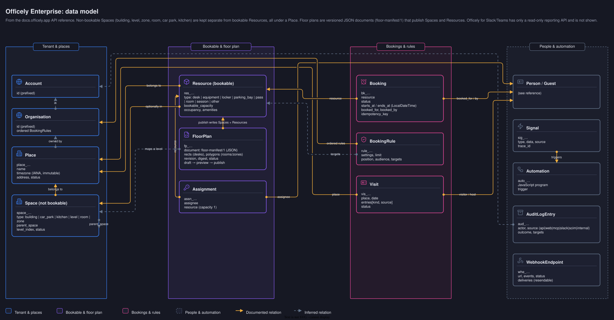

# Officely — vendor profile

Researched and validated 2026-11-25. Each bracketed number links to the Sources list in §18.

**Read this first: Officely is now two products from one company.**
- **Officely for Slack / Microsoft Teams** (called "classic" below; that is our label, not the vendor's; help centre at help.getofficely.com). This is the original Slack-native desk booking app [[1]](#s1). It is sold as Basic/Premium plans with add-ons for Parkly (parking) and Meeting Rooms [[2]](#s2). Floor plans are static PNG links [[3]](#s3)[[4]](#s4) (possibly stale, page dated 2025). It has a small reporting API, workspace-scoped and documented in OpenAPI [[5]](#s5)[[5]](#s5).
- **Officely Enterprise** (officely.app; docs at docs.officely.app). This is a newer, much richer platform [[6]](#s6). It has a dated-version REST API, webhooks, an MCP server, SCIM and a JSON floor-plan model [[7]](#s7)[[8]](#s8)[[9]](#s9). Today's getofficely.com marketing and pricing describe this product [[10]](#s10)[[11]](#s11).

The hint "Slack/Teams-native" fits Officely for Slack/Teams. The developer surface that matters to spaceweave belongs to Enterprise.

## 1. Snapshot
- **Company and products:** both products come from the same company, Hotelflex Limited trading as Officely. The Slack Marketplace lists the publisher of the Slack app as HotelFlex Limited [[1]](#s1), and validation on 2026-11-25 found the same entity on the Enterprise side: the DPA at trust.officely.app states that "Hotelflex Limited, trading as Officely" provides Officely Enterprise, and getofficely.com's privacy policy and terms name the same company [[1]](#s1). getofficely.com also links straight to docs.officely.app, trust.officely.app and api.officely.app, and its status page tracks both the Slack app and the web app [[12]](#s12). The workspace reporting API at api.getofficely.com belongs to Officely for Slack/Teams, not to Enterprise: its token is created "in Officely for Slack or Microsoft Teams" [[5]](#s5).
- **Positioning:** desk, meeting room and parking booking. Enterprise is pitched as "workplace intelligence beyond basic desk booking" [[6]](#s6)[[11]](#s11). YC describes it as "Office management software for hybrid workspaces" [[13]](#s13) (third-party).
- **Backing:** backed by Y Combinator (S17) and, by its own claim, used by 500+ companies [[14]](#s14). YC's profile lists HQ as London, UK [[13]](#s13) (third-party). It raised a $2M seed led by TEN13 in 2021 [[15]](#s15) (third-party; possibly stale, page dated 2021).
- **Segment:** SMB to mid-market. The $500/month minimum [[10]](#s10) and per-space pricing [[10]](#s10) point toward mid-size offices (analysis).
- **Pricing (Enterprise, undated page, references G2 Fall 2026):** $2 per bookable space per month billed annually, or $2.50 billed monthly [[10]](#s10), in USD [[10]](#s10). The minimum is $500/month [[10]](#s10). There is no free plan and no tiers [[10]](#s10), and no separate enterprise tier [[10]](#s10). The vendor compares this with a typical ~$5/person [[14]](#s14).
- **Licensing unit:** the bookable space (desk, room or parking space), not the user [[10]](#s10).
- **Gating:** everything is in the single plan, including the API [[10]](#s10), Entra SSO [[10]](#s10) and all integrations: 35 per the pricing page (34 listed on /integrations) [[10]](#s10)[[16]](#s16). The pricing page does not mention SCIM, though the API reference documents it [[17]](#s17).
- **Officely for Slack/Teams pricing:** current Basic/Premium prices are **not publicly documented**. I checked the help centre billing article and the pricing page. In 2021 there was a free plan for ≤10 employees and one office [[15]](#s15), then $2.50 per office employee per month [[15]](#s15) (third-party; possibly stale, page dated 2021).

## 2. Space kinds
Enterprise data model ([[18]](#s18)–[[19]](#s19)):

| Kind | Representation | Notes |
|---|---|---|
| Hot desk | Resource `type=desk`, `bookable_capacity` 1 | — |
| Desk pool / neighbourhood | Floor-plan `snap-pool` node becomes a pool Resource bookable by several people [[9]](#s9). A ResourceGroup per Space (INFERRED as the neighbourhood equivalent) | Officely for Slack/Teams: "neighbourhoods" with a desk count, where blank means unlimited [[20]](#s20), grouped by category such as floors [[20]](#s20) (possibly stale, page dated 2025) |
| Assigned desk | Assignment on a capacity-1 Resource [[21]](#s21); AssignmentRelease lends it out | — |
| Meeting room | Resource `type=room`, booked as a whole [[18]](#s18) | Officely for Slack/Teams: separate "Meeting Rooms by Officely" add-on [[2]](#s2) |
| Car parking | Resource `type=parking_bay` [[18]](#s18) inside a Space `type=car_park` [[22]](#s22) | Officely for Slack/Teams: separate "Parkly" app [[2]](#s2) |
| Lockers / equipment | Resource `type=locker` / `equipment` | — |
| Passes (lunch, day pass) | Resource `type=pass` [[18]](#s18) | — |
| Time slots (EV charger) | Resource `type=session` [[18]](#s18) | — |
| Event spaces | Not publicly documented (no event type in the Resource enum) | — |

- **Booking rules:** BookingRules are ordered. For each setting the first matching rule wins [[23]](#s23), and every matching limit applies [[23]](#s23).
- **Check-in:** `POST /bookings/:id/check-in` works only while the booking's check-in window is open [[24]](#s24). Booking statuses include `expired` for undecided approvals [[24]](#s24).
- **Capacity:** `bookable_capacity` sets concurrent bookings, while `occupancy` is a recommended headcount for information only and does not limit bookings [[18]](#s18).

## 3. Features
- **Rules and quotas:** see §2 [[23]](#s23)[[23]](#s23). Officely for Slack/Teams has booking windows and limits (Parkly booking-limits article listed in the help centre) [[2]](#s2).
- **Check-in:** in Officely for Teams, a reminder prompts people to confirm attendance and admins can auto-cancel unchecked bookings [[25]](#s25). Enterprise has a check-in endpoint and events, and badge, Wi-Fi and sensor Signals feed Automations [[11]](#s11)[[26]](#s26)[[27]](#s27).
- **Analytics:** Officely for Slack/Teams has a workspace reporting API covering offices, people, teams, work statuses and insights [[5]](#s5)[[5]](#s5)[[5]](#s5). Enterprise attendance reporting is not covered by any validated source.
- **Visitors:** Enterprise has Guest and Visit objects. A Visit aggregates the day's arrivals and departures from sources including badge, Wi-Fi, kiosk and QR code [[28]](#s28).
- **Mobile apps:** native iOS/Android apps are not publicly documented. The product runs in Teams [[16]](#s16) and the web [[12]](#s12), and Officely for Slack also runs in Slack [[1]](#s1).
- **Teams/Slack:** both are supported [[1]](#s1)[[16]](#s16). The Slack app is not available on Enterprise Grid [[1]](#s1). The Enterprise API has a Slack workspace toggle [[29]](#s29) and Teams setup endpoints [[30]](#s30)[[30]](#s30).

## 4. Floor-plan pipeline
- **Officely for Slack/Teams:** the floor plan is a PNG hosted elsewhere and pasted as a link [[3]](#s3)[[4]](#s4). The vendor deliberately has no interactive map [[3]](#s3)[[4]](#s4) and does not create floor plans for customers [[3]](#s3) (possibly stale, page dated 2025).
- **Enterprise:** the Floor Plan object holds a JSON `document` (format `floor-manifest/1`) made of `nodes`. Each node carries a projection tag: `snap-desk` uses a rectangle with x/y/w/h, defaulting to 108×60 [[9]](#s9), while `snap-pool`, `snap-room` and `snap-space` use polygons of at least 3 points [[9]](#s9). Publishing creates, updates or archives Spaces and Resources, and a resource is placed in the smallest Space that contains the centre of its box [[9]](#s9). The workflow is draft, then preview, then publish [[9]](#s9)[[9]](#s9)[[31]](#s31). Only the 3 most recent published versions are kept [[9]](#s9).
- **Import formats (CAD/DWG/DXF/PDF/SVG/image):** not publicly documented for Enterprise. The UI floor-plan guide covers only drafts and publishing [[31]](#s31). Officely for Slack/Teams accepts PNG only [[3]](#s3) (possibly stale, page dated 2025).
- **Auto-detection of desks/rooms:** not publicly documented.
- **Indoor-map standards (IMDF, IndoorGML, IFC):** not publicly documented.
- **Geometry via API:** yes for Enterprise. `GET /floor-plans/:id/document` and the versions endpoints return the node geometry [[9]](#s9). The coordinate units are not documented.

## 5. Calendar and directory sync
- **Calendars:** organisation-wide Google Calendar or Outlook connection. It writes confirmed bookings into each person's work calendar [[32]](#s32)[[16]](#s16) and backfills existing bookings [[32]](#s32). It can optionally set office days as each person's working location and name the mapped building in it [[32]](#s32). Sync appears to run one way, Officely to calendar (INFERRED: the docs describe no read-back). Latency is not publicly documented. Resource (room) calendars are not documented.
- **Directory:** Microsoft Entra ID provisioning sends names, work email, active status and selected groups [[33]](#s33)[[16]](#s16). SCIM connections are managed through the API [[17]](#s17), and the Entra setup token expires after 7 days [[17]](#s17). When Entra marks someone inactive, Officely deactivates them and ends their current and upcoming bookings, waitlist places, desk assignments, group memberships and roles [[33]](#s33). Okta and Google provisioning are not publicly documented.
- **HRIS:** the integrations page lists 30 integrations tagged "HR and leave", including Workday, SAP SuccessFactors, Personio, HiBob, BambooHR and Rippling [[16]](#s16).

## 6. IoT, sensors and hardware
- There is no named sensor or access-control vendor. Sensors connect through the API [[16]](#s16), and badge and Wi-Fi check-in is advertised [[10]](#s10).
- Mechanism: systems record Signals, typed by a customer-defined JSON-schema SignalType. A Signal alone changes nothing [[26]](#s26). An Automation (customer JavaScript) reacts to it [[27]](#s27). Visit entries can carry the sources `badge`, `wifi`, `kiosk` and `qr_code` [[28]](#s28).
- Kiosks and room/desk displays: hardware products are not publicly documented. `kiosk` appears only as a Visit source value [[28]](#s28).

## 7. Hosting and data
- **Enterprise:** SaaS on Cloudflare [[34]](#s34). The core database can be located in the EU, the US, or Cloudflare's FedRAMP Moderate data centres, agreed at account setup; otherwise Officely chooses per customer [[35]](#s35)[[34]](#s34)[[34]](#s34). This is a data-centre location choice, not a FedRAMP authorisation of Officely. Analytics, AI, logs, support and integrations may be processed outside that location, including in the US [[34]](#s34).
- **Officely for Slack** (per its marketplace listing): Google Cloud, United Kingdom [[1]](#s1), with AES-256 encryption at rest [[1]](#s1).
- On-prem or private cloud: not publicly documented, and the product appears to be SaaS only.

## 8. Compliance and privacy
- The trust centre at trust.officely.app has a security overview, privacy policy, terms of service, DPA and subprocessors list [[36]](#s36).
- **SOC 2 / ISO 27001 / Cyber Essentials:** not publicly documented. None appears on the trust centre, data-handling page or DPA.
- **GDPR DPA:** live data is deleted within 60 days of a deletion request [[37]](#s37). Breach notice is "without undue delay" with no hour limit [[37]](#s37). New subprocessors get at least 20 days' email notice, with a right to object [[37]](#s37).
- **Subprocessors (updated 2026-11-05):** Cloudflare [[38]](#s38), PostHog EU [[38]](#s38), Anthropic and OpenAI for AI features [[38]](#s38).
- **AI:** AI-assisted diagnostics and support are standard with no opt-out [[34]](#s34). The vendor says customer content never trains AI models [[14]](#s14).
- **Audit logs:** an AuditLogEntry is recorded per change request, including who made it, where it came from, how it ended and what it changed [[39]](#s39). Retention is not documented.
- **Employee-location-data stance:** no explicit policy found. The product does collect badge, Wi-Fi and Visit data [[28]](#s28).

## 9. Authentication
- **End-user SSO:** Microsoft Entra ID [[10]](#s10)[[16]](#s16), configured separately from directory sync [[33]](#s33). The SAML/OIDC protocol is not named. Other IdPs are not publicly documented.
- **SCIM:** yes, for Entra [[17]](#s17)[[17]](#s17).
- **API auth:** Account API Tokens (`oat_v1_…`, bearer, no OAuth exchange [[40]](#s40), shown once [[40]](#s40), scoped to the account or one organisation [[11]](#s11)). OAuth 2.0 authorization code with PKCE for Person tokens, which last one hour [[40]](#s40). Permissions are named per operation, and a request under a granted Delegation carries the `Officely-Delegation` and `Officely-On-Behalf-Of` headers to act for someone else [[40]](#s40).
- **Officely for Slack/Teams reporting API:** a single workspace token [[5]](#s5).

## 10. REST API
**Enterprise API**
- Base URL `https://api.officely.app` [[8]](#s8), with an `Officely-Version` header (currently 2026-08-11) [[8]](#s8).
- Responses are wrapped in `data`, and errors carry a documented `code` [[8]](#s8). Every response has an `X-Request-Id` [[8]](#s8). IDs are prefixed [[8]](#s8).
- Pagination is cursor-based (`after`/`next_after`), with a limit of 100 by default and 500 at most [[41]](#s41)[[41]](#s41).
- Breaking changes ship as new dated versions; additive changes arrive in place [[42]](#s42)[[42]](#s42).
- Rate limits: only a 429 `api_token_rate_limited` code exists. Numeric limits are not documented [[43]](#s43).
- Idempotency keys are supported on writes [[24]](#s24).
- An OpenAPI spec is not found for the Enterprise API. The reference has pages for 36 objects and 5 lookups [[8]](#s8).

**Officely for Slack/Teams workspace API**
- Base URL `api.getofficely.com/v1`, with an OpenAPI 3.0.3 spec at `/openapi.json` [[5]](#s5) and interactive docs [[44]](#s44). Its token is created in Officely for Slack or Microsoft Teams, not in Enterprise [[5]](#s5).
- Endpoints: offices, users, teams, work-statuses, and insights, with CSV responses [[5]](#s5).
- Rate limit: 10 requests/minute per token [[5]](#s5). Some endpoints are in preview [[5]](#s5).
- It is read-only (GET only) [[5]](#s5).

## 11. Events and real-time
- **Webhooks:** endpoints subscribe to event names, `<object>.*` or `*` [[45]](#s45). Requests are signed per Standard Webhooks [[11]](#s11). The secret is shown once [[45]](#s45), and on rotation the previous secret keeps signing for 24 hours [[45]](#s45). Retries run for about 3 days [[45]](#s45) over 12 automatic attempts, and an endpoint whose requests have failed for 3 days is disabled [[45]](#s45). Each delivery is a WebhookDelivery that can be read and resent [[45]](#s45).
- **Event log and catalogue:** a full event catalogue and an event-listing endpoint were not confirmed by any validated source.
- Streaming (SSE/WebSocket): not publicly documented.

## 12. Data model (Enterprise, from API reference)

Source: [`diagrams/officely.drawio`](diagrams/officely.drawio). The SVG embeds the diagram, so it also opens in draw.io for editing.

Fields and relations marked "untraced" were seen on the object's reference page during validation but have no ledger claim; treat them as INFERRED.

| Entity | Key fields | Relations | Source |
|---|---|---|---|
| Account | prefixed ID | owns Organisations, People (INFERRED, untraced) | [[8]](#s8) |
| Organisation | prefixed ID | owns Places and BookingRules (INFERRED, untraced); rule precedence is per Organisation's ordered rules | [[23]](#s23) |
| Place | `place_`, name, timezone (IANA, immutable); address, status (untraced) | a site such as an office building; owned by an Account and an Organisation (INFERRED, untraced); contains Spaces and Resources | [[19]](#s19)[[46]](#s46) |
| Space | `space_`, type (building/car_park/kitchen/level/room/zone); parent_space, level_index, status (untraced) | belongs to Place; nests via parent_space (INFERRED, untraced); not bookable | [[22]](#s22)[[19]](#s19) |
| Resource | `res_`, type (desk/equipment/locker/parking_bay/pass/room/session/other), bookable_capacity, occupancy (informational); amenities (untraced) | belongs to Place; optionally in a Space; in ResourceGroups (INFERRED, untraced) | [[18]](#s18)–[[18]](#s18)[[19]](#s19)[[18]](#s18) |
| FloorPlan | `fp_`, document (floor-manifest/1); space, revision, document_digest, status (untraced) | maps one level Space (INFERRED, untraced); publishing writes Spaces and Resources; last 3 versions kept | [[9]](#s9)–[[9]](#s9)[[9]](#s9)[[9]](#s9) |
| Booking | `bk_`, resource, status, starts_at/ends_at (LocalDateTime); booked_for, booked_by, pending_change, idempotency_key (untraced except idempotency_key) | Resource, Person; Guest, Approval, Hold (INFERRED, untraced) | [[8]](#s8)[[24]](#s24)[[24]](#s24)[[24]](#s24) |
| BookingRule | `rule_`, settings, limit; position, audience, targets (untraced) | Organisation; targets Resources and ResourceGroups (INFERRED, untraced) | [[23]](#s23)[[23]](#s23) |
| Assignment | `assn_`, assignee, resource | Person and Resource (capacity 1) | [[21]](#s21) |
| Visit | `vis_`, place, date, entries[kind, source], status | Person or Guest (+host) | [[28]](#s28) |
| Signal | `sig_`, type, data, source; trace_id (untraced) | optional Person/Place/Space (INFERRED, untraced); triggers Automations | [[26]](#s26)[[27]](#s27) |
| Automation | `auto_`, JavaScript program; trigger, source field names (untraced) | Events and Signals | [[27]](#s27) |
| AuditLogEntry | `aud_`, actor, source; outcome, targets (untraced); source values (untraced) include api, web, mcp, slack, scim and internal | Account (INFERRED, untraced) | [[39]](#s39) |
| WebhookEndpoint | `whe_`, url, events, status | WebhookDeliveries (readable and resendable) | [[45]](#s45)–[[45]](#s45)[[45]](#s45) |

The reference also lists Amenity, Announcement, Approval, Closure, Delegation, Group, Guest, Hold, Role, Waitlist Entry and others, 36 objects in all [[8]](#s8). I did not fetch those pages individually.

## 13. SDKs and ecosystem
- **Official SDKs:** not publicly documented. A CLI (`officely integrations teams setups prepare`) is referenced on the Teams reference page [[30]](#s30), but I found no repository.
- **Agent plugins:** Claude Code and Codex plugins [[7]](#s7)[[47]](#s47).
- **GitHub org or community libraries:** none found by searching.
- **Zapier, Power Automate and Make:** not publicly documented. None appear on the integrations page or in search results.

## 14. Developer experience
- **Sandbox/trial API access:** not publicly documented. The Officely for Slack/Teams spec lists a staging server, `api.development.getofficely.com` [[5]](#s5), which is likely internal (INFERRED).
- **Postman collection:** not found. **Changelog:** not found. **Deprecation policy:** none beyond dated versions [[42]](#s42).
- **Docs quality (analysis):** the Enterprise reference is unusually thorough. It documents per-object refusal codes, permissions per operation, events, and design rules for prefixed IDs and timezones. Several detail tables did not render to the fetcher.

## 15. AI and agents
- The MCP server is at `https://mcp.officely.app/mcp` over streamable HTTP [[48]](#s48), with four tools (`search`, `docs`, `read`, `write`) [[48]](#s48). Clients are Claude, ChatGPT, Codex, Cursor, VS Code and others [[47]](#s47). It authenticates with OAuth as the person, or with an Account API Token for unattended use [[48]](#s48).
- Agent code runs in a closed sandbox [[11]](#s11). Booking rules still apply to agent bookings, and a refused booking returns the reason to the agent as an error [[11]](#s11).
- AI booking agents are in early access per the Enterprise help article [[6]](#s6). AI features process data via Anthropic and OpenAI [[38]](#s38).
- The Officely for Slack listing answers "no" to LLM use [[1]](#s1), which contrasts with Enterprise.

## 16. Accessibility and i18n
- **WCAG/VPAT:** not publicly documented. Searches found none.
- **Languages:** not publicly documented.
- **Timezones:** each Place has an IANA timezone [[19]](#s19), and booking times are Place-local [[8]](#s8).

## 17. Relevance to spaceweave (analysis)
- **Spatial hierarchy:** Officely Enterprise's model is a close match for spaceweave's target output. It has Place (site, timezone), then a Space tree (building, level, zone, room, kitchen, car_park), with bookable Resources typed desk, room, parking_bay, locker and so on [[22]](#s22)[[46]](#s46). A pool Resource covers multi-capacity areas [[9]](#s9). Separating non-bookable Spaces from bookable Resources [[19]](#s19) is a sound pattern to borrow.
- **Floor-plan manifest:** `floor-manifest/1` is effectively the target format spaceweave could emit. It uses rectangles for desks and polygons for rooms, zones and pools [[9]](#s9)[[9]](#s9). Spatial containment derives the parent Space [[9]](#s9). Whether bindings to existing `res_`/`space_` IDs preserve history across re-imports is INFERRED. A DWG/PDF-to-manifest pipeline would be a clear differentiator, because Officely documents no CAD or PDF import or auto-detection.
- **Publish workflow:** draft, preview with an impact digest, then publish with an expected revision [[9]](#s9). This is a good model for re-ingesting revised drawings without silently cancelling bookings.
- **Ignore Officely for Slack/Teams for geometry:** it uses static PNGs and explicitly rejects interactive maps [[3]](#s3)[[4]](#s4) (possibly stale, page dated 2025).
- **Open questions:** coordinate units and origin for manifest nodes, whether node geometry supports curves or holes, and whether third parties can author manifests through the public API at scale. `POST /floor-plans` suggests yes, but rate limits are undocumented [[43]](#s43).

## 18. Sources

All accessed 2026-11-25.

1. https://slack.com/marketplace/A018RKTRY8P-officely-desk-booking (official-docs (vendor-authored marketplace listing))
2. https://help.getofficely.com/en/ (official-docs)
3. https://help.getofficely.com/en/articles/5276128-floor-plan-on-officely-in-slack (official-docs)
4. https://help.getofficely.com/en/articles/9657100-adding-a-floor-plan-on-officely-in-ms-teams (official-docs)
5. https://api.getofficely.com/openapi.json (api-ref)
6. https://help.getofficely.com/en/articles/16050005-officely-enterprise-know-how-your-office-is-really-used (official-docs)
7. https://docs.officely.app/ (official-docs)
8. https://docs.officely.app/reference/introduction (api-ref)
9. https://docs.officely.app/reference/floor-plan (api-ref)
10. https://getofficely.com/pricing (official-docs)
11. https://getofficely.com/api (official-docs)
12. https://getofficely.com/status (official-docs)
13. https://www.ycombinator.com/companies/officely (review)
14. https://getofficely.com (official-docs)
15. https://techcrunch.com/2021/12/09/officely-raises-2m-to-help-hybrid-teams-coordinate-office-time-right-in-slack (review)
16. https://getofficely.com/integrations (official-docs)
17. https://docs.officely.app/reference/integrations/scim (api-ref)
18. https://docs.officely.app/reference/resource (api-ref)
19. https://docs.officely.app/using/workplaces (official-docs)
20. https://help.getofficely.com/en/articles/5878076-setting-up-neighborhoods-desks-on-officely-in-slack (official-docs)
21. https://docs.officely.app/reference/assignment (api-ref)
22. https://docs.officely.app/reference/space (api-ref)
23. https://docs.officely.app/reference/booking-rule (api-ref)
24. https://docs.officely.app/reference/booking (api-ref)
25. https://help.getofficely.com/en/articles/10057627-check-ins-in-officely-in-ms-teams (official-docs)
26. https://docs.officely.app/reference/signal (api-ref)
27. https://docs.officely.app/reference/automation (api-ref)
28. https://docs.officely.app/reference/visit (api-ref)
29. https://docs.officely.app/reference/integrations/slack (api-ref)
30. https://docs.officely.app/reference/integrations/teams (api-ref)
31. https://docs.officely.app/using/floor-plans (official-docs)
32. https://docs.officely.app/reference/integrations/calendar (api-ref)
33. https://docs.officely.app/using/directory-sync (official-docs)
34. https://trust.officely.app/data-handling (official-docs)
35. https://getofficely.com/v2 (official-docs)
36. https://trust.officely.app (official-docs)
37. https://trust.officely.app/data-processing-agreement (official-docs)
38. https://trust.officely.app/subprocessors (official-docs)
39. https://docs.officely.app/reference/audit-log-entry (api-ref)
40. https://docs.officely.app/reference/authentication (api-ref)
41. https://docs.officely.app/reference/pagination (api-ref)
42. https://docs.officely.app/reference/versioning (api-ref)
43. https://docs.officely.app/reference/errors (api-ref)
44. https://api.getofficely.com/docs/ (api-ref)
45. https://docs.officely.app/reference/webhook-endpoint (api-ref)
46. https://docs.officely.app/reference/place (api-ref)
47. https://docs.officely.app/building/start/agents (official-docs)
48. https://docs.officely.app/building/other-mcp (official-docs)

## Validation

114 ACCEPT, 2 REVISE (C8 integration count now "35 per pricing page, 34 listed on /integrations"; C94 core-DB location now EU, US or Cloudflare FedRAMP Moderate data centres, stated as a location choice, not an Officely FedRAMP authorisation), 0 ledger REJECT, 20 NEW (N1-N20) all used. Same-company check passed: Hotelflex Limited t/a Officely publishes both Officely for Slack/Teams and Officely Enterprise, now stated in §1. Corrected the misattribution in §3 (U6): the api.getofficely.com workspace reporting API belongs to Officely for Slack/Teams, not Enterprise; Enterprise attendance reporting is now marked uncited. 8 unsourced statements were dropped or corrected: GET /events and the event-catalogue examples (§11), the BookingRule settings list (§2), the Boost.space mention (§13), and the AuditLogEntry source list (now includes `internal`, marked untraced). The "web" claim was re-cited to C33. The other uncited statements were re-cited to N1-N20. §12 data-model fields and relations without a ledger claim are marked untraced/INFERRED. Flags: C12, C13 third-party; C20-C22 third-party and possibly stale (2021); C23-C28 possibly stale (2025 help articles). "classic" is the drafter's label and is now replaced or qualified. No SOC 2/ISO evidence, numeric Enterprise rate limits, mobile apps or WCAG statement found. Claim ids (C#/N#) refer to the evidence ledger and validation report in `evidence/`.
