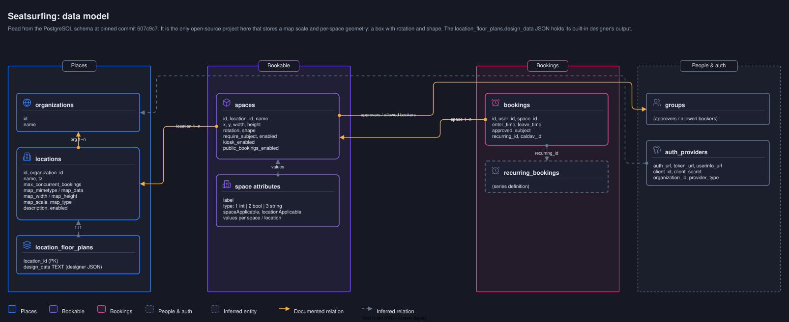
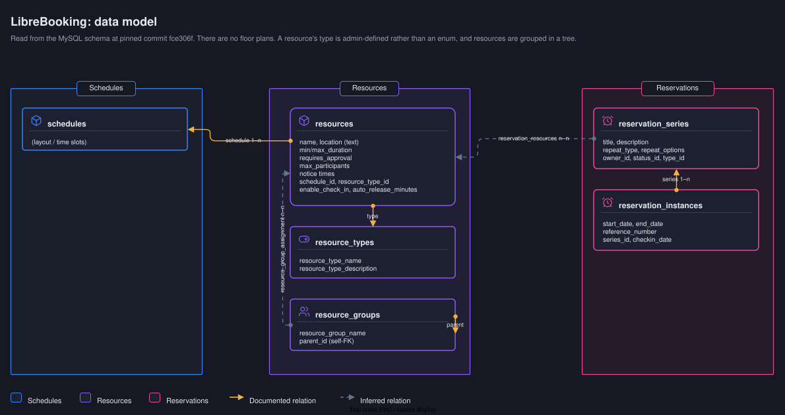
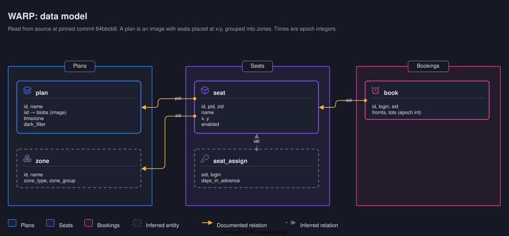
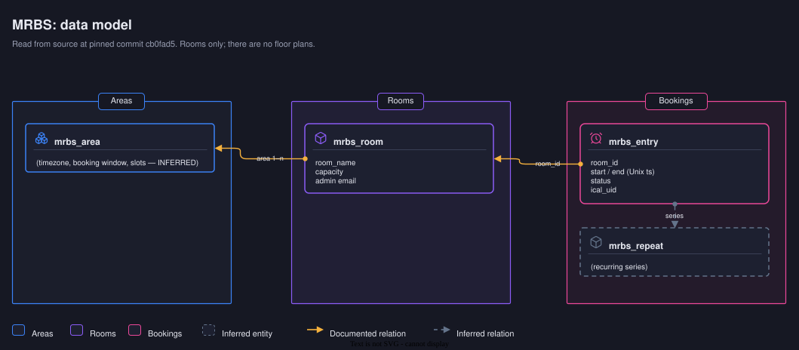
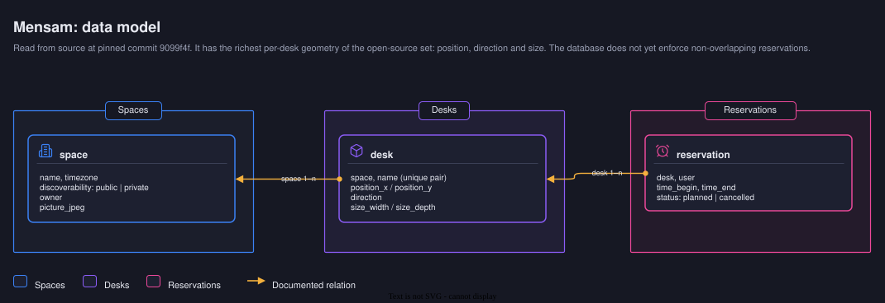

# Self-hostable open-source desk, room and parking booking projects

Researched and validated 2026-11-25. Each bracketed number links to the Sources list at the end. Data-model facts come from schema and migration files read at pinned commits, not from memory. The vendor template has been adapted for open-source projects. Sections that apply only to commercial SaaS (pricing, trust centre, SOC 2, status page) are left out. Each one is "Not publicly documented". Seatsurfing also sells a hosted SaaS; its compliance posture was not researched in this survey.

## How projects were selected

I searched GitHub with `gh search repos` (sorted by stars) for "desk booking", "hot desking", "desk sharing", "room booking", "parking booking", "seat booking", "meeting room booking", "workspace booking", "desk reservation", "office booking", "parking spot reservation" and "librebooking". Five projects stand out on stars, recent commits and relevance:

| Project | Repo | Stars | Last commit | Licence | Language(s) | Focus |
|---|---|---|---|---|---|---|
| Seatsurfing | seatsurfing/seatsurfing | 320 | 2026-11-25 | GPL-3.0 | Go + TypeScript/React | Desks, rooms, parking [[1]](#s1)[[2]](#s2) |
| LibreBooking | LibreBooking/librebooking | 851 | 2026-11-23 | GPL-3.0 | PHP | Generic resource scheduling [[3]](#s3)[[4]](#s4) |
| WARP | sebo-b/warp | 173 | 2026-10-29 | MIT | Python (Flask) + TypeScript | Hot desks + parking on floor maps [[5]](#s5)[[6]](#s6) |
| MRBS | meeting-room-booking-system/mrbs-code | 219 | 2026-11-23 | GPL-2.0 (GitHub shows NOASSERTION) | PHP | Meeting rooms [[7]](#s7)[[8]](#s8)[[9]](#s9) |
| Mensam | jumper149/mensam | 44 | 2026-07-07 | AGPL-3.0 | Haskell + Elm | Desks in coworking/hot-desk spaces [[10]](#s10)[[11]](#s11) |

Found but not profiled [[12]](#s12): classroombookings (226★, AGPL-3.0; school timetable rooms, less relevant), workplacify (46★; last push June 2026), and dorianim/mrbs-docker (32★; a packaging of MRBS). Among the profiled projects, parking appears only as a space in Seatsurfing and WARP [[2]](#s2)[[6]](#s6).

---

## 1. Seatsurfing (closest analogue to spaceweave)

**Snapshot.** Seatsurfing is an open-core project: free self-hosted code plus a hosted SaaS and a paid plugin [[13]](#s13)[[14]](#s14). The repo holds a Go REST backend, a PWA booking UI and an admin UI [[13]](#s13). It is also sold as SaaS hosted in Germany, free for up to 10 users [[13]](#s13). A paid "Plus Plugin" unlocks Exchange room-calendar sync, SCIM 2.0 and Teams sign-in on self-hosted installs [[14]](#s14)[[15]](#s15). Plugin licences are per instance and sold by user tier (25 to 1,000 users), free up to 10 users [[14]](#s14).

**Space kinds.** Seatsurfing has no type or kind column. A "space" is any bookable unit: desk, conference room or garage [[16]](#s16). The features list names parking, whole rooms and single seats [[2]](#s2). A space is told apart only by typed custom attributes (int, bool or string) that apply to spaces and/or locations (areas) [[16]](#s16)[[17]](#s17), and by per-space flags: approval groups, allowed-booker groups, kiosk, public bookings [[18]](#s18). Approvals can be required per space [[2]](#s2). Areas carry `max_concurrent_bookings` and a timezone [[19]](#s19). The kiosk flag [[18]](#s18) enables a read-only, per-space occupancy display for wall tablets and e-ink screens, with no booking actions and no QR codes, so it is not a check-in feature [[20]](#s20). Check-in: Not publicly documented.

**Floor plans.** A location (area/floor) has one map, in one of two modes [[21]](#s21):
- An uploaded raster or SVG image stored inline in the `locations` row (`map_mimetype`, `map_data BYTEA`, `map_width`, `map_height`, later `map_scale`) [[22]](#s22)[[19]](#s19). The API accepts PNG, JPEG, GIF or SVG and returns the image as base64 [[23]](#s23). The features page lists only JPEG, PNG and GIF [[2]](#s2).
- A "designed" plan made in a built-in floor-plan designer and stored as a text document (`design_data`, default `'{}'`) in `location_floor_plans` [[24]](#s24)[[21]](#s21). I did not inspect the document's internal schema.

Spaces are placed by drag and drop [[2]](#s2) and stored as a rotated box (`x, y, width, height, rotation`), plus a `shape` string [[25]](#s25)[[18]](#s18). Map geometry is exposed through the API [[23]](#s23)[[26]](#s26). There is no CAD/DWG/DXF/PDF import and no auto-detection of desks in any doc I read (Not publicly documented; searched the features, concepts and REST API docs and the OpenAPI spec).

**Auth.** Built-in users can log in with a password, with TOTP or passkey MFA [[2]](#s2). Generic OAuth2/OIDC providers are stored per organisation, with auth, token and userinfo URLs and client credentials [[27]](#s27)[[28]](#s28). Setup guides exist for Azure, Google and Keycloak [[29]](#s29). No doc or spec I read mentions SAML or LDAP (Not publicly documented). SCIM 2.0 needs the Plus Plugin on self-hosted installs and syncs one way only, users and groups but no spaces or bookings [[14]](#s14)[[15]](#s15)[[15]](#s15).

**REST API.** An OpenAPI 3.1.0 spec sits in the repo at `specs/openapi.yaml` [[30]](#s30)[[26]](#s26). It has 99 paths, including `/location/{id}/map` and `/location/{locationId}/space/bulk` [[31]](#s31). API auth uses JWT bearer and HTTP Basic, and service accounts can also use long-lived API tokens generated via `POST /user/{id}/api-token` and stored as SHA-256 hashes [[32]](#s32)[[30]](#s30)[[33]](#s33). There is also an MCP server for AI tools [[2]](#s2).

**Data model (source).** Fields and relations marked INFERRED were read from the pinned source by the validator but are not covered by a ledger claim.

| Entity (table) | Key fields | Relations | Source |
|---|---|---|---|
| locations | id, organization_id, name, tz, max_concurrent_bookings, map_mimetype/map_data/map_width/map_height/map_scale, map_type; description, enabled (INFERRED) | org 1–n locations | [[22]](#s22)[[19]](#s19) |
| location_floor_plans | location_id (PK, FK: INFERRED), design_data TEXT | 1–1 location (INFERRED) | [[24]](#s24) |
| spaces | id, location_id, name, x, y, width, height, rotation, shape, require_subject, enabled, kiosk_enabled, public_bookings_enabled | location 1–n spaces; spaces_approvers / spaces_allowed_bookers → groups | [[25]](#s25)[[18]](#s18) |
| space attributes | label, type (1 int / 2 bool / 3 string), spaceApplicable, locationApplicable; values per space/location (INFERRED) | attribute 1–n values (INFERRED) | [[17]](#s17) |
| bookings | id, user_id, space_id, enter_time, leave_time, approved, subject, recurring_id, caldav_id | space 1–n bookings; recurring_bookings 1–n bookings (INFERRED) | [[34]](#s34) |
| auth_providers | auth_url, token_url, userinfo_url, client_id, client_secret; organization_id, provider_type (INFERRED) | org 1–n (INFERRED) | [[28]](#s28) |

**Deployment.** The container image is published for amd64 and arm64 on GHCR, with PostgreSQL via Docker Compose [[13]](#s13). The Kubernetes docs use plain kubectl manifests, not a Helm chart [[35]](#s35).

**Ecosystem.** Microsoft Teams app on AppSource; Confluence app (cloud only) [[13]](#s13).

## 2. LibreBooking

**Snapshot.** LibreBooking is the most-starred project here. It is a general resource scheduler forked from the last open-source Booked Scheduler release (2020) [[3]](#s3)[[4]](#s4). Its features include multi-resource booking, waitlists, quotas and credits, reporting and ICS export [[4]](#s4). **Security note:** every release before 7.2.0 has a stored-XSS flaw that allows admin takeover, and fixes are not backported [[4]](#s4).

**Space kinds.** LibreBooking has no fixed desk/room/parking kinds. `resources` carry scheduling rules and a free-text `location` [[36]](#s36). Admin-defined `resource_types` and a hierarchy of `resource_groups` (via `parent_id`) were added in schema 2.5 [[37]](#s37). Check-in and auto-release came in schema 2.6 [[38]](#s38).

**Floor plans.** Not publicly documented.

**Auth.** It has many pluggable auth plugins: ActiveDirectory, CAS, Krb5, LDAP, Mellon, SAML, Shibboleth, WordPress and others [[39]](#s39). It also supports OAuth2/OIDC with IdPs such as authentik and Keycloak [[40]](#s40).

**REST API.** The API lives under `/Web/Services/index.php`, serves its own generated docs page and must be enabled in config [[41]](#s41); it is off by default (`api.enabled` = false) [[4]](#s4). An OpenAPI or Swagger spec is Not publicly documented. Auth uses `X-Booked-SessionToken` and `X-Booked-UserId` headers obtained from an Authenticate call [[41]](#s41). Resources: Accessories, Accounts, Attributes, Authentication, Groups, Reservations, Resources, Schedules, Users [[41]](#s41).

**Data model (source).** Relations marked INFERRED are not covered by a ledger claim.

| Entity | Key fields | Relations | Source |
|---|---|---|---|
| resources | name, location (text), min/max_duration, requires_approval, max_participants, notice times, schedule_id; later resource_type_id, enable_check_in, auto_release_minutes | schedule 1–n resources; resource_type 1–n | [[36]](#s36)[[37]](#s37)[[38]](#s38) |
| resource_types | resource_type_name, resource_type_description | — | [[37]](#s37) |
| resource_groups | resource_group_name, parent_id (self-FK) | tree; resource_group_assignment n–n resources (INFERRED) | [[37]](#s37) |
| reservation_series | title, description, repeat_type, repeat_options, owner_id, status_id, type_id | 1–n reservation_instances; n–n resources via reservation_resources (INFERRED) | [[42]](#s42) |
| reservation_instances | start_date, end_date, reference_number, series_id, checkin_date | series 1–n | [[42]](#s42)[[38]](#s38) |

**Deployment.** Needs PHP 8.4+ on Apache with MySQL 8 or MariaDB 10.6 [[4]](#s4). Container images are kept in a separate `LibreBooking/docker` repo, which has docker, kubernetes and podman examples [[4]](#s4)[[43]](#s43). Helm chart: Not publicly documented.

## 3. WARP (Workspace Autonomous Reservation Program)

**Snapshot.** WARP is a self-service hot-desk and parking tool, created when an office moved to hybrid hot-desking because of COVID-19 [[6]](#s6)[[44]](#s44). It rules out approvals on purpose [[44]](#s44).

**Space kinds.** Every bookable thing is a "seat": a desk or a parking stall [[6]](#s6). Kinds are separated by **zones**. Users can hold one seat per zone per time slot, so a desk plus a parking spot works but two desks in one zone does not [[44]](#s44). `zone_type` is an access level, not a space kind [[45]](#s45).

**Floor plans.** A "plan" holds one JPEG or PNG floor-map image (stored as a DB blob, max 2 MB) plus its seats. A plan can mix seats from several zones [[44]](#s44)[[45]](#s45). A seat is just a point (`x, y`) on the plan, with no size or rotation [[46]](#s46). There is no CAD or vector import (Not publicly documented).

**Auth.** SAML 2.0 (python3-saml or mod_auth_mellon), LDAP/AD, Azure AD via MSAL, and generic OIDC [[47]](#s47).

**REST API.** JSON XHR endpoints (`warp/xhr/*.py`) validated by JSON schemas [[45]](#s45). An OpenAPI spec or API docs beyond FEATURES.md: Not publicly documented.

**Data model (source).** `plan(id, name, iid→blobs, timezone)`; `seat(id, pid→plan, zid→zone, name, x, y, enabled)`; `book(id, login, sid, fromts, tots)` with epoch-int times [[46]](#s46). INFERRED (not covered by a ledger claim): `plan.dark_filter`, `zone(id, name, zone_type, zone_group)` and `seat_assign(sid, login, days_in_advance)`.

**Deployment.** An all-in-one debug image, Docker Compose, or Podman Quadlet [[44]](#s44). Helm chart: Not publicly documented.

## 4. MRBS (Meeting Room Booking System)

**Snapshot.** MRBS is a PHP meeting-room booker (GPL v2) [[7]](#s7)[[8]](#s8)[[9]](#s9).

**Space kinds.** Rooms grouped into areas, nothing else [[9]](#s9). `mrbs_room` holds `capacity` but has no geometry [[48]](#s48).

**Floor plans.** None in the schema [[48]](#s48). Not publicly documented elsewhere.

**Auth.** Many back ends, including LDAP and SAML (via SimpleSAMLphp) [[49]](#s49). Native OIDC: Not publicly documented.

**REST API.** Not publicly documented.

**Data model (source).** `mrbs_area` has many `mrbs_room` (room_name, capacity, admin email) [[48]](#s48). Bookings live in `mrbs_entry` (room_id, start/end Unix timestamps, status, ical_uid) [[50]](#s50). INFERRED (not covered by a ledger claim): the `mrbs_area` timezone, booking-window and slot settings, and the `mrbs_repeat` table for recurring series.

**Deployment.** A php-apache Dockerfile in the repo [[51]](#s51). There is also a community Docker packaging (mrbs-docker) [[12]](#s12). Helm chart: Not publicly documented.

## 5. Mensam

**Snapshot.** Mensam is a small, desk-only app for coworking spaces, hot-desk offices and hacker spaces [[11]](#s11). It is written in Haskell with an Elm frontend [[10]](#s10).

**Space kinds.** Desks only, inside a "Space" (the venue) [[11]](#s11).

**Floor plans.** A Space has an optional JPEG picture [[52]](#s52). Each desk has an optional position (x, y), direction, width and depth stored as doubles [[53]](#s53). This is the richest per-desk geometry of the five, but there is no import pipeline (Not publicly documented).

**Auth.** OIDC, SAML and LDAP: Not publicly documented.

**REST API.** It serves an OpenAPI spec generated from the servant API types [[54]](#s54).

**Data model (source).** `space(name, timezone, discoverability public/private, owner, picture_jpeg)` [[52]](#s52); `desk(space, name, position_x/y, direction, size_width/depth)`, unique per (space, name) [[53]](#s53); `reservation(desk, user, time_begin, time_end, status planned/cancelled)`. A TODO notes that the database does not yet enforce non-overlap [[55]](#s55).

**Deployment.** Docker image on DockerHub [[11]](#s11). Helm chart: Not publicly documented.

---

## Cross-project comparison

Sources are the `.drawio` files beside each SVG in [`diagrams/`](diagrams/).

| | Seatsurfing | LibreBooking | WARP | MRBS | Mensam |
|---|---|---|---|---|---|
| Desks / rooms / parking | all three, untyped [[16]](#s16)[[2]](#s2) | any resource; admin types [[37]](#s37) | desks + parking via zones [[6]](#s6)[[44]](#s44) | rooms only [[9]](#s9) | desks only [[11]](#s11) |
| Floor plan | image (PNG/JPEG/GIF/SVG) or built-in designer [[21]](#s21)[[23]](#s23) | not documented | JPEG/PNG image [[45]](#s45) | none [[48]](#s48) | optional JPEG picture [[52]](#s52) |
| Bookable geometry | box x,y,w,h,rotation + shape [[25]](#s25)[[18]](#s18) | not documented | point x,y [[46]](#s46) | none [[48]](#s48) | point + direction + w/d [[53]](#s53) |
| CAD/PDF import | not documented | not documented | not documented | not documented | not documented |
| SSO | OAuth2/OIDC [[27]](#s27) | LDAP, AD, SAML, CAS, OIDC… [[39]](#s39)[[40]](#s40) | SAML, LDAP, Azure AD, OIDC [[47]](#s47) | LDAP, SAML… [[49]](#s49) | not documented |
| SCIM | SCIM 2.0, Plus Plugin [[14]](#s14)[[15]](#s15) | not documented | not documented | not documented | not documented |
| OpenAPI | yes, 3.1.0 in repo [[26]](#s26) | not documented (generated HTML docs) [[41]](#s41) | not documented | not documented | yes, generated [[54]](#s54) |
| Deploy | Docker, K8s manifests [[13]](#s13)[[35]](#s35) | Docker repo incl. K8s example [[43]](#s43) | Docker/Compose/Quadlet [[44]](#s44) | Dockerfile [[51]](#s51) | Docker [[11]](#s11) |
| Helm chart | none; kubectl manifests [[35]](#s35) | not documented | not documented | not documented | not documented |

## Relevance to spaceweave (analysis, not sourced fact)

1. **Nobody ingests CAD or PDF.** In every project I checked, a floor plan is a background image plus hand-placed markers, or a hand-drawn design in Seatsurfing's case. DWG/PDF to bookable-model ingestion is an open gap, and it is spaceweave's core.
2. **Seatsurfing is the natural integration target.** Its OpenAPI 3.1 spec, Go backend, `/location/{id}/map` image upload and `/location/{locationId}/space/bulk` endpoint (both in the spec [[31]](#s31)) mean spaceweave could export a rendered plan plus space rectangles straight into a Seatsurfing location. Its geometry (integer pixel box + rotation + `map_scale`) [[19]](#s19)[[25]](#s25) is lossy compared with real polygons. A spaceweave exporter would need to rasterise or emit SVG and project room or desk polygons to bounding boxes.
3. **Space kind is usually not modelled.** Seatsurfing and WARP have no kind enum: kinds come from attributes or zones. LibreBooking uses admin-defined `resource_types`. That suggests spaceweave should carry an explicit, extensible kind (desk, room, parking, …) plus free attributes, so it can map onto both styles.
4. **Geometry granularity varies: point, box, point+direction+size.** Mensam's desk direction and size, and Seatsurfing's rotation, show that per-desk orientation matters to UIs. spaceweave's model should keep the true polygon and derive a centroid, oriented bounding box and rotation for export.
5. **Hierarchy is shallow everywhere:** org → location/area (= floor) → space. There are no buildings or sites as first-class entities, apart from LibreBooking's generic resource-group tree. spaceweave's building/floor hierarchy would need to flatten to "area per floor" on export.
6. **Floor-plan scale is mostly absent.** Only Seatsurfing has a `map_scale` [[19]](#s19). spaceweave's real-world scale (a 99% accuracy target) is a differentiator that these consumers cannot use yet.

## Biggest gaps

- I did not inspect the internal JSON schema of Seatsurfing's floor-plan designer (`design_data`). It is the most relevant format for a spaceweave exporter and deserves a follow-up read of the UI source.
- LibreBooking's generated API page lives only on a running instance, so I did not verify its field-level shapes.
- No project documents indoor-map standards (IMDF, IndoorGML, IFC) or occupancy sensors.

## Sources

All accessed 2026-11-25.

1. https://api.github.com/repos/seatsurfing/seatsurfing (github)
2. https://seatsurfing.io/docs/features (official-docs)
3. https://api.github.com/repos/LibreBooking/librebooking (github)
4. https://github.com/LibreBooking/librebooking/blob/fce306faa379137a8c8c9beb1f21fc5075fc3870/README.md (github)
5. https://api.github.com/repos/sebo-b/warp (github)
6. https://github.com/sebo-b/warp/blob/64bbcb8771b367b012ca218753c183b932ab45ee/README.md#L13 (github)
7. https://api.github.com/repos/meeting-room-booking-system/mrbs-code (github)
8. https://github.com/meeting-room-booking-system/mrbs-code/blob/cb0fad53f044ddad97acb04ae98e7a5a398ca471/LICENSE (github)
9. https://github.com/meeting-room-booking-system/mrbs-code/blob/cb0fad53f044ddad97acb04ae98e7a5a398ca471/README.md (github)
10. https://api.github.com/repos/jumper149/mensam (github)
11. https://github.com/jumper149/mensam/blob/9099f4f7914ddd6d82c9ad5e3c56756fd7a762c7/README.adoc (github)
12. https://api.github.com/repos/classroombookings/classroombookings (github)
13. https://github.com/seatsurfing/seatsurfing/blob/607c9c7dd91ed288723c83d3dfeaadb0b515d179/README.md (github)
14. https://seatsurfing.io/docs/self-hosted/plus-plugin (official-docs)
15. https://seatsurfing.io/docs/scim (official-docs)
16. https://seatsurfing.io/docs/concepts (official-docs)
17. https://github.com/seatsurfing/seatsurfing/blob/607c9c7dd91ed288723c83d3dfeaadb0b515d179/specs/openapi.yaml#L753-L766 (github)
18. https://github.com/seatsurfing/seatsurfing/blob/607c9c7dd91ed288723c83d3dfeaadb0b515d179/server/repository/space-repository.go#L69-L118 (github)
19. https://github.com/seatsurfing/seatsurfing/blob/607c9c7dd91ed288723c83d3dfeaadb0b515d179/server/repository/location-repository.go#L59-L94 (github)
20. https://github.com/seatsurfing/seatsurfing/blob/607c9c7dd91ed288723c83d3dfeaadb0b515d179/specs/kiosk-mode.md (official-docs)
21. https://github.com/seatsurfing/seatsurfing/blob/607c9c7dd91ed288723c83d3dfeaadb0b515d179/specs/openapi.yaml#L439-L442 (github)
22. https://github.com/seatsurfing/seatsurfing/blob/607c9c7dd91ed288723c83d3dfeaadb0b515d179/server/repository/location-repository.go#L36-L44 (github)
23. https://github.com/seatsurfing/seatsurfing/blob/607c9c7dd91ed288723c83d3dfeaadb0b515d179/specs/openapi.yaml#L2661-L2691 (github)
24. https://github.com/seatsurfing/seatsurfing/blob/607c9c7dd91ed288723c83d3dfeaadb0b515d179/server/repository/location-floor-plan-repository.go#L11-L26 (github)
25. https://github.com/seatsurfing/seatsurfing/blob/607c9c7dd91ed288723c83d3dfeaadb0b515d179/server/repository/space-repository.go#L48-L57 (github)
26. https://github.com/seatsurfing/seatsurfing/blob/607c9c7dd91ed288723c83d3dfeaadb0b515d179/specs/openapi.yaml#L1-L3 (github)
27. https://github.com/seatsurfing/seatsurfing/blob/607c9c7dd91ed288723c83d3dfeaadb0b515d179/specs/openapi.yaml#L105 (github)
28. https://github.com/seatsurfing/seatsurfing/blob/607c9c7dd91ed288723c83d3dfeaadb0b515d179/server/repository/auth-provider-repository.go#L19-L31 (github)
29. https://seatsurfing.io/docs/auth-provider/azure (official-docs)
30. https://seatsurfing.io/docs/rest-api (official-docs)
31. https://github.com/seatsurfing/seatsurfing/blob/607c9c7dd91ed288723c83d3dfeaadb0b515d179/specs/openapi.yaml#L3079 (official-docs)
32. https://github.com/seatsurfing/seatsurfing/blob/607c9c7dd91ed288723c83d3dfeaadb0b515d179/specs/openapi.yaml#L122-L132 (github)
33. https://github.com/seatsurfing/seatsurfing/blob/607c9c7dd91ed288723c83d3dfeaadb0b515d179/specs/openapi.yaml#L40 (official-docs)
34. https://github.com/seatsurfing/seatsurfing/blob/607c9c7dd91ed288723c83d3dfeaadb0b515d179/server/repository/booking-repository.go#L47-L87 (github)
35. https://seatsurfing.io/docs/self-hosted/kubernetes/ (official-docs)
36. https://github.com/LibreBooking/librebooking/blob/fce306faa379137a8c8c9beb1f21fc5075fc3870/database_schema/create-schema.sql#L184-L210 (github)
37. https://github.com/LibreBooking/librebooking/blob/fce306faa379137a8c8c9beb1f21fc5075fc3870/database_schema/upgrades/2.5/schema.sql#L3-L27 (github)
38. https://github.com/LibreBooking/librebooking/blob/fce306faa379137a8c8c9beb1f21fc5075fc3870/database_schema/upgrades/2.6/schema.sql#L104-L116 (github)
39. https://github.com/LibreBooking/librebooking/tree/fce306faa379137a8c8c9beb1f21fc5075fc3870/plugins/Authentication (github)
40. https://github.com/LibreBooking/librebooking/blob/fce306faa379137a8c8c9beb1f21fc5075fc3870/docs/source/Oauth2-Configuration.rst (github)
41. https://github.com/LibreBooking/librebooking/blob/fce306faa379137a8c8c9beb1f21fc5075fc3870/docs/source/API.rst (github)
42. https://github.com/LibreBooking/librebooking/blob/fce306faa379137a8c8c9beb1f21fc5075fc3870/database_schema/create-schema.sql#L277-L319 (github)
43. https://github.com/LibreBooking/docker/tree/main/.examples (github)
44. https://github.com/sebo-b/warp/blob/64bbcb8771b367b012ca218753c183b932ab45ee/README.md (github)
45. https://github.com/sebo-b/warp/blob/64bbcb8771b367b012ca218753c183b932ab45ee/FEATURES.md (github)
46. https://github.com/sebo-b/warp/blob/64bbcb8771b367b012ca218753c183b932ab45ee/warp/sql/schema.sql#L71-L136 (github)
47. https://github.com/sebo-b/warp/blob/64bbcb8771b367b012ca218753c183b932ab45ee/README.md#L38-L41 (github)
48. https://github.com/meeting-room-booking-system/mrbs-code/blob/cb0fad53f044ddad97acb04ae98e7a5a398ca471/tables.pg.sql#L84-L101 (github)
49. https://github.com/meeting-room-booking-system/mrbs-code/blob/cb0fad53f044ddad97acb04ae98e7a5a398ca471/AUTHENTICATION#L126-L199 (github)
50. https://github.com/meeting-room-booking-system/mrbs-code/blob/cb0fad53f044ddad97acb04ae98e7a5a398ca471/tables.pg.sql#L138-L180 (github)
51. https://github.com/meeting-room-booking-system/mrbs-code/blob/cb0fad53f044ddad97acb04ae98e7a5a398ca471/Dockerfile (github)
52. https://github.com/jumper149/mensam/blob/9099f4f7914ddd6d82c9ad5e3c56756fd7a762c7/server/source/library/Mensam/Server/Database/Schema.hs#L127-L144 (github)
53. https://github.com/jumper149/mensam/blob/9099f4f7914ddd6d82c9ad5e3c56756fd7a762c7/server/source/library/Mensam/Server/Database/Schema.hs#L242-L262 (github)
54. https://github.com/jumper149/mensam/blob/9099f4f7914ddd6d82c9ad5e3c56756fd7a762c7/server/source/library/Mensam/API/Route/Api/OpenApi.hs (github)
55. https://github.com/jumper149/mensam/blob/9099f4f7914ddd6d82c9ad5e3c56756fd7a762c7/server/source/library/Mensam/Server/Database/Schema.hs#L266-L288 (github)

## Validation

72 ledger claims accepted (C1–C72), 0 revised, 0 rejected; 6 new claims (N1–N6) added. All 14 unsourced draft statements were handled: U3 (wrong "per-user API tokens") was corrected to service-account API tokens [N3]; U2, U4, U8 and U14 now cite C3/C20, N2, N4 and N2/C28; U1's unsupported negative parking-search claim and "most results were student projects" were dropped; U5, U6, U7, U9, U11 and U12 (no ledger rows) were turned into "Not publicly documented", including LibreBooking floor plans/OpenAPI, the non-Seatsurfing Helm rows, WARP API docs, MRBS OIDC/REST API (the unchecked README.sqlapi description was removed); U10 ("long-running") and U13 (Mensam JWT/Elm auth paths and NixOS module) were removed. Seatsurfing check-in now uses N1 (kiosk mode is read-only, not check-in), LibreBooking API off-by-default cites N5, SCIM 2.0 cites N6. Data-model trace fixes: LibreBooking `description` renamed to `resource_type_description`; fields and relations without claim coverage (Seatsurfing locations.description/enabled, space-attribute values, recurring_bookings, auth_providers organization_id/provider_type, floor-plan PK/FK; LibreBooking resource_group_assignment and reservation_resources; WARP zone, seat_assign, dark_filter; MRBS area settings and mrbs_repeat) are marked INFERRED. No STALE or THIRD-PARTY-ONLY flags. Claim ids (C#/N#) refer to the evidence ledger and validation report in `evidence/`.
