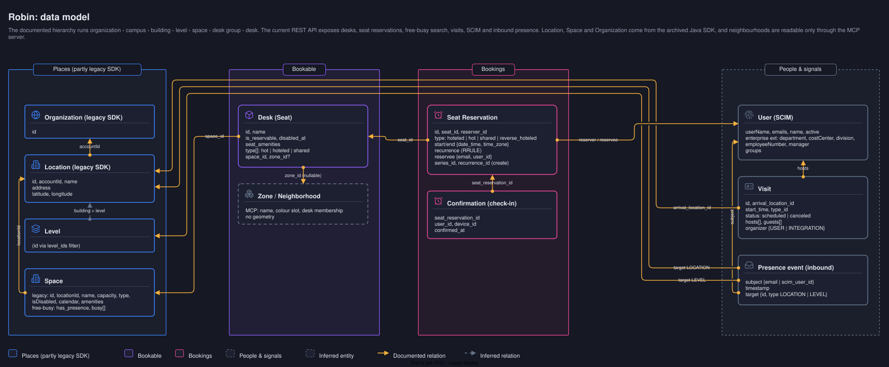

# Robin (robinpowered.com)

Researched and validated 2026-11-25. Each bracketed number links to the Sources list in §18.

## 1. Snapshot
- **Positioning:** cloud-subscription workplace management software [[1]](#s1) covering room scheduling, desk booking, parking/lockers/custom resources, visitor management, analytics, interactive maps, space/move planning and event services [[1]](#s1).
- **Segment:** aimed at companies with 500+ employees, at least a third of them using the office regularly [[2]](#s2). The threshold is soft: the same page also says Robin may fit orgs with more than 150 hybrid employees [[2]](#s2).
- **HQ:** Boston, MA (from the GitHub org profile) [[3]](#s3).
- **Pricing:** no published prices. Quotes come through a sales form [[2]](#s2), billing is annual [[2]](#s2) and hardware is extra [[2]](#s2). Current plan names in the docs are **Essentials**, **Business** and the **One Workplace Platform** [[4]](#s4).
- **Licensing unit:** at least partly per space and per desk, because archiving either one releases a license [[5]](#s5)[[6]](#s6). Whether users are also licensed is not publicly documented.
- **Tier gating:**
  - API tokens need "a plan that includes API tokens" [[7]](#s7).
  - SAML SSO needs the *Advanced Authentication and Security* entitlement; everyone else gets Google or M365 SSO [[8]](#s8).
  - SCIM needs *Advanced Authentication + User Management* [[9]](#s9).
  - Which named plan includes these entitlements is not publicly documented.
- **Free tier / trial:** no free tier is documented. Time-limited trials of the Scheduling and Desks products exist [[10]](#s10). The pricing page itself offers only "Book a demo" and "Take a platform tour", with no free trial or prices [[2]](#s2).

## 2. Space kinds

| Kind | Booking rules / quotas | Check-in | Capacity | API / data model |
|---|---|---|---|---|
| **Desks: hot** | Same day only, up to 1 day [[11]](#s11) | Remote check-in window, Abandoned Desk Protection [[12]](#s12) | n/a | Desk type `["hot"]`, reservation `type: hot` [[13]](#s13) (possibly stale, page dated 2025) |
| **Desks: hotel(ed)** | Booked in advance, 1–5+ days [[11]](#s11). Priority booking policies give groups a longer horizon [[14]](#s14). Auto-booking up to the advance threshold, max 31 days [[15]](#s15) | as above | n/a | `["hoteled"]`, `hoteled` [[13]](#s13) (possibly stale, page dated 2025) |
| **Desks: assigned / shared assigned** | Permanent, set by admin. Can be shared on days the owner is out [[11]](#s11) | Follows office hours and the confirmation window [[12]](#s12) | n/a | `assigned` is deprecated in favour of `shared` (weekly RRULE) plus exclusions. Other users book `reverse_hoteled` inside the exclusions [[13]](#s13)[[16]](#s16)[[16]](#s16) (possibly stale, pages dated 2025) |
| **Neighborhoods** | Colour-coded desk groups that are visual only, managed in assignment drafts [[17]](#s17) | n/a | n/a | No REST resource documented [[18]](#s18). Readable through the MCP `get_building`/`get_draft_data` tools (name, colour slot, desk membership; no geometry) [[19]](#s19). The Desk object has `zone_id`/`zone` [[13]](#s13) (possibly stale, page dated 2025); whether zones are the same thing as neighborhoods is INFERRED and unconfirmed |
| **Meeting rooms / spaces** | On-demand (no calendar), scheduled (resource calendar), request-only (admin approval; only when the org uses meeting room approvals) [[5]](#s5) | Meeting check-in, abandoned-meeting protection, automatic room check-in through Logitech, Neat or Google Meet hardware [[20]](#s20) | `min_capacity`/`max_capacity` filters [[21]](#s21) (possibly stale, page dated 2025) | Spaces are searched with `POST /free-busy/spaces`. Default types are breakout, call, conference, meeting, office, study_room [[21]](#s21) |
| **Car parking** | Booking types Reservable / Not reservable / Assigned. Overlap control, role restriction [[22]](#s22) | Not publicly documented | n/a | No public REST endpoint [[18]](#s18). Reachable via the MCP `book_resource` tool as a "custom resource" [[19]](#s19) |
| **Lockers** | Multi-day booking, optional Require Check-In [[22]](#s22) | yes [[22]](#s22) | n/a | as parking |
| **Equipment / custom resources** | Template-based (e.g. lab equipment) [[22]](#s22) | Not publicly documented | n/a | as parking. These run on a "new backend" [[22]](#s22) |
| **Event spaces** | Handled by request-only spaces and meeting-room approvals [[5]](#s5) | n/a | n/a | n/a |

The data model the docs describe is organization > campus (optional) > building > level > space > desk group > desk [[6]](#s6). Every desk must belong to a desk group [[6]](#s6).

## 3. Features
- **Rules and quotas:**
  - advance-booking threshold [[15]](#s15);
  - priority booking [[14]](#s14);
  - abandoned desk and meeting protection [[12]](#s12);
  - local-check-in-only policies [[23]](#s23).
  - Per-user quotas such as "N days per week" are not publicly documented.
- **Check-in methods:** web, mobile, email, Slack/Teams, QR/NFC stickers [[23]](#s23), and automatic check-in by badge or Wi-Fi [[20]](#s20).
- **Analytics:** dashboards plus CSV exports (Activity summary, Desks, Presence, Spaces, People roster and others), also available through the Analytics API [[24]](#s24)[[24]](#s24).
- **Visitor management:** visits, guests, check-in/out and visit types, with a public Visitor API [[25]](#s25)[[26]](#s26).
- **Mobile:** iOS and Android apps [[1]](#s1).
- **Teams and Slack:** Robin's Slack app is compatible with Slack and Slack Enterprise Grid. Robin also integrates with Slack and Microsoft Teams for meeting and desk-reservation notifications and booking actions such as check-in and cancel [[27]](#s27)[[1]](#s1).

## 4. Floor-plan pipeline
- **Three ways to get a map:**
  - Self-serve CAD import of **.dxf only**, under 30 MB, one floor per file [[28]](#s28). Robin auto-selects the layers that "show best" and the user can change the selection [[28]](#s28).
  - Drawing a map from scratch in the Map Editor [[29]](#s29) (described in the same help article).
  - Sending a PDF, JPG or PNG (≤25 MB) to Robin's maps team, whose design team converts it in about 2–3 business days [[29]](#s29). "Manually" is a reasonable reading but is not the article's word.
- **Format coverage:** DWG is not listed among the self-serve formats; only .dxf is accepted, and a help-centre search for "DWG" returns no results [[28]](#s28).
- **No automatic detection of desks or rooms:** the docs tell users not to import desk or furniture layers. Desks, spaces and furnishings are placed by hand in the separate Layout tool [[28]](#s28), and spaces are drawn as polygons by dragging outline points [[5]](#s5). Room or desk recognition from CAD is not publicly documented.
- **Editor:**
  - drawing tools for interior walls, exterior walls and rectangular areas, with snapping and a 15° angle lock [[30]](#s30);
  - other element kinds: furniture, labels, decor regions, accessibility symbols and a floor boundary [[30]](#s30).
- **Re-import:** a new CAD upload keeps existing desks and spaces but may displace them [[28]](#s28).
- **Indoor-map standards (IMDF, IndoorGML, IFC):** not publicly documented.
- **Map geometry through the API:** not publicly documented. Neither the REST reference nor the MCP tool list exposes walls or polygons. MCP returns buildings, floors, desks and neighborhoods, and edits floor plans only through scenario-planning drafts [[31]](#s31)[[19]](#s19).

## 5. Calendar and directory sync
- **Calendars:** Google Workspace, Microsoft 365 and on-prem Exchange [[1]](#s1).
  - Microsoft 365 (Exchange Online) connects through an OAuth enterprise app installed by a global admin [[32]](#s32), which uses the Microsoft Graph API [[33]](#s33).
  - On-prem Exchange room calendars are accessed via impersonation (UserImpersonation per room calendar), not delegate access [[33]](#s33).
- **Sync window and latency:** about 3 months ahead for both Google and Microsoft. The first sync takes about 20 minutes, then sync is described as "instant" [[34]](#s34).
- **Direction:** two-way is implied by booking from Robin into room calendars, but the article does not state it [[34]](#s34).
- **Provisioning:**
  - SCIM 2.0 through Okta, Entra ID and OneLogin [[9]](#s9), at `POST /v1.0/scim-2/Users` [[35]](#s35) (possibly stale, page dated 2025).
  - HRIS: no named HRIS provisioning connector is documented. Rippling appears only as a natively supported SAML identity provider [[8]](#s8), not as an HRIS integration.

## 6. IoT, sensors and hardware
- **Universal Presence Connector:** a generic inbound endpoint for badge readers, locks, turnstiles and occupancy sensors [[36]](#s36).
  - Endpoint: `POST https://badge-presence-collector.services.robinpowered.com/v1.0/connectors/{uuid}/presence`, with an EU host [[36]](#s36).
  - Each event targets a LOCATION or LEVEL directly, or a mapped source ID [[36]](#s36).
  - The token needs the `badge_integrations:manage` permission [[36]](#s36), and there is a test mode [[36]](#s36).
  - **The current connector resolves only to building or floor level** [[36]](#s36). A sensor integration (Vergesense) is listed, but its granularity is not described [[1]](#s1). The archived Java SDK modelled space-level presence (`GET/POST/DELETE /spaces/{id}/presence`); its current status is undocumented [[37]](#s37).
- **Access control integrations:** Genetec, Gallagher, Verkada, Genea, Brivo, Avigilon and Kisi. Custom integrations carry service and maintenance fees [[38]](#s38). Badge data can also be uploaded as CSV [[39]](#s39).
- **Room check-in from video devices:** Logitech Sync, Neat Pulse and Google Meet hardware [[20]](#s20).
- **Displays and signage:**
  - room displays (iPad, Fire, Neat Pad, Crestron, Logitech Tap Scheduler) and Embrava desk signs [[40]](#s40);
  - status boards and kiosks (interactive map, static map, scheduling list) [[41]](#s41);
  - QR/NFC stickers [[23]](#s23).

## 7. Hosting and data
- **Model:** SaaS only [[1]](#s1). Private or on-prem deployment is not publicly documented.
- **Cloud provider: AWS plus Google Cloud.** Robin's security page says all customer data is stored on AWS, and customers choose a U.S. or European data center [[42]](#s42) (undated page). Its privacy policy (updated 2025-07-29) lists both Amazon Web Services (cloud service provider) and Google LLC (cloud services) as sub-processors [[43]](#s43), and the status page lists Google Cloud SQL [[44]](#s44), so hosting spans AWS and Google Cloud. The workload split between the two is not publicly documented [[42]](#s42).
  - Data is stored across multiple availability zones [[42]](#s42) (undated page; subject to the same caveat).
  - AI conversations are stored in GCP us-east4 (US) and europe-west3 (EU) [[45]](#s45).
- **EU limits:** Robin's primary service cluster is in the US; an EU data server is offered. Not available on EU: Slack Enterprise Grid, the Robin Admin mobile app, SSO/SCIM for Azure AD and OneLogin, and Analytics Executive Insights and AI assistant [[46]](#s46). EU-hosted orgs also cannot connect AI assistants (MCP) [[47]](#s47).

## 8. Compliance and privacy
- **Certifications:** SOC 2 and ISO 27001 (blog, 2022). The SOC 2 type is not stated [[48]](#s48) (possibly stale, page dated 2022).
- **Trust centre:** hosted on TrustShare at robin.trustshare.com [[42]](#s42). The page renders with JavaScript only and could not be read.
- **Security controls:** encryption in transit and at rest, and annual third-party penetration tests [[42]](#s42) (undated page).
- **GDPR / DPA:** request through gdpr@robinpowered.com. Google is named as a subprocessor for AI features [[45]](#s45).
- **Sub-processors:** the privacy policy (updated 2025-07-29) publishes a sub-processor table: Amazon Web Services, Google LLC, Sumo Logic, Intercom, SendGrid, Looker, Gainsight, Sigma and Snowflake, all US entities [[43]](#s43).
- **Retention:**
  - calendar data is deleted on request, but anonymized derived data is kept [[42]](#s42) (undated page);
  - AI conversations are kept for 90 days [[45]](#s45);
  - backups are kept for 30 days [[42]](#s42) (undated page).
- **Audit logs:**
  - a Calendar Event Audit Log [[49]](#s49);
  - no audit log of MCP connector activity [[31]](#s31).
- **Employee-location stance:** Robin advises treating reservation and check-in history as attendance data, and its MCP connector exposes no live presence signal [[31]](#s31).

## 9. Authentication
- **End-user SSO:**
  - Google and Microsoft 365 on all plans [[8]](#s8).
  - SAML 2.0, IdP- or SP-initiated, with native support for Okta, OneLogin and Rippling, and guides for Entra ID, ADFS, Google Workspace and Delinea [[8]](#s8).
  - OIDC for end users is not publicly documented.
- **SCIM:** see §5.
- **API authentication:**
  - API tokens are sent as `Authorization: Access-Token <token>` [[50]](#s50) (possibly stale, page dated 2025). Org tokens are recommended; a personal token of an Admin or Owner also works for the connector [[36]](#s36). Scopes are Read and/or Write [[7]](#s7).
  - A partner OAuth endpoint, `POST https://auth.robinpowered.com/token`, with grant `urn:robin:partner_impersonation` (client_id/secret plus a user to impersonate). It returns a Bearer token [[51]](#s51).
  - The Visits API uses `Bearer` plus a `tenant-id` header [[26]](#s26).
  - The MCP server uses OAuth with dynamic discovery, 1-hour access tokens and refresh tokens [[52]](#s52)[[31]](#s31).

## 10. REST API
- **Docs:** https://docs.robinpowered.com (ReadMe-hosted, with an llms.txt index) [[18]](#s18).
- **Base URL:** `https://api.robinpowered.com/v1.0`, with the version in the path [[50]](#s50) (possibly stale, page dated 2025).
- **OpenAPI:** each reference page embeds an OpenAPI 3.1.0 fragment for its operation [[51]](#s51). A downloadable full spec or a Postman collection is not publicly documented.
- **Documented resources today [[18]](#s18):**
  - Desk (Seat) settings;
  - desk reservations (create, get, list, update, instances, confirmation/check-in, exclusions, publish-shared-schedule);
  - `POST /free-busy/spaces`;
  - SCIM Users;
  - the Auth token endpoint;
  - Visits, Guests, Visit Types and Custom Visit Forms;
  - Analytics exports;
  - the Universal Presence Connector.
- **Coverage statement:** Robin states that not all functionality in its apps is available or documented in the public API [[1]](#s1).
- **Older resources:** the archived Java SDK shows endpoints for organizations, locations, spaces, presence, events and devices [[53]](#s53). These are no longer listed in the docs index, and their current status is not publicly documented.
- **Response envelope:** `meta` / `data` / `paging` [[50]](#s50) (possibly stale, page dated 2025).
- **Pagination:** page-based. Free-busy uses `page`/`per_page` [[21]](#s21) (possibly stale, page dated 2025); Visits uses `page_size` 1–100 and `has_next_page` [[26]](#s26).
- **Rate limits:** only the Analytics API documents one, at 30 POSTs/min [[24]](#s24). Global limits are not publicly documented.
- **Versioning and deprecation:** the version is in the path. Deprecations are announced in the docs with "will be removed some time in the future" and no dates [[50]](#s50) (possibly stale, page dated 2025).

## 11. Events and real-time
- **Outbound webhooks:** none documented (confirmed on validation). The term appears only for inbound or Slack-channel uses: the Slack "channel for webhook" setting and the connector's inbound "Webhook URL" [[27]](#s27)[[36]](#s36). The docs index has no webhook entry [[18]](#s18), and the help-centre search for "webhook" and web search turned up no outbound event catalogue, signing or retry policy.
- **Streaming:** not publicly documented.
- **Ways to get events out of Robin today:**
  - polling the reservation endpoints;
  - asynchronous Analytics exports, which are poll-only [[24]](#s24).

## 12. Data model (documented)

Source: [`diagrams/robin.drawio`](diagrams/robin.drawio). The SVG embeds the diagram, so it also opens in draw.io for editing.

| Entity | Key fields | Relations | Source |
|---|---|---|---|
| Desk (Seat) | id, name, is_reservable, disabled_at, seat_amenities, type array (`hot`/`hoteled`/`shared`/~~assigned~~) | space_id → Space. zone_id → Zone (nullable; Zone has no documented entity, and Zone = Neighborhood is INFERRED) | [[13]](#s13)[[13]](#s13) (possibly stale, pages dated 2025) |
| Seat Reservation | id, seat_id, reserver_id (required for org tokens), type (`hoteled`,`hot`,`shared`,`reverse_hoteled`,~~assigned~~; the create enum spells it `reverse_hotel`), start/end {date_time, time_zone}, recurrence (RRULE), reservee {email,user_id}, confirmation | → Desk. → User (reserver, reservee). Exclusions on shared | [[16]](#s16)[[16]](#s16)[[16]](#s16) (possibly stale, pages dated 2025) |
| Seat Reservation (create response) | series_id, recurrence_id | → recurring series | [[54]](#s54) (possibly stale, page dated 2025) |
| Confirmation (check-in) | seat_reservation_id, user_id, device_id, confirmed_at | → Reservation, → Device | [[55]](#s55) (possibly stale, page dated 2025) |
| Space (free-busy result) | has_presence, busy[{from,to,events}]. Filters: types, capacity, amenity_ids | scoped by location_ids / level_ids | [[21]](#s21)[[21]](#s21) (possibly stale, pages dated 2025) |
| Space (legacy SDK) | id, locationId, name, capacity, type, isDisabled, calendar, amenities | → Location | [[53]](#s53) |
| Location (legacy SDK) | id, accountId, name, address, latitude, longitude | → Organization (via `/organizations/{id}/locations` and `accountId`) | [[53]](#s53) |
| Visit | id, arrival_location_id, start_time, type_id, status (`scheduled`/`canceled`), hosts[], guests[], organizer {type USER/INTEGRATION} | → Location, → Users | [[26]](#s26)[[26]](#s26) |
| SCIM User | userName, emails, name, active, enterprise ext (department, costCenter, division, employeeNumber, manager), groups (response schema only) | → Groups | [[9]](#s9)[[35]](#s35) ([[35]](#s35) possibly stale, page dated 2025) |
| Presence event (inbound) | subject {email \| scim_user_id}, timestamp, source.id or target {id, type LOCATION/LEVEL} | → Location / Level | [[36]](#s36) |
| Hierarchy (docs, not API) | organization > campus > building > level > space > desk group > desk | | [[6]](#s6) |
| Neighborhood (MCP only) | name, colour slot, desk membership; no geometry | → Desks | [[19]](#s19) |
| Not exposed in the REST API | Neighborhood, parking spot, locker, custom resource, map/wall geometry | | [[18]](#s18)[[19]](#s19)[[1]](#s1) |

## 13. SDKs and ecosystem
- **Official SDK:** the Java SDK (`robin-java-sdk`), now **archived** [[53]](#s53). No other official SDKs are documented.
- **Community libraries:** none found by GitHub or web search. Search results named "Robin" were unrelated products (Robin AI, Atera Robin).
- **Robin's GitHub org:** 88 public repositories, mostly forks and archived React Native/Angular projects [[3]](#s3).
- **Automation platforms (Zapier, Power Automate, Make):** not publicly documented; no Robin connector was found.
- **Marketplaces:** a Slack app exists [[27]](#s27).

## 14. Developer experience
- **Sandbox:** not publicly documented. The Universal Presence Connector has a test mode [[36]](#s36).
- **Postman collection:** not publicly documented.
- **Changelog:** the help centre has dated product-update articles (e.g. [[14]](#s14)). There is no API-specific changelog.
- **Deprecation policy:** deprecations are inline and undated [[50]](#s50) (possibly stale, page dated 2025).
- **Docs quality (analysis):**
  - Modern, LLM-friendly ReadMe pages exist for the endpoints that are documented [[18]](#s18).
  - Coverage is narrow: there is no documented REST API for locations, levels, spaces CRUD, parking or lockers [[18]](#s18)[[1]](#s1).
  - Auth schemes are inconsistent: `Access-Token` for the core API, Bearer plus `tenant-id` for Visits, and OAuth partner impersonation [[50]](#s50)[[26]](#s26)[[51]](#s51).

## 15. AI and agents
- **MCP server:** `https://mcp.robinpowered.com/mcp`, with OAuth sign-in [[52]](#s52).
  - It has 38 tool sections (a count, not a number stated on the page), including `find_available_desks`, `book_resource` (desk or custom resource), `suggest_spaces`, `get_building`, `create_building_draft`/`publish_draft`, stack plans and scenario-planning metrics [[19]](#s19).
  - Supported clients include Claude, ChatGPT, Copilot Studio and Gemini (Antigravity CLI / Gemini Enterprise) [[52]](#s52).
  - Governance controls exist at the org and role level [[31]](#s31)[[31]](#s31).
  - Not available to EU-hosted organizations [[47]](#s47).
- **Robin's own AI features** run on Google Gemini [[45]](#s45):
  - the Robin User Agent, which plans the week;
  - an Analytics AI assistant;
  - a meeting-room conflict assistant;
  - an AI Scheduling Agent in Early Access [[56]](#s56).
- **Teams/Copilot agent:** connecting through Copilot Studio is documented [[52]](#s52). A native Teams agent is not publicly documented.

## 16. Accessibility and i18n
- **Accessibility:** WCAG 2.1 AA target, a VPAT and an annual third-party audit [[57]](#s57).
- **Languages:** English, French, Canadian French, German, Spanish, Japanese and Italian [[58]](#s58).
- **Time zones:** set per building [[4]](#s4). The API uses an IANA `time_zone` on reservation start and end [[54]](#s54) (possibly stale, page dated 2025).
- **Multi-region:** separate US and EU instances [[42]](#s42)[[46]](#s46).

## 17. Relevance to spaceweave (ANALYSIS, not sourced fact)
- **Floor-plan ingestion is Robin's weak spot and our opportunity.**
  - Robin's self-serve path takes **.dxf only**, uses CAD layers only for **walls and structure**, and tells admins to leave desk and furniture layers off and place resources by hand [[28]](#s28)[[28]](#s28).
  - PDF and raster plans are converted by Robin's design team in 2–3 days [[29]](#s29).
  - The idea we are betting on is automatically detecting walls, openings, rooms, room names and scale from DWG or PDF, then generating desks and spaces. Robin does not claim to do this. A spaceweave export that drops straight into Robin's Layout step would remove days of work for its customers.
- **No geometry API.**
  - Robin exposes no map or polygon geometry, and no indoor-map standard, through REST or MCP [[18]](#s18)[[19]](#s19).
  - So spaceweave cannot push maps into Robin programmatically today.
  - Any integration would be (a) a DXF that is clean by Robin's layer conventions, or (b) a partnership. A DXF export with structural layers separated from furniture layers is a cheap, high-value target.
- **Space-kind modelling lessons:**
  1. Desk "type" is a **set** of booking modes (e.g. `["hoteled","shared"]`), not a single enum [[13]](#s13). Model `bookingModes []Mode` rather than `kind string`.
  2. Assigned seating is modelled as weekly-RRULE ownership plus exclusions that open sub-bookings (`reverse_hoteled`) [[16]](#s16)[[16]](#s16). This is a clean way to represent "shared assigned" desks.
  3. Spaces carry a scheduling configuration (on-demand, scheduled or request-only) that is separate from their type [[5]](#s5).
  4. Parking, lockers and custom resources live on a separate, newer backend with template-based kinds [[22]](#s22)[[22]](#s22). That points to a generic "bookable resource with a template" abstraction rather than a hard-coded enum.
  5. The hierarchy is organization > campus > building > level > space > desk group > desk [[6]](#s6), and desk groups are mandatory [[6]](#s6). spaceweave's floor model should emit levels, spaces (polygons) and desk groups to map 1:1.
  6. Presence attaches to LOCATION or LEVEL, not to spaces [[36]](#s36). Building-level and floor-level IDs are the integration keys for sensors.
- **Risk:** Robin's public API surface is shrinking toward booking, visitors, analytics and MCP, and the legacy SDK is archived [[53]](#s53)[[18]](#s18)[[1]](#s1). Robin should not be relied on as a source of truth for space inventory through its API.

## 18. Sources

All accessed 2026-11-25.

1. https://support.robinpowered.com/hc/en-us/articles/4416639332621 (official-docs)
2. https://robinpowered.com/pricing (official-docs)
3. https://github.com/robinpowered (github)
4. https://support.robinpowered.com/hc/en-us/articles/47031753371277 (official-docs)
5. https://support.robinpowered.com/hc/en-us/articles/29725198277133 (official-docs)
6. https://support.robinpowered.com/hc/en-us/articles/49104744413709 (official-docs)
7. https://support.robinpowered.com/hc/en-us/articles/203564920 (official-docs)
8. https://support.robinpowered.com/hc/en-us/articles/205893636 (official-docs)
9. https://support.robinpowered.com/hc/en-us/articles/360000111823 (official-docs)
10. https://support.robinpowered.com/hc/en-us/articles/360004137872 (official-docs)
11. https://support.robinpowered.com/hc/en-us/articles/30522099463693 (official-docs)
12. https://support.robinpowered.com/hc/en-us/articles/4405812722829 (official-docs)
13. https://docs.robinpowered.com/reference/seat (api-ref)
14. https://support.robinpowered.com/hc/en-us/articles/33102901327373 (blog)
15. https://support.robinpowered.com/hc/en-us/articles/23497626385677 (official-docs)
16. https://docs.robinpowered.com/reference/reservation (api-ref)
17. https://support.robinpowered.com/hc/en-us/articles/39315017820557 (official-docs)
18. https://docs.robinpowered.com/llms.txt (api-ref)
19. https://mcp.robinpowered.com/ (official-docs)
20. https://support.robinpowered.com/hc/en-us/articles/49121504731277 (official-docs)
21. https://docs.robinpowered.com/reference/free-busyspaces (api-ref)
22. https://support.robinpowered.com/hc/en-us/articles/35531710539405 (official-docs)
23. https://support.robinpowered.com/hc/en-us/articles/4404000276365 (official-docs)
24. https://docs.robinpowered.com/docs/analytics-api (api-ref)
25. https://support.robinpowered.com/hc/en-us/articles/45838434471949 (official-docs)
26. https://docs.robinpowered.com/reference/listvisits-1 (`Bearer <your-token>` ... `tenant-id` \)
27. https://support.robinpowered.com/hc/en-us/articles/360051881352 (official-docs)
28. https://support.robinpowered.com/hc/en-us/articles/45855133966221 (official-docs)
29. https://support.robinpowered.com/hc/en-us/articles/11379164575629 (official-docs)
30. https://support.robinpowered.com/hc/en-us/articles/47800975251853 (official-docs)
31. https://support.robinpowered.com/hc/en-us/articles/49474415235213 (official-docs)
32. https://support.robinpowered.com/hc/en-us/articles/360000104866 (official-docs)
33. https://support.robinpowered.com/hc/en-us/articles/206005776 (official-docs)
34. https://support.robinpowered.com/hc/en-us/articles/206198233 (official-docs)
35. https://docs.robinpowered.com/reference/scim-2users-1 (api-ref)
36. https://docs.robinpowered.com/docs/universal-connector (api-ref)
37. https://github.com/robinpowered/robin-java-sdk/blob/master/src/main/java/com/robinpowered/sdk/service/PlacesService.java (official-docs)
38. https://support.robinpowered.com/hc/en-us/articles/27939860829837 (official-docs)
39. https://support.robinpowered.com/hc/en-us/articles/33187153615373 (official-docs)
40. https://support.robinpowered.com/hc/en-us/articles/206315843 (official-docs)
41. https://support.robinpowered.com/hc/en-us/articles/360000467483 (official-docs)
42. https://robinpowered.com/security (official-docs)
43. https://robinpowered.com/privacy (official-docs)
44. https://status.robinpowered.com/ (official-docs)
45. https://support.robinpowered.com/hc/en-us/articles/35209911294221 (official-docs)
46. https://support.robinpowered.com/hc/en-us/articles/36396634988429 (official-docs)
47. https://support.robinpowered.com/hc/en-us/articles/49768034531085 (official-docs)
48. https://robinpowered.com/blog/robin-adds-soc2-to-security-certifications (blog)
49. https://support.robinpowered.com/hc/en-us/articles/39608803424909 (official-docs)
50. https://docs.robinpowered.com/docs/getting-started (api-ref)
51. https://docs.robinpowered.com/reference/posttoken (api-ref)
52. https://support.robinpowered.com/hc/en-us/articles/49335757326861 (official-docs)
53. https://github.com/robinpowered/robin-java-sdk (github)
54. https://docs.robinpowered.com/reference/reserve-desks (api-ref)
55. https://docs.robinpowered.com/reference/reservationsseatsidconfirmation-1 (api-ref)
56. https://support.robinpowered.com/hc/en-us/articles/40004690038285 (official-docs)
57. https://support.robinpowered.com/hc/en-us/articles/14544907354509 (official-docs)
58. https://support.robinpowered.com/hc/en-us/articles/7817569562381 (official-docs)

## Validation

The validator accepted 92 ledger claims, revised 4 (C46, C57, C59, C94), rejected no ledger claims, and added 9 new claims (N1–N9). All of them are applied here. Hosting now reads AWS plus Google Cloud, with the workload split not publicly documented (C57, N1, C91, C65). §8 now covers the published sub-processor table (N1) and the 30-day backups (N6). Time-limited Scheduling/Desks trials are documented (N2), but there is still no free tier; the pricing-page CTAs are cited (N7). Other revisions: C46 (impersonation rather than "EWS"), C59 (adds the Analytics Executive Insights/AI assistant exclusions on EU, plus no MCP on EU from N5) and C94 (Teams via N8, not the Slack article). Removed draft-only statements: the SaaSworthy price, the meeting-room "admin-only/role-scoped restrictions", parking local check-in, the "virtual closet", equipment check-in, CSV-import provisioning, the Microsoft marketplace listing, the status-page link to updates.robinpowered.com, and "legacy plans kept until retired". Corrections: the "subprocessor list not readable" and "free tier not documented" lines are fixed, Rippling is restated as a SAML provider rather than an HRIS connector, and sensor granularity is restated using N3 and N9. Data-model fixes: the "not exposed in REST" row is re-cited to C78, C86 and N4; Neighborhoods are now shown as readable through MCP `get_building`/`get_draft_data`; `series_id` and `recurrence_id` are attributed to C20; and Zone = Neighborhood stays INFERRED. Flags: C14–C21, C23, C48, C69–C72 and C76 are marked possibly stale (2025 pages), and C61 is marked possibly stale (2022). Security-page claims (C57, C58, C60, C63, N6) are marked undated. "No outbound webhooks" is confirmed. Two items (the GitHub map-stack forks and the php-ews/php-ntlm/recurr repos, plus Map Editor drawing from scratch) remain verified only by the validator, with no ledger claim, and are labelled as such. Claim ids (C#/N#) refer to the evidence ledger and validation report in `evidence/`.
