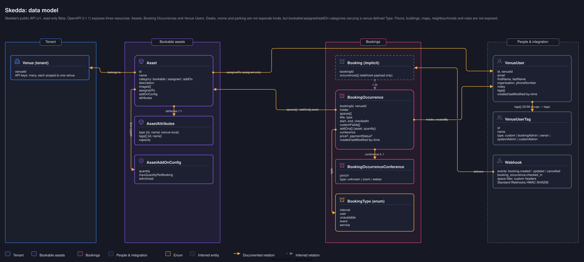

# Skedda

Researched and validated 2026-11-25. Each bracketed number links to the Sources list in §18. Most help-centre pages show only a relative "Updated X ago" label, not a date.

**Headline:** Skedda has a small public API, and it is documented unusually well. The API is read-only, in Beta, and has three resources: Assets, Booking Occurrences and Venue Users. It publishes an OpenAPI 3.1.1 file and sends webhooks signed to the Standard Webhooks spec [[1]](#s1)[[2]](#s2). Skedda builds floor plans as a service from any layout file you send. The API exposes no map geometry [[1]](#s1)[[3]](#s3).

## 1. Snapshot
- **Positioning:** Founded in 2013 in Melbourne. Skedda reports 8,000+ organisations and 3.19M+ users [[4]](#s4). It serves workplaces, universities, nonprofits, financial services, healthcare, government and coworking [[4]](#s4). AllBooked is Skedda's sister product for sports, studios, coworking and community booking, with built-in pricing, payments and membership management [[5]](#s5).
- **HQ:** Microsoft 365 publisher attestations from both Skedda Inc and Skedda Pty Ltd give the United States (both dated 2024–25, so treat as possibly stale) [[6]](#s6)[[7]](#s7). The About page names only Melbourne as where it started [[4]](#s4).
- **Licensing unit:** priced per space and billed annually. Users and bookings are unlimited [[5]](#s5).
- **Tiers (as of 2026-11-25):**
  - US/Canada: Plus from $249/mo (35 spaces), Premier from $349/mo (45 spaces), Enterprise by quote, AllBooked by quote [[5]](#s5).
  - EMEA/APAC: Starter from $99/mo (15 spaces), Plus from $149/mo (20), Premier from $199/mo (25) [[5]](#s5).
- **Free tier:** none. There is a 14-day trial with no payment method required [[5]](#s5).
- **Which tier unlocks what:**
  - API and webhooks: Skedda Premier or AllBooked Advanced [[8]](#s8)[[9]](#s9).
  - SCIM: Premier [[10]](#s10).
  - SAML SSO: "possibly" needs an upgrade. The tier is not stated clearly [[11]](#s11).
  - Assigned spaces: Premier only [[12]](#s12).
  - Maps: Skedda Workplace plans [[13]](#s13).
  - Check-in: Plus and Premier [[14]](#s14).
  - Two-way calendar sync: a "Premium-tier" subscription [[15]](#s15). Skedda uses "Premium" and "Premier" inconsistently.
  - Visitor management: paid add-on [[16]](#s16).

## 2. Space kinds
Every space is an **Asset** with exactly one category: `bookable`, `assigned` or `addOn` [[1]](#s1). Desks, rooms and parking are not separate kinds in the data model. They are told apart by a venue-defined **Type** attribute, such as Desk, Meeting room or Parking space [[17]](#s17). In the API this appears as `attributes.type`, along with `tags` and `capacity` [[1]](#s1). Type and tag ids are local to the venue, not global [[1]](#s1).

| Kind | Support | How it is represented |
|---|---|---|
| Hot desks | Yes | `bookable` asset with a venue Type such as "Desk" [[1]](#s1)[[17]](#s17) |
| Assigned desks | Yes, Premier only | `assigned` asset with `assignedTo` → VenueUser; not bookable [[1]](#s1)[[12]](#s12) |
| Neighbourhoods | Yes, on the map with per-neighbourhood access rules [[3]](#s3) | Not in the API. INFERRED: probably built from tags or rules |
| Meeting rooms | Yes | `bookable` asset with a Type; `capacity`; conference join URL on occurrences [[1]](#s1)[[17]](#s17) |
| Car parking | Yes [[17]](#s17) | `bookable` asset with Type "parking space" [[17]](#s17) |
| Equipment and catering | Yes, as add-ons | `addOn` asset with `addOnConfig.quantity` and `maxQuantityPerBooking`; booked as `addOns[]` on an occurrence [[1]](#s1) |
| Lockers, event spaces | Not publicly documented as distinct kinds. Searched the help centre and the llms.txt index | Would be generic `bookable` assets (INFERRED) |

- **Booking rules:** quotas can be set by user or group, tag, space, period and time of day, and the strictest applicable quota wins [[18]](#s18). Booking windows can be set by space and tag, in days or hours [[19]](#s19).
- **Check-in:** the window and auto-release are covered in §3 [[14]](#s14).
- **Capacity:** one capacity value per space [[17]](#s17).
- **Booking types:** `internal`, `user`, `unavailable`, `event` and `service` [[1]](#s1).

## 3. Features
- **Rules and quotas:** see §2 [[18]](#s18)[[19]](#s19).
- **Check-in:** by email link, QR code, mobile app, Slack, Teams, web or on-site Wi-Fi. A booking that isn't checked in is removed automatically when the window ends [[1]](#s1)[[14]](#s14).
- **Analytics:** the Insights dashboard shows utilisation KPIs. It filters by date, day, time, space tags and user tags, with custom ranges of up to 6 months [[20]](#s20).
- **Audit log:** the booking activity feed, with CSV/XLSX export [[21]](#s21).
- **Visitor management:** a paid add-on. It offers QR self check-in, CSV import of up to 500 visitors, and deliveries [[16]](#s16).
- **Mobile:** native iOS and Android apps, plus a white-labelled PWA for each venue [[22]](#s22).
- **Teams and Slack:**
  - The Teams app lets people manage bookings and get check-in and visitor notifications [[23]](#s23).
  - The Slack app sends check-in reminders and visitor alerts, and has a `/skedda-in` "Who's in?" report [[24]](#s24).

## 4. Floor-plan pipeline
- **Authoring:** Skedda's team builds the map. Customers "send Skedda any layout file — architectural PDF, CAD drawing, PNG, or a hand-drawn sketch" [[3]](#s3).
  - Turnaround is quoted three different ways on the same page: 24 h, 48 h and two business days [[3]](#s3).
  - Changes are requested through support chat [[13]](#s13).
- **Editor:** admins mark spaces on the finished map. The Pick tool clicks a shape and the backend draws its bounding rectangle. The Drag tool draws a rectangle by hand [[13]](#s13).
  - So a space's position on the map is a rectangle, not a polygon. This is a light inference from [[13]](#s13).
  - The map is "a view", not a layer for rules [[13]](#s13).
- **Self-serve import, auto-detection of desks and rooms, and indoor-map standards (IMDF, IndoorGML, IFC):** not publicly documented.
  - Looked in: the platform floor-plan page, the Floor Plans settings article, and the llms.txt help index.
  - The older help article "Floor plans and maps" (4225747) now returns 404.
  - Third-party search summaries say the maps are SVG, but I could not load a Skedda page saying so, so it is not cited.
- **Map geometry in the API:** no. The Asset model has no coordinates, floor, map or geometry fields [[1]](#s1). The only map-related API data is `images` (asset photo URLs) [[1]](#s1).

## 5. Calendar and directory sync
- **Microsoft 365 two-way sync:** pairs Skedda spaces with M365 room resources, in both directions [[15]](#s15).
  - Up to 100 sync pairs [[15]](#s15).
  - Requires 15-minute granularity, no pricing rules and no online payments [[15]](#s15).
  - Uses Graph application permissions: Calendars.ReadWrite, Place.Read.All (to discover rooms and subscribe to changes), Mail.Read/Send for RSVP forwarding, and People/User/Contacts reads for attendee search [[6]](#s6).
- **Google Workspace two-way sync:** pairs spaces with Google Workspace room resources [[25]](#s25).
- **Sync latency:** not publicly documented. The sync is push-based: Skedda subscribes to Graph change notifications for paired rooms, but no interval or latency is given [[15]](#s15).
- **Provisioning:**
  - SCIM from Entra ID and Okta, with "additional identity providers coming soon" [[10]](#s10).
  - SCIM groups become Skedda user tags. Users removed via SCIM are deleted, and their past bookings are anonymised [[10]](#s10).
  - SAML users are created just-in-time at first login [[11]](#s11).
  - HRIS connectors: not publicly documented. None appear on the integrations page [[26]](#s26).

## 6. IoT, sensors and hardware
- **Occupancy:** detected from Wi-Fi/IP presence, not sensors. The mobile app and the Companion desktop app (Windows/Mac) check whether the user is on the office's public IPs [[27]](#s27). This can trigger automatic check-in [[1]](#s1).
- **Sensor APIs or partners:** not publicly documented. Looked in the occupancy-tracking article and the integrations page [[26]](#s26)[[27]](#s27).
- **Access control:**
  - Kisi, through Zapier [[28]](#s28).
  - AllBooked has a Seam access-control article [[29]](#s29).
- **Displays:**
  - Tablet displays on any tablet that can run a PWA, with QR codes and room actions (check in, book now, end meeting) [[30]](#s30).
  - Logitech Tap Scheduler [[26]](#s26).

## 7. Hosting and data
- **Hosting model:** SaaS only, on Microsoft Azure [[6]](#s6)[[31]](#s31). No private or on-prem option is documented.
- **Regions:** US, EU, Australia and Canada [[32]](#s32).
  - Each region is a fully separate deployment, with its own database, auth, storage and keys [[32]](#s32).
  - Each region has a primary and a backup Azure region, e.g. EU: Frankfurt with a Berlin backup [[32]](#s32).
- **Choosing a region:** the region is fixed when the account is created. Accounts made through self-sign-up are always in the US [[32]](#s32).
- **Data leaving the region:** email goes through Mailgun in the US, and some integrations are US-only [[32]](#s32).
- **Conflicting source:** the Microsoft attestation (developer update June 2025, stale) says data is stored in the USA only. The newer data-residency policy supersedes it [[6]](#s6)[[32]](#s32).

## 8. Compliance and privacy
- **SOC 2:** Type 2, announced in July 2025 [[33]](#s33). The Trust Center at trust.skedda.com lists SOC 2 Type 1 and Type 2 and GDPR [[31]](#s31).
- **ISO 27001:** the Microsoft attestation says "No" [[6]](#s6). Not listed in the Trust Center [[31]](#s31).
- **GDPR:** Skedda says it complies with EU and UK GDPR. Its DPA, with Standard Contractual Clauses, applies automatically, and the DPO is at dpo@skedda.com [[34]](#s34).
- **Sub-processors:** listed on the Trust Center, including Azure, Cloudflare, Google Workspace and Vanta [[31]](#s31).
- **Retention:**
  - Bookings and visits: 1 year by default, configurable [[29]](#s29).
  - Old users without bookings can be deleted automatically [[29]](#s29).
  - Occupancy data: 1 month by default per its article [[35]](#s35). The help index says 3 months [[29]](#s29), so the sources conflict.
  - Data is retained less than 60 days after account termination, per the attestation [[6]](#s6).
- **Audit logs:** the booking activity feed [[21]](#s21).
- **Stance on employee location data:** occupancy data is "not shared with third parties", and Skedda recommends short retention under GDPR storage limitation [[35]](#s35). Showing booking-holder names on tablets is off by default [[30]](#s30).

## 9. Authentication
- **End-user SSO:** SAML 2.0, with Entra/Azure AD, Google Workspace, Okta, ADFS, OneLogin and others [[11]](#s11). JumpCloud appears on the integrations page [[26]](#s26). OIDC is not publicly documented [[11]](#s11).
- **SCIM:** Entra ID and Okta, with a bearer token per venue [[10]](#s10).
- **API auth:**
  - Static per-venue API keys sent as Bearer tokens [[1]](#s1).
  - Keys expire after 30, 60 or 90 days, 1 year (the default) or never [[8]](#s8).
  - No OAuth2 and no scopes. A key has admin-level visibility of its venue, including admin-only custom fields; the reference states this in its BookingOccurrenceCustomField model [[1]](#s1).

## 10. REST API
- **Docs:** https://api.skedda.com/api/v1/docs/
  - Also served as Markdown (`/api/v1/docs.md`) and as HTML (`/api/v1/docs/html`) [[1]](#s1).
  - OpenAPI: `/api/v1/openapi/v1.json` and `/api/v1/openapi/v1.yaml`, version 3.1.1, info.version 1.0.0 [[1]](#s1)[[2]](#s2).
- **Base URL:** `https://api.skedda.com/api/v1` [[1]](#s1).
  - Regional API hosts (e.g. EU): not publicly documented. The docs name only api.skedda.com, even though regions are isolated [[32]](#s32). This is worth asking Skedda about.
- **Resources:**
  - `GET /assets`
  - `GET /booking-occurrences` (date window of at most 31 days, with filters spaceIds, holders and lastModifiedTime)
  - `GET /booking/{bookingId}/occurrence/{date}`
  - `GET /venue-users`
  - `GET /venue-user/{id}` [[1]](#s1)
- **Response shape:** a metadata/data/paging envelope. Date-times are formatted with the venue's local offset, and `metadata.timezone` gives the IANA zone [[1]](#s1).
- **Pagination:** forward-only cursor, `page[after]`, page size 1–100. Occurrence lists also return a `Link: rel=next` header [[1]](#s1).
- **Strict validation:** unknown query parameters return 400 [[1]](#s1).
- **Expansion:** `expand` inlines related records, with at most 3 expanded fields in one path [[1]](#s1).
- **Rate limit:** 100 requests/min per key in a fixed window, with `X-RateLimit-*` headers and 429 plus `Retry-After` [[1]](#s1).
- **Errors:** an `errors[]` array with a stable `type` code and a `requestId` [[1]](#s1).
- **Versioning:** a `/v1` path segment, but the Beta label allows changes "without a version bump". The changelog is embedded in the docs and its entries are undated [[1]](#s1).

## 11. Events and real-time
- **Events:** `booking.created`, `booking.updated`, `booking.cancelled`, `booking_occurrence.checked_in` [[1]](#s1).
  - Cancelling one occurrence of a series sends `booking.updated` with `cancelledOccurrenceDates` [[1]](#s1).
- **Payload:** an envelope of `{type, timestamp, data, metadata{timezone, requestId}}`.
  - Booking events carry the whole booking: ids, holder email, spaces, title, type, price, created and modified by, start and end of the first occurrence, `occurrences[]` dates, and custom fields.
  - The check-in event uses a smaller payload [[1]](#s1).
- **Signing:** follows the Standard Webhooks spec. It is an HMAC-SHA256 over `id.timestamp.body` with a `whsec_` secret, and timestamps more than 5 minutes off are rejected [[1]](#s1).
- **Delivery:**
  - The receiver must return 2xx within 10 s [[1]](#s1).
  - 5 attempts over about 42 minutes. 3xx and most 4xx responses are not retried [[1]](#s1).
  - `webhook-id` can be used to deduplicate. Test events can be sent [[1]](#s1).
  - Events that happen while a webhook is disabled are dropped, not replayed [[9]](#s9).
- **Limits and filters:** up to 15 webhooks per venue, each filtered by space. Custom headers are allowed [[1]](#s1).
- **Gaps:** no events for assets or users, and no streaming. Older marketing still describes "webhooks" as running through Zapier [[36]](#s36).

## 12. Data model

Source: [`diagrams/skedda.drawio`](diagrams/skedda.drawio). The SVG embeds the diagram, so it also opens in draw.io for editing.

Everything in this table comes from the API reference. Relations are documented unless marked INFERRED.

| Entity | Key fields | Relations | Source |
|---|---|---|---|
| Asset | id, name, category (bookable/assigned/addOn), description, images[], assignedTo, addOnConfig, attributes | assignedTo → VenueUser (assigned only) | [[1]](#s1) |
| AssetAttributes / AssetAttribute | type{id,name}, tags[{id,name}], capacity | venue-local ids | [[1]](#s1) |
| AssetAddOnConfig | quantity, maxQuantityPerBooking, isArchived | belongs to an addOn Asset | [[1]](#s1) |
| BookingOccurrence | bookingId, venueId, holder, spaces[], title, type, createdBy, lastModifiedBy, createdTime, lastModifiedTime, customFields[], addOns[], conference, start, end, checkedIn, paymentStatus?, price?, chargeTransactionId? | holder/createdBy → VenueUser; spaces → Asset; addOns[].asset → Asset; many occurrences per booking | [[1]](#s1) |
| Booking (implicit) | bookingId, occurrences[] dates (webhook only) | 1:N BookingOccurrence; INFERRED as a hidden parent entity, since no booking resource exists | [[1]](#s1) |
| BookingOccurrenceConference | joinUrl, type (unknown/zoom/webex) | on an occurrence | [[1]](#s1) |
| BookingType enum | internal, user, unavailable, event, service | none | [[1]](#s1) |
| VenueUser | id, venueId, email, firstName, lastName, organisation, phoneNumber, notes, paymentGatewayCustomerId, createdTime, lastModifiedTime, createdBy, lastModifiedBy, tags[] | tags → VenueUserTag | [[1]](#s1) |
| VenueUserTag | id, name, type (custom/bookingAdmin/owner/systemAdmin/customAdmin) | SCIM groups map to tags | [[1]](#s1)[[10]](#s10) |
| Venue | id only (`venueId`) | tenant; each API key is scoped to one venue, and a venue may have several keys | [[1]](#s1) |

Not in the API: floors, buildings, maps, neighbourhoods, quotas and rules, visits, and occupancy data.

## 13. SDKs and ecosystem
- **Official SDKs:** none. The GitHub org has 2 unrelated public repos [[37]](#s37). Skedda points users to the OpenAPI file and AI assistants for generating clients [[38]](#s38).
- **Community code (all third-party):**
  - alyyousuf7/skedda: a Go CLI and library that logs in with user credentials, inactive since 2020 [[39]](#s39).
  - DKorytkin/ha-skedda-integration: a Home Assistant integration that auto-books slots [[40]](#s40).
- **Zapier:**
  - 7 triggers covering new, updated and cancelled user and internal bookings, plus booking requests. No actions are listed [[41]](#s41).
  - Zapier also hosts a Skedda MCP listing with the same triggers [[42]](#s42).
- **Power Automate and Make:** no native connectors are documented. The webhooks help article only suggests pointing webhooks at them [[9]](#s9).

## 14. Developer experience
- **Docs quality:** high. The reference has precise semantics, explicit edge cases, error codes, and verification code in C#, Node and Python [[1]](#s1).
- **Sandbox or trial API access:** not publicly documented. The trial is "Premium" [[5]](#s5), but whether it includes the API is unknown.
- **Tooling:** no Postman collection is documented. The OpenAPI file can be imported [[1]](#s1).
- **Changelog:** embedded in the docs and undated [[1]](#s1).
- **Deprecation policy:** not publicly documented beyond the Beta caveat [[1]](#s1).

## 15. AI and agents
- **Official:** a help article explains how to give the OpenAPI spec to Claude, ChatGPT, Claude Code or Codex so they write scripts [[38]](#s38).
- **No official MCP server, Copilot agent or AI scheduling feature found.** Looked in the help-centre index, the integrations page and search results.
- **Third-party:** Zapier's Skedda MCP listing [[42]](#s42).

## 16. Accessibility and i18n
- **WCAG or VPAT:** not publicly documented. Searched; nothing Skedda-specific came up.
- **Languages:** English, Spanish, German and French "initially". Venues set a default and users can override it [[43]](#s43).
- **Time zones:** each venue has an IANA time zone, and API date-times carry its offset [[1]](#s1).
- **Regions:** four hosting regions [[32]](#s32).

## 17. Relevance to spaceweave (analysis, not sourced fact)
- **Floor-plan ingestion is Skedda's manual, service-led gap.** Customers send PDF, CAD or PNG files and Skedda staff produce the map. Admins then mark each space as a rectangle by clicking or dragging [[3]](#s3)[[13]](#s13).
  - spaceweave's automatic DWG/PDF → walls, openings, rooms and names pipeline would replace exactly this step.
  - A plausible integration: spaceweave produces the map plus space polygons, then emits a matching list of spaces.
  - However, Skedda's API is read-only, so spaceweave cannot push spaces or maps into Skedda today [[1]](#s1).
- **The space-kind model is minimal and worth contrasting.**
  - Skedda has three structural categories: bookable, assigned and addOn. "Desk", "room" and "parking" are only venue-defined labels [[1]](#s1)[[17]](#s17).
  - spaceweave should model kind as structural, since it affects geometry, capacity and rules, while still allowing venue-defined subtypes and tags. Otherwise mapping to and from Skedda will be lossy.
  - Add-ons (counted inventory with a per-booking cap) are a useful pattern for equipment [[1]](#s1).
- **No geometry, floor or building hierarchy in the API** [[1]](#s1). A spaceweave export to Skedda can match only by asset `id` or `name`. spaceweave should keep an external-id mapping table.
- **Patterns worth copying for spaceweave's own API:**
  - strict parameter validation [[1]](#s1);
  - offset-carrying date-times plus an IANA time zone [[1]](#s1);
  - one record per occurrence for recurring bookings [[1]](#s1);
  - incremental sync with explicit "deletions not reported" semantics [[1]](#s1);
  - Standard Webhooks signing [[1]](#s1);
  - OpenAPI served alongside docs that are friendly to LLMs [[1]](#s1)[[38]](#s38).
  - These fit the project's chi/OpenAPI direction.
- **Regional isolation** [[32]](#s32) suggests spaceweave connectors will need a base URL per region. The API docs don't say how EU or AU tenants reach the API, so this is an open question.

## 18. Sources

All accessed 2026-11-25.

1. https://api.skedda.com/api/v1/docs/ (api-ref)
2. https://api.skedda.com/api/v1/openapi/v1.json (api-ref)
3. https://www.skedda.com/platform/office-floor-plan (official-docs)
4. https://www.skedda.com/about (official-docs)
5. https://www.skedda.com/pricing (official-docs)
6. https://learn.microsoft.com/en-us/microsoft-365-app-certification/teams/skedda-inc (United States of America" ... "Which hosting cloud providers does the app use? \)
7. https://learn.microsoft.com/en-us/microsoft-365-app-certification/teams/skedda-pty-ltd (official-docs)
8. https://support.skedda.com/en/articles/16539325-getting-started-with-the-skedda-allbooked-api-beta (official-docs)
9. https://support.skedda.com/en/articles/17675989-webhooks (official-docs)
10. https://support.skedda.com/en/articles/11625592-scim-integration-for-automated-user-provisioning (official-docs)
11. https://support.skedda.com/en/articles/4191038 (official-docs)
12. https://support.skedda.com/en/articles/10289675-assigned-spaces (official-docs)
13. https://support.skedda.com/en/articles/5349028-floor-plans-maps-settings-overview (official-docs)
14. https://support.skedda.com/en/articles/5242690-check-in (official-docs)
15. https://support.skedda.com/en/articles/8223380-two-way-sync (official-docs)
16. https://support.skedda.com/en/articles/8205639-visitor-management (official-docs)
17. https://support.skedda.com/en/articles/9969743-space-attributes (official-docs)
18. https://support.skedda.com/en/articles/3184573-quotas (official-docs)
19. https://support.skedda.com/en/articles/105795 (official-docs)
20. https://support.skedda.com/en/articles/5807358-insights (official-docs)
21. https://support.skedda.com/en/articles/1658938-booking-activity-feed (official-docs)
22. https://support.skedda.com/en/articles/812494-is-there-a-skedda-and-allbooked-app (official-docs)
23. https://support.skedda.com/en/articles/6165941-microsoft-teams-app (official-docs)
24. https://support.skedda.com/en/articles/8910658-skedda-slack-introduction (official-docs)
25. https://support.skedda.com/en/articles/8820611-two-way-sync-google (official-docs)
26. https://www.skedda.com/integrations (official-docs)
27. https://support.skedda.com/en/articles/9620092-occupancy-tracking (official-docs)
28. https://support.skedda.com/en/articles/5961602-kisi-integration-electronic-locks (official-docs)
29. https://support.skedda.com/llms.txt (official-docs)
30. https://support.skedda.com/en/articles/6816007-tablet-displays (official-docs)
31. https://trust.skedda.com/ (official-docs)
32. https://support.skedda.com/en/articles/17721271-skedda-data-residency-policy (official-docs)
33. https://www.skedda.com/blog/skedda-soc-2-security (blog)
34. https://support.skedda.com/en/articles/1434084-skedda-and-the-gdpr (official-docs)
35. https://support.skedda.com/en/articles/9620217-occupancy-data-retention (official-docs)
36. https://www.skedda.com/integrations/webhooks (official-docs)
37. https://github.com/skedda (github)
38. https://support.skedda.com/en/articles/17312455-using-the-api-with-ai-assistants (official-docs)
39. https://github.com/alyyousuf7/skedda (github)
40. https://github.com/DKorytkin/ha-skedda-integration (github)
41. https://zapier.com/apps/skedda/integrations (review)
42. https://zapier.com/mcp/skedda (review)
43. https://support.skedda.com/en/articles/10559440-language-localization (official-docs)

## Validation

Validated on 2026-11-25 by an independent agent that re-fetched all 42 cited URLs. Result: 90 claims accepted, 1 revised, 0 rejected, plus 3 new claims added and accepted. Two statements in the draft had no source behind them: one was dropped ("one space per spot" for car parking) and one was corrected (a venue can hold several API keys, not one). Claims resting on Microsoft 365 publisher attestations dated 2024–25 are flagged as possibly stale.
